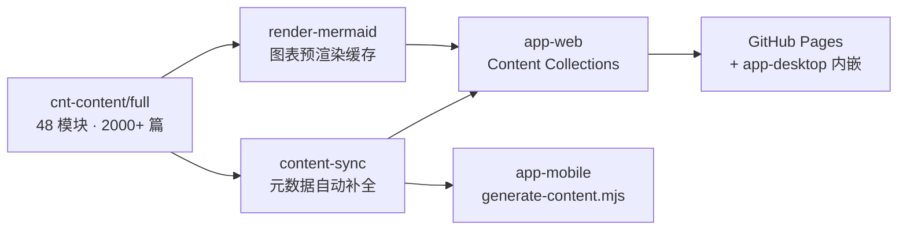

# FANDEX

[](https://github.com/fanquanpp/FANDEX/releases/latest)
[](https://github.com/fanquanpp/FANDEX/actions/workflows/deploy.yml)
[](LICENSE)

**FANDEX 是一套面向零基础学习者的编程自学笔记库，也是学成之后的随身语法速查伴侣。**

48 个技术模块、2000+ 篇中文教学笔记，从"计算机是如何工作的"一路讲到数据库、后端、
云原生与游戏开发。网页、Windows 桌面端、移动端（iOS + Android）共享同一内容体系，
全部内容离线可用。写作风格是"带实战、讲解、知识点、理论的学习笔记"：先动手做出来，再讲
为什么，最后给坑点与自检——不是教材，也没有概念堆砌。

整个体系是单一 Git 仓库（monorepo）：内容唯一来源 `cnt-content/full`，模块元数据
唯一来源 `shd-shared/metadata/modules.json`，设计令牌唯一来源 `shd-shared/tokens/`。

在线阅读：<https://fanquanpp.github.io/FANDEX/>

## 仓库结构

```
FANDEX/
├── app-web/              # 网页端（Astro 7 + React 19 + Tailwind 4），GitHub Pages 部署
├── app-desktop/          # Windows 桌面端（Tauri 2，内嵌 web 产物，完全离线）
├── app-desktop-portable/ # 桌面便携版（免安装解压即用，与 app-desktop 共用构建）
├── app-mobile/           # 移动端（Flutter，iOS + Android 双端）
├── cnt-content/          # 内容层：full/ 教学笔记、syntax/ 语法速查素材
├── shd-shared/           # 共享层：设计令牌、模块元数据、图标资产
├── docs/                 # 课程地图与历史审计记录
└── scripts/              # 仓库级脚本（release.mjs 一键发版）
```

## 三端一览

| | app-web | app-desktop | app-mobile |
| --- | --- | --- | --- |
| 平台 | 网页 | Windows | iOS + Android |
| 技术栈 | Astro 7 + React 19 | Tauri 2 | Flutter（Dart + Kotlin/Swift + GLSL） |
| 状态 | 主线 | 主线 | 主线 |

三端共享同一内容管线，任何一端都不维护独立内容副本。桌面端与移动端装好即完全
离线；网页端是 PWA，可安装到桌面/主屏离线回访。

## 快速开始

学习内容本身不需要任何环境——直接访问网页或安装应用即可。本地开发：

```bash
# 环境：Node.js >= 22，pnpm >= 10（版本见根 package.json 的 packageManager）
git clone https://github.com/fanquanpp/FANDEX.git
cd FANDEX && pnpm install --frozen-lockfile

pnpm dev:web        # 网页端开发服务器（content-sync + tokens-drift 门禁 + astro dev）
pnpm build:web      # 完整构建（mermaid 预渲染 + 内容同步 + tokens-drift 门禁 + 静态构建
                    # + katex 字体裁剪 + 搜索索引）
pnpm typecheck      # 全仓类型检查（app-web astro check + shd-shared/tokens）
```

web 端命令在 `app-web/` 目录（或 `pnpm --filter @fandex/web <script>`）：

```bash
pnpm --filter @fandex/web lint        # eslint（CI deploy 工作流前置步骤）
pnpm --filter @fandex/web qa          # qa-check.mjs：产物目录 20 余项静态检查
                                      # （页面数/base/sitemap/暗色/响应式/shiki 等）
pnpm --filter @fandex/web test:smoke  # Playwright 冒烟（tests/ 共 20 用例：smoke 8 +
                                      # subpage-ux 10 + nav-depth 2；跑前需 build）
```

Lighthouse CI（lighthouserc.json：perf >= 0.85、CLS <= 0.1 为 error 档硬断言，
LCP <= 2500ms、字体 <= 300KB 为 warn 档）由 CI 在推送/PR 指向 main 且改动涉及
app-web 等路径时自动运行；冒烟测试经 scripts/lhci-server.mjs 本地起产物服务。

### web 端 UI/UX 体系（2026-10「仪器面板」改版）

第 1 期改版落地了一套全站自洽的视觉语言「仪器面板」：细线、刻度、角标、反色墨水
取代大圆角与光效。要点（活体标本见站内 noindex 页 `/design-system/`）：

- **设计令牌**：唯一真源 `shd-shared/tokens/`（DTCG JSON），web 副本
  `app-web/src/styles/shared/tokens.css` 由它派生，`check-tokens-drift.mjs` 挂在
  dev/build 链上硬校验逐值一致；样式单一入口 `app-web/src/styles/site.css`。
  暗色纯黑灰板 + cyan 强调；亮色冷雾灰板；品牌字体 IBM Plex Sans / Chakra Petch /
  JetBrains Mono 自托管（woff2 latin 子集）。
- **排版**：.prose 行宽帽 `--size-prose-measure`（默认 68ch，段落/列表/引用/提示块/
  折叠块/脚注同帽，代码块/表格/图保持全宽）；表头 accent 8% tint 降噪 +
  `tabular-nums` 数字列 + 行 hover 1px 刻度环；h4 下划线改为模块色竖刻度。
- **组件基元**：`.fndx-button` 四层级（primary/secondary/ghost/danger）× 三尺寸
  （32/40/48px），active 按压 scale(0.97)、focus-visible 2px outline、hover 态仅在
  支持 hover 的设备生效；互斥单选选中态统一「反色墨水」（前景底 + 背景字），
  常驻位置指示用刻度线 + 字重，二者分工。
- **导航框架**：Layout 与 HomeLayout 共用 `SiteHeader.astro`（doc/home 两变体）；
  z-index 全站统一刻度（`--z-sticky 10` 至 `--z-overlay-top 1000`，见
  `shared/layout-components.css` 令牌块）；<1024px 目录重排为吸顶折叠条
  （补齐全站移动端页内导航），目录尾部「回到开头」常驻。
- **动效预算**：全部动效可解释、可降级，尊重全局 prefers-reduced-motion 兜底
  （global.css）；唯一背景层 SceneBackdrop（fixed + z-index -1）承载 fx 体系
  （WebGL2 letter-glitch 字符海 + data-fx 声明式入场），不新增背景层与光效。
- **性能**：KaTeX 字体三格式裁剪（构建期剔除 woff/ttf，部署产物少约 580KB）、
  侧栏「全部模块」面板 React 依赖懒加载（不打开零成本）、设计系统页第三方组件
  试验场 client:visible 拖后水合。

Android 与 Windows 桌面端的构建命令见 `CONTRIBUTING.md`「环境准备」与各端 README。

## 内容管线

你只写 Markdown，其余一切由管线在构建前自动补全：



- **写作**：文档放入 `cnt-content/full/<编号-模块id>/`，文件名编号即学习顺序；
  frontmatter 手写 `title` 与 `description` 即可，托管字段由 `pnpm sync` 自动补全；
  站内引用写 `related` / `prerequisites`（格式 `模块id/文件名`），死链自动清理。
- **图表**：mermaid 在构建前由 `app-web/scripts/render-mermaid.mjs` 用 headless
  Chromium 预渲染成亮 / 暗两套内联 SVG（带磁盘缓存），页面加载即所见，支持
  拖拽平移、缩放、全屏与查看源码；公式由 KaTeX 构建期渲染，跨端字号一致。
- **校验**：`content-audit.mjs` 只检查 frontmatter 可解析（站点构建的硬依赖）；
  写作风格、篇幅与组织方式由作者自行决定。唯一的全项目内容约束：不使用 emoji。

实操手册（新增文档 / 模块、常见问题排查）见 [CONTENT-GUIDE.md](CONTENT-GUIDE.md)；
完整协作流程见 [CONTRIBUTING.md](CONTRIBUTING.md)；全项目强约束见 [AGENTS.md](AGENTS.md)。

## 维护要点

- **内容是第一公民**：改内容 = 改 `cnt-content/full` 下的 md，跑一次 `pnpm sync`
  即完成全部派生数据更新；改坏引用会被 sync 自动修复或明确报错。
- **脚本各司其职**：`content-sync.mjs`（元数据）、`render-mermaid.mjs`（图表缓存）、
  `build-syntax.mjs`（速查卡片）、`audit-learning-path.mjs`（路径数据完整性）。
  它们之间只通过文件与 JSON 交接，没有隐藏耦合。
- **样式单一来源**：设计令牌在 `shd-shared/tokens/`（DTCG JSON）。web 端副本与
  Android 的 `TokenColors.kt`（`Theme.kt` 只做 Material 角色映射）均由它派生：
  改 JSON 后运行 `pnpm --filter @fandex/tokens build:css && pnpm --filter @fandex/tokens generate:kt`，
  `check-tokens-drift.mjs` 会硬校验两侧派生文件与真源逐值一致。
- **发版**：`pnpm release [版本号]` 自动同步全部版本文件、CHANGELOG 并打 tag，
  安装包由维护者本地构建后随 GitHub Release 上传。

## AI 接入说明

FANDEX 本身不提供 AI 服务。网页端提供可选的 AI 服务商接入通道（当前支持
[OrcaRouter](https://www.orcarouter.ai/)），默认关闭：不配置你自己的 API Key
就不会产生任何 AI 请求，密钥仅保存在你本机浏览器中。详情见站内页脚「AI 设置」
与 [DISCLAIMER.md](DISCLAIMER.md)。

## 贡献

欢迎修正文档错误、补充知识点与报告问题。仓库采用 `main`（受保护发布主线）+
`dev`（协作集成分支）双分支模型；外部贡献者从 fork 向 `dev` 提 PR。提交信息遵循
Conventional Commits。

## 许可与免责

- 内容以 [MIT License](LICENSE) 发布；引用或改编的第三方内容均在对应文档中注明
  原始出处与许可。
- 学习内容仅供教育参考，不构成职业、投资或任何专业建议；完整条款见
  [DISCLAIMER.md](DISCLAIMER.md)。
