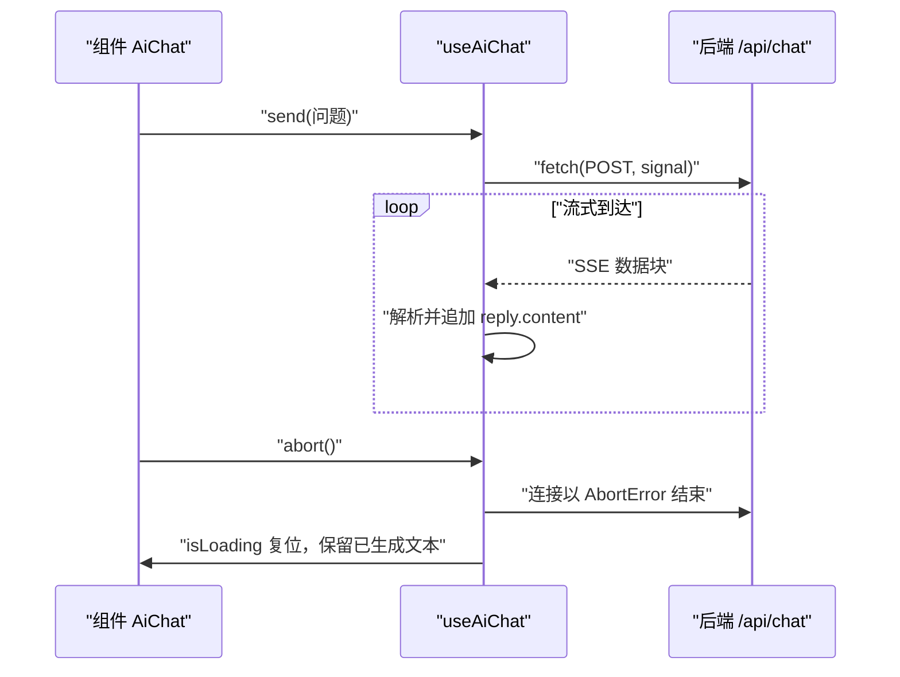

## 前置知识

- [Vue3 概述与环境搭建](/vue3/010-OverviewEnv)：有一个能跑的 Vue3 + Vite 项目，会写组件与 setup 语法；
- [第一次调用大模型 API](/ai-llm/030-FirstLlmApiCall)：知道 LLM 的流式输出是「逐段到达的小块文本」。

没读过也可以，本文会带上需要的部分：第 2 节会从零解释 SSE 与 ReadableStream；composable 的思想在 [自定义 Hook](/vue3/090-CustomHook)，第 4 节的封装就是把那篇的原则用在这个具体场景。

## 学习目标

读完本文你将能够：

1. 解释为什么 AI 对话界面被称为「新一代 TodoMVC」，并列出它比普通表单多出来的五个工程关切；
2. 写出 fetch + ReadableStream 解析 SSE 的代码，说清缓冲区按事件边界切分的原因，并解释 EventSource 为什么不适格；
3. 用 composable 把流消费封装成 useAiChat（messages、isLoading、abort、send），说出它与组件解耦的收益；
4. 解释打字机效果的真实来源是 LLM 逐段生成而非前端模拟，并实现 AbortController 中断与状态清理；
5. 落实 AI 输出的渲染安全：只把净化后的内容交给 v-html，代码高亮只着色不执行；
6. 按「错误分类给出用户话术」的思路处理网络中断、429 与内容过滤，并用 Pinia 实现刷新后的会话恢复。

预计 30 到 45 分钟，含 3 个动手实验与 3 道练习。

## 1. 问题引入：AI 对话界面是新一代 TodoMVC

十几年来，「做一个 TodoMVC」是检验前端是否入门的标准动作。2026 年这个标准动作换成了「做一个 AI 对话界面」：面试要考，公司内部工具要做，每个新产品都在长出对话框。它看似只是「输入框 + 消息列表」，实则是一套完整的前端工程——比 TodoMVC 多出五个必须处理的关切：

1. **流式消费**：回答是逐段到达的，不是一次性的 JSON；
2. **可中断**：生成几十秒的过程里，用户随时可能点「停止」；
3. **不可信渲染**：AI 输出可能含 Markdown、HTML 甚至注入内容，渲染前必须净化；
4. **长列表性能**：一场长对话几百条消息，响应式系统别为它空转；
5. **状态恢复**：刷新页面，会话还在不在？

这五条就是本篇的目录。后端把 LLM 流透传成 SSE 的事件机制（服务端为什么必须包一层、key 放哪）在前端流式相关篇章与 ai-llm 模块已有展开，本篇专注 Vue3 这一端的消费与渲染。

## 2. 核心机制：fetch + ReadableStream 解析 SSE

后端 /api/chat 返回的是 SSE 格式（Content-Type: text/event-stream）：一串 `data: {...}` 行，每行携带一小段新生成文本，直到 `data: [DONE]` 收尾。浏览器端用 fetch 拿到 Response 后，从 body 里取 reader 逐块读：

```typescript
// 最小解析骨架（先看机制，第 4 节封装成 composable）
const res = await fetch("/api/chat", {
  method: "POST",
  headers: { "Content-Type": "application/json" },
  body: JSON.stringify({ messages }),
})

const reader = res.body!.getReader()
const decoder = new TextDecoder()
let buffer = ""

while (true) {
  const { done, value } = await reader.read()
  if (done) break
  buffer += decoder.decode(value, { stream: true })

  // SSE 事件以空行分隔；网络分块不保证按事件边界切，所以要攒 buffer
  const events = buffer.split("\n\n")
  buffer = events.pop() ?? ""   // 最后一段可能不完整，留到下一轮

  for (const event of events) {
    const line = event.split("\n").find((l) => l.startsWith("data:"))
    if (!line) continue
    const payload = line.slice(5).trim()
    if (payload === "[DONE]") continue
    const delta = JSON.parse(payload).text ?? ""
    // delta：本次到达的增量文本，追加到当前回复上
  }
}
```

两个必须理解的细节：其一，**buffer 是必须的**——网络分包与 SSE 事件边界毫无关系，一个 chunk 可能切在事件中间，先攒再按空行切，不完整的一段留到下一轮；其二，**TextDecoder 的 stream: true** 让解码器记住跨 chunk 的残缺多字节字符，中文才不会乱码。

## 3. 为什么不用 EventSource

浏览器确实有原生 SSE 客户端 EventSource，一行就能建连接。但对话场景它有两处硬伤：

| | EventSource | fetch + ReadableStream |
| --- | --- | --- |
| 请求方法 | 只能 GET | 任意（对话需要 POST 传消息列表） |
| 自定义请求头 | 不能（无法带 Authorization 等） | 任意 |
| 请求体 | 无 body | 自由 JSON |
| 中断控制 | 有限 | AbortController 完整可控 |
| 适用场景 | 单向的、无鉴权的通知推送 | 对话这类需鉴权、需提交上下文的流 |

对话请求要 POST 一份消息历史、常要带鉴权头、要能随时断——EventSource 全都受限。所以 2026 年的事实标准是 fetch + ReadableStream：多十几行代码，换来完全的控制权。EventSource 留给「纯通知推送」场景即可。

## 4. useAiChat：用 composable 封装流消费

把第 2 节的骨架直接写在组件里，会让组件同时承担「渲染」与「协议解析」两个职责。[自定义 Hook](/vue3/090-CustomHook) 篇的原则在这里兑现：流消费是逻辑不是视图，抽成 composable 后组件只管渲染，逻辑可复用、可独立测试（怎么测见 [Vue3 测试策略](/vue3/300-Vue3TestStrategy)）：

```typescript
// composables/useAiChat.ts
import { ref, shallowRef } from "vue"

export interface ChatMessage {
  role: "user" | "assistant"
  content: string
}

export function useAiChat() {
  const messages = ref<ChatMessage[]>([])
  const isLoading = ref(false)
  let controller: AbortController | null = null

  async function send(content: string) {
    messages.value.push({ role: "user", content })
    // 预置一条空的 assistant 消息，流的增量往它身上追加
    const reply: ChatMessage = { role: "assistant", content: "" }
    messages.value.push(reply)
    isLoading.value = true

    controller = new AbortController()
    try {
      const res = await fetch("/api/chat", {
        method: "POST",
        headers: { "Content-Type": "application/json" },
        // 把对话历史发给后端（不含刚预置的空回复）
        body: JSON.stringify({ messages: messages.value.slice(0, -1) }),
        signal: controller.signal,
      })

      if (res.status === 429) {
        reply.content = "请求太频繁了，请稍等几秒再试。"
        return
      }

      const reader = res.body!.getReader()
      const decoder = new TextDecoder()
      let buffer = ""

      while (true) {
        const { done, value } = await reader.read()
        if (done) break
        buffer += decoder.decode(value, { stream: true })
        const events = buffer.split("\n\n")
        buffer = events.pop() ?? ""
        for (const event of events) {
          const line = event.split("\n").find((l) => l.startsWith("data:"))
          if (!line) continue
          const payload = line.slice(5).trim()
          if (payload === "[DONE]") continue
          reply.content += JSON.parse(payload).text ?? ""  // 按到达顺序追加
        }
      }
    } catch (e) {
      if (e instanceof DOMException && e.name === "AbortError") {
        // 用户主动中断：不算错误，保留已生成的部分
      } else {
        reply.content = "连接中断了，点击重试可以继续。"
      }
    } finally {
      isLoading.value = false
      controller = null
    }
  }

  function abort() {
    controller?.abort()   // fetch 立刻 reject，finally 负责状态清理
  }

  return { messages, isLoading, send, abort }
}
```



组件端从此只剩渲染：

```vue
<!-- components/AiChat.vue -->
<script setup lang="ts">
import { useAiChat } from "@/composables/useAiChat"

const { messages, isLoading, send, abort } = useAiChat()
const draft = ref("")

function submit() {
  if (!draft.value.trim() || isLoading.value) return
  send(draft.value.trim())
  draft.value = ""
}
</script>

<template>
  <div class="chat">
    <div v-for="(m, i) in messages" :key="i" class="msg" :class="m.role">
      {{ m.content }}
    </div>
    <button v-if="isLoading" @click="abort">停止生成</button>
    <form @submit.prevent="submit">
      <input v-model="draft" placeholder="问点什么……" />
    </form>
  </div>
</template>
```

注意两个封装决策：预置空 assistant 消息让增量有明确的落点，模板无需区分「等首块」与「追加中」两种状态；controller 用普通变量而非 ref——它不是渲染状态，放进响应式系统只是徒增代理开销。

## 5. 打字机效果与中断

经常有人问「打字机效果怎么做」。答案是：**你已经在做了**。LLM 本来就是逐段生成的，前端只要按到达顺序渲染，天然的打字机效果就出现了。反向的误区是前端用 setInterval 逐字「吐」完整文本——那是在模拟一个系统本来的样子，多一层延迟还多一份代码。前端唯一要做的是别把到达顺序打乱：增量按序追加到 reply.content，Vue 的响应式会负责每次追加后的重渲染。

中断是流式 UI 的标配交互。abort() 调用后，fetch 的 promise 以 AbortError reject，代码走进 catch 的专门分支——中断不是错误，已生成的半截文本要保留（用户往往已经读了一半），isLoading 在 finally 里复位。清理要彻底：controller 置空，让「停止生成」按钮随 isLoading 消失，不留悬挂状态。

## 6. Markdown 渲染安全

AI 回复几乎必然是 Markdown（代码块、列表、加粗），按纯文本渲染体验很差，按富文本渲染则打开一个安全口子：**AI 输出必须按不可信 HTML 对待**。它可能因提示注入而输出恶意结构（攻击面分析见 [提示注入与安全](/ai-llm/190-PromptInjectionSecurity)），直接 v-html 等于把 XSS 引进页面。安全管线两步：解析 + 净化：

```typescript
// utils/renderMarkdown.ts
import DOMPurify from "dompurify"
import { marked } from "marked"

export function renderMarkdown(md: string): string {
  const html = marked.parse(md, { async: false }) as string
  // 只放行文本结构标签，脚本与事件属性一律剥除
  return DOMPurify.sanitize(html, { FORBID_TAGS: ["style", "form"], FORBID_ATTR: ["onerror", "onclick"] })
}
```

```vue
<!-- 组件内：v-html 的内容必须来自净化函数 -->
<div class="msg" v-html="renderMarkdown(m.content)"></div>
```

铁律只有一条：**进 v-html 的字符串必须出自 DOMPurify**。代码块高调用 Shiki 或 highlight.js 这类纯文本着色方案——它只改变颜色不执行任何内容，与「高亮不执行」的安全边界一致。流式期间每来一个增量都要重新解析渲染整条消息，内容长时可以只在结尾几块做完整 Markdown 渲染、中间块纯文本先行（性能权衡见第 7 节）。

## 7. 长列表性能：ref 与 shallowRef

一场长对话几百条消息，默认的 ref 深响应式会把每条消息的每个字段都包上代理。对「只整体追加、很少改中间」的消息列表，这是纯开销。两个可用的优化（响应式系统原理见 [响应式系统](/vue3/050-ReactiveSystem)）：

```typescript
import { ref, shallowRef, triggerRef } from "vue"

// 方案 A：列表浅响应 + 手动通知
const messages = shallowRef<ChatMessage[]>([])
function push(msg: ChatMessage) {
  messages.value = [...messages.value, msg]  // 整体替换触发更新，元素本身不被深度代理
}
function appendToLast(delta: string) {
  // 修改最后一条后手动通知；配合「只渲染最后 N 条」效果更好
  messages.value[messages.value.length - 1].content += delta
  triggerRef(messages)
}
```

更轻的组合是：**历史列表用 shallowRef（或干脆普通数组 + 每次赋新数组），当前正在生成的那条消息单独用一个 ref**——高频更新的只有它，其余几百条静止不动。列表超过百条、渲染又含 Markdown 解析时，再上虚拟滚动（只渲染视口内的消息），工具与参数见 [Vue3 性能实战](/vue3/320-Vue3PerformancePractice)。判断顺序永远是：先确认真的卡，再优化；消息量在几十条的普通场景，深响应式完全够用。

## 8. 错误与重试

流式对话的错误要按「用户能做什么」分类，而不是抛一坨技术细节到界面上：

| 错误 | 界面话术 | 用户能做的动作 |
| --- | --- | --- |
| 网络中断 / fetch 失败 | 「连接中断了，已保留部分回答」 | 保留已生成文本，提供重试按钮 |
| 429 限流 | 「请求太频繁，X 秒后可再试」 | 倒计时后重试（重试本身也要守限流） |
| 内容过滤 / 敏感拒绝 | 「这个请求无法处理，换个问法试试」 | 中性话术，不透出内部拒绝原因 |
| 5xx 服务错误 | 「服务暂时不可用，稍后再试」 | 稍后重试 |

重试的实现注意一点：send() 开头会 push 一条 user 消息，直接重调会把同一问题记两遍。把重试做成独立函数——先移除上一轮失败的 assistant 占位消息（和可选的 user 消息），再重新 send；或者让 send 接受「复用末条 user 消息」的选项。话术原则与 429 的计时细节（退避到多少秒）涉及成本与配额的边界，见 [token、成本与延迟](/ai-llm/180-TokenCostLatency)。

## 9. 会话持久化：Pinia

刷新丢会话是对话产品的高频差评来源。做法是会话状态上移到 Pinia store（store 设计见 [Pinia 状态管理](/vue3/210-PiniaStateManagementDetailed)），持久化交给插件落 localStorage（机制见 [Pinia 持久化插件](/vue3/220-PiniaPersistencePlugin)）：

```typescript
// stores/chat.ts
import { defineStore } from "pinia"

export const useChatStore = defineStore("chat", {
  state: () => ({
    sessions: {} as Record<string, ChatMessage[]>,  // 按会话 id 分组
    activeId: "",
  }),
  actions: {
    snapshot(id: string, messages: ChatMessage[]) {
      this.sessions[id] = messages   // 关键时机：流结束时才快照，见下文
    },
  },
  persist: true,   // 由持久化插件落 localStorage
})
```

一个时序上的坑要避开：**流式进行中不要每个增量都写持久化**——每个 token 触发一次序列化与写盘，几百条消息的长对话会明显拖慢。正确时机是流结束、中断或页面卸载（beforeunload）时快照一次。useAiChat 的 finally 块正是这个时机：isLoading 复位的同时调 store.snapshot。刷新后从 store 读回，会话原样恢复。

## 10. 常见困惑

**Q：为什么我收到的文本一大段一大段，而不是逐字？**

到达粒度由服务端与网络缓冲决定，本就不是逐字。前端按到达顺序追加即可，块大块小都正确。追求更细的观感可以在渲染层做轻量缓冲，但通常没有必要。

**Q：messages 放组件 ref 还是 Pinia store？**

单组件内用完即弃的对话，ref 足够；要跨页面、要刷新恢复、要会话切换，就上移到 store。第 4 节的 composable 与 store 不冲突：composable 管流消费的「过程」，store 管「结果」的存放。

**Q：SSE 断了能像下载一样断点续传吗？**

HTTP SSE 没有内建续传。简单做法是接受截断 + 用户点重试（重新生成），或服务端支持「从第 N 个 token 续」的自定义协议——那是高级话题，先做好「截断不丢已生成内容」的体验。

**Q：shallowRef 之后界面不更新了？**

浅响应只追踪整体替换，改嵌套字段（如 messages.value[0].content += ...）不会触发更新。要么整体换新数组，要么改完调 triggerRef。第 7 节的「当前消息单独 ref」方案则是绕开这个限制的惯用法。

## 11. 动手实验

实验一：配合任一可用的 /api/chat 后端（或公开的流式演示端点），跑通 useAiChat 与 AiChat 组件，观察逐段渲染的效果。

实验二：生成中途点「停止生成」，验证三件事：isLoading 复位、已生成文本保留、控制台无未捕获异常（AbortError 已被正确吞掉）。

实验三：临时把 renderMarkdown 换成直接 v-html，构造一条诱导模型输出 img 标签与 onerror 属性的提示，在浏览器里观察脚本触发；再接回 DOMPurify 管线确认剥除。这个实验做完，净化这条铁律你会记一辈子。

练习一（笔头）：说出 EventSource 不能用于对话场景的两个硬限制。

练习二（笔头）：「网络中断」「429」「内容拒绝」三种错误的界面话术与用户动作各是什么？

练习三（笔头）：为什么流式进行中不做持久化快照，快照应该挂在哪个时机？

## 12. 官方文档

- Vue 组合式函数与 shallowRef：https://cn.vuejs.org/guide/reusability/composables.html
- MDN Streams API（ReadableStream / TextDecoder）：https://developer.mozilla.org/zh-CN/docs/Web/API/Streams_API
- DOMPurify（净化配置项）：https://github.com/cure53/DOMPurify
- Pinia 与持久化插件：https://pinia.vuejs.org/

## 13. 自检清单

1. 能否列出 AI 对话界面比普通表单多出的五个工程关切？
2. 能否写出 SSE 解析骨架并解释 buffer 与 TextDecoder stream: true 各自解决什么问题？
3. 能否说出 useAiChat 四个导出物（messages、isLoading、abort、send）各自的职责，以及 composable 封装的收益？
4. 能否解释打字机效果的真实来源，并完整描述中断时的状态清理路径？
5. 能否复述 v-html 的安全铁律，并说出高亮方案「只着色不执行」的边界？
6. 能否说出 shallowRef 的适用条件、triggerRef 的作用，以及快照持久化的正确时机？
