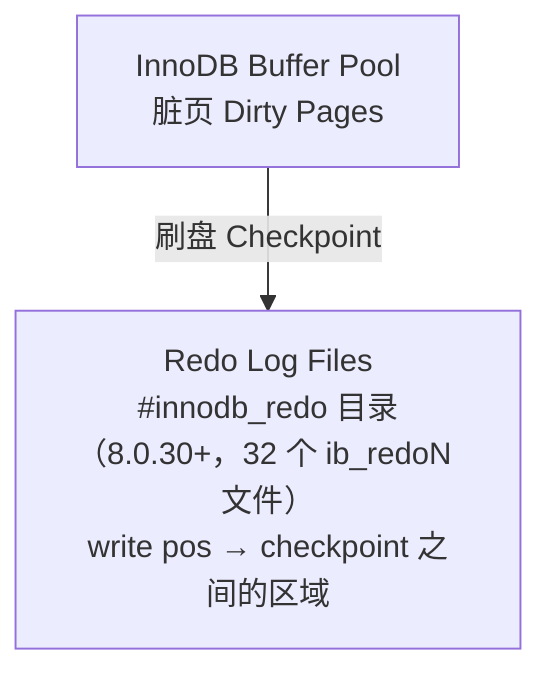
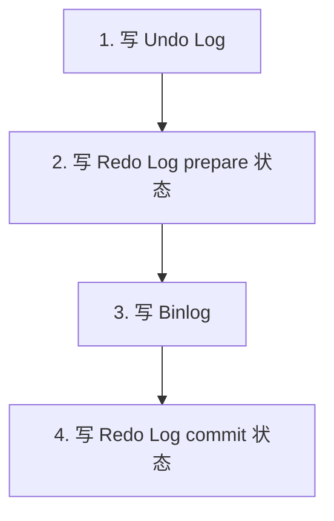

## 1. 三种日志概览

### 1.1 日志定位

| 日志     | 层级          | 作用                   | 写入方式       |
| -------- | ------------- | ---------------------- | -------------- |
| Redo Log | InnoDB 引擎层 | 崩溃恢复（crash-safe） | 顺序写，循环写 |
| Undo Log | InnoDB 引擎层 | 事务回滚 + MVCC 版本链 | 随机写         |
| Binlog   | Server 层     | 主从复制 + 数据恢复    | 顺序写，追加写 |

### 1.2 日志内容对比

```
Redo Log:  记录"物理修改"——某页某偏移量写入了什么数据
Undo Log:  记录"逻辑反向"——如何将数据恢复到修改前
Binlog:    记录"逻辑操作"——执行了什么 SQL 语句（STATEMENT）或行变更（ROW）
```

## 2. Redo Log 写入机制

### 2.1 Redo Log 架构



### 2.2 写入流程

```
1. 事务修改数据页 → 生成 Redo Record
2. 写入 Redo Log Buffer（内存）
3. 写入 OS Buffer Cache（write）
4. 刷盘到 Redo Log File（fsync）
```

### 2.3 刷盘策略（innodb_flush_log_at_trx_commit）

| 值  | 行为                       | 安全性       | 性能 |
| --- | -------------------------- | ------------ | ---- |
| 0   | 每秒刷盘一次               | 丢失1秒数据  | 最高 |
| 1   | 每次提交都 fsync           | 不丢数据     | 最低 |
| 2   | 每次提交 write，每秒 fsync | OS崩溃丢数据 | 中等 |

```sql
-- 查看当前设置
SHOW VARIABLES LIKE 'innodb_flush_log_at_trx_commit';

-- 生产推荐：设为 1（最安全）
SET GLOBAL innodb_flush_log_at_trx_commit = 1;
```

### 2.4 Redo Log 组提交（Group Commit）

多个事务同时提交时，只需一次 fsync：

```
事务A提交 → 进入 fsync 队列
事务B提交 → 进入 fsync 队列  ──→ 一次 fsync 刷入所有 Redo
事务C提交 → 进入 fsync 队列
```

## 3. Undo Log 写入机制

### 3.1 Undo Log 的双重作用

1. **事务回滚**：保存修改前的数据，ROLLBACK 时恢复
2. **MVCC 版本链**：通过 `DB_ROLL_PTR` 串联历史版本

### 3.2 写入时机

```
1. 事务执行 UPDATE/DELETE → 先将旧值写入 Undo Log
2. 事务执行 INSERT → 写入 Undo Log（记录主键值，用于回滚时删除）
3. 事务 COMMIT → Undo Log 标记为可清理（但不立即删除，供 MVCC 使用）
4. 当没有事务需要访问该 Undo Log → 由 Purge 线程清理
```

### 3.3 Undo Log 类型

| 类型        | 对应操作      | 回滚操作                   |
| ----------- | ------------- | -------------------------- |
| INSERT Undo | INSERT        | DELETE                     |
| UPDATE Undo | UPDATE/DELETE | UPDATE（恢复旧值）/ INSERT |

### 3.4 Undo Log 与 MVCC 的关系

```
事务A (trx_id=100) 修改行: name='Alice' → 'Bob'

当前行: {name='Bob', trx_id=100, roll_ptr→undo_1}
                                        ↓
Undo Log: {name='Alice', trx_id=50, roll_ptr→undo_2}

事务B (trx_id=200) 快照读:
  ReadView: m_ids=[100], min_trx_id=100
  → trx_id=100 在 m_ids 中，不可见
  → 遍历到 undo_1: trx_id=50 < min_trx_id，可见
  → 返回 name='Alice'
```

## 4. Binlog 写入机制

### 4.1 Binlog 格式

| 格式      | 内容         | 优缺点                                            |
| --------- | ------------ | ------------------------------------------------- |
| STATEMENT | SQL 语句     | 日志量小，但不确定函数（NOW()、UUID()）导致不一致 |
| ROW       | 行变更前后值 | 数据一致性好，但日志量大（8.0 起默认格式）        |
| MIXED     | 混合模式     | 默认 STATEMENT，不确定函数切 ROW                  |

### 4.2 写入流程

```
1. 事务执行 DML → 写入 Binlog Cache（线程级内存）
2. 事务 COMMIT → Binlog Cache 写入 Binlog File
3. 根据 sync_binlog 设置决定 fsync 时机
```

### 4.3 刷盘策略（sync_binlog）

| 值  | 行为                   | 安全性        | 性能 |
| --- | ---------------------- | ------------- | ---- |
| 0   | 由 OS 决定何时 fsync   | 可能丢数据    | 最高 |
| 1   | 每次提交都 fsync       | 不丢数据      | 最低 |
| N   | 每 N 次提交 fsync 一次 | 丢 N-1 个事务 | 中等 |

```sql
-- 生产推荐：设为 1
SET GLOBAL sync_binlog = 1;
```

## 5. 三种日志的写入顺序

### 5.1 事务提交时的写入顺序

```
1. 写入 Undo Log（保证可回滚）
2. 写入 Redo Log（prepare 阶段）
3. 写入 Binlog
4. 写入 Redo Log（commit 阶段）
```

这就是**两阶段提交**的核心流程：



### 5.2 为什么要两阶段提交

如果 Redo Log 和 Binlog 不保证一致性，主从数据会不一致：

```
场景1：先写 Redo Log，再写 Binlog（Redo 写完崩溃）
  主库：事务已提交（Redo Log 有记录）
  从库：事务未复制（Binlog 无记录）
  → 主从数据不一致！

场景2：先写 Binlog，再写 Redo Log（Binlog 写完崩溃）
  主库：事务未提交（Redo Log 无记录）
  从库：事务已复制（Binlog 有记录）
  → 主从数据不一致！

两阶段提交：
  崩溃恢复时检查 Redo Log 状态：
  - prepare + Binlog 完整 → 提交事务
  - prepare + Binlog 不完整 → 回滚事务
  → 保证主从数据一致！
```

## 教学自检（先遮住代码自己写，再对照）

遮码自检法：先只读题干，自己写/自己答，再展开参考答案对照。

1. 概念自问：一条 UPDATE 提交时，redo、undo、binlog 三者各在什么时机落盘？顺序为什么不可乱？

参考答案（先自己答，再对照）：undo 的写入伴随数据页修改产生（受 redo 保护）；事务提交时先写 redo（prepare 状态，按 innodb_flush_log_at_trx_commit 落盘）→ 再写 binlog → 最后 redo 置为 committed。顺序保证两阶段提交的裁决点：崩溃恢复时"redo prepare + binlog 完整 → 提交，redo prepare + binlog 不完整 → 回滚"——binlog 若写在 redo 之前，主库没提交从库却先收到，主从必然不一致。

2. 概念自问：redo 是物理日志、binlog 是逻辑日志——"物理/逻辑"的差别在实际排查中怎么用？

参考答案（先自己答，再对照）：redo 记录"哪个页哪个字节改成什么"，只能被 InnoDB 自己重放，与崩溃恢复绑定；binlog 记录语句/行变更，人能读懂（mysqlbinlog 解码）、能跨库重放，与复制和 PITR 绑定。排查时问"这次变更在哪个日志里查"：查"刚才那次提交有没有落盘"看 redo 的 LSN；查"谁在什么时候改了这行数据"用 binlog。

3. 判断题：双一配置（sync_binlog=1 + innodb_flush_log_at_trx_commit=1）下，事务提交一定不丢数据。

参考答案（先自己答，再对照）：对"MySQL 所在主机"成立——redo 与 binlog 都已 fsync 到磁盘，主机崩溃不丢已提交事务。但若讨论"不丢"到什么程度：异步复制下主机磁盘损毁时从库可能还没有收到 binlog，数据照样丢——双一保证的是本机持久性，复制拓扑的持久性要靠半同步或组复制补齐。别把双一当高可用方案。

4. 概念自问：为什么 undo 的写入也需要 redo 保护？这体现了什么恢复协议思想？

参考答案（先自己答，再对照）：崩溃恢复要靠 undo 回滚未提交事务——如果 undo 本身没有落盘保障，恢复程序面对 prepare 状态的 redo 既无法可靠判断事务状态、也无法执行回滚。任何参与恢复协议的结构都必须先于它的使用场景持久化。这是 WAL 思想的一般化：日志要保护的数据，包括日志本身赖以工作的机制。

## 延伸阅读
- 索引与执行计划，见本模块 EXPLAIN 与索引失效两篇。
- 三大日志各自的完整机制，见本模块重做日志、撤销日志、二进制日志与日志系统四篇。
- Redis 缓存与 MySQL 的组合模式，见 `019-redis` 模块。
