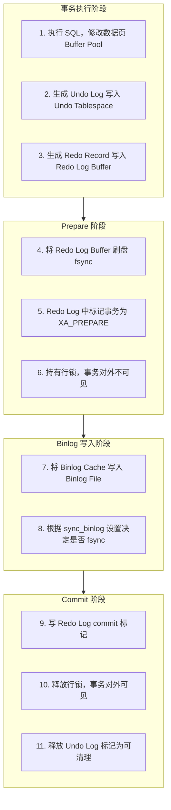
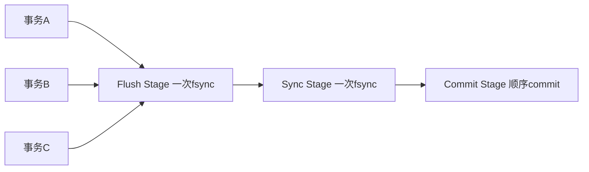

## 1. 两阶段提交的必要性

### 1.1 问题背景

InnoDB 的 Redo Log 和 Server 层的 Binlog 是两个独立的日志系统。如果不协调写入顺序，崩溃后会导致数据不一致：

```
主库执行: UPDATE accounts SET balance = balance - 100 WHERE id = 1;

情况1: Redo Log 写入成功，Binlog 未写入 → 主库已扣款，从库未扣款
情况2: Binlog 写入成功，Redo Log 未写入 → 主库未扣款，从库已扣款
```

### 1.2 两阶段提交方案

将事务提交分为 **Prepare** 和 **Commit** 两个阶段，中间插入 Binlog 写入：

```
阶段1 (Prepare):  写 Redo Log，标记为 prepare 状态
阶段间:           写 Binlog
阶段2 (Commit):   写 Redo Log，标记为 commit 状态
```

## 2. 两阶段提交流程

### 2.1 详细执行步骤



### 2.2 组提交优化

多个事务同时提交时，可以合并 fsync 操作：



阶段1（Flush）：多个事务的 Redo Log 一起 fsync；阶段2（Sync）：多个事务的 Binlog 一起 fsync；阶段3（Commit）：依次标记 commit

## 3. 崩溃恢复

### 3.1 恢复流程

MySQL 重启时，InnoDB 扫描 Redo Log 进行崩溃恢复：

```
1. 从 Checkpoint 点开始扫描 Redo Log
2. 重做（Redo）：重放所有已提交事务的修改
3. 回滚（Undo）：撤销所有未提交事务的修改
4. 处理 XA PREPARE 状态的事务：
   a. 检查 Binlog 中是否有该事务的记录
   b. 有 → 提交事务（commit）
   c. 无 → 回滚事务（rollback）
```

### 3.2 各种崩溃场景分析

| 崩溃时机                  | Redo Log 状态 | Binlog 状态 | 恢复动作         |
| ------------------------- | ------------- | ----------- | ---------------- |
| Prepare 之前              | 无记录        | 无记录      | 无需恢复         |
| Prepare 之后、Binlog 之前 | prepare       | 无记录      | 回滚事务         |
| Binlog 之后、Commit 之前  | prepare       | 有记录      | 提交事务         |
| Commit 之后               | commit        | 有记录      | 已完成，无需处理 |

### 3.3 Binlog 完整性判断

```sql
-- MySQL 通过 XID（事务ID）匹配 Redo Log 和 Binlog
-- 每个 Binlog 事务组以 XID event 结尾

-- Binlog 中的事务格式：
-- BEGIN
-- ... (行变更事件)
-- XID 12345  ← 事务标识

-- 恢复时：在 Binlog 中查找 XID=12345
-- 找到 → 事务完整，提交
-- 找不到 → 事务不完整，回滚
```

## 4. XA 事务

### 4.1 外部 XA 事务

MySQL 支持 X/Open XA 规范，实现跨数据库的分布式事务：

```sql
-- XA 事务语法
XA START 'txn1';
UPDATE accounts SET balance = balance - 100 WHERE id = 1;
XA END 'txn1';
XA PREPARE 'txn1';   -- 第一阶段：准备
-- 此时可以查询事务状态
XA RECOVER;
XA COMMIT 'txn1';    -- 第二阶段：提交
-- 或 XA ROLLBACK 'txn1';  -- 第二阶段：回滚
```

### 4.2 XA 事务状态机

```
START → END → PREPARE → COMMIT
                ↓
            ROLLBACK

状态: ACTIVE → IDLE → PREPARED → COMMITTED
                              → ROLLED_BACK
```

### 4.3 XA 事务的注意事项

- **悬挂事务**：PREPARE 后未 COMMIT 也未 ROLLBACK，占用锁资源
- **超时处理**：服务端没有内建的 XA 超时自动回滚，需应用层兜底并监控悬挂
- **监控**：定期执行 `XA RECOVER` 检查悬挂事务

```sql
-- 查看悬挂事务
XA RECOVER;

-- 手动回滚悬挂事务
XA ROLLBACK 'txn1';
```

## 5. 半同步复制与两阶段提交

### 5.1 半同步复制对两阶段提交的影响

```
异步复制:    主库提交 → 返回客户端 → 从库异步拉取 Binlog
半同步复制:  主库提交 → 等待至少1个从库确认收到 Binlog → 返回客户端
```

半同步复制在 Binlog 写入后增加了一个等待步骤：

```
Prepare → Binlog → 等待从库ACK → Commit
```

### 5.2 After Sync vs After Commit

| 模式         | 等待时机                 | 数据安全                         | 性能 |
| ------------ | ------------------------ | -------------------------------- | ---- |
| After Sync   | Binlog 写入后、Commit 前 | 主库崩溃不丢数据（无损半同步）   | 相近 |
| After Commit | Commit 后                | 主库崩溃可能丢数据、可现"幻影读" | 相近 |

```sql
-- 5.7+ 默认 After Sync（变量自 8.0.26 更名；旧名 rpl_semi_sync_master_* 与旧插件名 9.5.0 起移除，8.4 中新旧并存）
SET GLOBAL rpl_semi_sync_source_wait_point = AFTER_SYNC;
```

### 5.3 After Sync 的优势

```
After Sync 流程:
1. Prepare
2. 写 Binlog
3. 等待从库 ACK  ← 在 Commit 之前
4. Commit

如果主库在步骤3后崩溃：
- 从库已收到 Binlog → 从库会提交
- 主库未 Commit → 恢复时检查 Binlog 完整 → 提交
- 数据一致！
```

## 教学自检（先遮住代码自己写，再对照）

遮码自检法：先只读题干，自己写/自己答，再展开参考答案对照。

1. 概念自问：没有两阶段提交时，"redo 先提交、binlog 后写"与"binlog 先写、redo 后提交"各出什么主从不一致？

参考答案（先自己答，再对照）：前者——redo 提交后主机崩溃，主库有这笔数据、binlog 没来得及写，从库收不到，主库多；后者——binlog 写完但 redo 未提交就崩溃，从库已收到日志会提交这笔数据，主库回滚后没有，从库多。两阶段提交把写 binlog 卡在 redo prepare 与 commit 之间，让 binlog 的完整性成为崩溃恢复的裁决依据，两个日志永远同进退。

2. 概念自问：崩溃恢复面对"redo 处于 prepare"的事务，裁决规则是什么？为什么规则只有两条？

参考答案（先自己答，再对照）：binlog 完整（该事务的 binlog 事件齐全）→ 提交；binlog 不完整/没有 → 回滚。只有两条是因为判定标准只有一件事：这笔事务有没有可能已被复制到从库——有则必须让主库也提交（保持一致），没有则安全回滚。binlog 是这个"是否已外传"的唯一权威记录，这就是它必须写在提交裁决点上的原因。

3. 判断题：XA 事务（跨库两阶段提交）与 MySQL 内部两阶段提交（redo/binlog）是一回事。

参考答案（先自己答，再对照）：不是，只是共享"两阶段"这个名字。内部两阶段提交协调的是单机上的两个日志（redo 与 binlog），目的是崩溃恢复时主从一致；XA 协调的是多个独立数据库实例（事务管理器 + 资源管理器，prepare/commit 跨网络），目的是跨库原子性。前者由 MySQL 自动完成、用户无感；后者是应用层显式协议，有悬挂事务等独立故障模式。

4. 概念自问：After Sync 与 After Commit 的差异本质是什么？"无损半同步"指哪种？

参考答案（先自己答，再对照）：差异在等待从库 ACK 的时机——Sync 在 binlog 写完后、内部 commit 前等待，Commit 在 commit 之后等待。After Commit 崩溃时：主库已提交但 ACK 未及返回，从库可能没收到该事务——主库恢复后这笔数据还在但从库没有，还可能出现"主库读了、从库没有"的幻影读；After Sync 把提交卡在 ACK 之后，只要没提交，从库必已收到——主库崩溃也不丢已提交数据，即"无损半同步"（rpl_semi_sync_source_wait_point=AFTER_SYNC）。

跨库 XA 的完整机制与务实替代（本地消息表、Saga、TCC）见[分布式事务](/mysql/540-DistributedTransaction)；组复制在提交阶段的多数派仲裁是另一种"提交前先获得外部确认"，见[组复制](/mysql/620-GroupReplication)。
