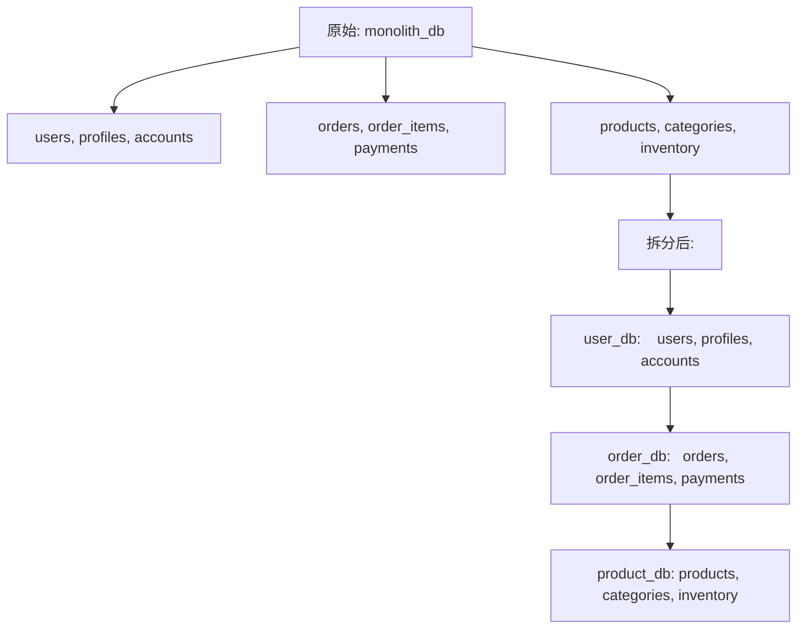

## 1. 分库分表概述

### 1.1 为什么需要分库分表

| 问题             | 阈值        | 影响         |
| ---------------- | ----------- | ------------ |
| 单表数据量过大   | > 5000万行  | 查询性能下降 |
| 单库连接数过多   | > 5000      | 连接池耗尽   |
| 单机磁盘容量不足 | > 2TB       | 无法写入     |
| 写入瓶颈         | > 10000 TPS | 主库延迟     |

### 1.2 拆分维度

```
垂直拆分：按业务/模块拆分（微服务化）
水平拆分：按数据行拆分（同结构多表/多库）

垂直分库: 用户库 | 订单库 | 商品库
垂直分表: 订单基础信息表 | 订单详情表
水平分库: order_db_0 | order_db_1 | order_db_2
水平分表: order_0 | order_1 | ... | order_15
```

## 2. 垂直拆分

### 2.1 垂直分库

将不同业务的表拆分到不同数据库：



**优点**：业务解耦、独立扩展、故障隔离
**缺点**：跨库 JOIN、分布式事务

### 2.2 垂直分表

将大表的列拆分为多个表：

```sql
-- 原始表
CREATE TABLE users (
    id          INT PRIMARY KEY,
    name        VARCHAR(50),
    email       VARCHAR(100),
    avatar_url  VARCHAR(500),   -- 大字段
    bio         TEXT,            -- 大字段
    settings    JSON,            -- 低频访问
    created_at  TIMESTAMP
);

-- 拆分后
CREATE TABLE users_base (
    id          INT PRIMARY KEY,
    name        VARCHAR(50),
    email       VARCHAR(100),
    created_at  TIMESTAMP
);

CREATE TABLE users_profile (
    user_id     INT PRIMARY KEY,
    avatar_url  VARCHAR(500),
    bio         TEXT,
    settings    JSON,
    FOREIGN KEY (user_id) REFERENCES users_base(id)
);
```

## 3. 水平拆分

### 3.1 分片键选择

分片键（Sharding Key）决定了数据如何分布：

| 分片键      | 优点                 | 缺点                 |
| ----------- | -------------------- | -------------------- |
| user_id     | 按用户隔离，查询集中 | 数据倾斜（大用户）   |
| order_id    | 均匀分布             | 按用户查询需扫描多片 |
| create_time | 按时间归档           | 热点写入             |

**选择原则**：

1. 高频查询条件包含分片键
2. 数据分布均匀
3. 尽量避免跨片查询

### 3.2 分片算法

**Hash 取模**：

```
分片号 = hash(shard_key) % N

user_id=123 → 123 % 4 = 3 → 分片3
user_id=456 → 456 % 4 = 0 → 分片0

优点: 数据分布均匀
缺点: 扩容需要数据迁移（rehash）
```

**Range 范围**：

```
user_id 1-100万    → 分片0
user_id 100万-200万 → 分片1
user_id 200万-300万 → 分片2

优点: 扩容方便（新增范围）
缺点: 数据可能倾斜（热点范围）
```

**一致性哈希**：

```
将分片节点映射到 0-2^32 的环上
数据 key 的 hash 值顺时针找到最近的节点

优点: 扩容只需迁移少量数据
缺点: 实现复杂
```

### 3.3 分片数量规划

```
目标数据量: 10亿行
单表推荐量: 2000万行
分表数: 10亿 / 2000万 = 50

分库数: 根据连接数和磁盘容量
  单库 2000连接 → 5个库 → 每库 10张表

最终: 5库 × 10表 = 50张表
命名: order_db_0.order_0 ~ order_db_4.order_9
```

## 4. ShardingSphere

### 4.1 ShardingSphere-JDBC 配置

```yaml
# application.yml
spring:
  shardingsphere:
    datasource:
      names: ds0, ds1
      ds0:
        type: com.zaxxer.hikari.HikariDataSource
        jdbc-url: jdbc:mysql://localhost:3306/order_db_0
        username: root
        password: root
      ds1:
        type: com.zaxxer.hikari.HikariDataSource
        jdbc-url: jdbc:mysql://localhost:3306/order_db_1
        username: root
        password: root
    rules:
      sharding:
        tables:
          t_order:
            actual-data-nodes: ds${0..1}.t_order_${0..15}
            table-strategy:
              standard:
                sharding-column: user_id
                sharding-algorithm-name: order-table-mod
            database-strategy:
              standard:
                sharding-column: user_id
                sharding-algorithm-name: order-db-mod
            key-generate-strategy:
              column: order_id
              key-generator-name: snowflake
        sharding-algorithms:
          order-table-mod:
            type: MOD
            props:
              sharding-count: 16
          order-db-mod:
            type: MOD
            props:
              sharding-count: 2
        key-generators:
          snowflake:
            type: SNOWFLAKE
```

### 4.2 分布式主键

| 方案           | 原理           | 优点         | 缺点         |
| -------------- | -------------- | ------------ | ------------ |
| Auto Increment | 各片不同起始值 | 简单         | 扩容困难     |
| UUID           | 随机生成       | 无需协调     | 无序、索引差 |
| Snowflake      | 时间+机器+序列 | 有序、高性能 | 时钟回拨     |
| 号段模式       | 预分配号段     | 高性能       | 依赖中心服务 |

```sql
-- Snowflake ID 结构 (64位)
-- 1位符号 | 41位时间戳 | 10位机器ID | 12位序列号
-- 每毫秒可生成 4096 个ID
-- 可用约69年
```

### 4.3 跨片查询处理

```sql
-- ShardingSphere 自动路由
SELECT * FROM t_order WHERE user_id = 100;
-- 路由到: ds0.t_order_4

-- 跨片查询
SELECT * FROM t_order WHERE status = 'pending';
-- 广播到所有分片，合并结果

-- 排序分页
SELECT * FROM t_order ORDER BY created_at DESC LIMIT 10;
-- 各分片取 TOP 10 → 合并排序 → 取全局 TOP 10
```

## 5. MyCAT

> 现状注（2026 年末）：MyCAT/MyCat2 社区活跃度已明显衰退，新项目不建议入坑；本节保留以帮助读者看懂存量系统。新方案在 ShardingSphere（Apache 顶级项目，持续演进）与 Vitess 之间选，见[分库分表中间件](/mysql/680-ShardingMiddleware)的对比表。

### 5.1 MyCAT 架构

```
应用 → MyCAT (代理层) → 后端 MySQL 实例

MyCAT 作为数据库代理，应用连接 MyCAT 如同连接 MySQL
MyCAT 负责路由、合并、过滤
```

### 5.2 MyCAT 配置

```xml
<!-- schema.xml -->
<schema name="ORDER_DB" checkSQLschema="false">
    <table name="t_order" primaryKey="order_id"
           dataNode="dn1,dn2,dn3,dn4"
           rule="mod-long" />
</schema>

<dataNode name="dn1" dataHost="host1" database="order_db_0" />
<dataNode name="dn2" dataHost="host1" database="order_db_1" />
<dataNode name="dn3" dataHost="host2" database="order_db_0" />
<dataNode name="dn4" dataHost="host2" database="order_db_1" />

<!-- rule.xml -->
<tableRule name="mod-long">
    <rule>
        <columns>user_id</columns>
        <algorithm>mod-long</algorithm>
    </rule>
</tableRule>
<function name="mod-long" class="io.mycat.route.function.PartitionByMod">
    <property name="count">4</property>
</function>
```

### 5.3 ShardingSphere vs MyCAT

| 维度   | ShardingSphere  | MyCAT        |
| ------ | --------------- | ------------ |
| 架构   | JDBC/Proxy      | Proxy        |
| 性能   | JDBC直连更高    | 网络开销     |
| 部署   | 无需独立部署    | 需要独立部署 |
| 语言   | Java            | Java         |
| 社区   | Apache 顶级项目 | 社区维护     |
| 推荐度 |                 |              |

## 教学自检（先遮住代码自己写，再对照）

遮码自检法：先只读题干，自己写/自己答，再展开参考答案对照。

1. 概念自问：垂直拆分与水平拆分分别解决什么问题？为什么"先垂直后水平"是通用次序？

参考答案（先自己答，再对照）：垂直拆分按业务边界分库、按冷热/大小分表——解决的是"业务耦合"与"单表列过多"的问题，不改数据分布规律，实施风险低；水平拆分按分片键把行散到多库多表——解决的是"单表行数/写入量超过单机容量"的问题，引入分布式 ID、跨片查询、跨片事务等全部复杂度。垂直先行是因为它常常已能救回性能，且为水平拆分划定了业务边界——问题域切小了，水平拆分的代价才可控。

2. 概念自问：分片键选择的三原则是什么？为什么"订单按 user_id 分片"时商家后台查询会痛？

参考答案（先自己答，再对照）：三原则——高频查询等值命中分片键（路由准）、数据分布均匀（防倾斜）、写入分散（防热点）。按 user_id 分片后，买家查询精准路由，商家后台"查我的全部订单"没有 user_id——全路由扇出（每个分片都查一遍再合并），数据量越大越慢。化解：异构索引表（按商家维度冗余一份订单映射）或宽表冗余，用写入冗余换两侧查询都可路由。

3. 判断题：分布式 ID 用数据库自增就行，每个分片设不同步长。

参考答案（先自己答，再对照）：步长错开只是权宜之计——扩容时要改步长、全局有序性差、跨片合并排序混乱。生产级方案的主流是"趋势递增 + 全局唯一"：雪花类算法（时间戳 + 机器位 + 序列号）或号段模式（应用批量取号段）。选型判据：是否需要严格递增（binlog 回放与索引写入友好）、时钟回拨怎么处理、ID 里是否愿意暴露时间与机器信息。

4. 概念自问：跨片事务的两条务实路线是什么？各自牺牲了什么？

参考答案（先自己答，再对照）：路线一，避免跨片——让相关数据同分片（分片键设计阶段就规划好，如订单与订单明细同 user_id 分片），牺牲的是 schema 设计自由度；路线二，最终一致——本地事务提交 + 补偿/消息对账，牺牲的是瞬时强一致（中间态可见）。XA 在分片中间件下因协调者单点与锁放大基本不用于高并发 OLTP。共同结论：跨片事务的最优解是在"设计时"消灭它，而不是在"运行时"处理它。

## 6. 分库分表后的挑战

### 6.1 跨库 JOIN

```sql
-- 无法直接 JOIN
SELECT o.*, u.name FROM t_order o JOIN t_user u ON o.user_id = u.id;

-- 解决方案:
-- 1. 冗余字段: t_order 中冗余 user_name
-- 2. 应用层组装: 分别查询后代码合并
-- 3. 广播表: 小表复制到所有库
-- 4. ER分片: 关联表按相同分片键分布
```

### 6.2 分布式事务

```sql
-- ShardingSphere 分布式事务
-- XA 事务
SET GLOBAL transaction_type = XA;
BEGIN;
INSERT INTO t_order ...;  -- 分片1
INSERT INTO t_order ...;  -- 分片2
COMMIT;  -- 两阶段提交

-- BASE 事务（Saga）
SET GLOBAL transaction_type = BASE;
-- 最终一致性
```

### 6.3 扩容与数据迁移

```
扩容方案:
1. 停机迁移: 停服 → 数据迁移 → 启动新配置
2. 双写迁移: 新旧双写 → 历史数据迁移 → 切换
3. 一致性哈希: 仅迁移少量数据

推荐: ShardingSphere Scaling 模块
  在线扩容，自动数据迁移，无需停服
```
