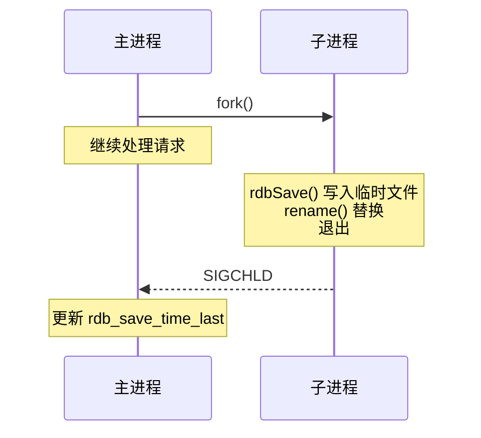

## 1. RDB 概述

RDB（Redis Database）是 Redis 的默认持久化方式，通过在指定时间间隔内对数据集进行快照（snapshot），将内存中的数据以二进制文件形式写入磁盘。生成的 RDB 文件紧凑、体积小，非常适合用于备份和灾难恢复。

RDB 的核心优势：

- **紧凑高效**：RDB 文件是经过压缩的二进制格式，体积远小于 AOF 日志
- **恢复速度快**：直接加载二进制文件，恢复大数据集的速度远快于 AOF
- **对性能影响小**：`bgsave` 由子进程完成，主进程几乎不受影响
- **适合冷备**：可以定期将 RDB 文件归档到远程存储

RDB 的主要不足：

- **数据丢失风险**：非实时持久化，两次快照之间的数据可能丢失
- **fork 开销**：数据集很大时，`fork()` 子进程可能耗时较长
- **不支持增量**：每次都是全量快照，无法记录增量变更

## 2. save 命令

`save` 命令以**阻塞**方式生成 RDB 文件：

```redis
SAVE
```

执行流程：

1. 主进程直接调用 `rdbSave()` 函数
2. 主进程被阻塞，无法响应任何客户端请求
3. RDB 文件写入完成后，主进程恢复服务

**适用场景**：

- 数据集很小，阻塞时间可忽略
- 需要确保快照完成的测试环境
- Redis 正在关闭时（shutdown 触发 save）

**风险**：生产环境中数据集较大时，`save` 可能导致数秒甚至数十秒的阻塞，严重影响可用性。

## 3. bgsave 命令

`bgsave`（Background Save）是生产环境推荐的方式，通过 `fork()` 子进程完成快照：

```redis
BGSAVE
```

执行流程：

1. 主进程调用 `fork()` 创建子进程
2. 子进程调用 `rdbSave()` 将数据写入临时 RDB 文件
3. 写入完成后，子进程将临时文件原子性地重命名为正式 RDB 文件
4. 子进程退出，主进程收到信号



**查看 bgsave 状态**：

```redis
LASTSAVE          # 返回最近一次成功保存的 Unix 时间戳
INFO Persistence   # 查看 rdb 相关统计信息
```

**bgsave 期间的保护机制**：

- bgsave 执行期间，再次调用 `bgsave` 会被拒绝（`ERR Background save already in progress`）
- `save` 命令同样会被拒绝，避免产生竞争条件

## 4. 写时复制（Copy-On-Write）

写时复制（COW）是 `bgsave` 能够在不阻塞主进程的情况下生成一致性快照的关键机制。

### 4.1 fork 与内存共享

`fork()` 创建子进程后，父子进程共享同一块物理内存页。此时内存消耗并不会翻倍，因为页表指向相同的物理帧。

### 4.2 COW 触发条件

当主进程尝试**修改**某个共享页时：

1. 内核检测到该页被标记为只读（共享页）
2. 触发缺页异常（Page Fault）
3. 内核复制该页的副本给主进程
4. 主进程在副本上执行修改
5. 子进程仍然读取原始页的数据

```
fork() 后：
  父进程页表 → 物理页 A (只读)
  子进程页表 → 物理页 A (只读)

父进程修改页 A：
  父进程页表 → 物理页 A' (可写) ← 新副本
  子进程页表 → 物理页 A  (只读) ← 原始数据
```

### 4.3 内存开销估算

COW 的额外内存开销取决于 `bgsave` 期间被修改的页面数量：

$$\text{COW 额外内存} \approx \text{修改页数} \times \text{页大小}$$

Linux 默认页大小为 4KB。假设 bgsave 耗时 5 秒，每秒写入 10 万个 key，每个 key 平均 100 字节：

$$\text{修改页数} \approx \frac{5 \times 100000 \times 100}{4096} \approx 12207 \text{ 页}$$

$$\text{COW 额外内存} \approx 12207 \times 4\text{KB} \approx 48\text{MB}$$

**生产建议**：预留 Redis 实例内存的 20%~50% 作为 COW 缓冲。

## 5. 自动触发配置

Redis 通过 `save` 配置项实现自动触发 RDB 快照：

```redis
# 官方发行版 redis.conf 的默认值（Redis 7.0 起改为如下三档；7.0 之前是 900 1 / 300 10 / 60 10000）
save 3600 1     # 3600秒内有至少1个key被修改
save 300 100    # 300秒内有至少100个key被修改
save 60 10000   # 60秒内有至少10000个key被修改
```

> 老资料里常见的 `save 900 1`、`save 300 10` 是 6.x 及更早版本的默认值；7.0 起官方把默认三档调整为 `3600 1 / 300 100 / 60 10000`（每小时 1 次、每 5 分钟 100 次、每分钟 1 万次）。看旧博客时注意区分「示例配置」与「出厂默认」。

**触发逻辑**：满足任意一个条件即触发 `bgsave`。

```redis
# 禁用自动 RDB
save ""

# 运行时修改
CONFIG SET save "900 1 300 10 60 10000"
```

### 5.1 自动触发条件评估

Redis 每秒执行一次 `serverCron()`，检查是否满足 save 条件：

1. 遍历所有 `save` 配置项
2. 计算自上次成功保存以来的时间间隔和修改 key 数量
3. 如果满足任一条件，触发 `bgsave`

## 6. RDB 文件格式

RDB 文件采用二进制格式，结构如下：


各数据库区域结构：


**编码优化**：

- 小整数使用变长编码（1/2/4 字节）
- 短字符串使用嵌入编码（len + data）
- LZF 压缩长字符串
- 整数集合（intset）直接存储
- 压缩列表（ziplist/listpack）直接存储

## 7. RDB 文件恢复

### 7.1 自动恢复

Redis 启动时自动检测 RDB 文件：

1. 读取 `dir` 和 `dbfilename` 配置
2. 打开 RDB 文件，校验 checksum
3. 逐个加载 key-value 到内存
4. 加载完成后开始接受客户端请求

```redis
# 配置 RDB 文件路径
dir /var/lib/redis
dbfilename dump.rdb
```

### 7.2 RDB 文件校验

```bash
# 使用 redis-check-rdb 工具
redis-check-rdb dump.rdb
```

### 7.3 恢复注意事项

- RDB 文件加载期间 Redis 处于阻塞状态
- 如果 RDB 文件损坏，Redis 可能拒绝启动
- `redis-check-rdb` 只有**检测**能力（CRC64 校验、格式解析、报告损坏位置），没有修复选项——不要与 `redis-check-aof --fix` 混淆（--fix 属于 AOF 工具）。RDB 损坏的正确恢复路径是：从备份副本恢复，或让从库/主库重新执行 BGSAVE 生成新文件

## 8. 配置优化

### 8.1 关键配置项

```redis
# RDB 文件名
dbfilename dump.rdb

# 存储目录
dir /var/lib/redis

# 是否压缩（LZF）
rdbcompression yes

# 是否使用 CRC64 校验
rdbchecksum yes

# bgsave 失败时是否停止写入
stop-writes-on-bgsave-error yes

# 自动触发条件（7.0+ 默认三档；示例按需改写）
save 3600 1
save 300 100
save 60 10000
```

### 8.2 性能调优建议

| 场景                   | save 配置       | 说明                        |
| ---------------------- | --------------- | --------------------------- |
| 高可用（允许少量丢失） | `save 60 10000` | 减少快照频率，降低 I/O 压力 |
| 数据安全（尽量少丢失） | `save 60 1`     | 增加快照频率，增加 I/O 开销 |
| 纯缓存（可丢失）       | `save ""`       | 禁用 RDB，最大化性能        |
| 大数据集               | 适当放宽间隔    | 减少 fork 开销              |

### 8.3 大内存实例优化

当 Redis 实例使用内存超过 10GB 时：

- `fork()` 耗时可能超过 1 秒
- COW 可能占用数 GB 额外内存
- 建议拆分为多个小实例，或使用 AOF 替代
- 考虑开启 `lazyfree-lazy-eviction` 减少主线程阻塞

## 9. RDB 与 AOF 对比

| 特性       | RDB                | AOF               |
| ---------- | ------------------ | ----------------- |
| 持久化方式 | 定时快照           | 实时追加日志      |
| 数据安全性 | 可能丢失数分钟数据 | 最多丢失 1 秒数据 |
| 文件体积   | 小（压缩二进制）   | 大（文本日志）    |
| 恢复速度   | 快                 | 慢                |
| 性能影响   | fork 开销          | 写入开销          |
| 适用场景   | 备份、灾难恢复     | 数据安全优先      |

## 教学自检（先遮住代码自己写，再对照）

遮码自检法：先只读题干，自己写/自己答，再展开参考答案对照。

1. 概念自问：`bgsave` 为什么不阻塞主进程？它靠哪两个机制把「拍快照」与「继续服务」同时做到？

参考答案（先自己答，再对照）：一是 `fork()` 创建子进程，快照写入由子进程完成；二是写时复制（COW）——fork 后父子进程共享只读物理页，主进程修改某页时内核才复制出新页给主进程，子进程始终读 fork 瞬间的原始数据。所以 bgsave 产出的是一致性快照，代价是快照期间写入越多、COW 复制的页越多。

2. 判断题：bgsave 期间实例内存最多翻倍。

参考答案（先自己答，再对照）：不对，是「最多接近翻倍、实际取决于写入量」。fork 瞬间内存几乎不涨（只复制页表）；此后只有被修改的页才触发复制，COW 额外内存约为「快照期间被改的页数 × 页大小」。容量规划按「写入高峰期的修改页数」预留，工程上常以实例内存的 20%~50% 作缓冲，但那不是「必然翻倍」。

3. 概念自问：`SAVE` 与 `BGSAVE` 的本质区别是什么？各自什么时候用？

参考答案（先自己答，再对照）：SAVE 由主进程同步执行 `rdbSave()`，期间无法响应任何请求——只在数据集极小或实例关闭流程（shutdown 触发）里可接受；BGSAVE fork 子进程后台执行，生产默认路径。自动化 `save` 配置触发的就是 BGSAVE。

4. 概念自问：RDB 的数据丢失窗口由什么决定？为什么「每秒 1 万次修改」的实例丢了 59 秒数据不奇怪？

参考答案（先自己答，再对照）：窗口由 save 条件的「秒数 × 修改数」触发节奏决定——条件满足才触发 bgsave，两次快照之间的写入只在内存里。默认三档中最激进的一档也是 60 秒才保一次底，所以高峰期实例崩溃时，丢掉的最多是「距上次成功快照」的全部写入；要秒级安全必须上 AOF（redis/160）或混合持久化（redis/170）。

5. 动手自问：Redis 启动时怎么决定加载 RDB 还是 AOF？RDB 文件损坏了怎么处理？

参考答案（先自己答，再对照）：启动时若 `appendonly yes` 则优先加载 AOF（数据更全），否则加载 `dir/dbfilename` 指定的 RDB。RDB 先过 CRC64 校验，损坏可能导致拒绝启动；`redis-check-rdb` 只能体检（校验与定位损坏点），没有修复选项（`--fix` 是 redis-check-aof 的），所以 RDB 损坏的恢复靠备份副本或重新 BGSAVE 生成，而不是修文件——根因通常是磁盘故障或进程崩溃打断写入。

## save 命令

**基本写法：阻塞方式生成 RDB 文件**
`SAVE`
```bash
# 阻塞方式生成 RDB 文件，主进程无法响应请求
SAVE
```

---

## bgsave 命令

**基本写法：后台子进程生成 RDB 文件**
`BGSAVE`
```bash
# 后台方式生成 RDB 文件（生产推荐）
BGSAVE
```

**基本写法：查看最近一次保存时间**
`LASTSAVE`
```bash
# 返回最近一次成功保存的 Unix 时间戳
LASTSAVE
```

**基本写法：查看 RDB 统计信息**
`INFO Persistence`
```bash
# 查看 rdb 相关统计信息
INFO Persistence
```

---

## 写时复制（COW）

**基本写法：fork 创建子进程共享内存**
`fork()`
```c
// fork() 创建子进程后，父子进程共享同一块物理内存页
// 父进程页表 → 物理页 A (只读)
// 子进程页表 → 物理页 A (只读)
```

**基本写法：父进程修改页时触发 COW**
`fork() → 父进程写入 → 复制页`
```c
// 父进程修改页 A 时，操作系统复制一份新页
// 父进程页表 → 物理页 A' (可写) ← 新副本
// 子进程页表 → 物理页 A  (只读) ← 原始数据
```

**基本写法：COW 额外内存估算**
`COW 额外内存 ≈ 修改页数 × 页大小`
```c
// Linux 默认页大小为 4KB
// 假设 bgsave 耗时 5 秒，每秒写入 10 万个 key，每个 key 平均 100 字节
// 修改页数 ≈ (5 × 100000 × 100) / 4096 ≈ 12207 页
// COW 额外内存 ≈ 12207 × 4KB ≈ 48MB
```

---

## 自动触发配置

**基本写法：配置自动触发条件**
`save <seconds> <changes>`
```bash
# 3600秒内有至少1个key被修改时触发（7.0+ 默认三档之一；6.x 及更早的默认是 save 900 1）
save 3600 1
```

**多条件写法：配置多个自动触发条件**
`save <seconds> <changes>`
```bash
# 配置多个触发条件，满足任意一个即触发 bgsave（7.0+ 官方默认三档）
save 3600 1
save 300 100
save 60 10000
```

**基本写法：禁用自动 RDB**
`save ""`
```bash
# 禁用自动 RDB 快照
save ""
```

**基本写法：运行时修改 save 配置**
`CONFIG SET save "<config>"`
```bash
# 运行时修改 save 配置
CONFIG SET save "900 1 300 10 60 10000"
```

---

## RDB 文件格式

**基本写法：RDB 文件整体结构**
`[REDIS][version][databases][EOF][checksum]`
```c
// RDB 文件采用二进制格式
// 魔数 → 版本号 → 数据库数据 → 结束标记 → 校验和
```

**基本写法：数据库区域结构**
`[SELECTDB][key-value对(带过期时间)][key-value对(无过期时间)]`
```c
// 各数据库区域结构
// 数据库编号 → key-value对(带过期时间) → key-value对(无过期时间)
```

---

## RDB 文件恢复

**基本写法：配置 RDB 文件路径**
`dir <path>`
```bash
# 设置 RDB 文件存储目录
dir /var/lib/redis
```

**基本写法：配置 RDB 文件名**
`dbfilename <name>`
```bash
# 设置 RDB 文件名
dbfilename dump.rdb
```

**基本写法：校验 RDB 文件**
`redis-check-rdb <file>`
```bash
# 使用 redis-check-rdb 工具校验文件
redis-check-rdb dump.rdb
```

---

## 配置优化

**基本写法：设置 RDB 文件名**
`dbfilename <name>`
```bash
# 设置 RDB 文件名
dbfilename dump.rdb
```

**基本写法：设置存储目录**
`dir <path>`
```bash
# 设置 RDB 文件存储目录
dir /var/lib/redis
```

**基本写法：开启 LZF 压缩**
`rdbcompression <yes|no>`
```bash
# 开启 RDB 文件 LZF 压缩
rdbcompression yes
```

**基本写法：开启 CRC64 校验**
`rdbchecksum <yes|no>`
```bash
# 开启 RDB 文件 CRC64 校验
rdbchecksum yes
```

**基本写法：bgsave 失败时停止写入**
`stop-writes-on-bgsave-error <yes|no>`
```bash
# bgsave 失败时停止接受写入
stop-writes-on-bgsave-error yes
```
