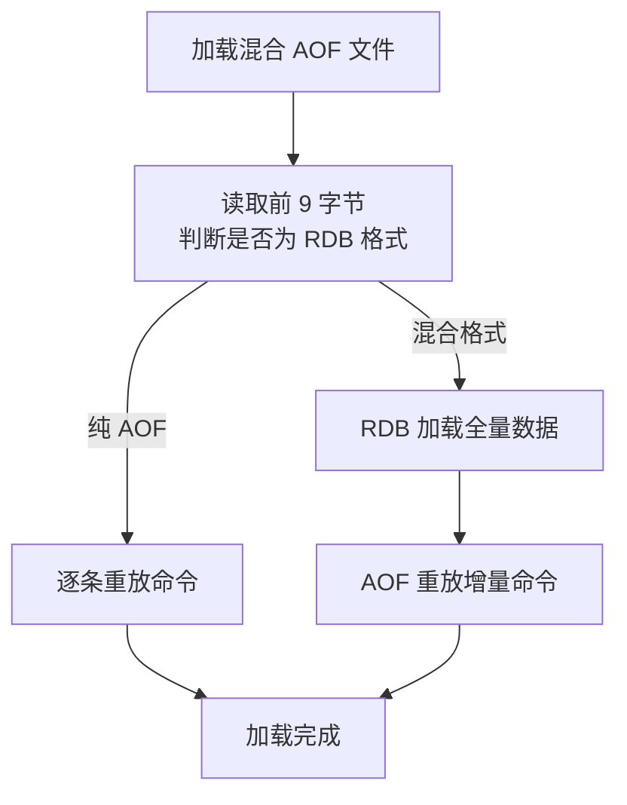
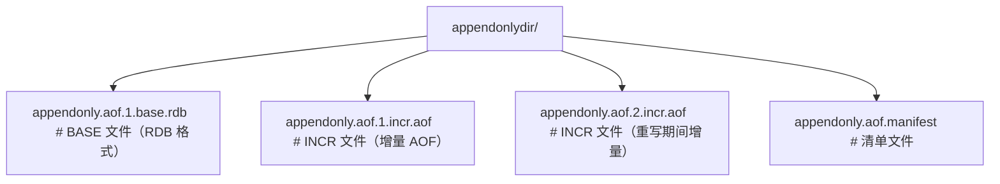

## 1. 混合持久化概述

混合持久化是 Redis 4.0 引入的持久化方案，结合了 RDB 的高效恢复和 AOF 的数据安全性。在 AOF 重写时，将当前数据以 RDB 格式写入 AOF 文件开头，后续增量命令仍以 AOF 格式追加。

**核心思想**：


> 7.0 multi-part AOF 之后：上述「RDB 开头 + AOF 增量」拆成了两个文件——
> RDB 快照独立为 `*.base.rdb`（base），增量命令在 `*.incr.aof`（incr），
> 由 manifest 清单串联，本质与混合持久化思想一致，加载顺序不变
> （先 base 后 incr）。4.x~6.x 才是真正的「单文件混合」。

## 2. 混合持久化工作原理

### 2.1 重写时的文件生成

当 AOF 重写触发时：

1. 子进程将当前内存数据以 **RDB 二进制格式**写入临时文件开头
2. 重写期间的新命令以 **AOF 文本格式**追加到临时文件末尾
3. 重写完成后，临时文件替换旧 AOF 文件

```
重写过程：

旧 AOF 文件：
  SET key1 val1
  SET key2 val2
  DEL key1
  SET key3 val3
  SET key2 newval2
  ...（数百万条命令）

新 AOF 文件（混合格式）：
  [RDB 二进制数据：key2=newval2, key3=val3, ...]
  SET key4 val4        ← 重写期间的增量命令
  SET key5 val5
  ...
```

### 2.2 文件体积对比

假设 Redis 中有 100 万个 key，每个 key 平均 100 字节：

| 格式     | 估算大小       | 说明                    |
| -------- | -------------- | ----------------------- |
| 纯 AOF   | ~200 MB        | 每条命令的文本表示      |
| 纯 RDB   | ~100 MB        | 压缩二进制格式          |
| 混合 AOF | ~100 MB + 增量 | RDB 部分 + 少量增量 AOF |

混合 AOF 的体积约为纯 AOF 的 50%~70%，接近 RDB 的紧凑程度。

## 3. 混合持久化加载流程

Redis 启动加载混合 AOF 文件时：

```
1. 读取 AOF 文件头部
2. 检测到 RDB 格式标记（REDIS 前缀）
3. 以 RDB 方式加载前半部分（快速恢复全量数据）
4. 以 AOF 方式重放后半部分（恢复增量数据）
5. 加载完成，开始接受请求
```

详细流程：



### 3.1 格式检测

Redis 通过检查 AOF 文件开头来判断格式：

- 以 `REDIS` 开头 → RDB 格式（混合 AOF）
- 以 `*` 开头 → 纯 AOF 格式（RESP 协议）

```c
// 伪代码
int loadAppendOnlyFile(char *filename) {
    if (starts_with(buf, "REDIS")) {
        // 混合格式：先加载 RDB 部分
        rdbLoadRio(&rdb);
        // 再加载 AOF 增量部分
        while (readCommand(&cmd)) {
            executeCommand(cmd);
        }
    } else {
        // 纯 AOF 格式
        while (readCommand(&cmd)) {
            executeCommand(cmd);
        }
    }
}
```

## 4. 配置与启用

### 4.1 开启混合持久化

```redis
# redis.conf
appendonly yes                    # 开启 AOF
aof-use-rdb-preamble yes          # 开启混合持久化（4.0 引入，7.0 起默认 yes）
```

```redis
# 运行时修改
CONFIG SET aof-use-rdb-preamble yes
```

### 4.2 关键配置项

```redis
# AOF 基础配置
appendonly yes
appendfilename "appendonly.aof"
appendfsync everysec

# 混合持久化开关
aof-use-rdb-preamble yes

# 重写触发条件
auto-aof-rewrite-percentage 100
auto-aof-rewrite-min-size 64mb
```

### 4.3 版本兼容性

| Redis 版本 | 混合持久化支持 | 默认值 |
| ---------- | -------------- | ------ |
| < 4.0      | 不支持         | -      |
| 4.0        | 支持           | no     |
| 5.0+       | 支持           | yes    |
| 7.0+       | 支持（MP-AOF） | yes    |

**注意**：Redis 7.0 引入了 Multi Part AOF（MP-AOF），将 AOF 拆分为基础文件（BASE）和增量文件（INCR），进一步优化了混合持久化的实现。

## 5. 三种持久化方案对比

| 特性       | 纯 RDB           | 纯 AOF         | 混合持久化     |
| ---------- | ---------------- | -------------- | -------------- |
| 数据安全性 | 低（分钟级丢失） | 高（秒级丢失） | 高（秒级丢失） |
| 恢复速度   | 快               | 慢             | 较快           |
| 文件体积   | 最小             | 最大           | 中等           |
| 性能影响   | fork 开销        | 写入开销       | 两者兼具       |
| 可读性     | 不可读           | 可读           | 部分可读       |
| 兼容性     | 所有版本         | 所有版本       | Redis 4.0+     |

### 5.1 恢复速度对比

对于 1000 万个 key 的数据集：

| 方案     | 恢复时间 | 说明                         |
| -------- | -------- | ---------------------------- |
| 纯 RDB   | ~10 秒   | 直接加载二进制               |
| 纯 AOF   | ~120 秒  | 逐条重放命令                 |
| 混合 AOF | ~15 秒   | RDB 快速加载 + 少量 AOF 重放 |

混合持久化的恢复速度约为纯 AOF 的 **8~10 倍**，接近纯 RDB 的水平。

## 6. Redis 7.0 Multi Part AOF

Redis 7.0 对 AOF 进行了重大重构，引入 Multi Part AOF（MP-AOF）：

### 6.1 文件结构



### 6.2 Manifest 文件

```json
file appendonly.aof.1.base.rdb seq 1 type b
file appendonly.aof.1.incr.aof seq 1 type h
file appendonly.aof.2.incr.aof seq 2 type h
```

### 6.3 重写流程变化

1. 创建新的 BASE 文件（RDB 格式）
2. 重写期间的增量写入新的 INCR 文件
3. 更新 manifest 文件（原子替换）
4. 异步删除旧的 BASE 和 INCR 文件

**优势**：

- 不再需要将增量命令追加到重写后的文件
- 重写完成后只需更新 manifest，无需修改数据文件
- 减少了重写期间的内存占用

## 7. 最佳实践

### 7.1 生产环境推荐配置

```redis
appendonly yes
appendfsync everysec
aof-use-rdb-preamble yes
auto-aof-rewrite-percentage 100
auto-aof-rewrite-min-size 64mb
```

### 7.2 场景选择

| 场景         | 推荐方案            | 理由               |
| ------------ | ------------------- | ------------------ |
| 数据安全优先 | 混合持久化          | 兼顾安全和恢复速度 |
| 纯缓存       | 禁用持久化          | 最大化性能         |
| 备份为主     | RDB + 定时归档      | 文件紧凑，便于传输 |
| 金融/支付    | 混合 + always fsync | 最高数据安全       |

### 7.3 监控要点

```redis
# 查看持久化状态
INFO Persistence

# 关键指标
# aof_current_size: 当前 AOF 文件大小
# aof_base_size: 上次重写后的大小
# aof_rewrite_in_progress: 是否正在重写
# aof_last_bgrewrite_status: 上次重写状态
```

## 教学自检（先遮住代码自己写，再对照）

遮码自检法：先只读题干，自己写/自己答，再展开参考答案对照。

1. 概念自问：混合持久化把 RDB 与 AOF 各自的长处拼在哪里？短处呢？

参考答案（先自己答，再对照）：长处拼接：恢复速度靠「前半段 RDB 二进制全量加载」（比纯 AOF 逐条重放快一个量级），数据安全靠「后半段 AOF 增量按 appendfsync 追加」（丢数据上限回到秒级）。短处是两者兼具——付 fork/COW 的快照成本，也付增量写盘的成本；且 base 是二进制不可读。

2. 动手自问：7.0 的 multi-part AOF 目录里，混合思想落在哪两类文件上？与 4.x~6.x 的「单文件混合」差别是什么？

参考答案（先自己答，再对照）：落在 `*.base.rdb`（RDB 全量）与 `*.incr.aof`（AOF 增量）上，由 manifest 清单串联，加载顺序仍是先 base 后 incr。差别：4.x~6.x 是真正的「一个文件里 RDB 头 + AOF 尾」；7.0 拆成多文件，重写只需生成新 base + 登记 manifest，不再有重写缓冲区双写。

3. 判断题：`aof-use-rdb-preamble no` 可以让 AOF 更小。

参考答案（先自己答，再对照）：错。设 no 只是让 base 文件也用 RESP 文本格式（纯 AOF），体积更大、加载更慢——它存在的意义只剩兼容老工具/老流程；官方配置注释明确说「禁用它仅为向后兼容」。想省体积应该保持 yes 并让重写正常触发。

4. 概念自问：金融/支付类场景的持久化组合怎么选？纯缓存场景呢？

参考答案（先自己答，再对照）：金融类用混合持久化 + `appendfsync always`：恢复快、丢失上限压到一条命令，代价是吞吐最低——够不够要用容量与延迟预算验证。纯缓存直接 `appendonly no` + `save ""`（或保留默认 RDB 做兜底），持久化越薄吞吐越高，缓存数据本来就允许丢。

5. 动手自问：同是「最多丢 1 秒」承诺，混合 AOF（everysec）与纯 RDB 的差别在恢复速度上怎么体现？

参考答案（先自己答，再对照）：两者丢失上限接近（everysec 的 1 秒 vs RDB 的快照间隔——后者实际更大），差别在恢复：千万键规模混合 AOF 约 15 秒（RDB 全量 + 少量增量重放），纯 AOF 要逐条重放约 2 分钟。选混合的理由通常是「既要秒级安全又要分钟内恢复」，两样都不要时纯 RDB 最省。
