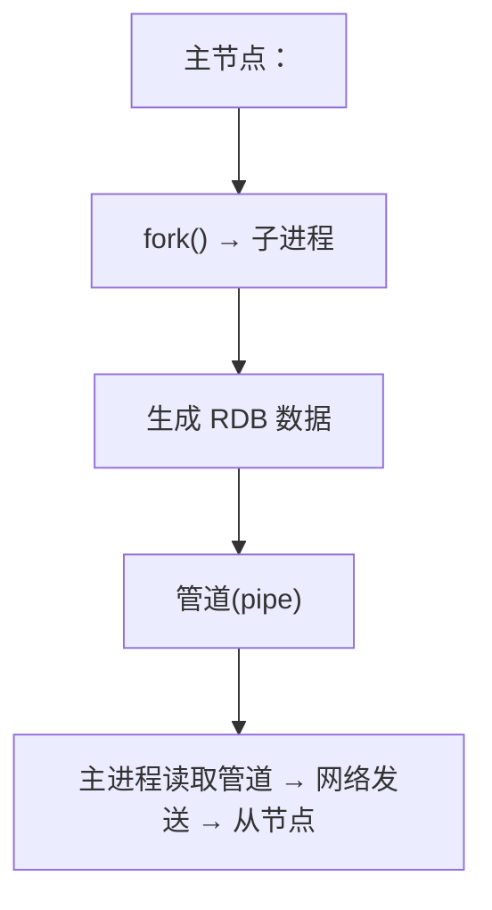
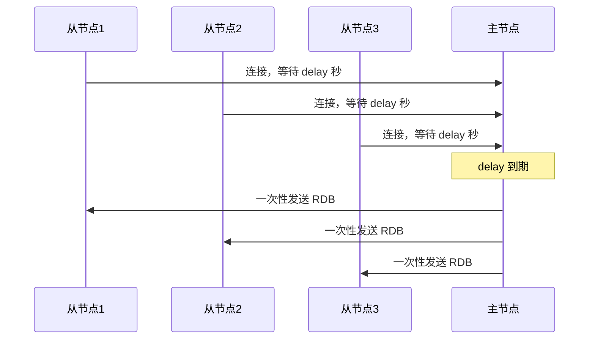
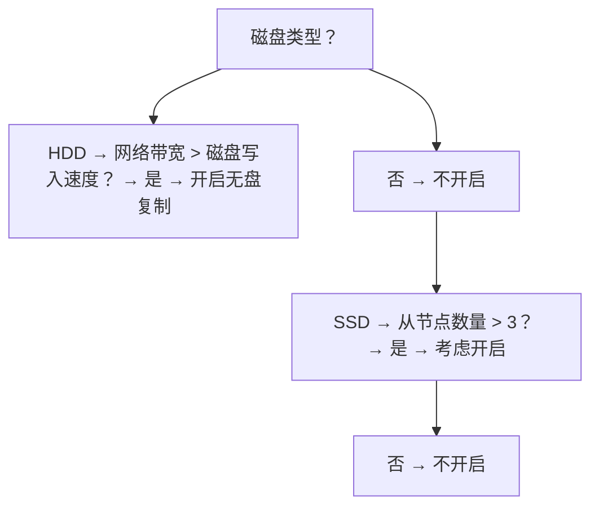

## 1. 无盘复制概述

无盘复制（Diskless Replication）是 Redis 2.8.18 引入的特性，允许在主从复制过程中**跳过磁盘 I/O**，直接通过网络将 RDB 数据从主节点发送到从节点，无需在主节点磁盘上生成临时 RDB 文件。

**传统复制流程**：

```
主节点内存 → RDB文件(磁盘) → 读取磁盘 → 网络发送 → 从节点
```

**无盘复制流程**：

```
主节点内存 → 网络直接发送 → 从节点
```

## 2. 传统复制的磁盘瓶颈

### 2.1 问题分析

传统主从复制的 RDB 生成过程涉及两次磁盘 I/O：

1. **写入磁盘**：子进程将 RDB 数据写入临时文件
2. **读取磁盘**：主进程读取临时文件发送给从节点

当数据集较大时，磁盘 I/O 成为瓶颈：

$$\text{复制总耗时} = \text{fork 时间} + \frac{\text{数据集大小}}{\text{磁盘写入速度}} + \frac{\text{数据集大小}}{\text{磁盘读取速度}} + \frac{\text{数据集大小}}{\text{网络带宽}}$$

### 2.2 磁盘瓶颈场景

| 场景           | 磁盘类型 | 数据集大小 | 磁盘写入耗时 | 网络传输耗时  |
| -------------- | -------- | ---------- | ------------ | ------------- |
| HDD + 大数据集 | HDD      | 50 GB      | ~500s        | ~400s (1Gbps) |
| SSD + 大数据集 | SSD      | 50 GB      | ~50s         | ~400s (1Gbps) |
| SSD + 小数据集 | SSD      | 5 GB       | ~5s          | ~40s (1Gbps)  |

对于 HDD 环境，磁盘 I/O 可能成为复制的主要瓶颈。

### 2.3 临时文件对磁盘的影响

- 临时 RDB 文件可能占用大量磁盘空间
- 频繁的全量同步会加速磁盘磨损（SSD）
- 磁盘空间不足会导致复制失败

## 3. 无盘复制工作原理

### 3.1 核心机制

无盘复制通过管道（pipe）将 RDB 数据直接从子进程传输到网络套接字：



### 3.2 详细流程

1. 主节点收到从节点的 `PSYNC` 请求
2. 主节点判断使用无盘复制
3. 主节点 `fork()` 子进程
4. 子进程将 RDB 数据写入管道（而非磁盘文件）
5. 主进程从管道读取数据，通过套接字发送给从节点
6. 从节点接收 RDB 数据，写入临时文件
7. 从节点加载临时 RDB 文件完成同步

### 3.3 管道缓冲区

管道有容量限制，当子进程写入速度超过网络发送速度时，管道缓冲区满，子进程被阻塞：

```c
// 管道缓冲区大小
#define PIPE_BUF 65536  // 64KB (Linux 默认)

// 实际 Redis 使用更大的管道
// 通过 fcntl(fd, F_SETPIPE_SZ, size) 调整
```

Redis 会根据网络带宽动态调整管道大小，避免子进程频繁阻塞。

## 4. 配置与启用

### 4.1 核心配置

```redis
# 开启无盘复制
repl-diskless-sync yes

# 无盘复制延迟启动时间（秒）
repl-diskless-sync-delay 5

# 无盘复制加载模式（Redis 7.0+）
repl-diskless-load on-empty-db
```

### 4.2 repl-diskless-sync-delay

延迟启动是为了等待更多从节点同时连接，实现**并行复制**：



- 设为 `0`：第一个从节点请求时立即开始复制
- 设为 `5`（默认）：等待 5 秒，收集更多从节点
- 设为较大值：适合大量从节点同时同步的场景

### 4.3 repl-diskless-load

Redis 7.0+ 支持从节点无盘加载，直接从网络套接字解析 RDB 数据到内存：

```redis
# 配置选项
repl-diskless-load disabled    # 禁用（默认，先写磁盘再加载）
repl-diskless-load on-empty-db # 仅当从节点数据库为空时使用
repl-diskless-load swapdb      # 使用交换数据库（保留旧数据直到加载完成）
repl-diskless-load flush-before-load  # 直接清空后加载（不推荐）
```

**swapdb 模式**：

```
1. 从节点创建备份数据库（swapdb）
2. 直接从网络加载 RDB 到主数据库
3. 加载成功后，删除备份数据库
4. 加载失败时，从备份数据库恢复
```

## 5. 无盘复制的适用场景

### 5.1 适合无盘复制

| 场景             | 原因                                  |
| ---------------- | ------------------------------------- |
| HDD 磁盘         | 磁盘 I/O 是瓶颈，无盘复制大幅提升速度 |
| 临时磁盘         | 避免写入临时文件                      |
| 高频全量同步     | 减少磁盘磨损                          |
| 磁盘空间有限     | 不需要额外空间存储 RDB 文件           |
| 多从节点同时同步 | 并行发送效率更高                      |

### 5.2 不适合无盘复制

| 场景           | 原因                         |
| -------------- | ---------------------------- |
| SSD 磁盘       | 磁盘 I/O 不是瓶颈            |
| 网络带宽受限   | 网络成为瓶颈，无盘复制无优势 |
| 单从节点       | 无并行复制收益               |
| 需要持久化 RDB | 无盘复制不生成磁盘文件       |

### 5.3 决策流程



## 6. 性能对比

### 6.1 复制耗时对比

假设数据集 20GB，HDD 写入速度 100MB/s，网络带宽 1Gbps：

| 方案     | 磁盘写入 | 磁盘读取 | 网络传输 | 总耗时   |
| -------- | -------- | -------- | -------- | -------- |
| 传统复制 | 200s     | 200s     | 160s     | ~560s    |
| 无盘复制 | 0s       | 0s       | 160s     | ~160s    |
| 提升比例 | -        | -        | -        | **3.5x** |

### 6.2 内存开销

无盘复制在复制期间的内存开销：

$$\text{额外内存} = \text{fork 开销} + \text{管道缓冲区} + \text{COW 开销}$$

与传统复制相比，无盘复制的内存开销基本相同，因为两者都需要 `fork()` 和 COW 机制。

## 7. 无盘复制的注意事项

### 7.1 网络中断

- 无盘复制过程中网络中断，无法断点续传
- 必须重新发起全量同步
- 传统复制中断后同样无法断点续传，也要重新同步——差异只在磁盘：传统模式留下（或复用）已生成的 RDB 文件，无盘模式连这份磁盘缓存都没有，每次都要重新生成与发送

### 7.2 多从节点同步

- 无盘复制支持同时向多个从节点发送 RDB
- 但如果从节点在不同时间请求，后到的从节点需要等待下一次全量同步
- `repl-diskless-sync-delay` 可以缓解此问题

### 7.3 与 AOF 的交互

- 无盘复制不影响 AOF 持久化
- AOF 仍然正常写入磁盘
- 无盘复制仅跳过复制过程中的 RDB 磁盘写入

### 7.4 监控指标

```redis
# 查看复制状态
INFO Replication

# 关键指标
# repl_diskless_sync: 是否开启无盘复制
# repl_diskless_sync_delay: 延迟时间
# connected_slaves: 已连接从节点数
```

## 教学自检（先遮住代码自己写，再对照）

遮码自检法：先只读题干，自己写/自己答，再展开参考答案对照。

1. 概念自问：无盘复制省掉的是哪两次磁盘 I/O？「慢盘快网」为什么是它的甜点区？

参考答案（先自己答，再对照）：省掉「子进程把 RDB 写盘」与「主进程读盘再发网」两步——fork 后子进程直接把快照写进管道，主进程读管道就发网络。复制总耗时里的「数据集/磁盘写速 + 数据集/磁盘读速」两项归零，只剩网络传输；所以磁盘越慢（HDD、网络盘）、带宽越富余，收益越大。快 SSD 上这两项本来就小，收益有限。

2. 动手自问：`repl-diskless-sync-delay` 设 5 的默认值是在等什么？把它设成 0 换来什么、丢掉什么？

参考答案（先自己答，再对照）：等更多从库在同一窗口内到达，一次全量同步并行喂给多个从库——磁盘less 模式一旦开始传输，后到的从库只能排队等下一轮。设 0 表示第一个从库到达就立刻开始：全量启动最快，但「多个从库同时上线」（如机房恢复、批量新实例）会退化成一轮轮串行传输；保持默认 5 秒（7.0 起同步方式默认就是无盘，delay 默认仍为 5）正是给并发到达留的聚合窗。

3. 判断题：从库开启 repl-diskless-load 后，加载数据期间仍能对外提供服务。

参考答案（先自己答，再对照）：只有 swapdb 模式勉强成立——它把旧数据留在内存、新数据从网络直接解析进另一份空间，复制期间继续用旧数据应答；on-empty-db（更安全，避免新旧数据同驻内存）只在从库为空时走无盘加载，disabled 则先落盘再加载。三个取值是「内存换可用性」的三档，默认 disabled。

4. 概念自问：无盘复制不影响 AOF 持久化的原因是什么？

参考答案（先自己答，再对照）：无盘复制只替换「全量同步时 RDB 的产生方式」（网络直发代替落盘），AOF 是另一条独立链路——写命令照常追加 aof_buf 并按 appendfsync 刷盘。两者共享的只有 fork 带来的 COW 内存放大问题，所以「开了无盘复制就不用管持久化磁盘」是错误推论。

5. 动手自问：从节点数量与磁盘类型这两个变量，怎么组合出一个「开/不开无盘」的决策式？

参考答案（先自己答，再对照）：磁盘写入速度与网络带宽先比一轮：网络带宽 > 磁盘写速（HDD、云盘典型）→ 开；SSD 且从库少（单从库无并行收益）→ 不开。从库数量是第二判断：≥3 个从库会同时拉全量时，即使 SSD 也值得开（并行发送省 fork 轮次）。一句话：瓶颈在盘就开，瓶颈不在盘就从库数量说了算。
