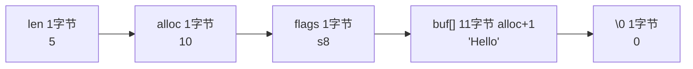

---

## 1. SDS 数据结构

### 1.1 结构定义

Redis 没有直接使用 C 语言的字符串，而是自定义了 SDS（Simple Dynamic String）：

```c
// Redis 5.0+ sdshdr 结构（按长度分5种）
struct __attribute__((packed)) sdshdr8 {
    uint8_t  len;         // 已使用长度（不含\0）
    uint8_t  alloc;       // 总分配容量（不含\0和header）
    unsigned char flags;   // 类型标识：SDS_TYPE_8
    char     buf[];       // 实际数据（柔性数组）
};

struct __attribute__((packed)) sdshdr16 {
    uint16_t len;
    uint16_t alloc;
    unsigned char flags;
    char buf[];
};

// 同理 sdshdr32, sdshdr64
```

### 1.2 SDS 与 C 字符串对比

| 特性        | C 字符串         | SDS                   |
| ----------- | ---------------- | --------------------- |
| 获取长度    | $O(n)$ 遍历      | $O(1)$ 直接读取 len   |
| 缓冲区溢出  | 不检查，可能溢出 | 自动扩容，杜绝溢出    |
| 修改长度    | 每次重新分配     | 预分配 + 惰性释放     |
| 二进制安全  | 依赖 `\0` 结尾   | 用 len 判断结束       |
| 兼容 C 函数 | 是               | 是（buf 末尾有 `\0`） |

### 1.3 内存布局



len = 5：已使用 5 字节；alloc = 10：总容量 10 字节（不含 header 和 \0）；剩余空间 = alloc - len = 5 字节

## 2. 预分配策略

### 2.1 空间预分配规则

当 SDS 需要扩容时，Redis 不仅分配所需空间，还额外预分配：

```
规则1: 修改后 len < 1MB
  预分配: alloc = len（翻倍分配）
  示例: len=10 → 修改后 len=15 → alloc=30

规则2: 修改后 len >= 1MB
  预分配: alloc = len + 1MB（固定追加1MB）
  示例: len=3MB → 修改后 len=5MB → alloc=6MB
```

### 2.2 预分配效果

```
连续追加操作 "hello" → "hello world" → "hello world redis"

无预分配: 3次 realloc
  malloc(5) → realloc(11) → realloc(17)

有预分配: 1次 realloc
  malloc(5) → realloc(22)  ← 第二次追加无需重新分配
  len=17, alloc=22, 剩余5字节
```

### 2.3 源码分析

```c
// sds.c - sdsMakeRoomFor
sds sdsMakeRoomFor(sds s, size_t addlen) {
    size_t free = sdsavail(s);  // 剩余空间
    if (free >= addlen) return s;  // 空间足够，直接返回

    size_t len = sdslen(s);
    size_t newlen = len + addlen;

    // 预分配策略
    if (newlen < SDS_MAX_PREALLOC)  // SDS_MAX_PREALLOC = 1MB
        newlen *= 2;               // 翻倍
    else
        newlen += SDS_MAX_PREALLOC; // +1MB

    return sds_realloc(s, newlen);
}
```

## 3. 惰性删除

### 3.1 空间释放策略

当 SDS 缩短字符串时，不立即释放多余内存，而是把剩余容量记在 `alloc` 里（当前 `alloc - len` 就是可复用的空间；早期版本的 SDS 才有独立 `free` 字段，5.0 起的五类型结构用 alloc 隐式表达）：

```c
// sds.c - sdstrim
sds sdstrim(sds s, const char *cset) {
    // ... 删除首尾匹配字符
    // 不调用 realloc 释放内存
    // 仅更新 len 和 free
    sdssetlen(s, newlen);  // 更新 len
    return s;
}
```

### 3.2 惰性删除示例

```
SDS: "hello world" (len=11, alloc=11)

执行: sdstrim(s, "ld")  → 删除首尾的 'l' 和 'd'
结果: "hello wor" (len=9, alloc=11)
      剩余空间 = 2 字节，未释放

执行: sdsRemoveFreeSpace(s)  → 显式释放
结果: "hello wor" (len=9, alloc=9)
```

### 3.3 何时真正释放

```c
// 1. 显式调用 sdsRemoveFreeSpace
// 2. 键被删除时，整个 SDS 被释放
// 3. Redis 内存淘汰时
// 4. 使用 SDS 的对象被重写时
```

## 4. 二进制安全

### 4.1 C 字符串的问题

C 字符串以 `\0` 表示结尾，无法存储包含 `\0` 的二进制数据：

```c
char *str = "hello\0world";  // C认为长度是5，丢失"world"
printf("%zu", strlen(str));   // 输出: 5
```

### 4.2 SDS 的二进制安全

SDS 使用 `len` 字段判断长度，而非 `\0`：

```c
// SDS 可以存储任意二进制数据
sds s = sdsnewlen("hello\0world", 11);  // len=11
printf("%zu", sdslen(s));  // 输出: 11

// buf 中: 'h','e','l','l','o','\0','w','o','r','l','d','\0'
//          ↑ 数据中的\0           ↑ 结尾的\0（兼容C函数）
```

### 4.3 兼容 C 字符串函数

SDS 的 `buf` 末尾始终保留 `\0`，可以直接使用 C 字符串函数：

```c
sds s = sdsnew("hello");
printf("%s", s);  // 直接传给 printf，兼容 C 字符串
strcmp(s, "hello");  // 可以使用 strcmp
```

## 5. SDS 类型选择

### 5.1 五种 SDS 类型

| 类型        | len/alloc 类型 | 最大长度 | header 大小 |
| ----------- | -------------- | -------- | ----------- |
| SDS_TYPE_5  | 无（3位存储）  | 31 字节  | 1 字节      |
| SDS_TYPE_8  | uint8_t        | 255 字节 | 3 字节      |
| SDS_TYPE_16 | uint16_t       | 64 KB    | 5 字节      |
| SDS_TYPE_32 | uint32_t       | 4 GB     | 9 字节      |
| SDS_TYPE_64 | uint64_t       | 16 EB    | 17 字节     |

### 5.2 类型选择逻辑

```c
// sds.c - sdsReqType
static inline char sdsReqType(size_t string_size) {
    if (string_size < 1 << 5)  return SDS_TYPE_5;
    if (string_size < 1 << 8)  return SDS_TYPE_8;
    if (string_size < 1 << 16) return SDS_TYPE_16;
    if (string_size < 1ll << 32) return SDS_TYPE_32;
    return SDS_TYPE_64;
}
```

短字符串使用小 header，节省内存。例如存储 "key"（3字节），使用 SDS_TYPE_8，header 仅 3 字节。

## 教学自检（先遮住代码自己写，再对照）

遮码自检法：先只读题干，自己写/自己答，再展开参考答案对照。

1. 概念自问：SDS 相比 C 字符串解决了哪四个痛点？「二进制安全」具体指什么？

参考答案（先自己答，再对照）：四个痛点：O(1) 取长度（len 字段，C 要遍历到 \0）；杜绝缓冲区溢出（写入前按 alloc 检查扩容）；修改减少内存重分配（预分配 + 惰性释放）；可存任意字节。二进制安全指「内容里出现 \0 不截断」——长度由 len 决定而非结尾符，所以图片字节、序列化对象都能直接存；同时 buf 末尾仍补一个 \0 兼容 C 函数。

2. 动手自问：为什么 String 值的 embstr 与 raw 编码分界是 44 字节？这个数字怎么推出来的？

参考答案（先自己答，再对照）：jemalloc 的分配单元是 64 字节：redisObject 头 16 字节 + sdshdr8 头 3 字节（len+alloc+flags）+ 内容 44 字节 + 结尾符 1 字节 = 64，恰好一块内存放下，读时一次 cache line 命中。超过 44 字节后拆成 redisObject 与 SDS 两块独立分配（raw），多一次指针跳转但可就地修改。推法比数字本身重要——encoding 阈值都是内存分配器的产物。

3. 判断题：对 embstr 编码的键执行 APPEND 后，长度若缩回 44 字节以内，编码会转回 embstr。

参考答案（先自己答，再对照）：错。embstr 是只读设计，任何写命令（APPEND、SETRANGE 等预分配路径）都会把它转成 raw，且转换是**单向**的——即使 APPEND 后长度回落，编码仍是 raw。频繁追加的值从第一个字节起就按 raw 对待，不必纠结。

4. 概念自问：预分配的「翻倍」与「+1MB」两档各在什么时候生效？大值场景为什么用 +1MB？

参考答案（先自己答，再对照）：扩容后新长度小于 SDS_MAX_PREALLOC（1MB）时翻倍分配，给连续追加留倍增空间；达到或超过 1MB 后只追加固定 1MB——翻倍在 MB 级会把内存峰值放大一倍（3MB 变 6MB 的瞬时开销），固定增量把浪费压到常数。策略本质：小字符串用倍增摊平追加成本，大字符串用常数增量控制内存放大。

5. 动手自问：五种 SDS 类型（5/8/16/32/64）按什么选型？header 各占几字节？

参考答案（先自己答，再对照）：按字符串**长度上限**选最小够用的类型：TYPE_5（<32 字节，header 1 字节，只有 flags 没有独立 len/alloc）；TYPE_8（<256 字节，header 3 字节）；TYPE_16（<64KB，header 5 字节）；TYPE_32（<4GB，header 9 字节）；TYPE_64（更高，header 17 字节）。header 沿 len/alloc 字段宽度翻倍而增长——这就是「短字符串省内存」的结构基础。

## 结构定义

**结构定义写法：sdshdr8 头部**
`struct __attribute__((packed)) sdshdr8 { uint8_t len; uint8_t alloc; unsigned char flags; char buf[]; }`
```c
// 定义 sdshdr8 类型头部（用于短字符串）
struct __attribute__((packed)) sdshdr8 {
    uint8_t  len;         // 已使用长度（不含\0）
    uint8_t  alloc;       // 总分配容量（不含\0和header）
    unsigned char flags;   // 类型标识：SDS_TYPE_8
    char     buf[];       // 实际数据（柔性数组）
};
```

**结构定义写法：sdshdr16 头部**
`struct __attribute__((packed)) sdshdr16 { uint16_t len; uint16_t alloc; unsigned char flags; char buf[]; }`
```c
// 定义 sdshdr16 类型头部（用于中等长度字符串）
struct __attribute__((packed)) sdshdr16 {
    uint16_t len;
    uint16_t alloc;
    unsigned char flags;
    char buf[];
};
```

**结构定义写法：sdshdr32 头部**
`struct __attribute__((packed)) sdshdr32 { uint32_t len; uint32_t alloc; unsigned char flags; char buf[]; }`
```c
// 定义 sdshdr32 类型头部（用于较长字符串）
struct __attribute__((packed)) sdshdr32 {
    uint32_t len;
    uint32_t alloc;
    unsigned char flags;
    char buf[];
};
```

**结构定义写法：sdshdr64 头部**
`struct __attribute__((packed)) sdshdr64 { uint64_t len; uint64_t alloc; unsigned char flags; char buf[]; }`
```c
// 定义 sdshdr64 类型头部（用于超长字符串）
struct __attribute__((packed)) sdshdr64 {
    uint64_t len;
    uint64_t alloc;
    unsigned char flags;
    char buf[];
};
```

---

## 内存布局

**内存布局写法：sdshdr8 字节排列**
`[len][alloc][flags][buf[]][\0]`
```c
// sdshdr8 内存布局示例
// len = 5:   已使用5字节
// alloc = 10: 总容量10字节（不含header和\0）
// 剩余空间 = alloc - len = 5字节
```

---

## 预分配策略

**预分配规则写法：修改后 len 小于 1MB**
`if (newlen < SDS_MAX_PREALLOC) newlen *= 2;`
```c
// 规则1: 修改后 len < 1MB 时翻倍分配
// 示例: len=10 → 修改后 len=15 → alloc=30
```

**预分配规则写法：修改后 len 大于等于 1MB**
`else newlen += SDS_MAX_PREALLOC;`
```c
// 规则2: 修改后 len >= 1MB 时固定追加1MB
// 示例: len=3MB → 修改后 len=5MB → alloc=6MB
```

**函数源码写法：sdsMakeRoomFor 扩容核心函数**
`sds sdsMakeRoomFor(sds s, size_t addlen)`
```c
// sds.c - sdsMakeRoomFor 扩容核心函数
sds sdsMakeRoomFor(sds s, size_t addlen) {
    size_t free = sdsavail(s);  // 剩余空间
    if (free >= addlen) return s;  // 空间足够，直接返回

    size_t len = sdslen(s);
    size_t newlen = len + addlen;

    // 预分配策略
    if (newlen < SDS_MAX_PREALLOC)  // SDS_MAX_PREALLOC = 1MB
        newlen *= 2;               // 翻倍
    else
        newlen += SDS_MAX_PREALLOC; // +1MB

    return sds_realloc(s, newlen);
}
```

---

## 惰性删除

**函数源码写法：sdstrim 缩短字符串不释放内存**
`sds sdstrim(sds s, const char *cset)`
```c
// sds.c - sdstrim 删除首尾匹配字符但不调用 realloc
sds sdstrim(sds s, const char *cset) {
    // 删除首尾匹配字符
    // 不调用 realloc 释放内存
    // 仅更新 len 和 free
    sdssetlen(s, newlen);  // 更新 len
    return s;
}
```

**惰性删除示例写法：仅更新 len 不释放内存**
`sdstrim(s, "ld")`
```c
// SDS: "hello world" (len=11, alloc=11)
// 执行: sdstrim(s, "ld")  → 删除首尾的 'l' 和 'd'
// 结果: "hello wor" (len=9, alloc=11)
//       剩余空间 = 2 字节，未释放
```

**显式释放写法：sdsRemoveFreeSpace 回收内存**
`sdsRemoveFreeSpace(s)`
```c
// 显式调用 sdsRemoveFreeSpace 释放剩余空间
// 结果: "hello wor" (len=9, alloc=9)
```

**真正释放时机写法：触发内存回收的条件**
`sdsRemoveFreeSpace(s) | 键被删除 | 内存淘汰 | 对象重写`
```c
// 1. 显式调用 sdsRemoveFreeSpace
// 2. 键被删除时，整个 SDS 被释放
// 3. Redis 内存淘汰时
// 4. 使用 SDS 的对象被重写时
```

---

## 二进制安全

**函数源码写法：sdsnewlen 存储包含 \0 的二进制数据**
`sds sdsnewlen(const void *init, size_t initlen)`
```c
// SDS 可以存储任意二进制数据
sds s = sdsnewlen("hello\0world", 11);  // len=11
printf("%zu", sdslen(s));  // 输出: 11
```

**兼容 C 字符串函数写法：buf 末尾保留 \0**
`sdsnew("hello")`
```c
// SDS 的 buf 末尾始终保留 \0，可以直接使用 C 字符串函数
sds s = sdsnew("hello");
printf("%s", s);  // 直接传给 printf，兼容 C 字符串
strcmp(s, "hello");  // 可以使用 strcmp
```

---

## 类型选择

**函数源码写法：sdsReqType 根据字符串长度选择 SDS 类型**
`static inline char sdsReqType(size_t string_size)`
```c
// sds.c - sdsReqType 根据字符串长度选择 SDS 类型
static inline char sdsReqType(size_t string_size) {
    if (string_size < 1 << 5)  return SDS_TYPE_5;
    if (string_size < 1 << 8)  return SDS_TYPE_8;
    if (string_size < 1 << 16) return SDS_TYPE_16;
    if (string_size < 1ll << 32) return SDS_TYPE_32;
    return SDS_TYPE_64;
}
```
