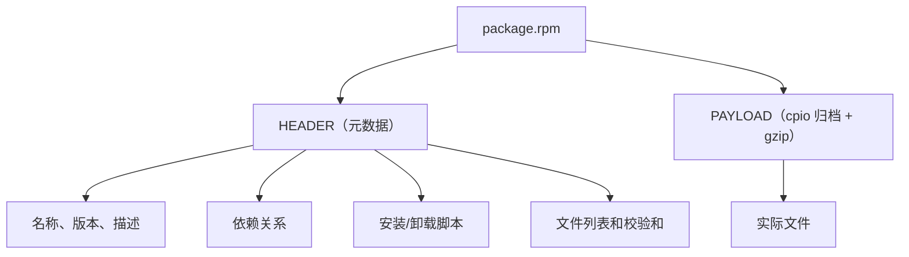
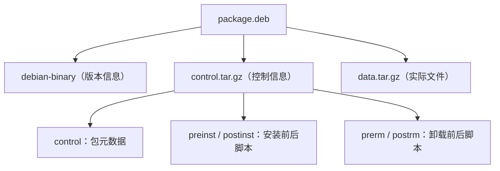
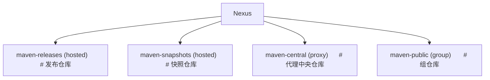

## 为什么需要包管理与仓库

拿到一个软件，为什么不能"下载一个文件运行就完了"？三个问题逼出了包管理这套体系：

- **依赖问题**：软件依赖几十个库，每个库又依赖别的库——手工装等于手工解一张依赖图，升级一个包可能弄坏另一个。包管理器把依赖图交给机器解；
- **一致性问题**：十台服务器要装"完全相同"的一套东西，手工装必然漂移。包是原子单元：装、升、卸、查都走同一条路，机器上"装了什么"永远可查询（`rpm -qa` / `dpkg -l`）；
- **信任问题**：从网上下载的二进制可能被篡改。包自带 GPG 签名与校验和，仓库是你信任的源——`gpgcheck=1` 拦住的就是"半路被换过的包"。

而**仓库（repository）**回答的是"从哪拿"：官方源、自建源（内网加速与合规）、企业制品库（Artifactory/Nexus，把 RPM/DEB/Maven/Docker 镜像统一管起来，供 CI/CD 产出与消费）。心智模型一句话：**包是原子单元，仓库是分发渠道，包管理器是依赖求解器**。

本篇命令偏多，但别背命令——先记住"每个命令回答哪个问题"：装/卸（变更系统状态）、查询（这台机器上有什么）、仓库配置（从哪拿、信不信）。

## 1. RPM 包管理

### 1.1 RPM 基础

RPM（Red Hat Package Manager）是 Red Hat 系列的包管理格式。

```bash
# 安装
rpm -ivh package.rpm      # 安装并显示进度
rpm -Uvh package.rpm      # 升级安装
rpm -Fvh package.rpm      # 仅升级（已安装才升级）

# 查询
rpm -qa                   # 列出所有已安装包
rpm -qi package           # 查看包信息
rpm -ql package           # 列出包文件
rpm -qf /path/file        # 查询文件所属包
rpm -qR package           # 查看依赖

# 卸载
rpm -e package            # 卸载包
rpm -e --nodeps package   # 忽略依赖卸载

# 验证
rpm -V package            # 验证包完整性
rpm --import RPM-GPG-KEY  # 导入GPG密钥
```

### 1.2 RPM 包结构

```
package-name-version-release.architecture.rpm
例: nginx-1.24.0-1.el9.x86_64.rpm

名称: nginx
版本: 1.24.0
发行号: 1.el9
架构: x86_64
```

RPM 包内部结构（一个 .rpm = HEADER 元数据 + PAYLOAD 文件负载两部分）：



这个结构解释了 rpm 命令为什么快：`-q` 查询只读 HEADER 不解压 PAYLOAD，所以"查这台机器装了什么"是元数据操作，与文件大小无关。

### 1.3 SPEC 文件

构建 RPM 包的核心配置文件：

```spec
Name:           myapp
Version:        1.0.0
Release:        1%{?dist}
Summary:        My Application

License:        MIT
URL:            https://example.com
Source0:        %{name}-%{version}.tar.gz

BuildRequires:  gcc, make
Requires:       openssl >= 1.1

%description
My application description.

%prep
%setup -q

%build
%configure
make %{?_smp_mflags}

%install
make install DESTDIR=%{buildroot}

%files
%doc README.md
%license LICENSE
%{_bindir}/myapp
%{_mandir}/man1/myapp.1*

%changelog
* Sat Jun 14 2026 fanquanpp <fanquanpp@example.com> - 1.0.0-1
- Initial package
```

## 2. DEB 包管理

### 2.1 dpkg 基础

```bash
# 安装
dpkg -i package.deb       # 安装
dpkg -r package           # 卸载（保留配置）
dpkg -P package           # 完全卸载

# 查询
dpkg -l                   # 列出所有已安装包
dpkg -l package           # 查看包状态
dpkg -L package           # 列出包文件
dpkg -S /path/file        # 查询文件所属包
dpkg -s package           # 查看包详细信息
```

### 2.2 DEB 包结构



**control 文件**：

```
Package: myapp
Version: 1.0.0
Architecture: amd64
Maintainer: fanquanpp <fanquanpp@example.com>
Description: My Application
 My application description.
Depends: libc6 (>= 2.31), libssl3
```

## 3. YUM/DNF 仓库

rpm 只管"手里这个包"，不解决依赖——依赖求解是 DNF 的活。现代 Red Hat 系（EL 9+）一律用 `dnf`（yum 是它的兼容别名），日常心智：install/remove 变更，search/info 查询，仓库配置决定它能看见什么。

### 3.1 YUM/DNF 基础

```bash
# 安装
dnf install package
dnf install package-1.0.0   # 指定版本

# 更新
dnf update                  # 更新所有
dnf update package          # 更新指定包

# 查询
dnf search keyword          # 搜索包
dnf info package            # 查看包信息
dnf list installed          # 列出已安装包
dnf list available          # 列出可用包

# 依赖
dnf deplist package         # 查看依赖
dnf repoquery --requires package  # 查询依赖

# 清理
dnf clean all               # 清理缓存
dnf autoremove              # 删除不需要的依赖
```

### 3.2 配置仓库

```ini
# /etc/yum.repos.d/myrepo.repo
[myrepo]
name=My Custom Repository
baseurl=https://repo.example.com/centos/$releasever/$basearch/
enabled=1
gpgcheck=1
gpgkey=https://repo.example.com/RPM-GPG-KEY
priority=1
```

### 3.3 创建本地仓库

```bash
# 安装工具（EL 9+ 的实现名是 createrepo_c）
dnf install createrepo_c

# 创建仓库
mkdir -p /repo/rpms
cp *.rpm /repo/rpms/
createrepo_c /repo/rpms/

# 更新仓库
createrepo_c --update /repo/rpms/
```

## 4. APT 仓库

Debian 系的分层与 Red Hat 系一一对应：dpkg 管"手里这个包"（不管依赖），apt 负责依赖求解与仓库。`apt update` 与 `apt upgrade` 的区别是高频困惑：前者只刷新"有什么可装"的索引（不装任何东西），后者才真正变更系统——所以"改了 sources.list 生效"靠 update。

### 4.1 APT 基础

```bash
# 安装
apt install package
apt install package=1.0.0    # 指定版本

# 更新
apt update                   # 更新索引
apt upgrade                  # 升级所有
apt full-upgrade             # 完整升级（可删除包）

# 查询
apt search keyword
apt show package
apt list --installed
apt depends package

# 清理
apt autoremove
apt clean
```

### 4.2 配置源

```bash
# /etc/apt/sources.list（传统一行式格式）
deb https://mirrors.aliyun.com/ubuntu/ noble main restricted
deb https://mirrors.aliyun.com/ubuntu/ noble-updates main restricted
deb https://mirrors.aliyun.com/ubuntu/ noble-security main restricted
```

格式：`deb URL distribution component`（示例用 24.04 LTS 的代号 noble）。

注意：Ubuntu 24.04 起默认改用 deb822 格式（`/etc/apt/sources.list.d/ubuntu.sources`，字段化的多行格式），两种格式并存可用，但同一发行版别在两处重复配置。

### 4.3 创建 APT 仓库

```bash
# 安装工具
apt install dpkg-dev

# 创建仓库
mkdir -p /repo/debs
cp *.deb /repo/debs/
cd /repo
dpkg-scanpackages debs / | gzip > debs/Packages.gz
```

## 5. 制品仓库管理

系统包管理之外，还有一层更贴近 DevOps 日常的仓库：**制品仓库**。区别在"谁在消费"——系统包仓库面向服务器运维，制品仓库面向 CI/CD：流水线构建出 jar/war/镜像/Helm chart，推进 Local 仓库；下游部署从 Virtual 仓库拉。Local/Remote/Virtual 三分是 Artifactory 的核心心智模型，Nexus 里对应 hosted/proxy/group，概念同构。

### 5.1 Artifactory

JFrog Artifactory 是企业级制品仓库：

| 仓库类型 | 说明                   |
| -------- | ---------------------- |
| Local    | 本地仓库，存储内部制品 |
| Remote   | 远程仓库，代理外部仓库 |
| Virtual  | 虚拟仓库，聚合多个仓库 |

**支持的包格式**：Maven、npm、Docker、PyPI、RPM、DEB、Go、Helm 等。

### 5.2 Nexus

Sonatype Nexus 是另一个流行的制品仓库：



### 5.3 制品版本管理

**语义化版本（SemVer）**：

$$\text{MAJOR.MINOR.PATCH}$$

- MAJOR：不兼容的 API 变更
- MINOR：向后兼容的功能新增
- PATCH：向后兼容的问题修复

**版本范围**：

```
>=1.0.0 <2.0.0    # 兼容1.x
^1.2.3            # >=1.2.3 <2.0.0
~1.2.3            # >=1.2.3 <1.3.0
1.*               # 1.x任意版本
```

## 6. 安全与签名

### 6.1 GPG 签名

```bash
# 生成密钥对
gpg --full-generate-key

# 签名 RPM
rpm --addsign package.rpm

# 验证签名
rpm --checksig package.rpm

# 签名 DEB
dpkg-sig -s builder -k KEYID package.deb
```

### 6.2 仓库安全

- 启用 GPG 检查（gpgcheck=1）
- 使用 HTTPS 传输
- 定期轮换签名密钥
- 实施访问控制策略

## 自检

- 遮住开头，用三句话回答为什么需要包管理：依赖、一致性、信任各对应哪条命令或配置？（提示：依赖求解、`rpm -qa` 可查询、`gpgcheck=1`）
- 遮住 RPM 结构图，画出 .rpm 两大组成与 HEADER 里的四类元数据；再解释 `rpm -q` 为什么不用解压 PAYLOAD。
- 不看正文说出两对区别：`apt update` 与 `apt upgrade`；dpkg 与 apt、rpm 与 dnf 的分工边界各在哪一层？
- Artifactory 的 Local/Remote/Virtual 各解决什么问题？遮住表格，用自己的话把"CI 产出推哪、部署从哪拉、外部依赖从哪省流量"三个场景对应到三种仓库类型。
- 版本范围口算：`^1.2.3` 与 `~1.2.3` 各允许装到哪个上限版本？说不出 MAJOR/MINOR/PATCH 各自的兼容性承诺就回第 5.3 节。
