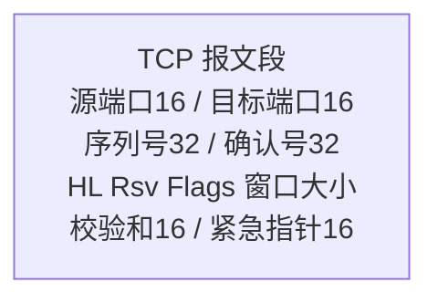
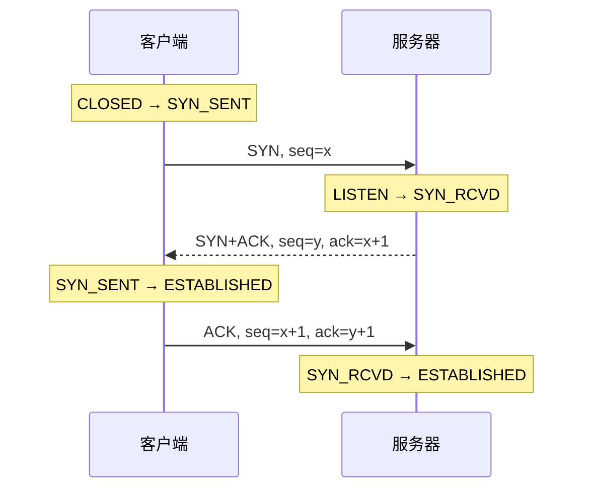
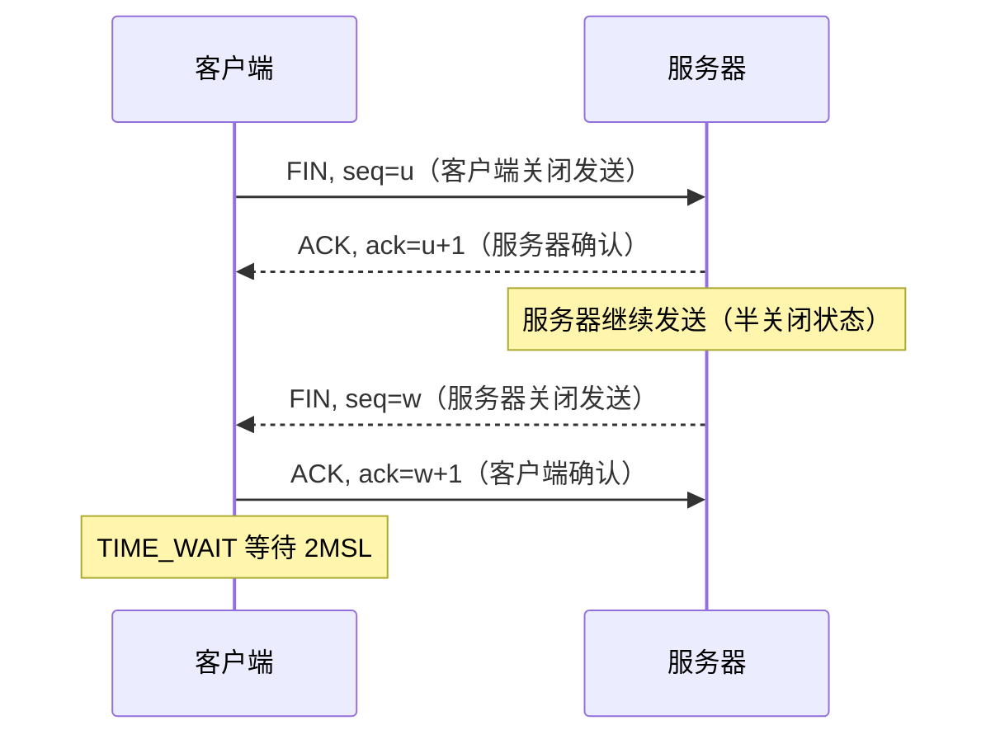
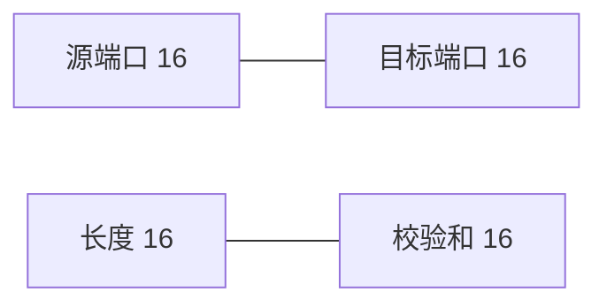
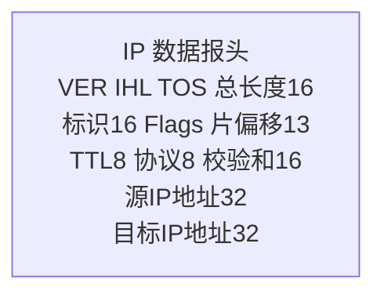

## 前置知识

建议先阅读以下内容再进入本文：

- 网络基础与协议

## 1. OSI 七层模型详解

### 1.1 各层功能

| 层级 | 名称       | 功能         | PDU         | 设备   |
| ---- | ---------- | ------------ | ----------- | ------ |
| 7    | 应用层     | 网络服务接口 | 数据        | 网关   |
| 6    | 表示层     | 数据格式转换 | 数据        | -      |
| 5    | 会话层     | 会话管理     | 数据        | -      |
| 4    | 传输层     | 端到端通信   | 段(Segment) | 防火墙 |
| 3    | 网络层     | 路由寻址     | 包(Packet)  | 路由器 |
| 2    | 数据链路层 | 帧传输       | 帧(Frame)   | 交换机 |
| 1    | 物理层     | 比特传输     | 比特(Bit)   | 集线器 |

### 1.2 数据封装过程

```
应用数据
    ↓ + 应用层头
表示层PDU
    ↓ + 表示层头
会话层PDU
    ↓ + TCP/UDP头
传输层段(Segment)
    ↓ + IP头
网络层包(Packet)
    ↓ + 帧头+帧尾
数据链路层帧(Frame)
    ↓
物理层比特流(Bit)
```

## 2. TCP/IP 模型

### 2.1 四层结构

| TCP/IP 层  | 对应 OSI 层 | 协议                 |
| ---------- | ----------- | -------------------- |
| 应用层     | 5/6/7       | HTTP, DNS, SMTP, FTP |
| 传输层     | 4           | TCP, UDP, SCTP       |
| 网际层     | 3           | IP, ICMP, ARP        |
| 网络接口层 | 1/2         | Ethernet, Wi-Fi      |

### 2.2 TCP vs OSI

| 特性     | OSI      | TCP/IP   |
| -------- | -------- | -------- |
| 层数     | 7        | 4        |
| 先有模型 | 是       | 否       |
| 实用性   | 理论参考 | 实际标准 |
| 严格分层 | 是       | 较灵活   |

## 3. TCP 协议深度

### 3.1 TCP 首部格式



**标志位**：

| 标志 | 含义             |
| ---- | ---------------- |
| URG  | 紧急指针有效     |
| ACK  | 确认号有效       |
| PSH  | 接收方应尽快交付 |
| RST  | 重置连接         |
| SYN  | 同步序列号       |
| FIN  | 释放连接         |

### 3.2 三次握手



**为什么是三次**：本质上是最少要保证「双方的收发能力都被确认」。两次无法让服务器确认自己的
发送与客户端的接收可达；且历史中失效的旧 SYN 若直接建立连接，会浪费服务器资源——第三次 ACK
让客户端有机会否决旧连接。

**初始序列号（ISN）是随机选取的**：防止被猜测伪造（老的四元组报文迟到的「历史幻影连接」也
需要靠序列号区分新旧）。

### 3.3 四次挥手



**为什么是四次**：TCP 全双工，两个方向各需一次 FIN/ACK。中间两次「ACK 与 FIN」通常因服务器
还有数据没发完而无法合并——若发完了，ACK+FIN 合并成一次，就退化为三次报文。

**TIME_WAIT 为什么要 2MSL**（MSL = 报文最大生存时间；Linux 把 TIME_WAIT 时长固定为约 60 秒，
不提供 sysctl 调整项，`tcp_fin_timeout` 调的是另一个状态 FIN_WAIT_2 的超时）：

1. 确保最后一个 ACK 若丢失，对方重传 FIN 时自己还在场应答；
2. 让本连接的旧报文在网络中自然消亡，避免污染相同四元组的新连接。

大量 TIME_WAIT 出现在**主动关闭方**（通常是 Web 服务器），解决靠连接复用（长连接）而非调参。

### 3.4 滑动窗口与拥塞控制

TCP 可靠且高效，靠两套独立的窗口机制：

- **流量控制（rwnd）**：接收方在 ACK 中通告剩余缓冲区大小，防止「快发送方淹死慢接收方」，
  保护的是**对端**；
- **拥塞控制（cwnd）**：发送方对网络拥塞程度的自我估计，防止「压垮网络」，保护的是**链路**。

$$\text{实际发送窗口} = \min(\text{rwnd}, \text{cwnd})$$

经典拥塞控制（Reno）的四个阶段：

| 阶段     | 行为                                        | 触发条件            |
| :------- | :------------------------------------------ | :------------------ |
| 慢启动   | cwnd 从 10 MSS 起步，每个 RTT 翻倍（指数）   | 连接建立/超时后     |
| 拥塞避免 | cwnd 达到阈值 ssthresh 后每个 RTT 线性 +1    | cwnd ≥ ssthresh     |
| 快重传   | 收到 **3 个重复 ACK** 立即重传丢失段          | 丢包（乱序到达）    |
| 快恢复   | ssthresh 与 cwnd 减半后线性增长，不回到慢启动 | 触发快重传时        |

超时重传（RTO 到期）则被视为严重拥塞：cwnd 重置回初值、重新慢启动。Linux 默认算法为 **CUBIC**
（以三次函数平滑增长，高带宽长肥管道下更激进），数据中心内常配 BBR（基于带宽与 RTT 测量而非
丢包信号，`sysctl net.ipv4.tcp_congestion_control` 可查）。

**HTTP/3 为什么要换掉 TCP**：TCP 的按序交付使一个流丢包阻塞整个连接的交付（队头阻塞），且拥
塞窗口被所有流共享；QUIC 把可靠传输下沉到「流」粒度解决前者，连接迁移解决后者无法适应 Wi-Fi
切换的问题，详见 [HTTP 协议](networking/120-HTTPProtocol)。

### 3.5 TCP 状态机

```
CLOSED → SYN_SENT → ESTABLISHED
                ↓
CLOSED → LISTEN → SYN_RCVD → ESTABLISHED

ESTABLISHED → FIN_WAIT_1 → FIN_WAIT_2 → TIME_WAIT → CLOSED
ESTABLISHED → CLOSE_WAIT → LAST_ACK → CLOSED
```

`ss -s` 中各状态的排障含义见 [网络故障排查工具](networking/290-NetworkTroubleshootTools)：
CLOSE_WAIT 偏多 = 应用漏调 close，SYN_RCVD 偏多 = SYN Flood 或握手积压。

## 4. UDP 协议

### 4.1 UDP 首部



仅 8 字节首部，无连接、无确认、无重传。

### 4.2 TCP vs UDP

| 特性     | TCP       | UDP        |
| -------- | --------- | ---------- |
| 连接     | 面向连接  | 无连接     |
| 可靠性   | 可靠      | 不可靠     |
| 顺序     | 有序      | 无序       |
| 流控     | 有        | 无         |
| 拥塞控制 | 有        | 无         |
| 速度     | 较慢      | 快         |
| 首部     | 20~60字节 | 8字节      |
| 适用     | 文件传输  | 实时音视频 |

## 5. IP 协议

### 5.1 IPv4 首部



### 5.2 IPv6 改进

| 特性     | IPv4         | IPv6       |
| -------- | ------------ | ---------- |
| 地址长度 | 32位         | 128位      |
| 首部     | 可变         | 固定40字节 |
| 分片     | 路由器可分片 | 仅源端分片 |
| 安全     | 可选         | 内置IPsec  |
| 配置     | 手动/DHCP    | 自动配置   |

### 5.3 子网划分

$$\text{子网数} = 2^n$$

$$\text{每子网主机数} = 2^m - 2$$

其中 $n$ 为借用的位数，$m$ 为剩余主机位。

**示例**：192.168.1.0/24 划分为4个子网：

| 子网 | 网络地址         | 可用范围  | 广播地址 |
| ---- | ---------------- | --------- | -------- |
| 1    | 192.168.1.0/26   | .1~.62    | .63      |
| 2    | 192.168.1.64/26  | .65~.126  | .127     |
| 3    | 192.168.1.128/26 | .129~.190 | .191     |
| 4    | 192.168.1.192/26 | .193~.254 | .255     |

## 6. ARP 与 ICMP

### 6.1 ARP 协议

将 IP 地址解析为 MAC 地址：

```
主机A: 谁有 192.168.1.1？告诉 192.168.1.100（广播）
主机B: 192.168.1.1 的 MAC 是 aa:bb:cc:dd:ee:ff（单播）
```

**ARP 缓存**：

```bash
arp -a
ip neigh show
```

### 6.2 ICMP 协议

| 类型 | 代码 | 含义         |
| ---- | ---- | ------------ |
| 0    | 0    | Echo Reply   |
| 3    | 0~15 | 目标不可达   |
| 5    | 0~3  | 重定向       |
| 8    | 0    | Echo Request |
| 11   | 0~1  | 超时         |

**Ping 原理**：发送 ICMP Echo Request，等待 Echo Reply。

**Traceroute 原理**：发送 TTL 递增的 IP 包，通过 ICMP 超时消息确定路径。

## 常用端口速查

| 端口           | 协议    | 服务                                |
| -------------- | ------- | ----------------------------------- |
| 20/21          | TCP     | FTP                                 |
| 22             | TCP     | SSH                                 |
| 23             | TCP     | Telnet（明文，淘汰，别再用）        |
| 25             | TCP     | SMTP（邮件发送）                    |
| 53             | TCP/UDP | DNS                                 |
| 80             | TCP     | HTTP                                |
| 110 / 143      | TCP     | POP3 / IMAP（邮件接收）             |
| 443            | TCP     | HTTPS                               |
| 67/68          | UDP     | DHCP                                |
| 69             | UDP     | TFTP                                |
| 123            | UDP     | NTP（时间同步）                     |
| 161            | UDP     | SNMP                                |
| 3306/5432/6379 | TCP     | MySQL / PostgreSQL / Redis          |
| 8080           | TCP     | HTTP 备用端口                       |

## 教学自检

按遮码自检法：遮住上文图表，先自己默写或推演，再对照。

- 从应用数据到物理比特，封装依次加了哪些头尾？PDU 名称在每层怎么变？（段/包/帧/比特）
- TCP/IP 四层分别对应 OSI 哪几层？为什么说「OSI 先有模型后有协议，TCP/IP 相反」？
- 三次握手为什么两次不够？分别从「服务器确认发送能力」和「历史旧 SYN 幻影连接」两个角度说。
- 四次挥手为什么通常比握手多一次报文？半关闭状态发生在哪两步之间？
- TIME_WAIT 固定等约 60 秒（2MSL）的两个理由是什么？`tcp_fin_timeout` 调的是哪个状态、
  为什么改它解决不了 TIME_WAIT 积压？
- 流量控制（rwnd）与拥塞控制（cwnd）各自保护谁？实际发送窗口取二者什么关系？
- 快重传的触发条件（3 个重复 ACK）与快恢复「减半而非重置」的动机分别是什么？
- CLOSE_WAIT 偏多与 SYN_RCVD 偏多分别指向什么问题？用 `ss -s` 怎么确认？
