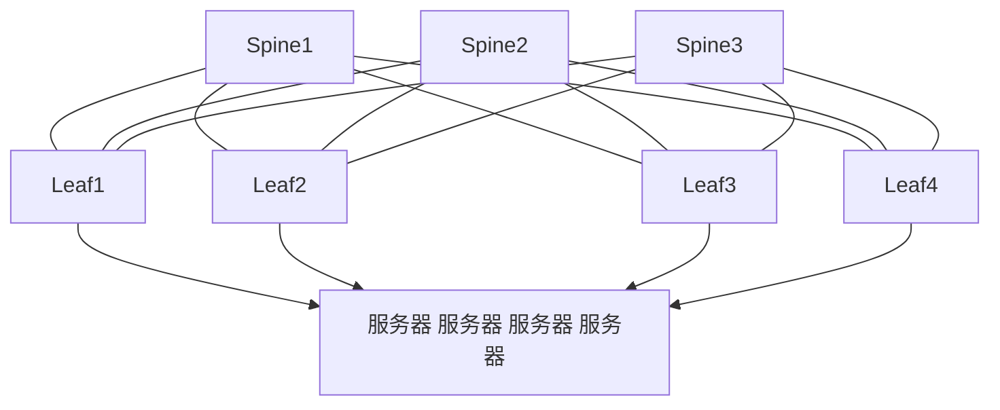

## 1. 层次化网络设计

### 1.1 三层架构

```
核心层：高速交换，不做策略
  <->
汇聚层：策略执行，路由边界
  <->
接入层：终端接入，VLAN划分
```

### 1.2 各层设计要点

| 层级   | 关键指标   | 设计原则       |
| ------ | ---------- | -------------- |
| 核心层 | 带宽、延迟 | 冗余、无策略   |
| 汇聚层 | 策略、路由 | 模块化、边界   |
| 接入层 | 密度、安全 | 端口安全、VLAN |

### 1.3 Collapsed Core

中小企业将核心层和汇聚层合并：

```
核心/汇聚层（二层合一）
  <->
接入层
```

## 2. 数据中心网络

### 2.1 Spine-Leaf 架构



**优势**：

- 任意两台服务器间跳数恒定（2跳）
- 水平扩展：增加 Spine 或 Leaf
- 无阻塞带宽：每台 Leaf 与所有 Spine 互联

**东西向流量**优化：服务器间通信无需经过核心。

### 2.2 超融合网络

| 流量类型 | 协议             | 要求     |
| -------- | ---------------- | -------- |
| 数据     | TCP/IP           | 高带宽   |
| 存储     | FC/iSCSI/NVMe-oF | 低延迟   |
| 管理     | SSH/SNMP         | 可靠     |
| 虚拟化   | VXLAN/Geneve     | 覆盖网络 |

### 2.3 网络虚拟化

**VXLAN**：

```
原始帧 → VXLAN头(8B) → UDP头 → IP头 → 外层帧
         VNI(24bit) = 1600万虚拟网络
```

**NVGRE**：使用 GRE 隧道封装。

**Geneve**：VXLAN 和 NVGRE 的统一替代。

### 2.x 设备命名规范（自原系统管理篇并入）

| 位置   | 设备类型 | 命名格式             | 示例         |
| :----- | :------- | :------------------- | :----------- |
| 核心层 | 交换机   | DC-CORE-01           | DC-CORE-01   |
| 汇聚层 | 交换机   | DC-AGG-{楼栋}-01     | DC-AGG-A1-01 |
| 接入层 | 交换机   | DC-ACC-{楼层}-{编号} | DC-ACC-3F-01 |
| 防火墙 | FW       | DC-FW-01             | DC-FW-01     |
| 路由器 | RT       | DC-RT-01             | DC-RT-01     |

命名格式「位置-类型-序号」让告警邮件、配置备份、工单系统不用点开详情就知道设备角色；楼层/楼栋字段在排障时直接缩范围。

## 3. SD-WAN

### 3.1 SD-WAN 架构

```
分支站点 ←→ SD-WAN控制器 ←→ 总部/数据中心
     <->           <->
  多链路      集中策略
(MPLS/Internet/5G)
```

### 3.2 SD-WAN 核心能力

| 能力       | 说明                 |
| ---------- | -------------------- |
| 多链路聚合 | 同时使用多条链路     |
| 智能选路   | 根据应用需求选择路径 |
| 应用识别   | DPI 识别应用类型     |
| 自动VPN    | 自动建立站点间隧道   |
| 集中管理   | 统一策略下发         |

### 3.3 流量调度策略

```
语音/视频 → 低延迟链路(MPLS)
关键业务 → 可靠链路(MPLS/专线)
普通上网 → Internet链路
备份流量 → 最便宜链路
```

## 4. 网络冗余设计

### 4.1 设备冗余

| 方案      | 说明         | 切换时间 |
| --------- | ------------ | -------- |
| VRRP/HSRP | 虚拟路由冗余 | 1~3秒    |
| GLBP      | 网关负载均衡 | 1~3秒    |
| 堆叠/IRF  | 设备虚拟化   | 毫秒级   |
| CSS/VSU   | 集群交换系统 | 毫秒级   |

### 4.2 链路冗余

```bash
# VRRP 配置
interface Vlan10
  ip address 10.0.0.2 255.255.255.0
  vrrp 10 ip 10.0.0.1
  vrrp 10 priority 120
  vrrp 10 preempt
  vrrp 10 track GigabitEthernet0/0 decrement 30
```

### 4.3 路径冗余

- 等价多路径（ECMP）
- 浮动静态路由
- OSPF 多路径

## 5. 网络容量规划

### 5.1 带宽计算

$$\text{所需带宽} = \text{用户数} \times \text{并发率} \times \text{每用户带宽} \times \text{峰值系数}$$

### 5.2 设备选型

| 指标     | 接入层   | 汇聚层   | 核心层  |
| -------- | -------- | -------- | ------- |
| 背板带宽 | 100G+    | 500G+    | 1T+     |
| 包转发率 | 100Mpps+ | 500Mpps+ | 1Bpps+  |
| 端口密度 | 48×1G    | 24×10G   | 36×100G |

## 教学自检

按遮码自检法：遮住上文图表，先自己推演，再对照。

- 三层架构里「核心层不做策略」的理由是什么？把 ACL 放核心层会损失什么？
- Collapsed Core 什么时候适用？它的代价是什么？
- Spine-Leaf 为什么任意两台服务器间跳数恒定？它优化的是南北向还是东西向流量？
- VXLAN 头 8 字节里的 VNI 有 24 位，对比 VLAN ID 12 位，扩大了多少倍？VXLAN 用 UDP 封装
  的外层 IP 头解决什么问题（跨三层传输二层网络）？
- SD-WAN 的「智能选路」与策略路由的本质区别是什么？（集中控制器按应用需求动态选，
  而不是人工静态规则）
- VRRP 切换为什么是秒级而堆叠是毫秒级？选型时用切换时间以外的什么维度权衡？
  （堆叠的管理面耦合风险）
- 带宽计算公式的四个乘数各来自哪里？「峰值系数」为什么不能拍脑袋？
- 零信任与「安全区域划分」的信任模型差在哪？

## 6. 网络安全设计

### 6.1 安全区域划分

```
Internet ← Untrust
    <->
DMZ（Web/Mail）
    <->
Trust（内网办公）
    <->
Server Zone（服务器区）
    <->
Management（管理区）
```

### 6.2 零信任网络设计

- 微分段：每个应用独立安全域
- 身份认证：每次访问都验证
- 最小权限：仅开放必要访问
- 持续监控：实时检测异常
