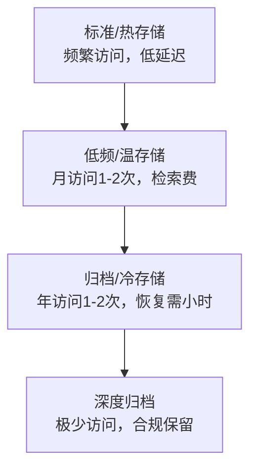
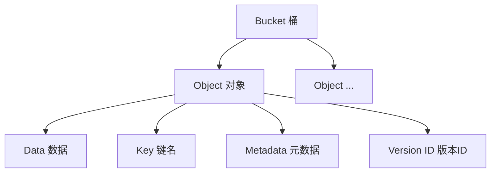
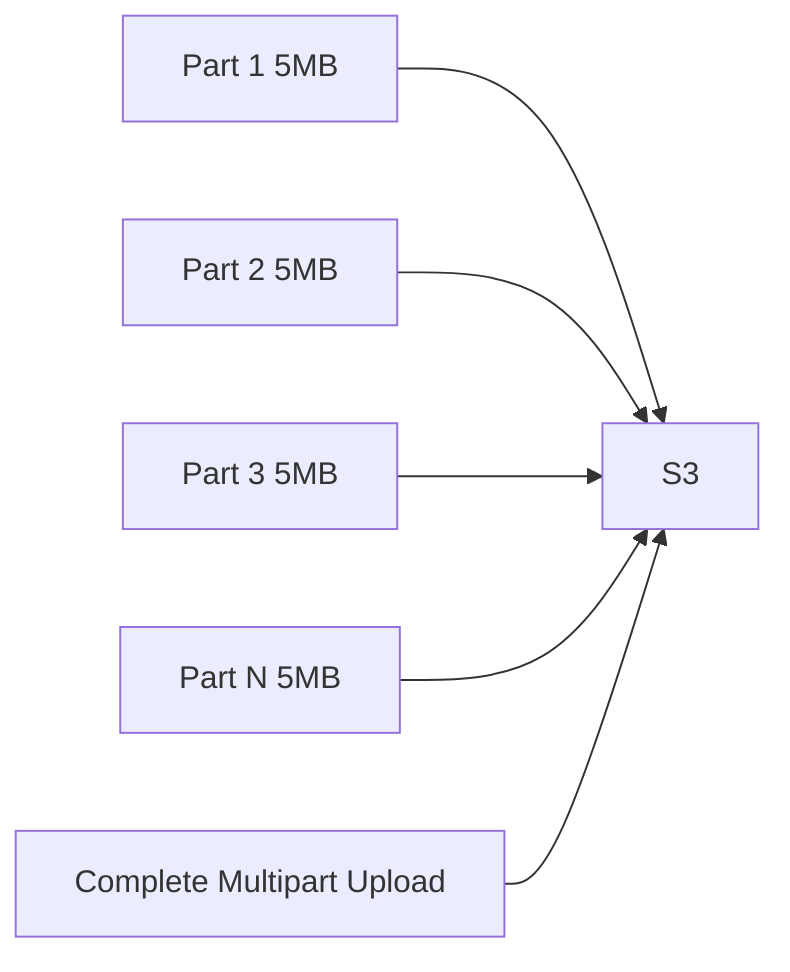
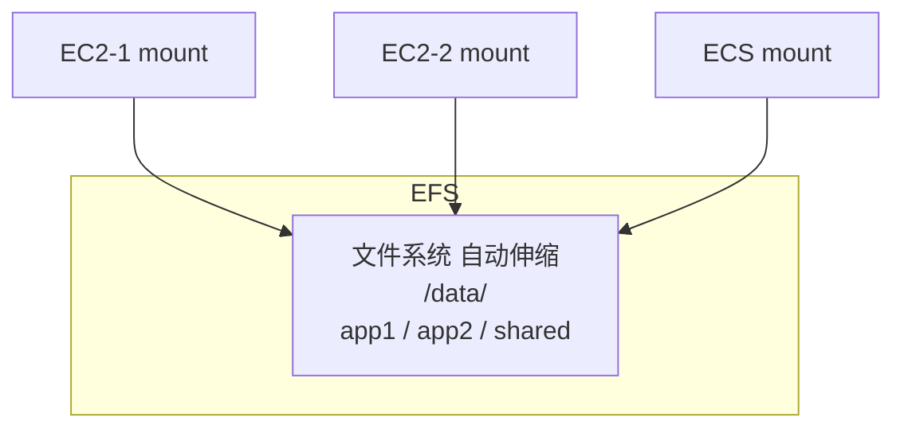
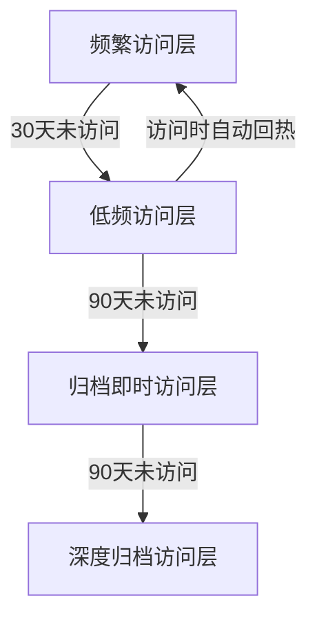
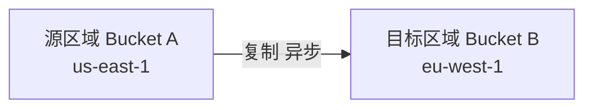

## 1. 云存储服务分类

### 1.1 存储类型对比

| 类型     | 访问方式   | 延迟      | 吞吐 | 适用场景              |
| -------- | ---------- | --------- | ---- | --------------------- |
| 对象存储 | REST API   | 10-100ms  | 高   | 图片/视频/备份/数据湖 |
| 块存储   | 块设备接口 | <1ms      | 中高 | 数据库/虚拟机磁盘     |
| 文件存储 | NFS/SMB    | 1-10ms    | 中   | 共享文件/内容管理     |
| 归档存储 | 异步恢复   | 分钟-小时 | 低   | 合规归档/冷数据       |

### 1.2 存储层级



成本递减，存取成本递增

## 2. 对象存储

### 2.1 核心概念



各云厂商对象存储对照：

| AWS | 阿里云 | GCP           | Azure        |
| --- | ------ | ------------- | ------------ |
| S3  | OSS    | Cloud Storage | Blob Storage |

### 2.2 S3 存储类

| 存储类                  | 最小存储期 | 检索费 | 可用性 | 典型用途               |
| ----------------------- | ---------- | ------ | ------ | ---------------------- |
| S3 Standard             | 无         | 无     | 99.99% | 热数据                 |
| S3 Intelligent          | 无         | 无     | 99.9%  | 访问模式不明           |
| S3 Standard-IA          | 30天       | 有     | 99.9%  | 低频访问               |
| S3 One Zone-IA          | 30天       | 有     | 99.5%  | 可重建的低频数据       |
| S3 Glacier Instant      | 90天       | 有     | 99.9%  | 需即时检索的归档       |
| S3 Glacier Flexible     | 90天       | 有     | 99.99% | 归档（分钟-小时恢复）  |
| S3 Glacier Deep Archive | 180天      | 有     | 99.99% | 长期归档（12小时恢复） |

### 2.3 S3 数据一致性

S3 提供**强一致性**读写：

- 写后读一致性：新对象写入后立即可读
- 覆盖写后读一致性：覆盖已有对象后立即可读
- 删除一致性：删除后立即不可读

### 2.4 S3 性能优化

**多部分上传**：



- 最小分片大小：5MB（最后一个分片除外）
- 最大分片数量：10,000
- 最大对象大小：5TB

**S3 Transfer Acceleration**：利用 CloudFront 边缘节点加速跨区域上传。

**S3 请求速率**：

$$
\text{单前缀请求限制} = 3{,}500 \text{ PUT/COPY/POST/DELETE/s} + 5{,}500 \text{ GET/s}
$$

通过前缀分散可线性提升吞吐：

$$
\text{总吞吐} = \text{前缀数} \times \text{单前缀限制}
$$

### 2.5 S3 安全

- **服务端加密**：SSE-S3（AES-256）、SSE-KMS（客户管理密钥）、SSE-C（客户提供密钥）
- **客户端加密**：上传前在客户端加密
- **预签名 URL**：临时授权访问
- **Bucket Policy**：细粒度访问控制
- **VPC Endpoint**：私有网络访问，不经公网
- **Object Lock**：WORM（一次写多次读）合规保留

## 3. 块存储

### 3.1 EBS（Elastic Block Store）

EBS 是 AWS 的块存储服务，作为 EC2 实例的持久化磁盘：

| 卷类型            | 最大 IOPS | 最大吞吐   | 最大容量 | 适用场景     |
| ----------------- | --------- | ---------- | -------- | ------------ |
| gp3               | 16,000    | 1,000 MB/s | 16 TB    | 通用 SSD     |
| io2 Block Express | 256,000   | 4,000 MB/s | 64 TB    | 高性能数据库 |
| st1               | 500       | 500 MB/s   | 16 TB    | 吞吐优化 HDD |
| sc1               | 250       | 250 MB/s   | 16 TB    | 冷 HDD       |

**gp3 独立配置 IOPS 和吞吐**：

$$
\text{IOPS} = \min(16{,}000, \text{配置值})
$$

$$
\text{吞吐} = \min(1{,}000 \text{ MB/s}, \text{配置值})
$$

$$
\text{吞吐上限} = \frac{\text{IOPS} \times \text{块大小}}{1024} \text{ MB/s}
$$

### 3.2 EBS 快照

EBS 快照是增量备份，存储在 S3 中：

```
全量快照1:  [A][B][C][D]        ← 包含所有数据块
增量快照2:  [B'][E]             ← 仅包含变更块
增量快照3:  [C'][F]             ← 仅包含变更块

恢复快照3:  [A][B'][C'][D][E][F] ← 合并所有快照的块
```

快照成本：

$$
\text{快照存储费} = \text{增量数据量} \times \text{单价/GB}
$$

### 3.3 多挂载卷

io2 卷支持多实例同时挂载（Multi-Attach）：

- 最多 16 个实例同时读写
- 需要集群文件系统（如 OCFS2、GFS2）
- 适用于 Oracle RAC、SAP HANA 等共享存储场景

## 4. 文件存储

### 4.1 EFS（Elastic File System）

AWS EFS 是托管 NFS 文件系统：



**EFS 存储类**：

| 存储类                 | 价格 | 访问模式        |
| ---------------------- | ---- | --------------- |
| Standard               | 标准 | 频繁访问        |
| Infrequent Access (IA) | 低   | 月访问 < 1 次   |
| Archive                | 极低 | 年访问 < 1-2 次 |

**EFS 性能模式**：

- **通用用途**：默认，低延迟，适合 Web 服务、CMS
- **最大 I/O**：高并发，延迟略高，适合大数据分析、媒体处理

**EFS 吞吐模式**：

- **突发吞吐**：基于文件系统大小分配基准和突发额度
- **预置吞吐**：独立于存储量指定吞吐量

$$
\text{基准吞吐} = \text{存储量(GB)} \times 0.05 \text{ MB/s/GB}
$$

### 4.2 FSx

AWS FSx 提供专用文件系统：

| 类型                 | 协议          | 适用场景     |
| -------------------- | ------------- | ------------ |
| FSx for Windows      | SMB           | Windows 应用 |
| FSx for Lustre       | POSIX         | HPC/机器学习 |
| FSx for NetApp ONTAP | NFS/SMB/iSCSI | 企业级多协议 |
| FSx for OpenZFS      | NFS           | 高性能 Linux |

### 4.3 阿里云 NAS

阿里云文件存储 NAS：

- **通用型 NAS**：NFS/SMB 协议，容量型/性能型/高级型
- **极速型 NAS**：基于 NVMe，亚毫秒延迟
- **CPFS**：并行文件系统，HPC 场景

## 5. 数据生命周期管理

### 5.1 生命周期策略

S3 生命周期规则自动转换对象存储类：

```json
{
  "Rules": [
    {
      "ID": "TransitionToIA",
      "Status": "Enabled",
      "Transitions": [
        { "Days": 30, "StorageClass": "STANDARD_IA" },
        { "Days": 90, "StorageClass": "GLACIER" },
        { "Days": 365, "StorageClass": "DEEP_ARCHIVE" }
      ],
      "Expiration": { "Days": 2555 }
    }
  ]
}
```

生命周期转换路径：

```
Standard → Standard-IA (30天) → Glacier (90天) → Deep Archive (365天) → 过期删除 (2555天)
```

### 5.2 成本优化分析

不同存储类的月度成本（以 1TB 数据为例）：

$$
C_{\text{Standard}} = 1000 \text{ GB} \times \$0.023/\text{GB} = \$23.00
$$

$$
C_{\text{IA}} = 1000 \text{ GB} \times \$0.0125/\text{GB} = \$12.50
$$

$$
C_{\text{Glacier}} = 1000 \text{ GB} \times \$0.004/\text{GB} = \$4.00
$$

$$
C_{\text{Deep Archive}} = 1000 \text{ GB} \times \$0.00099/\text{GB} = \$0.99
$$

### 5.3 智能分层

S3 Intelligent-Tiering 自动监控访问模式并移动数据：



> 深度归档层与归档即时访问层均支持毫秒级取回；监控费按对象数收取，小微对象
> 密集的场景需先算一笔账（对象少于约 128KB 的可配置跳过监控）。

## 6. 跨区域复制与一致性

### 6.1 S3 跨区域复制（CRR）



CRR 配置要求：

- 源和目标 Bucket 均需开启版本控制
- IAM 角色需授予复制权限
- 可指定存储类转换规则
- 复制时间控制（RTC）：15 分钟内完成 99.99% 的对象

### 6.2 双向复制与冲突解决

双向复制场景下，同一对象可能同时被修改：

$$
\text{冲突解决策略} = \begin{cases} \text{最新版本优先} & \text{基于时间戳} \\ \text{源区域优先} & \text{配置优先级} \end{cases}
$$

### 6.3 数据一致性验证

跨区域复制后的数据一致性验证方法：

| 方法                   | 精度   | 开销 | 适用场景 |
| ---------------------- | ------ | ---- | -------- |
| S3 Replication Metrics | 统计级 | 低   | 日常监控 |
| S3 Batch Operations    | 对象级 | 中   | 定期校验 |
| 自定义校验脚本         | 字节级 | 高   | 合规审计 |

S3 Replication Metrics 关键指标：

- **ReplicationLatency**：源对象复制到目标的时间
- **BytesPendingReplication**：待复制的字节数
- **OperationsPendingReplication**：待复制的操作数

## 教学自检

遮住上面的表格与配置示例，先口头回答，再展开对照。答不出的回到对应小节重读：

1. 对象、块、文件、归档四种存储形态各「卖的是什么」？数据库磁盘与共享网盘分别对应哪种？
2. S3 Standard-IA/One Zone-IA/Glacier 系列的最小存储期是多少？「盲转归档反而更贵」发生在什么访问模式下？
3. S3 现在是什么一致性？这意味着「覆盖写后立刻读」的行为是什么？
4. gp3 与 io2 的定位差异是什么？Multi-Attach 共享块设备为什么还需要集群文件系统？
5. EBS 快照是全量还是增量？恢复第 3 个快照时实际要读哪些数据块？
6. 生命周期规则里 128KB 最小对象限制影响什么？Intelligent-Tiering 的监控费在什么场景不划算？
7. 开启 CRR 的两个前提条件是什么？复制延迟指标（ReplicationLatency）回答什么问题？
8. 跨区域复制（CRR）是同步还是异步？它能当强一致方案用吗？

<details>
<summary>参考答案（先答再看）</summary>

1. 对象存储卖「REST API + 容量 + 高持久性」（放不改写的文件）；块存储卖「低延迟块设备接口」（数据库/虚拟机磁盘）；文件存储卖「NFS/SMB 共享语义」（大家的网盘）；归档存储卖「极低单价换分钟-小时级的异步恢复」。
2. IA 类 30 天、Glacier 系 90 天（Deep Archive 180 天）。频繁回迁的「冷」数据走归档反而贵：检索费叠加、且提前删除按最短存储期照收费——先看访问模式再分层。
3. 强一致（读后写/覆盖写/删除后立即可见）。覆盖写后立刻读到的一定是新值，不存在旧值窗口。
4. gp3 通用 SSD（IOPS/吞吐独立配置，性价比基准）；io2 Block Express 高性能（25.6 万 IOPS 量级，数据库重型负载）。Multi-Attach 只是把同一块设备给 16 个实例共享，块设备本身不懂文件锁——并发一致性必须靠集群文件系统（OCFS2/GFS2）保证。
5. 增量。恢复快照 3 = 合并快照 1 的全量块 + 快照 2、3 的变更块，实际读取的是「恢复到该时间点所需的全部块」，不是只有增量。
6. 小于 128KB 的对象转入 IA 类按 128KB 计费，小对象密集时分层省的钱被计费下限吃掉；Intelligent-Tiering 按对象数收监控费，海量小微对象时监控费可能超过节省——可对小于 128KB 的对象配置跳过监控。
7. 源和目标桶都开版本控制、IAM 复制角色权限。ReplicationLatency 回答「一个对象从源桶到目标桶花了多久」，配合 BytesPendingReplication 判断复制是否积压。
8. CRR 是异步复制，RPO 分钟级——只能用于容灾副本与跨区域分发，不能当同步复制用于强一致场景。

</details>

## 小结

- **初学者要点**：三种存储形态各司其职——对象存储放"永不改写的文件"、块存储做
  "数据库的磁盘"、文件存储当"大家的网盘"；S3 已是强一致，生命周期规则是存储
  成本优化的第一杠杆。
- **进阶注意**：存储类转换受最短存储期与最小对象大小（IA 类 128KB）约束，盲目
  分层可能倒亏；EBS Multi-Attach 只提供共享块设备，并发一致性要靠集群文件系统
  自行保证；跨区域复制的 RPO 是分钟级，不能当同步复制用于强一致场景。
