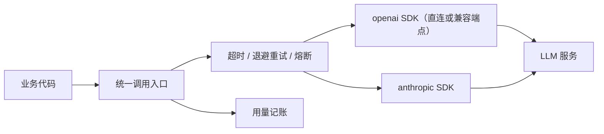

## 前置知识

- [Python 虚拟环境](/python/040-PythonVirtualEnv)：会建环境、会装依赖，知道 pip install 装到哪里；
- [第一次调用大模型 API](/ai-llm/030-FirstLlmApiCall)：知道 messages 数组、role 与 assistant 这些对话概念。

没读过也可以，本文会带上需要的部分：第 2 节从零贴出两个 SDK 的最小可跑代码；Pydantic 基础在 [数据类与 Pydantic](/python/550-DataClassPydantic)，第 5 节会用到的只有 model_validate_json 一个方法。

## 学习目标

读完本文你将能够：

1. 说出「概念在 ai-llm 模块、工程细节在本篇」的分工，并用一句话描述「Python 后端 + LLM」这个 2026 年最常见的服务形态；
2. 用 openai SDK（或兼容端点）与 anthropic SDK 各跑通一次同步与流式调用，并解释「接口形状是事实标准」意味着什么；
3. 用环境变量与 python-dotenv 管理 API key，说出三条「绝不」纪律；
4. 写出 Pydantic 定义 schema、校验失败把错误喂回去重试的完整回路；
5. 为 LLM 调用配上超时、指数退避重试（只对 429 与 5xx）、熔断三件套，并解释每一件解决什么问题；
6. 把 LLM 调用包成 FastAPI 服务并流式转发 SSE，同时用一个记账函数记录每次调用的 token 用量。

预计 30 到 45 分钟，含 3 个动手实验与 3 道练习。

## 1. 定位：装好 SDK 之后，工程问题才真正开始

第一次调用大模型 API 只需要十行代码（见 [第一次调用大模型 API](/ai-llm/030-FirstLlmApiCall)），概念与心智模型——上下文窗口、结构化输出的原理、成本与延迟的量级——都在 ai-llm 模块里。但把它变成一个能扛真实流量的 Python 服务，中间隔着一批文档不会主动告诉你的工程问题：key 放在哪、超时设多少、限流 429 怎么办、结构化输出解析失败怎么兜底、成本记在哪、怎么暴露给前端和其他系统。



本篇就是这批问题的 Python 侧答案。它不重复 ai-llm 模块的概念，遇到概念只做一句回顾并链接过去；它也不翻译 SDK 文档，SDK 细节点到为止。「Python 后端 + LLM」是 2026 年最常见的 AI 服务形态——本篇的最后你会亲手搭出这个形态的最小骨架。

## 2. SDK 基本形状：openai 事实标准与 anthropic

先认识一个行业事实：**openai 官方 Python SDK 的接口形状（client.chat.completions.create 一族）已成为大模型 API 的事实标准**。大量模型厂商直接提供 OpenAI 兼容端点，国产模型、开源模型的部署框架大多照此实现。这意味着你学会这一个 SDK，就能用「只换 base_url 与 key」的方式接上几乎所有主流模型：

```python
import os
from openai import OpenAI

# 官方 OpenAI：默认读 OPENAI_API_KEY 与 OPENAI_BASE_URL 环境变量
client = OpenAI()

resp = client.chat.completions.create(
    model="gpt-4o-mini",  # 示意，具体型号以所用厂商文档为准
    messages=[{"role": "user", "content": "用一句话解释什么是嵌入"}],
)
print(resp.choices[0].message.content)
print(resp.usage.total_tokens)  # 响应自带用量，成本记账靠它
```

```python
# 兼容端点：只换 base_url 与 key，其余代码一行不改
client = OpenAI(
    base_url="https://api.example-llm.com/v1",
    api_key=os.environ["EXAMPLE_LLM_KEY"],
)
```

anthropic SDK 是另一个独立实现，概念同构但形状不同——顶层是 client.messages.create，必须显式传 max_tokens，用量在 usage 里分 input_tokens 与 output_tokens：

```python
import anthropic

client = anthropic.Anthropic()  # 默认读 ANTHROPIC_API_KEY 环境变量
msg = client.messages.create(
    model="claude-sonnet-4-5",  # 示意，可用型号以 Anthropic 文档为准
    max_tokens=1024,
    messages=[{"role": "user", "content": "用一句话解释什么是嵌入"}],
)
print(msg.content[0].text)
print(msg.usage.input_tokens, msg.usage.output_tokens)
```

| | openai SDK | anthropic SDK |
| --- | --- | --- |
| 调用入口 | client.chat.completions.create | client.messages.create |
| max_tokens | 可省略（有默认） | 必填 |
| 回复文本 | choices[0].message.content | content[0].text |
| 用量 | usage.prompt_tokens / completion_tokens | usage.input_tokens / output_tokens |
| 兼容生态 | 大量厂商提供兼容端点 | 主要用于 Anthropic 模型 |

本篇后续示例以 openai SDK 风格书写（事实标准），换成 anthropic SDK 只是改调用入口与字段名。

## 3. Key 管理：环境变量与 python-dotenv

三条「绝不」纪律先行：**绝不把 key 写进代码与仓库；绝不在日志里打印 key；绝不用默认值兜底掩盖 key 缺失**。环境变量是所有云平台与容器编排的原生配置通道，本地开发用 python-dotenv 补齐体验：

```bash
pip install python-dotenv
```

```text
# .env 文件（必须已加入 .gitignore）
LLM_API_KEY=sk-your-key-here
LLM_BASE_URL=https://api.example-llm.com/v1
```

```python
import os
from dotenv import load_dotenv

load_dotenv()  # 把 .env 读进环境变量；已存在的环境变量不会被覆盖

key = os.environ["LLM_API_KEY"]  # 缺失时立刻 KeyError——这是优点，不是缺点
```

`os.environ["LLM_API_KEY"]` 用方括号而不是 get() 带默认值，是有意为之：key 缺失应该在进程启动时炸出来，而不是运行到一半才以一个难排查的 401 冒出来。线上部署则不依赖 .env，用平台的密钥管理（环境变量注入、Secrets 服务）——.env 只是本地开发的便车，不是生产方案。

## 4. 流式输出的消费

同步调用要等全部生成完才返回。加一个 stream=True，SDK 返回一个可迭代的流对象，每个 chunk 携带一小段新文本：

```python
stream = client.chat.completions.create(
    model="gpt-4o-mini",
    messages=[{"role": "user", "content": "讲一个 200 字的故事"}],
    stream=True,  # 服务端逐块推送，客户端边收边处理
)
for chunk in stream:
    delta = chunk.choices[0].delta.content
    if delta:
        print(delta, end="", flush=True)  # flush 让终端也「逐字」出，而不是攒在缓冲区
```

理解这段代码的关键：**流式改变的不是生成速度，而是首块到达时间与等待占有感**（这个心智模型的完整展开见前端流式两篇的同类讨论）。for 循环里的 delta 就是增量文本，转发给浏览器就是 SSE 的素材。注意 usage 统计在流式下的位置与同步调用不同（常挂在最后一个 chunk 或需要单独参数开启），以厂商文档为准——这直接影响第 7 节的记账怎么写。

## 5. 结构化输出：Pydantic schema 与校验重试回路

让模型返回可编程的结构（JSON）是大多数生产链路的前提。原理与设计纪律在 [结构化输出](/ai-llm/060-StructuredOutput)，那里讲「schema 即契约」；本篇给 Python 侧的完整可跑回路。核心循环是：定义 schema、请求输出、校验、失败把报错喂回去让模型自修：

```python
from pydantic import BaseModel, ValidationError
from openai import OpenAI

client = OpenAI()

class Invoice(BaseModel):
    vendor: str        # 开票方
    amount: float      # 金额
    currency: str      # 币种

def extract_invoice(text: str, max_retries: int = 2) -> Invoice:
    messages = [
        {"role": "system", "content": "从文本抽取发票信息，严格输出 JSON。"},
        {"role": "user", "content": text},
    ]
    for _ in range(max_retries + 1):
        resp = client.chat.completions.create(
            model="gpt-4o-mini",
            messages=messages,
            response_format={"type": "json_object"},  # 强制 JSON 模式，能力以厂商文档为准
        )
        raw = resp.choices[0].message.content
        try:
            return Invoice.model_validate_json(raw)   # 校验 + 解析一步完成
        except ValidationError as e:
            # 关键一步：把校验错误喂回去，让模型照着错误修
            messages.append({"role": "assistant", "content": raw})
            messages.append({"role": "user", "content": f"输出不符合 schema，错误如下，请修正后重新输出完整 JSON：\n{e}"})
    raise RuntimeError("结构化抽取重试次数用尽")
```

这个回路值得整段记住，它体现的是对 LLM 的基本工程态度：**模型会犯错，契约负责兜底，错误信息是最有效的纠偏信号**。Pydantic 校验的产出不只是「通过与否」，ValidationError 里带着「哪个字段、什么类型、期望什么」——把它原样喂回去，一次重试的修复率相当高。部分厂商还提供原生结构化输出参数（按 JSON Schema 约束解码），能从根上减少校验失败，采用与否以厂商文档为准。

## 6. 健壮性三件套：超时、退避重试、熔断

LLM API 是一个「慢、偶发限流、偶发抖动」的外部依赖。调用它的函数必须配三件套，缺一件都是生产事故的种子：

```python
from openai import APIConnectionError, InternalServerError, RateLimitError
from tenacity import retry, retry_if_exception_type, stop_after_attempt, wait_exponential
from pybreaker import CircuitBreaker

RETRYABLE = (RateLimitError, InternalServerError, APIConnectionError)

llm_breaker = CircuitBreaker(fail_max=5, reset_timeout=60)  # 连续 5 次失败后熔断 60 秒

@llm_breaker
@retry(
    retry=retry_if_exception_type(RETRYABLE),   # 只重试值得重试的异常
    wait=wait_exponential(multiplier=1, max=30),  # 指数退避：1s、2s、4s……封顶 30s
    stop=stop_after_attempt(5),
)
def ask_llm(messages: list[dict]):
    return client.chat.completions.create(
        model="gpt-4o-mini",
        messages=messages,
        timeout=30.0,  # 三件套之一：显式超时，绝不依赖 SDK 默认值
    )
```

三件各自解决不同的问题，混着理解等于没理解：

1. **超时**解决「无限等待」。LLM 偶尔会挂起，不设超时意味着你的工作线程/协程被它吊死，上游排队雪崩。数值按「接受的最坏等待」定，不是拍脑袋 30 秒；
2. **指数退避重试**解决「瞬时抖动与限流」。只对 429（限流）与 5xx（服务端错误）重试；4xx 参数错误重试一万次也不会通。指数退避避免在对方最忙时密集撞门；若响应带 Retry-After 头，优先按它等待；
3. **熔断**解决「下游持续故障还反复送人头」。退避重试是单次调用的耐心，熔断是全服务的总闸：连续失败达到阈值就快速失败一段时间，让下游喘息、让用户拿到确定的报错而不是 30 秒超时。

还有一个前置问题：重试是否安全取决于操作是否幂等。对 LLM 调用，同一问题多问一次通常无害，重试可以放开；若调用会触发下游写操作，重试前先想清楚。

## 7. 成本侧：批处理 API、prompt caching 与用量记账

成本模型（token 怎么计价、为什么输出比输入贵）在 [token、成本与延迟](/ai-llm/180-TokenCostLatency)。Python 侧要知道三个抓手：

**批处理 API（Batch API）**。大量非实时任务（历史数据回填、评测集跑分、离线摘要）不必占用实时接口：把请求打成 JSONL 文件提交，厂商在数小时内异步返回，单价低于同步调用（幅度与时限以厂商文档为准）：

```python
from openai import OpenAI

client = OpenAI()

# 1) 把一批请求写入 JSONL 文件并上传
file = client.files.create(file=open("batch_tasks.jsonl", "rb"), purpose="batch")
# 2) 提交批处理任务，24 小时窗口内完成
batch = client.batches.create(
    input_file_id=file.id,
    endpoint="/v1/chat/completions",
    completion_window="24h",
)
# 3) 轮询 batch.status，完成后下载结果文件
```

**prompt caching（提示缓存）**。重复出现的长前缀（固定的系统提示、长文档上下文）可被缓存，命中部分的输入按更低计价。OpenAI 侧对超过一定长度的重复前缀自动生效；Anthropic 侧需用 cache_control 显式标记缓存断点。把稳定内容放前、易变内容放后，缓存命中率才有意义——细节以厂商文档为准。

**用量记账**。每次响应都带 usage，成本治理的地基是「每次调用都记下来」。一个最小记账封装：

```python
from collections import defaultdict

ledger = defaultdict(lambda: {"input": 0, "output": 0})

def chat_metered(messages: list[dict], *, tag: str) -> str:
    """统一调用入口：所有 LLM 调用走这里，成本画像按 tag 逐日累积。"""
    resp = client.chat.completions.create(model="gpt-4o-mini", messages=messages)
    ledger[tag]["input"] += resp.usage.prompt_tokens
    ledger[tag]["output"] += resp.usage.completion_tokens
    return resp.choices[0].message.content
```

tag 按业务功能或租户打，日积月累就能回答「哪个功能烧钱最多」「这个租户要不要加套餐」这类只有数据能回答的问题。

## 8. 包成 FastAPI 服务：流式转发 SSE

前端不该直连 LLM（key 暴露、无法限流计量），标准形态是 Python 服务做中间层。用 [FastAPI](/python/880-PythonFastAPI) 包一层，把流式输出转发为 SSE：

```python
import json
from fastapi import FastAPI
from fastapi.responses import StreamingResponse
from pydantic import BaseModel

app = FastAPI()

class ChatIn(BaseModel):
    question: str

@app.post("/api/chat")
def chat(body: ChatIn):
    stream = client.chat.completions.create(
        model="gpt-4o-mini",
        messages=[{"role": "user", "content": body.question}],
        stream=True,
    )

    def sse():
        for chunk in stream:                      # 消费 LLM 的流
            delta = chunk.choices[0].delta.content
            if delta:
                yield "data: " + json.dumps({"text": delta}, ensure_ascii=False) + "\n\n"
        yield "data: [DONE]\n\n"                  # 自定义收尾事件

    return StreamingResponse(sse(), media_type="text/event-stream")
```

这个几十行的端点就是「Python 后端 + LLM」形态的最小骨架：FastAPI 负责鉴权、限流与校验（ChatIn 的 Pydantic 模型天然挡住畸形请求），生成器负责把 LLM 的流逐块转成自己的 SSE 协议。注意这里用了自定义事件格式而非透传厂商 SSE——前端只认你的协议，换厂商只改这一个文件。高并发场景把路由改成 async def 并换用异步 SDK 客户端（协程基础见 [协程与 asyncio](/python/660-CoroutineAsyncio)），本篇骨架先保证正确再谈优化。

## 9. 常见困惑

**Q：兼容端点与官方 SDK 是什么关系？可靠吗？**

SDK 是客户端实现，兼容端点是服务端承诺「按 OpenAI 的请求响应格式服务」。用官方 SDK 连兼容端点是普遍做法，但厂商对长上下文、工具调用等高级参数的支持程度参差，接入前用你的真实用例做一轮冒烟测试。

**Q：流式调用下 usage 怎么拿？**

与同步调用位置不同：可能在最后一个 chunk 里，或需要请求参数显式开启统计。这是第 4 节特意标注「以厂商文档为准」的点，也是为什么记账封装要基于真实响应结构测试后再上线。

**Q：重试会导致重复计费吗？**

会。每次重试都是一次新请求、一份新 token 账单。指数退避与 stop_after_attempt 控制的正是「为修复一个瞬时错误愿意多付几次钱」的上限。

**Q：为什么 key 要「缺失时立刻报错」而不是 get() 给默认值？**

默认值掩盖了配置错误，让进程带着隐患跑起来，最后以难定位的 401 暴露。启动即失败（fail fast）把错误位置从「业务运行深处」提前到「进程启动处」，排查成本低一个量级。

## 10. 动手实验

实验一：建虚拟环境，装 openai、python-dotenv、tenacity、pybreaker；配好 .env，跑通第 4 节的流式调用，观察终端逐字输出。

实验二：给调用套上第 6 节的装饰器，然后故意把 base_url 改成一个不存在的主机，观察重试与熔断的日志顺序；再把 key 改错（401），验证「不该重试的异常不重试」。

实验三：跑通第 8 节的 FastAPI 服务，用 `curl --no-buffer -N -X POST` 打 /api/chat，肉眼确认 SSE 逐块到达；再用 uvicorn 起服务，让同学或前端页面消费它。

练习一（笔头）：说出三件套各自的职责与「缺这一件会发生什么」。

练习二（笔头）：一段 8000 字的产品手册作为固定上下文、一个变化的问题，写出能让 prompt caching 生效的消息排布原则。

练习三（笔头）：你的服务要新增「按租户记录成本」需求，指出第 7 节记账封装需要改哪一处。

## 11. 官方文档

- OpenAI Python SDK 与批处理：https://github.com/openai/openai-python
- Anthropic Python SDK（含 prompt caching）：https://docs.anthropic.com/
- tenacity 重试：https://tenacity.readthedocs.io/ ；pybreaker 熔断：https://pybreaker.readthedocs.io/
- FastAPI：https://fastapi.tiangolo.com/

## 12. 自检清单

1. 能否说出本篇与 ai-llm 模块的分工，并画出「前端 - Python 服务 - LLM API」的三层形态图？
2. 能否用「只换 base_url 与 key」把示例切到一个 OpenAI 兼容端点，并解释这句话背后的行业事实？
3. 能否默写三条 key 管理「绝不」纪律，并解释 fail fast 的排查成本逻辑？
4. 能否完整写出「校验失败把错误喂回去重试」的结构化输出回路，并说明错误信息为什么是最有效的纠偏信号？
5. 能否区分超时、退避重试、熔断各自解决什么问题，并说出哪些异常不该重试？
