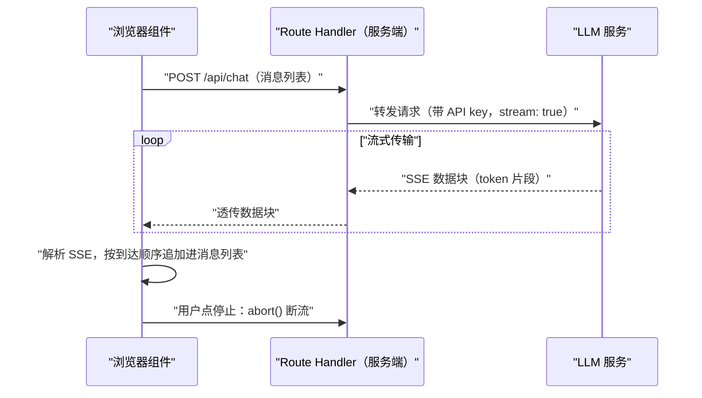

## 前置知识

- [Route Handlers 与 API 设计](/nextjs/040-RouteHandlersApi)：会写 route.ts、导出方法函数、返回 Response；
- [第一次调用大模型 API](/ai-llm/030-FirstLlmApiCall)：知道一次对话调用的请求与响应形状，听过「流式输出」这个词。

没读过也可以，本文会带上需要的部分：第 3 节会从「Route Handler 返回 Response」这个你已会的知识出发，只新增「Response 的 body 是一条流」这一件事。

## 学习目标

读完本文你将能够：

1. 解释为什么 AI 时代「等完整响应」不可接受，以及流式如何改变等待的感知而不改变总时长；
2. 区分模型流（LLM 逐 token 生成）与 UI 流（Suspense 分块渲染）这两种不同的流；
3. 写出在 Route Handler 里把 LLM 流式输出透传给浏览器的代码，并说出为什么这层服务端代理必须存在；
4. 写出 fetch + ReadableStream 解析 SSE 的客户端代码，解释缓冲区为什么必须按事件边界切分；
5. 说出流式 UI 的标准形状（消息列表、isLoading、AbortController 中断），并据此评估或自建封装；
6. 按「一次性动作用 Server Actions、长流式响应用 Route Handler」做出选型，并列出流式接口的三条安全成本纪律。

预计 30 到 45 分钟，含 3 个动手实验与 3 道练习。

## 1. 问题引入：等 30 秒才出现句号的灾难

大模型生成一段 800 字的回答，往往要几十秒。如果等它全部生成完再返回，用户面对的就是：点发送、转圈、30 秒白屏、一段文字突然砸出来。ChatGPT 把「逐字往外蹦」变成了所有人熟悉的样子之后，等完整响应的体验在 2026 年已经是不可接受的——**流式输出是 AI 时代前端的标配，不是锦上添花**。

先建立一个反直觉的认知：流式并没有让总时长变短，token 该生成多久还是多久。它改变的是**第一块内容到达的时间**（通常一两秒内）与**等待期间的占有感**（文字持续涌现，用户可以边看边等，甚至提前打断）。这与人因工程里的「感知性能」一致：同样的耗时，反馈越连续，等待越不难熬。

Next.js 在这件事上的角色很完整：它的服务端（Route Handler）替你保管 API key 并代理 LLM 请求，它的客户端（React）负责消费流并渲染——一个框架把流式体验的两端都管了。

## 2. 两种流：模型流与 UI 流

Next.js 生态里「流式」一词指两件不同的事，先分清再动手：

| | 模型流（本篇主角） | UI 流（渲染策略） |
| --- | --- | --- |
| 谁在产数据 | LLM 逐 token 生成文本 | 服务端把页面切成分块送出 |
| 谁在消费 | 你的 JS 逐块解析、拼装、渲染 | React 按到达顺序展示就绪的部分 |
| 典型载体 | SSE / ReadableStream | Suspense 与 streaming SSR |
| 受益者 | 对话、生成类界面 | 首屏加载、慢区块不阻塞整页 |

UI 流是 [渲染策略](/nextjs/060-RenderingStrategies) 里讲过的内容：它优化的是「页面各部分谁先就绪谁先出现」。模型流是本篇的主题：它优化的是「一份生成中的内容如何边产边看」。两者可以同时出现在一个页面里（页脚用 UI 流先到，中间的对话区在消费模型流），机制互不替代。本篇只展开模型流；等你哪天要给对话界面加「推荐问题」的骨架屏，再回去翻渲染策略那篇。

## 3. Route Handler 返回流：把 LLM 的流透传给浏览器

先回答「为什么不从浏览器直连 LLM API」：API key 不能进浏览器代码；请求要经过限流、计量与审计；将来换模型厂商时前端代码不该跟着改。所以标准形态是 Route Handler 做服务端代理——这层你在 [Route Handlers](/nextjs/040-RouteHandlersApi) 里已经写过，唯一的新知识是：**Response 的 body 可以是一条持续吐数据的流**，而不必是一段攒好的 JSON。

```typescript
// app/api/chat/route.ts
// 服务端把 LLM 的流式输出透传给浏览器（示意：以所用厂商的流式 API 文档为准）
export async function POST(req: Request) {
  const { messages } = await req.json()

  const upstream = await fetch("https://api.openai.com/v1/chat/completions", {
    method: "POST",
    headers: {
      "Content-Type": "application/json",
      Authorization: `Bearer ${process.env.OPENAI_API_KEY}`, // key 只在服务端
    },
    body: JSON.stringify({
      model: "gpt-4o-mini",   // 示意，具体型号以厂商文档为准
      messages,
      stream: true,           // 关键：向上游也要流式
    }),
  })

  if (!upstream.ok || !upstream.body) {
    return new Response("upstream error", { status: 502 })
  }

  // 把上游的字节流原样交给浏览器：body 本身就是一条流
  return new Response(upstream.body, {
    headers: {
      "Content-Type": "text/event-stream", // 声明这是 SSE
      "Cache-Control": "no-cache",         // 流式响应不可缓存
    },
  })
}
```

`stream: true` 之后，上游返回的是 SSE（Server-Sent Events）格式：一串 `data: {...}` 行，每行携带一小段新生成的 token，直到 `data: [DONE]` 结束。Route Handler 没有攒、没有解析、原样透传——`upstream.body` 本身就是 Web 标准的 ReadableStream，塞进 `new Response()` 就完成了转发。

顺带回答「为什么不用浏览器原生的 EventSource」：它只能发 GET、不能带自定义请求头（没法带鉴权 token）、没有请求体，而对话请求要 POST 一份消息历史、常要携带会话凭证。fetch + ReadableStream 全都可控，多十几行代码换来完整控制权，这也是 SSE 在 AI 前端一律走 fetch 的原因。

进阶一步：透传是起点，适配是演进。生产系统常在服务端把厂商的 SSE 转换成自家事件格式（统一错误、统一收尾事件），好处是前端只认你自己的协议，换厂商只改服务端：

```typescript
// 适配版 route.ts（示意）：把厂商事件流转换成自己的协议
// 前端只认 { text } 与 done 两种事件，换厂商只改这一个文件
const encoder = new TextEncoder()

export async function POST(req: Request) {
  const { messages } = await req.json()
  const upstream = await callLlmStream(messages)  // 建流式上游请求，同前

  const stream = upstream.body!.pipeThrough(
    new TransformStream({
      transform(chunk, controller) {
        // 注意：这里与第 4 节的客户端有同样的边界问题——chunk 不保证按事件切分，
        // 生产实现要把解析抽成带 buffer 的工具函数（前后端可共用一份）
        for (const event of parseSseWithBuffer(chunk)) {
          const delta = pickDelta(event)                 // 按厂商格式取出增量
          if (delta) {
            controller.enqueue(encoder.encode(`data: ${JSON.stringify({ text: delta })}\n\n`))
          }
          if (isDone(event)) {
            controller.enqueue(encoder.encode("event: done\ndata: {}\n\n"))
          }
        }
      },
    }),
  )

  return new Response(stream, {
    headers: { "Content-Type": "text/event-stream", "Cache-Control": "no-cache" },
  })
}
```

本篇先用透传把链路跑通，适配结构留到你的前端开始抱怨「厂商事件格式又变了」的那天。

## 4. 客户端消费：fetch + ReadableStream 解析 SSE

浏览器端拿到 Response 后，逐块读取并解析：

```tsx
// app/chat/page.tsx（客户端组件，骨架）
"use client"

import { useState } from "react"

export default function ChatPage() {
  const [text, setText] = useState("")
  const [loading, setLoading] = useState(false)

  async function send(question: string) {
    const controller = new AbortController()
    setLoading(true)

    const res = await fetch("/api/chat", {
      method: "POST",
      headers: { "Content-Type": "application/json" },
      body: JSON.stringify({ messages: [{ role: "user", content: question }] }),
      signal: controller.signal,   // 用户点「停止」时中断整条链
    })

    const reader = res.body!.getReader()
    const decoder = new TextDecoder()
    let buffer = ""

    while (true) {
      const { done, value } = await reader.read()
      if (done) break
      buffer += decoder.decode(value, { stream: true })

      // SSE 事件以空行分隔；网络分块不保证按事件边界切，所以要攒 buffer
      const events = buffer.split("\n\n")
      buffer = events.pop() ?? ""   // 最后一段可能不完整，留到下一轮

      for (const event of events) {
        for (const line of event.split("\n")) {
          if (!line.startsWith("data:")) continue
          const payload = line.slice(5).trim()
          if (payload === "[DONE]") continue
          const delta = JSON.parse(payload).choices[0].delta?.content ?? ""
          setText((t) => t + delta)  // 按到达顺序追加
        }
      }
    }
    setLoading(false)
  }

  return <div>{/* 输入框、发送按钮、text 渲染区 */}</div>
}
```

这段代码有三个容易踩坑的点，值得逐个说透：

1. **buffer 的存在原因**：网络分包与 SSE 事件边界毫无关系。一个 chunk 可能含半个事件、两个完整事件或一个半事件。所以先攒进 buffer，按 `\n\n` 切分，最后一段（可能不完整）留到下一轮——`events.pop()` 就是干这个的。
2. **TextDecoder 的 stream: true**：告诉解码器「这个 chunk 可能切在多字节字符（如中文）中间」，解码器会保留残缺字节到下一轮，避免中文乱码。
3. **setText 用函数式更新**：流式回调是异步批量到达的，函数式更新保证不丢追加。

## 5. 流式 UI 的标准形状：useChat 模式拆解

上面的代码能跑，但每个项目重写一遍不现实。以 Vercel AI SDK 的 useChat / useCompletion 为代表的封装之所以流行，是因为它们把流式 UI 固化成了一套标准形状（具体 API 以 SDK 文档为准）：

1. **messages 列表**：消息数组是唯一事实源，UI 只负责渲染它；
2. **isLoading 状态**：pending 期间给占位指示（闪烁光标、骨架行），而不是转圈遮罩；
3. **stop / 可中断**：暴露 AbortController，用户随时能停；
4. **错误态**：失败的消息条目可以单独重试，而不是整页报错；
5. **用户消息乐观更新**：点发送立刻显示用户气泡，不等服务端确认。



用不用 SDK 是工程选择（自己封装一份也就百来行，还能完全掌控协议），但**形状必须懂**：无论自建还是用 SDK，一个像样的流式聊天界面最后都长成这五条的样子。评估第三方封装时，就按这五条逐项对照。

## 6. 选型：Server Actions 还是 Route Handler

[Server Actions 与表单](/nextjs/050-ServerActionsForms) 里建立的选型框架在这里要补一条 AI 时代的细则：

| 场景 | 选择 | 理由 |
| --- | --- | --- |
| 一次性动作：「总结这篇文章」按钮 | Server Actions | 提交后等一个完整结果即可，Action 的返回值直接进组件状态 |
| 长流式响应：对话、逐 token 生成 | Route Handler | 需要持续读取 Response body、逐块渲染，还要能中断 |
| 开放接口、Webhook、给 App 复用 | Route Handler | 需要标准 HTTP 语义，Action 只为本应用 UI 服务 |

一句话判据：**需要逐块渲染的，走 Route Handler；等一个完整结果的，走 Server Actions**。还有一个事实层面的原因：Action 的调用协议是框架托管的函数调用，设计目标是「返回可序列化的最终值」，让它承载逐 token 的长流不是它的形状。两者也不互斥：对话页用 Route Handler 流式，「清除会话」按钮用 Action，各干各的。

## 7. 安全与成本：三条纪律

流式不改变任何安全基本面，但 AI 场景有三条必须显式遵守的纪律：

1. **API key 只在服务端**。route.ts 里的代码只在服务器执行，读环境变量密钥不会被打包进浏览器 JS；反过来，绝不要把 key 当 props 传给客户端组件，也不要在 `"use client"` 的模块里 import 任何读 key 的代码。
2. **流式也要限流与计量**。流式请求照样消耗 token，被中断的请求里已生成的部分通常也已计费（以厂商计费文档为准）。按用户维度限流、记录每次调用的用量，成本治理见 [token、成本与延迟](/ai-llm/180-TokenCostLatency)。别因为「响应是流」就忘了它是同一个 POST。
3. **输出按不可信数据对待**。模型输出可能被提示注入诱导出有害内容（详见 [提示注入与安全](/ai-llm/190-PromptInjectionSecurity)），渲染前要做与用户评论同级的处理：Markdown 先解析再净化，富文本渲染防 XSS。流式逐块到达不是放松理由——每个 delta 都是不可信数据的一部分。

## 8. 常见困惑

**Q：流式响应还能被 Next.js 缓存吗？**

不能也不该。SSE 响应要显式 `Cache-Control: no-cache`。可缓存的是另一层：问答对本身入库（或进 [数据获取与缓存](/nextjs/030-DataFetchingCaching) 体系），同样的问题直接命中历史答案，一次 LLM 调用都不用发。

**Q：为什么我的「流」一次性全部到达？**

常见三层原因，从外到内排查：中间代理或部署平台缓冲了响应（关掉对应缓冲配置）；响应被压缩层攒住；或者上游根本没开 stream 参数、你拿到的是完整 JSON 而不是 SSE（看 Content-Type 与响应内容形状）。本地用 curl 加 `--no-buffer` 是最快的定位手段。

**Q：客户端 abort 之后，服务端与上游会跟着停吗？**

客户端断开后，Route Handler 与上游的连接通常会随之取消，但已生成 token 的计费不受影响（以厂商文档为准）。比「停没停干净」更重要的工程动作是：中断后把「已生成了一半」的状态收尾好（保留已出文本、标记被中断），别留下孤儿请求还在往数据库写。

**Q：SSE 和 WebSocket 该选哪个？**

单向的服务器推送场景（本篇的逐 token 输出）SSE 就够，基于 HTTP、代理友好、实现简单；需要双向实时（协作白板、语音通话）才上 WebSocket。对话界面的输入是普通 POST，输出是单向流，SSE 正好。

## 9. 动手实验

实验一：跑通第 3、4 节的最小链路后，用 `curl --no-buffer -X POST http://localhost:3000/api/chat` 发请求，肉眼确认数据块逐段到达而不是一次性吐完。

实验二：给发送按钮旁边加「停止」按钮，绑 `controller.abort()`；在中途点击后检查：isLoading 是否复位、已生成的半截文本是否保留、控制台是否因 fetch 中断抛错（如果有，在 catch 里区分 AbortError 吞掉）。

实验三：把透传改成适配——服务端在流末尾追加一个自定义收尾事件，前端识别它来标记「回答完成」。这一步做完，你就理解了为什么生产系统都在服务端做协议适配。

练习一（笔头）：用一句话向产品经理解释「流式不减少总时长，为什么体验更好」。

练习二（笔头）：「上传 PDF 并等待解析结果」「逐字生成的法律条款问答」两个需求各选 Action 还是 Route Handler，并说出判据。

练习三（笔头）：列出本篇流式 UI 标准形状的五要素，对照你在用的或打算用的封装，找出缺的那一条。

## 10. 官方文档

- Next.js Route Handlers（含流式响应说明）：https://nextjs.org/docs/app/building-your-application/routing/route-handlers
- MDN Streams API 与 SSE：https://developer.mozilla.org/zh-CN/docs/Web/API/Streams_API
- Vercel AI SDK（useChat 等封装，API 以其文档为准）：https://sdk.vercel.ai/

## 11. 自检清单

1. 能否解释流式改变的是哪两个体验指标（首块到达时间与等待占有感），而不是总时长？
2. 能否区分模型流与 UI 流，并各举一个 Next.js 里的对应机制？
3. 能否写出或画出「Route Handler 透传 SSE」的链路，并说出这层代理存在的三个理由？
4. 能否解释客户端解析 SSE 时 buffer 与 TextDecoder stream: true 各自解决什么问题？
5. 能否不假思索地做出 Action 与 Handler 的选型判断，并说出流式接口的三条安全成本纪律？
