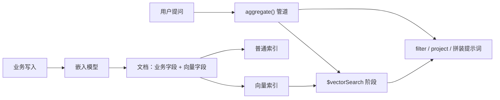

## 前置知识

- [MongoDB CRUD](/mongodb/020-MongoDBCRUDOperations)：会插入文档、会写 find 查询，知道「集合 + 文档」这个基本盘；
- [嵌入与向量检索](/ai-llm/070-EmbeddingsAndVectorSearch)：知道文本经嵌入模型变成高维向量、语义相近则向量相近，见过余弦相似度这个词。

没读过也可以，本文会带上需要的部分：第 2 节用三句话把嵌入压缩成最小必需知识；聚合管道不熟的话，读 [聚合管道](/mongodb/030-MongoDBAggregationPipeline) 前两节即可。

## 学习目标

读完本文你将能够：

1. 向同事解释 Atlas Vector Search 的心智模型——向量是普通字段、向量检索是聚合管道的一个阶段，并说出它与「另起一套向量库」方案在权限与运维上的差异；
2. 写出创建向量索引的关键参数（path、numDimensions、similarity），并解释 numDimensions 为什么必须与嵌入模型的输出维度一致；
3. 写出 $vectorSearch 查询阶段，说清 numCandidates「越大召回越准、也越慢」的权衡并按场景取值；
4. 用 filter 参数做预过滤，实现「先按权限筛、再算相似度」的租户隔离检索；
5. 用 $rankFusion 把向量检索与全文检索融合成混合检索；
6. 判断自己的部署形态（Atlas 还是自管）能否使用 Atlas Vector Search，并说出不可用时的替代路线。

预计 30 到 45 分钟，含 3 个动手实验与 3 道练习。

## 1. 问题引入：为了一次语义检索，再引入一套数据库？

你维护着一个跑在 MongoDB 上的知识库系统：问题、答案、编辑记录、租户与权限，全在一个库。现在要加 RAG——用户提问时，系统先从知识库里找出语义最相关的几条资料，再让大模型基于这些资料作答。RAG 的完整链路见 [RAG 基础](/ai-llm/080-RagFundamentals)，本篇只负责其中最关键的一步：语义检索。

按常见的早期做法，这一步意味着「再装一套专用向量库」：业务数据同步进向量库、向量库单独建索引、两边双写保一致、权限模型各维护一份。你获得的只是向量检索能力，付出的却是两套系统的一致性与运维成本。

MongoDB 用户的自然反应是：检索的对象本来就是业务数据，为什么不让 MongoDB 自己把这件事做掉？这正是 Atlas Vector Search 给出的答案——它把向量检索做成了数据库的原生能力，「RAG 要不要单独一套向量库」在 MongoDB 世界里从默认动作变成了选型题。

## 2. 心智模型：向量只是又一种字段，检索只是管道的一环

先把嵌入压缩成三句话（细节见 [嵌入与向量检索](/ai-llm/070-EmbeddingsAndVectorSearch)）：嵌入模型把一段文本映射成一个高维浮点数组，例如 1536 个数；语义相近的文本对应的数组在高维空间里方向相近；用向量夹角（如余弦相似度）就能量化「像不像」。于是「找出与用户问题最相关的资料」变成「找出与问题向量最相近的资料向量」。

在这个背景下，Atlas Vector Search 的三个构件各就各位：

1. **向量字段**：文档里的一个普通字段，装着嵌入生成的数组。它和 tenantId、createdAt 一样只是字段的值，不享有任何特权；
2. **向量索引**：告诉数据库「这个字段要按向量建索引」，并声明维度与相似度算法。底层是专门的近似最近邻（ANN）算法，你不需要懂其内部实现；
3. **$vectorSearch 阶段**：聚合管道里的一个阶段，输入查询向量，输出最相近的文档，再交给管道的下一个阶段。



这正是 MongoDB 的差异化所在：**向量检索不是平行于业务查询的另一个世界，而是聚合管道里的一环**。同一个文档既有业务字段又有向量，同一个集合既有向量索引又有普通索引，同一条管道可以先 $vectorSearch 再 $project、$match；最关键的是权限——你在普通查询上怎么控制租户隔离与字段可见，向量检索上就用同一套规则。专用向量库方案里「两边权限对齐」的工程难题，在这里从设计上就不存在。

## 3. 定义向量索引：三个关键参数

向量索引的声明围绕三个参数（完整参数表以官方文档为准）：

| 参数 | 含义 | 典型取值 |
| --- | --- | --- |
| path | 对文档里哪个字段建向量索引 | embedding |
| numDimensions | 向量维度 | 1536、3072 等，由嵌入模型决定 |
| similarity | 相似度算法 | cosine、dotProduct、euclidean |

```javascript
// 在 Atlas 控制台或用驱动创建搜索索引，定义形如：
// 索引类型为 vectorSearch，最新语法与创建方式以官方文档为准
db.questions.createSearchIndex("rag-vector", {
  fields: [
    {
      type: "vector",
      path: "embedding",        // 向量装在文档的 embedding 字段里
      numDimensions: 1536,      // 必须等于嵌入模型的输出维度
      similarity: "cosine",     // 语义检索最常用余弦相似度
    },
    {
      type: "filter",           // 声明为可预过滤字段，供 $vectorSearch 的 filter 使用
      path: "tenantId",
    },
  ],
})
```

三个点值得展开：

**维度必须与嵌入模型一致**。numDimensions 写 1536，配上一个输出 3072 维的模型，写入或查询时会直接报错——维度是硬约束。而且换嵌入模型等于换坐标系，存量向量与新查询向量不可比，通常要全量重建。所以索引定义与模型选型要在开工前对齐（选型思路见 [模型全景与选型](/ai-llm/020-ModelLandscapeSelection)）。

**similarity 的选择**。cosine 衡量方向、不受向量长度影响，是语义检索的默认选择；dotProduct 是点积，在向量已归一化时与余弦一致且计算更省；euclidean 是欧氏距离，适合「距离本身有意义」的场景。拿不准就用 cosine。

**filter 字段要预先声明**。想用业务条件做预过滤（第 6 节），对应字段必须先在索引里声明为 filter 类型，否则 $vectorSearch 的 filter 参数不认识它。

## 4. $vectorSearch：检索只是聚合管道的一环

查询时，把用户问题也过一遍同一个嵌入模型得到查询向量，然后把它作为聚合管道的第一个阶段：

```javascript
// queryEmbedding：用户问题经同一嵌入模型生成的 1536 维数组
const result = await db.questions.aggregate([
  {
    $vectorSearch: {
      index: "rag-vector",      // 用哪个向量索引
      path: "embedding",        // 对哪个字段算相似度
      queryVector: queryEmbedding,
      numCandidates: 200,       // 候选池大小，第 5 节展开
      limit: 5,                 // 最终返回条数
    },
  },
  {
    $project: {
      question: 1,
      answer: 1,
      score: { $meta: "vectorSearchScore" },  // 相似度得分
    },
  },
])
```

读这段代码要看到的那件事：$vectorSearch 之后就是熟悉的管道世界。你可以接着 $project 裁剪字段、$lookup 关联其他集合、$group 做统计——[聚合管道](/mongodb/030-MongoDBAggregationPipeline) 里学的组合能力原样可用。检索与业务加工在一条管道里完成，这就是「检索只是管道的一环」的实践含义。

## 5. numCandidates：召回率与延迟的权衡

limit 是「最终返回几条」，numCandidates 是「内部最多考察多少个候选」。底层 ANN 索引为了快，不会把全集合每个向量都比一遍，而是沿着索引结构找出一批最可能相近的候选，再精确打分排序。numCandidates 就是这批候选池的大小：

- 太小：候选池没盖住真正的近邻，明明库里有的相关资料没被召回——检索质量下降，RAG 的模型拿不到关键素材；
- 太大：考察得越多越准，但延迟与资源消耗随之上升，退化成接近全量扫描。

经验法则是从 limit 的十几倍起调，再用真实数据测延迟与召回的拐点。它是调优入口，不是「越大越好」的配置。

## 6. 预过滤：把权限关在相似度计算之前

多租户系统的第一个需求不是「语义最相关」，而是「本租户可见的那批里语义最相关」。$vectorSearch 的 filter 参数把业务条件放在相似度计算之前执行——先按索引缩小候选范围，再在范围内找近邻：

```javascript
{
  $vectorSearch: {
    index: "rag-vector",
    path: "embedding",
    queryVector: queryEmbedding,
    numCandidates: 200,
    limit: 5,
    filter: { tenantId: "acme-corp" },  // 只在 acme-corp 的文档里找近邻
  },
}
```

这与「先向量检索、检索完再过滤」是两种不同的语义：后者等于把其他租户的资料也送进候选池，一旦 limit 截断，本租户真正相关的资料可能根本进不了候选——性能与资费还被无关租户的向量拖累。预过滤是语义，不只是优化。结合普通集合上的权限体系，你可以把「谁能看到哪些资料」的规则完整复用到语义检索上，这正是第 2 节「同一套权限」的落点。

## 7. 混合检索：$rankFusion 融合向量与全文

向量检索擅长语义（「怎么重启服务」能召回写着 reboot 的文档），全文检索擅长精确词（产品代号、报错码、人名）。RAG 进阶阶段常把两路检索融合、各取所长。Atlas Vector Search 的 $rankFusion 阶段把多个检索管道的结果按排名融合（默认采用 Reciprocal Rank Fusion 类算法，权重与细节以官方文档为准）：

```javascript
const result = await db.docs.aggregate([
  {
    $rankFusion: {
      input: {
        pipelines: {
          semantic: [
            {
              $vectorSearch: {
                index: "rag-vector",
                path: "embedding",
                queryVector: queryEmbedding,
                numCandidates: 200,
                limit: 20,
              },
            },
          ],
          lexical: [
            {
              $search: {
                index: "default",
                text: { query: "SO-2026-0117", path: "body" },
              },
            },
          ],
        },
      },
    },
  },
  { $limit: 5 },
])
```

两路各自检索、各自排序，$rankFusion 按排名合并出一张最终榜单。什么时候值得上混合检索？一个朴素信号：用户查询里同时存在自然语言描述与精确关键词（工单号、错误码），单靠任何一路都会漏。全文索引的准备见 [全文搜索](/mongodb/045-FullTextSearch)。

## 8. RAG 数据层完整小例：入库与查询

把前几节串成一个最小 RAG 数据层（Node.js 驱动；嵌入调用封装为 embed()，做法见 [嵌入与向量检索](/ai-llm/070-EmbeddingsAndVectorSearch)）：

```javascript
import { MongoClient } from "mongodb"

const client = new MongoClient(process.env.MONGODB_URI)
const col = client.db("kb").collection("questions")

// 入库：业务字段与向量写进同一个文档
async function ingest(question, answer, tenantId) {
  const embedding = await embed(question)   // 同一个嵌入模型贯穿入库与查询
  await col.insertOne({
    tenantId,          // 业务字段：租户
    question,
    answer,
    embedding,         // 向量字段：与业务数据同文档共存
    createdAt: new Date(),
  })
}

// 查询：检索 + 预过滤
async function retrieveContext(userQuestion, tenantId) {
  const queryEmbedding = await embed(userQuestion)
  return col
    .aggregate([
      {
        $vectorSearch: {
          index: "rag-vector",
          path: "embedding",
          queryVector: queryEmbedding,
          numCandidates: 200,
          limit: 5,
          filter: { tenantId },
        },
      },
      { $project: { question: 1, answer: 1 } },
    ])
    .toArray()
}

// 把检索结果拼进提示词交给大模型——RAG 的后半段见 ai-llm 模块的 RAG 篇
async function ask(userQuestion, tenantId) {
  const docs = await retrieveContext(userQuestion, tenantId)
  const context = docs.map((d) => `问：${d.question}\n答：${d.answer}`).join("\n---\n")
  return callLlm(`请仅依据以下资料回答用户问题。\n\n${context}\n\n问题：${userQuestion}`)
}
```

三个工程要点：其一，入库与查询必须用同一个嵌入模型，否则两套向量空间不可比；其二，filter 的租户 ID 必须从服务端请求上下文取，而不是让前端传——否则预过滤形同虚设；其三，原始文本与向量存一个文档，更新资料时同文档一起改，一致性由 MongoDB 单文档原子性兜底。

## 9. 自管版本怎么办：替代路线

Atlas Vector Search 是 Atlas（MongoDB 官方云）上的能力，**社区版与多数自管部署没有它**。选型前先确认自己的部署形态：

- 用 Atlas 或愿意迁 Atlas：直接用本篇方案；
- 必须自管、且关系数据库也在技术栈里：PostgreSQL 的 pgvector 是最常被对比的替代——「向量与业务数据同库」的思路一致，见 [PostgreSQL 向量检索](/postgresql/320-KNNVectorIndex)；
- 检索本身就是核心产品（以图搜图、大规模推荐召回）：考虑专用向量库，它们在超大规模 ANN 与专项调优上更强，代价是回到第 1 节的双系统成本。

判断题不是「哪个更先进」，而是「检索需求的大小是否值得引入一个独立系统」。绝大多数 RAG 数据层的向量规模，用数据库自带的向量能力就够了。

## 10. 常见困惑

**Q：向量字段能不能用普通索引（多键索引）代替向量索引？**

不能。普通索引擅长等值与范围匹配，不擅长「高维空间里找相近方向」。把数组字段当普通多键索引查，语义相近但数值不同的向量互不命中。语义检索必须走向量索引。

**Q：$vectorSearch 能不能单独用，不进聚合管道？**

它本身就是聚合管道的一个阶段，只能在 aggregate() 里出现。这不是限制而是设计：检索结果天生可以继续被管道加工。

**Q：换嵌入模型后，只改索引里的 numDimensions 行吗？**

不行。旧向量的坐标系已经失效，查询向量与存量向量不可比。需要重建索引并全量重算存量文档的嵌入——这也是选嵌入模型时要慎重的原因之一。

**Q：为什么我的 filter 不生效？**

先检查该字段是否已在向量索引里声明为 filter 类型；再检查 filter 的写法是否符合官方语法（范围条件、多条件组合各有格式）。两者都以官方文档为准。

## 11. 动手实验

实验一（需 Atlas 免费集群）：按第 3 节建一个向量索引，用嵌入 API 对三句话生成 1536 维向量后写入，再用其中一句的向量查询，观察返回顺序是否与语义直觉一致。

实验二：把 numCandidates 从 20 逐步调到 500，固定其他参数，记录每次返回的 top 5 文档、得分与耗时变化，用自己的数据找出「收益递减」的拐点。

实验三：写入两个租户（tenantId 分别为 a 与 b）的文档，用 filter 限定一个租户查询，验证另一个租户的文档完全不出现在结果里。

练习一（笔头）：一句话说出「预过滤」与「检索后过滤」在多租户场景的语义差别。

练习二（笔头）：团队决定把嵌入模型从 1536 维换成 3072 维，列出上线前要做的全部事项。

练习三（笔头）：说出两个「该考虑专用向量库而非数据库自带向量能力」的信号。

## 12. 官方文档

- Atlas Vector Search（索引参数、$vectorSearch、$rankFusion 的权威语法）：https://www.mongodb.com/docs/atlas/atlas-vector-search/
- MongoDB 手册 - 聚合管道：https://www.mongodb.com/docs/manual/aggregation/

## 13. 自检清单

1. 能否不看资料说出 Atlas Vector Search 的三个构件，并解释「检索只是聚合管道的一环」带来的权限与运维收益？
2. 能否解释 numDimensions 为什么必须等于嵌入模型输出维度，以及换模型时要做哪些事？
3. 能否说清 numCandidates 的权衡方向：加大它，什么变好、什么变坏？
4. 能否解释预过滤与检索后过滤的语义差别，并说出 filter 字段的一个部署前提？
5. 面对自管部署，能否给出至少一条替代路线并说出取舍？
