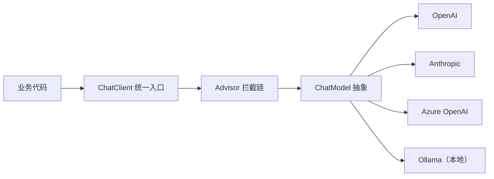

## 前置知识

- [Spring MVC 与 REST API](/spring-boot/060-SpringMvcRestApi)：会写 Controller、会注入 Bean，知道 starter 与 application.yml 的配置方式；
- [第一次调用大模型 API](/ai-llm/030-FirstLlmApiCall)：知道 messages、流式输出这些对话调用的基本概念。

没读过也可以，本文会带上需要的部分：第 2 节用 Spring Data 的类比把 Spring AI 的定位讲透；[服务间 HTTP 调用](/spring-boot/145-RestClientsAndServiceCalls) 讲的「调别人」纪律（超时、错误转换）在本篇全部适用，可以作为并行读物。

## 学习目标

读完本文你将能够：

1. 解释 Spring AI 的定位——像 Spring Data 统一数据库访问那样统一模型访问，并说出 ChatClient 抽象与 starter 切换带来的工程收益；
2. 写出 ChatClient 的同步 call() 与流式 stream()（返回 Flux）两种调用，并知道各自适配什么场景；
3. 用 .entity(Class) 把模型输出直接映射成 Java 类型，说清它与 Jackson、Bean Validation 的衔接；
4. 用 @Tool 注解把 Spring Bean 方法暴露给模型，复述工具调用的设计纪律与权限前提；
5. 用 Advisor 拦截链的心智模型（类比 AOP）规划检索增强、日志、安全检查这些横切关注点；
6. 配置 Ollama 本地模型做到开发环境零成本调用，并说出提示注入在企业 Java 场景的真实威胁面。

预计 30 到 45 分钟，含 3 个动手实验与 3 道练习。

## 1. 问题引入：LLM 能力必须能进存量 Java 体系

银行核心、订单系统、账务平台、风控引擎——企业里真正扛起业务的，是跑了十年的 Java/Spring 系统。2026 年的每个企业都在往这些系统里加 LLM 能力：智能客服、工单自动分类、合同要点抽取、内部文档问答。问题在于，这些能力必须长在存量体系里：复用现有的事务、权限、审计、监控与部署流水线，而不是在旁边搭一个 Python 孤岛然后互相调——孤岛意味着第二套运维体系、第二套安全边界和一条新的网络链路。

Java 生态对这个需求的答案就是 Spring AI。它的关键判断是：模型访问这件事和数据库访问一样，属于「每个应用都要做、但不应绑死在某家供应商上」的基础设施，理应由框架统一抽象。

## 2. Spring AI 的定位：像 Spring Data 统一数据库访问

回想 Spring Data 解决的问题：JDBC 时代每换一家数据库就学一套客户端 API；Spring Data 用 Repository 抽象统一了访问方式，实现由 starter 依赖与配置决定，业务代码不动。Spring AI 对模型做的是同一件事：



- **ChatClient** 是你写代码面对的统一入口，背后是被抽象的 ChatModel；
- **provider 由 starter 依赖与配置切换**：引入 openai starter、anthropic starter 或 ollama starter，改几行 application.yml，业务代码零改动：

```xml
<!-- pom.xml：换 provider 就是换 starter（坐标以官方文档为准） -->
<dependency>
  <groupId>org.springframework.ai</groupId>
  <artifactId>spring-ai-starter-model-openai</artifactId>
</dependency>
<!-- 切到本地 Ollama：把上面的依赖换成 spring-ai-starter-model-ollama，配置同步调整 -->
```

- **横切能力进拦截链**：检索增强、日志、安全检查这些通用逻辑做成 Advisor（第 6 节），与具体 provider 无关。

版本事实：Spring AI 1.x 已于 2025 年 5 月正式 GA，API 已稳定，但各 starter 的 artifactId 与配置项在演进中细节有变，**一切以官方文档为准**。网上 2024 年的教程里 API 名称多有出入，看到对不上就以官方文档校准，不要硬背。

## 3. ChatClient：call 与 stream

引入 starter（如 spring-ai-starter-model-openai）并在配置里填好 key 之后，注入 ChatClient.Builder 即可使用：

```yaml
spring:
  ai:
    openai:
      api-key: ${OPENAI_API_KEY}   # 从环境变量注入，绝不写进仓库
      chat:
        options:
          model: gpt-4o-mini       # 示意，可用型号以官方文档为准
```

```java
@RestController
class ChatController {

    private final ChatClient chat;

    ChatController(ChatClient.Builder builder) {
        this.chat = builder
                .defaultSystem("你是公司知识库助手，只依据检索到的资料回答") // 全局系统提示
                .build();
    }

    // 同步：等完整回复，适合内部任务（分类、抽取、批处理）
    @GetMapping("/api/qa")
    String qa(@RequestParam String q) {
        return chat.prompt().user(q).call().content();
    }

    // 流式：返回 Flux，SSE 逐段推给前端，适合对话界面
    @GetMapping(value = "/api/qa/stream", produces = MediaType.TEXT_EVENT_STREAM_VALUE)
    Flux<String> stream(@RequestParam String q) {
        return chat.prompt().user(q).stream().content();
    }
}
```

两种调用对应 [第一次调用大模型 API](/ai-llm/030-FirstLlmApiCall) 讲过的两种消费方式，选择判据与本系列前端流式篇一致：**要逐块渲染给用户就用 stream，内部加工等完整结果就用 call**。Flux 是 Project Reactor 的流类型，Spring MVC 的接口可以直接返回它做 SSE 输出（框架自动处理逐段推送），WebFlux 技术栈则更为原生。prompt().user(q) 的链式结构里还可以挂 options 覆盖单次调用的参数——全局默认配置一次，单次差异按需覆盖，和 Spring 的一贯风格一致。

落点也讲究：示例为了直观写在 Controller 里，生产代码应把 ChatClient 注入领域 Service，Controller 只编排 HTTP 语义。这样模型调用与业务方法（事务、权限）在同一层组合，测试时也能脱离 Web 层直接验证 Service 逻辑——与第 5 节的工具 Bean 出自同一个分层原则。

与 [RestClient](/spring-boot/145-RestClientsAndServiceCalls) 的关系要说清：RestClient 是通用的「你调别人」，调 LLM 厂商的裸 HTTP 也完全可行；Spring AI 的价值在于它不只是替你发请求，而是把结构化输出、工具调用、Advisor 这些 LLM 特有的工程关切抽象成了框架设施。调一两个端点用 RestClient 足够，要把 LLM 当长期基础设施用，就上 Spring AI。

## 4. 结构化输出：.entity() 直接触发转换与映射

工单分类、信息抽取这类场景需要的是 Java 对象，不是一坨 JSON 字符串。Spring AI 的 .entity(Class) 把「模型输出、解析、映射」压成一步：

```java
// 用 record 声明目标结构——schema 即文档
record TicketCategory(String category, String priority, String summary) {}

TicketCategory result = chat.prompt()
        .user("请对以下工单分类并给出摘要：\n" + ticketText)
        .call()
        .entity(TicketCategory.class);   // 模型输出 -> 解析 -> 映射成 TicketCategory
```

它在幕后做三件事：按 record 的结构生成格式要求注入提示、请求模型输出、用 Jackson 把返回映射成类型化对象（映射机制与 [Spring MVC 的消息转换](/spring-boot/060-SpringMvcRestApi) 同源）。拿到的是强类型对象，可以直接接 Bean Validation 校验、进事务、写库：

```java
// 在 record 上直接挂校验注解，模型输出落库前先过 [Bean Validation] 那一套
record TicketCategory(
    @NotBlank String category,
    @Pattern(regexp = "P0|P1|P2") String priority,
    @Size(max = 200) String summary
) {}
```

record 与 Jackson 的配合规则（字段名、嵌套结构）与常规反序列化一致，模型产出的 JSON 与 schema 不符时按解析失败处理——生产上仍要配重试与兜底，Python 侧的完整回路（校验失败把错误喂回去重试）在这里同样适用，原理见 [结构化输出](/ai-llm/060-StructuredOutput)。

## 5. 工具调用：@Tool 把 Bean 方法交给模型

让模型回答「订单 SO-2026-0117 到哪了」，正确姿势不是把订单表塞进提示，而是给它工具。Spring AI 用 @Tool 注解把 Spring Bean 方法暴露给模型：

```java
@Component
class OrderTools {

    private final OrderService orderService;   // 直接复用现有业务 Bean

    OrderTools(OrderService orderService) {
        this.orderService = orderService;
    }

    @Tool(description = "按订单号查询物流状态。订单号形如 SO-2026-0117")
    OrderStatus findOrder(String orderNo) {
        return orderService.query(orderNo);    // 现有权限校验、审计照常生效
    }
}

// 调用时挂上工具
String answer = chat.prompt()
        .user("我的订单 SO-2026-0117 到哪了？")
        .tools(new OrderTools())   // 也可注册 Bean 实例，以官方文档的注册方式为准
        .call()
        .content();
```

机制与通用原理（模型决定何时调用、参数由模型按描述填写、结果回填给模型继续推理）见 [工具调用设计](/ai-llm/110-ToolCallingDesign)，那篇里的设计纪律在此全部适用，尤其是两条：**description 是写给模型看的工具说明书**，写清楚用途、参数格式与边界，模型才会正确选用；**工具内部就是普通业务方法**，鉴权与校验不能因为「调用方是模型」而豁免——模型发起的调用也是调用，注入了什么身份就要按什么身份过权限。

## 6. Advisors：横切关注点的拦截链

给 LLM 调用加检索增强、加日志、加敏感词检查，最差的做法是把这些代码散在每处调用点。Spring AI 的 Advisor 提供了统一的位置——它在请求进入模型前后执行，可以改写请求（如检索资料注入上下文）、可以改写或观察响应（如记录、脱敏）。做过 Spring 开发的人对这个形状应该一眼熟悉：**Advisor 之于 ChatClient，就是 AOP 切面之于 Bean**（AOP 的心智模型见 [面向切面编程](/spring-boot/110-AspectOrientedProgramming)）：

```java
String answer = chat.prompt()
        .user(question)
        .advisors(
            new SimpleLoggerAdvisor(),   // 日志：记录 prompt 与响应，便于审计与排查
            new QuestionAnswerAdvisor(vectorStore, SearchRequest.defaults()) // RAG：检索资料注入上下文
        )
        .call()
        .content();
```

两个内置示例的分工：SimpleLoggerAdvisor 记录每次对话的进出，QuestionAnswerAdvisor 在调用前检索向量库并把命中资料注入提示——Spring AI 的 RAG 接入因此可以薄到一行 Advisor。自研 Advisor（敏感词、租户隔离、调用配额）实现框架的接口即可插入同一条链。判断一个横切逻辑该不该做成 Advisor 的判据与判断切面相同：它是否与业务无关、是否应该对多处调用统一生效。

## 7. 本地开发：Ollama 零成本环境

模型 API 是收费的外部依赖，日常开发与 CI 不应依赖它。Spring AI 对 Ollama（本地模型运行时，安装与模型管理见 [本地推理与 Ollama](/ai-llm/170-LocalInferenceOllama)）提供了一等支持——换一个 starter、改一段配置，业务代码一行不动：

```yaml
spring:
  ai:
    ollama:
      base-url: http://localhost:11434
      chat:
        options:
          model: qwen3   # 本地拉取的模型名，以 Ollama 模型库为准
```

这套「同一套代码、配置切换 provider」的能力正是第 2 节抽象价值的直接兑现：开发与 CI 跑本地 Ollama（零成本、可离线），预发与生产跑云端 provider（高质量、可扩容），环境差异被压进配置文件。联调前端流式界面、验证工具调用链路这些高频动作，本地模型顺手且免费。

## 8. 生态关系与安全提醒

**Spring Cloud 照常工作**。LLM 调用在架构视角上只是又一类下游依赖：网关、配置中心、熔断器该挂照挂，[服务间调用](/spring-boot/145-RestClientsAndServiceCalls) 里立的纪律（显式超时、错误统一转换）一条不少。Spring AI 自带重试配置（对限流与服务端错误做指数退避，配置键以官方文档为准），把它按业务能接受的等待上限调好：

```yaml
spring:
  ai:
    retry:
      max-attempts: 5            # 含首次调用；数值按业务容忍度定
      backoff:
        initial-interval: 1000   # 首次退避 1 秒
        multiplier: 2            # 之后 2s、4s……指数放大
```

配置里的 max-attempts 正是「为修复瞬时错误愿意多试几次」的上限声明——这个心智模型与本系列 Python 工程篇的健壮性三件套完全同构，只是落点从代码装饰器换成了 Spring 配置。反过来，这也解释了为什么企业选 Spring AI 而不是绕开框架裸调——它让 LLM 依赖落进了企业已有的治理轨道。

**提示注入是企业场景的真威胁，不是科幻**。工单正文、用户评论、上传文档都可能被塞入注入指令；在 Java 系统里这些输入往往直通高权限工具（查订单、改数据）。防线分三层：模型输出与外部文本一律按不可信数据处理；工具按最小权限暴露并逐层鉴权；日志与审计覆盖每一次工具调用。系统性的攻防见 [提示注入与安全](/ai-llm/190-PromptInjectionSecurity)——那篇里的结论在 JVM 世界原样成立。

## 9. 常见困惑

**Q：Spring AI 与直接用 RestClient 调 API，怎么选？**

一两个端点、调用方式固定，RestClient 直调更轻；要 provider 可切换、结构化输出、工具调用、Advisor 生态中的两个以上，Spring AI 的抽象就开始回本。与选 Spring Data 还是裸 JDBC 是同一类判断。

**Q：换 provider 真的只改配置吗？**

代码层面的调用可以零改动，但模型行为不会零改动：不同模型的指令遵循、工具调用格式、结构化输出质量有差异。切换后必须做一轮回归测试——抽象统一的是接口，不是智能水平。

**Q：stream() 返回的 Flux 在 Spring MVC 里能用吗？**

能。Spring MVC 支持返回 Flux 做 SSE 响应，框架负责逐段推送；WebFlux 技术栈则全程原生。前端消费这段 SSE 的通用做法（ReadableStream 解析、AbortController 中断）见前端流式相关篇章，机制与语言无关。

**Q：GA 之前的旧教程还能看吗？**

思路（ChatClient、Advisor、工具调用的心智模型）仍然有效，但具体 API 名称与配置项多有变动。校准的唯一标准是当前版本的官方文档。

## 10. 动手实验

实验一：本地装 Ollama 并拉一个小模型，工程里换 ollama starter 与配置，跑通第 3 节的 call() 与 stream()，全程不花一分钱 API 费。

实验二：定义 TicketCategory record，喂三段不同风格的工单文本给 .entity()，观察映射结果；故意喂一段无主题文本，观察解析失败时的异常形态。

实验三：给 OrderTools.findOrder 挂上 @Tool，问「订单 SO-2026-0117 到哪了」，打开 SimpleLoggerAdvisor 的日志，找到模型发起工具调用的记录，确认调用走了你的业务 Bean。

练习一（笔头）：用 Spring Data 类比向组长解释 Spring AI 的定位，并说出「换 provider 改哪里、不改哪里」。

练习二（笔头）：检索增强、调用日志、租户配额三个需求，判断哪些适合做成 Advisor，为什么。

练习三（笔头）：列出「把 orderService 全部方法包成 @Tool」这个方案的风险，并给出暴露原则。

## 11. 官方文档

- Spring AI 官方文档（starter 坐标、配置项与 API 以此为准）：https://docs.spring.io/spring-ai/reference/
- Spring AI 项目主页与版本状态：https://spring.io/projects/spring-ai

## 12. 自检清单

1. 能否用 Spring Data 类比说清 Spring AI 的定位，并画出 ChatClient 到各 provider 的分层图？
2. 能否写出 call() 与 stream() 两种调用并说出各自适配的场景？
3. 能否解释 .entity(Class) 在幕后做了哪三件事，以及解析失败时的工程兜底？
4. 能否复述 @Tool 的两条纪律（description 是给模型的说明书、工具照常过权限）？
5. 能否用 AOP 类比解释 Advisor，并说出「该不该做成 Advisor」的判据？
6. 能否说出 Ollama 在开发流程里的位置，以及提示注入在存量 Java 系统里的威胁面？
