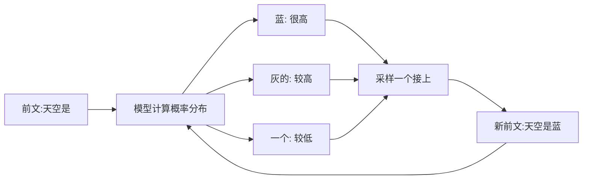
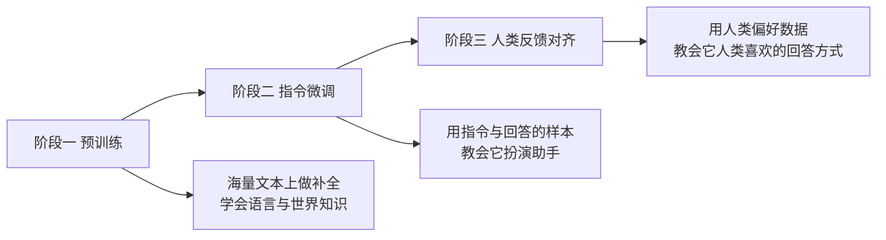

## 前置知识

- 读过 [第一个 Python 程序](/start/070-FirstProgramPython)：亲手跑通过一段代码，理解「程序按写好的指令一步步执行」；
- 读过 [程序设计基础](/cs-fundamentals/020-ProgrammingBasics)：知道「程序 = 指令 + 数据」，理解「确定性执行」——这正是本文要打破的那份确定性。

没读过也可以，本文会带上需要的部分：这两篇各花 10 分钟即可补齐。

## 学习目标

读完本文你将能够：

1. 用「下一个词预测器」向别人解释 LLM 在做什么，并说清它为什么不是数据库、也不是搜索引擎；
2. 解释 token 与分词是什么，判断哪些任务（比如数字母）会因分词而天然吃亏；
3. 用「工作记忆」类比说清上下文窗口的边界效应：超出窗口的内容不是「被遗忘」，而是「从未在场」；
4. 按预训练、指令微调、人类反馈对齐三个阶段，解释模型为什么会流畅且笃定地输出错误答案；
5. 说出幻觉的机制性根源，以及四条缓解思路各自拦截的是问题的哪一环；
6. 面对一个具体需求，借助对照表判断该用传统程序、搜索引擎还是 LLM。

预计 30 到 45 分钟，含 2 个动手实验与 4 道练习。

## 1. 问题引入：像数据库，又像人，到底是什么

第一次用 ChatGPT 这类产品的人，几乎都会经历同一种错位：它背得出诗句、讲得出历史，像个装满百科全书的数据库；可你问它一篇没公开过的内部文档，它也能答得头头是道——只是内容是编的。它又不像数据库。

换个角度它还像搜索引擎：能告诉你 Python 怎么装。可你让它对检索结果负责时，它给出的引用可能是拼凑的假链接。它又不像搜索引擎。

传统程序我们很熟悉：写好 `if` 和循环，机器确定性地执行，同样输入必然同样输出。LLM 完全不是这样运作的——同样的输入，两次回答可以不同；没人写过 `if` 判断「用户在问什么」，它却对答如流。

这些矛盾指向同一个事实：我们缺一个正确的心智模型。本文的任务就是建立它。有了它，后面所有「奇怪」的现象——数错字母、编造事实、答完就忘——都会从「神秘故障」变成「可以预期的机制」。

## 2. 心智模型：下一个词预测器

把模型拆到最简，它只做一件事：**看着已有的一段文字，预测下一个 token 的概率分布，挑一个接上去，然后重复**。直到它输出一个表示「说完了」的特殊 token。



这个循环就是全部。它不查询、不检索、不执行判断，它在**补全文本**。你现在看到的每一次「回答」，都是这个补全循环跑了几十次到几千次的结果。

值得先说一句：为什么不给出更多机制、偏要押注这一个模型？因为它有极强的解释经济性——后文所有现象（数字母翻车、答完就忘、说错话还理直气壮、两次回答不同）都能从「预测下一个 token」直接推出来，不需要为每个现象单配一个解释。一个模型管到底，比十个特设解释更接近真相，也更好记。

用这个模型重新看开头的矛盾，一切都通了：

- 为什么像数据库？预训练时它读过海量文本，高频出现的知识（诗句、常识、语法）被压进了参数，补全时自然带出来；
- 为什么能编造？因为补全机制根本不区分「读过的事实」和「顺着语境最顺的接法」——只要接得像，它就会接；
- 为什么两次回答不同？因为「挑一个」是带随机性的采样，不是取最大值，这一点第 9 节还会回到。

心智模型成立的前提，是先搞清「下一个词」里的「词」指什么。这就引出 token。

## 3. token：模型眼中的文字不是你眼中的文字

模型不认识「字」，不认识「单词」，它认识的单位叫 **token**。文字在进入模型前，会先被**分词器**（tokenizer）切成一串 token，每个 token 对应一个编号；模型的输入输出全程都是这些编号。

分词的主流思路（如 BPE，Byte Pair Encoding）可以粗暴理解为：**把训练语料里高频出现的字符片段合并成一个个 token**。于是常见英文单词往往一个 token 搞定，而生僻词会被拆成几块；中文常见词通常一到两个 token，具体切法因各家分词器而异。粗略感受一下量级：英文平均 1 个 token 约合 4 个字符上下，中文 1 个汉字通常占 1 到 2 个 token——精确比例以各厂商文档为准，不必背。

这个设计极其高效，但埋下一个著名陷阱：**模型看到的不是字母序列，是 token 序列**。

以经典的 strawberry 为例。你眼里它是 10 个字母，模型眼里它可能是类似 `str + aw + berry` 的几块 token（示意切法）。当你问「strawberry 里有几个 r」，模型的机制是：对 token 序列做统计意义上的续写，而不是像人一样逐字母扫描拼写。它就像被问「这个快递箱里有几颗糖」的人，而它只看得见箱子上印的图案——于是开始猜，猜完还要给一个流利的解释。

同理吃亏的还有：数一段文字里某个字出现的次数、按字母排序单词、反转字符串、给生僻词标音。这些任务的共同点是**答案藏在字符层，而模型工作在 token 层**。有趣的是，模型往往能解释「r 出现在哪几个位置」，但总数经常错——因为解释是流畅的补全，计数是它不擅长的字符操作。

把「哪些任务会因 token 吃亏」收成一张速查表，遇到可疑任务先对号入座：

| 任务类型 | 为什么吃亏 | 缓解方向 |
| --- | --- | --- |
| 数字母、数笔画、数出现次数 | 答案在字符层，模型工作在 token 层 | 用代码工具执行，模型只负责调用与解读 |
| 反转字符串、按字母排序 | 同上 | 同上 |
| 生僻词标音、罕见缩写解释 | 生僻内容被切成多块 token，内部结构不可见 | 提供参考资料让它「抄」，而不是「回忆」 |
| 长数字比大小、乘除运算 | 长数字可能从中间被切开 | 借助计算工具，不靠模型裸算 |

注意缓解方向那一列的共同点：**都不是「换个问法」，而是把字符级、数值级的工作移出模型**——这个「模型指挥工具」的分工，是本模块后半程 Agent 各篇的主旋律。

这也解释了一个反直觉的现象：同一个数字母任务，问英文单词错得多，问一个正好是独立 token 的短词反而可能对。错与对都不神秘，只取决于任务与分词粒度的错位程度。

token 还有另一重身份，从现在起就要有意识：**它同时是计量单位**。API 的费用按 token 计，上下文窗口的容量也按 token 计。所以「切 token 的方式」不只影响答错与否，还直接决定贵不贵、装不装得下——这层在 [第一次调用 LLM API](/ai-llm/030-FirstLlmApiCall) 与 [上下文工程](/ai-llm/050-ContextEngineering) 里会反复出现。

## 4. 上下文窗口：一张桌子大小的工作记忆

模型的每一次生成，能「看见」的只有**上下文窗口**里的内容：系统提示、你的全部对话历史、贴进去的资料，加起来不超过一个上限（现代模型从数万到数十万 token 不等，个别型号宣称更大，以官方文档为准）。

最好的类比是**一张桌子**：模型是只看桌面干活的工人，桌子面积有限。你有三份材料要它对照，桌面放得下就没问题；放不下，你就得拿走几份——而它对被拿走的那几份**毫无察觉**。

这里有个必须纠正的直觉：超出窗口的内容不是「模型忘了」。遗忘暗示「曾经记得」；对模型来说，**窗口外的东西从未在场**。第 1 轮说的话，如果到第 100 轮被挤出窗口，模型既不会记得也不会知道自己漏了什么——这正是很多长对话后期「前言不搭后语」的根源。

两个直接推论，后面几篇都会反复用到：

1. 「它记得我上一轮说的话」是假象——是应用层把上一轮原样复制进这次请求的窗口，模型自己没有任何跨请求的记忆；
2. 窗口是稀缺资源：塞得越多，单次调用越贵、注意力越分散。如何经营这个窗口，本模块 [上下文工程](/ai-llm/050-ContextEngineering) 整篇讨论。

再补一条尺寸感，把第 3 节的 token 换算接到窗口上：一页中文文档约一两千 token，一场 20 轮的日常对话轻松累积上万 token，一份长 PDF 可能就是几万。所谓「大窗口」，本质是「大预算」——预算怎么在系统提示、历史、资料之间分配，是后面所有篇章反复回味的经营题。

## 5. 训练三阶段：它为什么「说错话还理直气壮」

今天的对话模型不是一步训练出来的，而是三个阶段的产物。每一阶段只求建立直觉：



**阶段一：预训练。** 在互联网规模的文本上做亿万年如一日的「下一词预测」。模型的全部语言能力、大部分世界知识来自这里。但此时的它只会「接着写」：你给它一段问题，它可能顺理成章地续写出另一个问题、或者十个不同的答案——因为语料里问答常是成串出现的。

**阶段二：指令微调。** 用人工整理的「指令 → 高质量回答」样本继续训练，让它学会进入「助手」这个角色：遇到问题，输出的是回答本身，而不是续写出更多问题。

**阶段三：人类反馈对齐。** 让人对模型的多个回答排序打分，再用这些偏好数据训练，使模型的输出向人类认可的样式靠拢：更有用、更无害、更谦逊。

三个阶段走完，一个关键问题没有改变：**训练目标自始至终是「生成高概率、像样的文本」，而不是「生成经过核实的文本」**。没有任何一个阶段的损失函数在检查真伪。

所以当模型不知道答案时，它的机制不会切换成「查证模式」——它没有这个模式。它只会继续做最擅长的事：顺着语境，生成一段格式完美、语气笃定、细节丰富的**看起来像答案的文本**。语气上的自信与事实上的正确，在它的目标函数里从来是两件事。这就是「说错话还理直气壮」的完整解释。

## 6. 串起来：一次回答的全程拆解

四个概念都到位了，现在把它们组装起来，完整走一遍一次真实调用。用户在界面输入：「帮我看看这句英文有没有语法错误：He don't like apples.」

第一步，**组装窗口**。应用层把剧本摆好——system 里是产品预先写好的角色设定，messages 里是全部历史加这条新消息：

```json
[
  {"role": "system", "content": "你是一名严谨的英语老师,指出错误并给出修正"},
  {"role": "user", "content": "帮我看看这句英文有没有语法错误:He don't like apples."}
]
```

第二步，**分词**。整个窗口被切成 token 序列——包括你以为是「设定」的 system 提示，对模型来说它们只是窗口里靠前的 token。

第三步，**补全循环**。模型读完整个序列，开始逐个预测：根据「英语老师 + 找错误」的语境，「指出错误」是高概率的开局；写到错误本身时，主语 He 后面接 doesn't 的概率远高于 don't——这不是模型「懂语法」，是正确形态在预训练语料里出现了太多万次。每写出一个 token，它就被拼回序列末尾，模型看着变长的序列预测下一个。

第四步，**采样与终止**。每个位置从概率分布里挑一个（挑法受采样参数调控），直到模型输出表示「说完了」的特殊 token，循环结束。

第五步，**返回**。应用层拿到全文与 usage 统计，展示给用户——顺便，把这一轮的问答原样存下来，因为下一轮还要靠它重发窗口。

回看全程：模型没有查过任何语法书，没有执行过任何规则判断。它给出的是**与角色设定一致、与语料统计相符的高概率文本**——大多数时候这恰好等于正确答案，但「概率高」与「一定对」之间的那条缝，正是下一节的主角。

## 7. 幻觉：流畅度优先于真实性的机制性后果

上一节的结论值得单独立一节，因为它有个名字：**幻觉（hallucination）**——模型输出看似合理实则虚假的内容。

机制上可以再压成一句话：**补全的流畅度优先于真实性**。「编一个像样的引用」和「承认不知道」放在同一个概率分布里竞争，如果语境暗示「这里应该有一个引用」，前者往往就是更高概率的延续。幻觉不是偶发 bug，是这套机制在知识空白处的**默认行为**。

实践中幻觉有三张常见面孔，认得出形态才好对症：

| 形态 | 表现 | 高发场景 |
| --- | --- | --- |
| 事实编造 | 日期、数字、人名、法规条款凭空出现 | 追问冷门细节、追问具体数字时 |
| 来源虚构 | 书名、论文、链接、判例煞有介事 | 要求「给出处」「附引用」时——索要出处本身构造了「这里有一个出处」的语境暗示 |
| 逻辑滑步 | 前提错了，推理一路流畅无阻 | 多步推理链，错误在第一步埋下、中途无人叫停 |

第三张面孔尤其值得警惕：前两种还能靠「核实出处」发现，逻辑滑步的每一步单看都成立，只有链条起点是错的——这就是为什么工程上更信任「模型 + 外部工具」而不是「模型裸想」。

更重要的是推论：**用「更用力地问」无法根治它**。重复「请务必准确」几乎无效，因为准确性不在它的优化目标里。真正有效的思路都是在机制外部动手脚，总览如下，细节各有专篇：

| 思路 | 一句话原理 | 拦截的是哪一环 |
| --- | --- | --- |
| 给资料再回答 | 先检索文档塞进窗口，要求只依据资料作答 | 弥补知识空白，把「编」变成「抄」 |
| 约束输出结构 | 用 JSON 之类的固定格式限制回答形状，便于校验 | 让编造的内容更难蒙混过机器检查 |
| 要求引用与溯源 | 每个论断标注来自哪段资料，人工或程序复查 | 给幻觉增加被发现的成本 |
| 评估先行 | 用固定题集批量测试模型，量化错误率 | 不知道错多少，就谈不上缓解 |

第 1、2 条会在 [第一次调用 LLM API](/ai-llm/030-FirstLlmApiCall) 与 [结构化输出](/ai-llm/060-StructuredOutput) 落地成代码，第 4 条是 [LLM 评估](/ai-llm/150-LlmEvaluationEvals) 的主题。本篇你只需带走这句话：**看到笃定、流畅、细节丰满的回答，恰恰要多一分警惕**。

## 8. 三种角色对照：传统程序、搜索引擎、LLM

把三者放在一张表里，边界就清楚了：

| 维度 | 传统程序 | 搜索引擎 | LLM |
| --- | --- | --- | --- |
| 工作方式 | 执行人写的确定指令 | 检索并返回已有文档 | 逐 token 补全文本 |
| 同样输入两次运行 | 结果必然相同 | 结果基本相同 | 可能不同（采样随机性） |
| 擅长 | 规则明确、不容出错的流程 | 找「存在 somewhere 的原文」 | 语言任务：写、改、总结、翻译、结构化 |
| 不擅长 | 没写过的规则 | 综合、改写、回答没有现成页面的复合问题 | 精确计数、精确查证、算术（未借助工具时） |
| 失败模式 | 崩溃或抛异常，看得见 | 找不到或找错，看得出 | 流畅的错话，**看不出来** |
| 正确用法 | 要求它严格 | 要求它可溯源 | 给足上下文，并对关键结论做核验 |

最值得记住的是最后两行。传统程序错了会炸，搜索引擎错了你点开原文就能发现；LLM 的失败是最危险的失败形式——**错误以正确的形状出现**。所以工程上用 LLM 的铁律是：把它放在「语言处理」的位置上，把「精确计算」「事实查证」交给传统程序与工具，本模块工具调用、Agent 各篇都在展开这个分工。

铁律落成一个微缩例子：做一个「报销单审核」功能，正确分工是让模型读发票影像、抽取字段、判断表述是否含糊——这是语言任务；而「金额合计是否超过上限」「发票号是否重复」交给普通代码判断——那是规则与算术。模型负责「看懂」，代码负责「裁定」，两者的输出再合流。反过来（让模型心算合计）就是把铁律用反了。

## 9. 常见困惑

**问：它是不是联网查了资料才回答的？**
不是。网页产品是否带搜索取决于产品设计，模型本身没有联网动作，它的回答全部来自参数里的知识和窗口里的内容。由此带来「知识截止日期」概念：模型只见过训练截止前的世界，之后发生的事它一无所知——除非产品层额外接了搜索工具。

**问：它把整个互联网都存起来了吗？**
没有，也存不下。参数里存的是从海量文本中提炼出的**统计规律与关联**，类似压缩后的经验而非原文仓库。它能背出名句，是因为名句在语料中高频出现；换个语料里没出现的细节问它，机制立刻滑向补全——也就是幻觉。

**问：同一个问题两次回答不同，是不是不稳定、有 bug？**
是设计而非缺陷。「挑下一个 token」默认带随机性，为的是生成多样、自然的文本。需要稳定输出时（如自动化流水线），可以把采样参数调向确定性，但即便如此也非绝对一致，原因与操作详见 [第一次调用 LLM API](/ai-llm/030-FirstLlmApiCall)。

**问：它到底「理解」语言吗？**
这是哲学问题的工程切角：不需要下结论也能用好它。工程上有效的立场是：它没有人类式的理解与意图，但补全机制在语言任务上的表现足以当工具用；把它当「不明白语境但语言能力极强的补全器」来设计系统，比当「电子同事」来信任，犯的错会少得多。

**问：为什么它有时秒回，有时要等十几秒？**
生成是逐 token 进行的，**回答长度基本决定总时长**——让它写长文必然慢。输入窗口的长度则影响起步速度：塞进去的资料越多，第一个 token 出来得越晚。至于「同样的要求，这回变慢了」，通常是这回它决定写得更长。这条直觉的工程版（首字延迟、流式的取舍）在 [第一次调用 LLM API](/ai-llm/030-FirstLlmApiCall) 展开。

## 10. 动手实验：两个网页小实验

实验只需任一网页版对话模型（ChatGPT、Claude、Gemini、Kimi、智谱清言等均可）。

**实验一：让它数字母。** 输入：「strawberry 这个单词里有几个字母 r？」先自己数（答案是 3），再看它的回答。然后追问「你是怎么数出来的」，观察它的解释——很多模型会给出一段貌似逐字母检查的流畅描述，但结论可能仍是错的。对照第 3 节：它给的是「看起来像数数过程的补全」，不是真的字符扫描。再补一刀：问一个生造词（自己拼一个不存在的英文词）里某个字母的个数，观察错误率的变化——生造词会被切成更多 token，错位更严重。

**实验二：诱导一次幻觉。** 输入：「请介绍《量子管理学的十大定律》这本书的核心观点和作者背景。」（这本书不存在。）观察它是流畅地编出全书框架，还是停下来说不存在。然后同一个问题加一句「如果这本书不存在，请直接告诉我」，对比两次行为的差异。这个实验会给你两个终身受用的手感：其一，诱导性的提问框架本身就在给模型「这本书存在」的语境暗示；其二，明确授权它说「不知道」，能显著改善表现——这正是第 7 节「给模型一条低概率但正确的出路」的微缩版。

两个实验都不需要写代码。做完把它们各写三行记录下来，格式自定但必须包含三项：

```text
我的预期是什么 / 实际观察到什么 / 用本文哪个概念解释
```

把「预期」单独写出来是关键一步：实验的价值一半来自预期与现实的差值。日后你会反复用到这个习惯——本模块每一篇的动手实验都沿用这个格式。

## 11. 小练习

1. 概念题：用「下一个词预测器」解释——为什么问模型「写作文」比「做算术」可靠？指出两者分别落在模型的主场与短板上。
2. 判断题：把一本 300 页的 PDF 塞进窗口，模型就能准确引用第 217 页的脚注吗？从「工作记忆」与「注意力」两个角度说理由（提示：窗口装得下不等于看得到，见 [上下文工程](/ai-llm/050-ContextEngineering)）。
3. 归因题：客服机器人聊到第 30 轮开始重复用户几轮前的话并自相矛盾。用「窗口」「补全」两个概念给出最可能的解释。
4. 设计题：你要做一个「把用户上传的账单图片转成 JSON」的功能。结合对照表，说明为什么「识别与格式化」可以交给模型，而「金额合计的加法」不应该交给它。

## 12. 与之前和之后的知识的关系

- 往前：[程序设计基础](/cs-fundamentals/020-ProgrammingBasics) 里「程序是确定性的」这一默认假设，在 LLM 这里被打破了——这正是本文从「确定性执行」讲起的原因；
- 往后：下一篇 [模型版图与选型](/ai-llm/020-ModelLandscapeSelection) 回答「GPT、Claude、GLM、Qwen 这些模型怎么分、怎么选」；[第一次调用 LLM API](/ai-llm/030-FirstLlmApiCall) 把本文的补全循环变成你代码里的一次 HTTP 请求；
- 更远：本文埋下的三个伏笔——窗口的经营（[上下文工程](/ai-llm/050-ContextEngineering)）、幻觉的拦截（评估篇）、把补全器变 teammates 的提示设计（[提示工程](/ai-llm/040-PromptEngineering)）——构成整个模块的主线。

## 13. 自我检查

1. 能不看资料向别人讲清「补全循环」的四个步骤，并解释为什么它不是检索；
2. 能说出 token 与字母的关系，并举出一个因分词而吃亏的任务类型；
3. 能纠正「模型忘了之前的话」这个说法，换成准确的表述；
4. 能按顺序说出训练三阶段各自解决什么问题，并指出三阶段共同的目标函数是什么；
5. 能复述「流畅度优先于真实性」，并列出四条缓解思路各自的拦截位置。

## 本章总结

LLM 的全部行为都始于一个机制：给定前文，预测下一个 token，采样，接上，重复。token 是它唯一认识的文字单位，分词粒度与字符任务的错位造成数字母类翻车；上下文窗口是它的全部工作记忆，窗口外即不存在；三阶段训练（预训练、指令微调、人类反馈对齐）教会它像助手一样说话，但没有一个阶段教它核实真伪——于是流畅度压过真实性，幻觉成为机制在知识空白处的默认行为。缓解幻觉靠机制外手段：给资料、约束结构、要求溯源、评估先行。用 LLM 的铁律由此而来：让它做语言处理，把精确计算与事实查证交给传统程序和工具。

## 下一步

进入 [模型版图与选型](/ai-llm/020-ModelLandscapeSelection)：认识 GPT、Claude、Gemini、GLM 与 Llama、Qwen、DeepSeek 各自的位置，学会用四个维度为自己的场景选模型。
