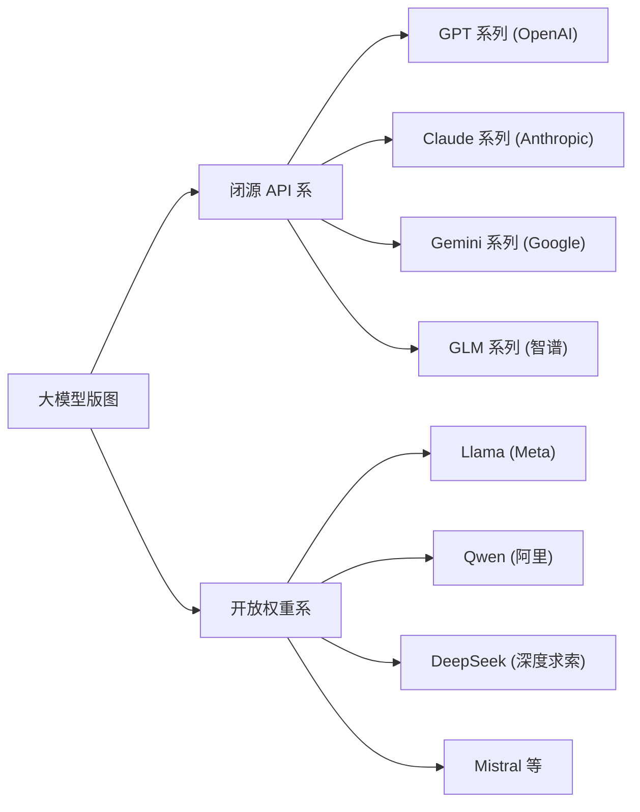
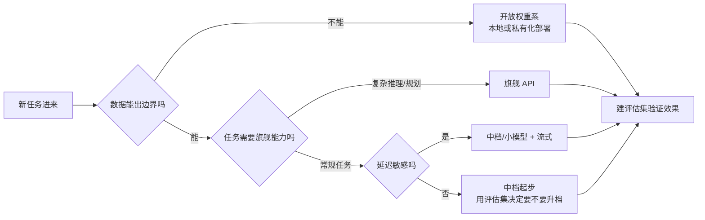
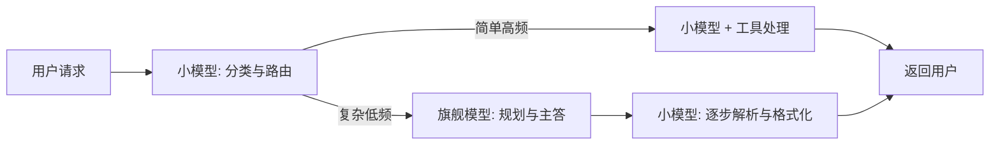

## 前置知识

- 读过 [LLM 是什么](/ai-llm/010-WhatIsLLM)：知道「下一个词预测器」「token」「上下文窗口」这三个概念，理解模型能力有主场与短板之分。

本文只依赖这一篇，10 分钟读完即可开始。

## 学习目标

读完本文你将能够：

1. 画出模型版图的两条大陆（闭源 API 系与开放权重系），说出各阵营的代表系列与分野标准；
2. 对比调 API、本地部署、微调定制三种获取形态的门槛、成本结构与数据去向，为给定场景指出该用哪种；
3. 按旗舰、中档、小模型三档说出典型分工，判断一个具体任务该落在哪一档；
4. 指出评测榜的三个失真来源（基准饱和、数据污染、场景错位），并说清「用自己的评估集测」为什么是唯一可信结论；
5. 用任务复杂度、数据隐私、成本预算、延迟要求四个维度，走完一张选型决策表；
6. 识别「大模型规划 + 小模型执行」的多模型组合模式，画出它的调用结构。

预计 30 到 45 分钟，含 1 个动手实验与 4 道练习。

## 1. 问题引入：货架上有几十个型号

假设你接到任务：给公司内部的知识库问答系统接入大模型。打开任意一家厂商的页面，你看到的不是「一个模型」，而是一排型号——分档的、分用途的、分尺寸的，还有-mini、-pro、-flash 之类的后缀；再搜「开源模型」，Llama、Qwen、DeepSeek、Mistral 又是一长串。

新问题立刻涌上来：用哪家的？要不要付费 API？公司数据能发出去吗？评测榜第一名是不是就等于最适合我的？跑在自己电脑上的小模型够不够用？

这些问题没有统一答案，但有一套系统的思考框架。本文就是那个框架：先把版图看清楚（两条大陆），再把获取方式看清楚（三种形态），再把档位看清楚（三层分工），最后用四个维度做决策，并学会怀疑一切评测榜单。

## 2. 心智模型：两条大陆

版图可以按「权重是否公开、按什么计费」粗分成两条大陆：



**闭源 API 系**：权重不公开，只能通过厂商提供的接口调用，按 token 计费。代表如 GPT 系列、Claude 系列、Gemini 系列、GLM 系列。特点是能力上限高、更新快、配套工具链完善，代价是数据要出你的网络边界、成本随用量线性增长、厂商停服或改价你只能接受。

**开放权重系**：模型权重公开发布，可下载到自己或第三方托管的环境里运行，代表如 Meta 的 Llama、阿里的 Qwen、深度求索的 DeepSeek、Mistral 等。特点是数据不出境、可控可改、长期看边际成本低，代价是需要自己承担部署与运维（哪怕只是 Ollama 的一键安装），且质量与时效通常比同档闭源旗舰慢半拍到一拍。

两条大陆的边界比想象中模糊，值得记住两个现实：其一，很多开放权重厂商同时提供官方 API——你下载它的权重可以自部署，图省事也可以直接调它的接口；其二，一些闭源厂商也会放出开放权重的小型号。所以「闭源」与「开放」描述的是**某个具体型号**的属性，不总是整个厂商的立场。

两条大陆的取舍收成一张表，后面所有决策都在这几行里做：

| 维度 | 闭源 API 系 | 开放权重系 |
| --- | --- | --- |
| 能力上限 | 通常最高 | 同代略逊或相近，升级节奏慢半拍 |
| 起步成本 | 注册即用 | 需要算力与环境 |
| 数据边界 | 出境（受厂商协议约束） | 完全可控 |
| 单位成本 | 按 token 持续付费 | 硬件固定成本加运维 |
| 可控性 | 受厂商政策与停服影响 | 版本、升级、价格自己说了算 |

选型的第一问由此产生：**数据愿不愿意离开你的边界**。这一问先把两条大陆二选一，剩下的选择题才轮到下一节。

## 3. 三种获取形态：调 API、本地部署、微调定制

同一批模型，到你手里的形态有三种，本质区别是「谁来跑推理」和「知识要不要改造」：

| 形态 | 一句话 | 门槛 | 数据去向 | 成本结构 | 适合 |
| --- | --- | --- | --- | --- | --- |
| 调 API | 厂商跑模型，你发请求 | 极低：注册、拿 key、发 HTTP | 离开你的边界（厂商侧处理，具体承诺看协议） | 按 token 计费，用多少付多少 | 绝大多数应用的起点 |
| 本地部署 | 权重下载，自己跑推理 | 中：显卡或大内存，装 Ollama 等运行时 | 完全不出境 | 硬件与电费一次性/固定成本 | 数据敏感、离线场景、高频调用 |
| 微调定制 | 拿自己的数据继续训练 | 高：数据工程与训练经验 | 训练数据进入你控制的权重 | 训练一次的费用 + 部署费用 | 任务样式独特、要固化领域格式 |

三个形态不是互斥的升级路线，而是按需取用：多数项目从调 API 起步验证价值；当数据敏感或调用量大时，把高频简单部分下沉到本地部署的小模型；只有当提示工程已经做到头、任务格式仍然稳定得不满意时，才考虑微调——它是「优化最后一公里」的手段，不是起点。

微调尤其要警惕一个常见误区：**它教不会模型新知识，主要教的是新的行为样式**（输出格式、语气、领域内任务的固定套路）。想让模型了解你的私有文档，第一选择是检索增强（把资料放进窗口）而不是微调。

三种形态各算各的账，交叉点值得心里有数：调 API 是「零固定成本、单价高」，本地部署是「固定成本高、边际趋近于零」。调用量小、任务多样时，API 几乎总是划算；当调用量持续走高、且任务能稳定落在某个开放权重小模型的能力圈内，本地部署的固定成本会被逐渐摊薄，越过某个交叉点后反超。交叉点在哪取决于你的量级、硬件与所选模型，没有通用答案——方法是把你的调用量级分别代入两种形态的成本结构各算一遍，让数字替你回答。

本地部署的具体操作（Ollama 一键跑通开放权重模型、硬件怎么估）是 [本地推理与 Ollama](/ai-llm/170-LocalInferenceOllama) 的主题；微调在本模块后续专篇展开。本篇只需把三种形态放进决策框架。

## 4. 能力与价格分层：旗舰、中档、小模型

无论哪条大陆，模型基本按三层分工，选档位是比选厂商更高频的日常决策：

| 档位 | 典型定位 | 典型任务 | 相对成本 |
| --- | --- | --- | --- |
| 旗舰 | 能力上限最高，推理与长任务最稳 | 复杂推理与规划、长文档分析、高质量写作、Agent 的主控大脑 | 最贵，常比小模型贵一个数量级，具体价目以官方定价页为准 |
| 中档 | 能力接近旗舰，速度与价格居中 | 日常问答、摘要、分类、信息抽取、多数业务功能 | 介于两者之间 |
| 小模型 | 快而便宜，能跑在消费级硬件 | 高频简单步骤：格式转换、标签打标、路由判断、敏感数据的本地处理 | 最便宜，本地部署甚至可忽略边际成本 |

两条经验法则：

1. **先从最低的档位试起**。大量业务功能（分类、抽取、格式化）中档甚至小模型就够，直接上旗舰是新手最常见的浪费；
2. **能力不够时先换档位，再换厂商**。同档厂商之间互换的收益通常远小于升一档——除非你踩中了某家的领域特长，而那要用评估集验证（下一节）。

档位选错有两套可识别的症状，反过来能帮你诊断。把简单任务交给旗舰，症状是「用力过猛」：回答冗长、附赠一堆没要的分析、JSON 里夹带解释性散文，下游解析成功率反而下降；把复杂任务交给小模型，症状是「幻觉率陡升」：推理链中间开始编造，长文档读到一半就丢线索。见到这两套症状，先动档位，再动提示。

## 5. 怎么读模型卡与评测榜：三个失真来源

选型时你一定会遇到两类材料：厂商的模型卡（介绍能力、窗口大小、定价）和第三方评测榜（MMLU 之类的基准分数排名）。前者要会挑重点，后者要会怀疑。

**模型卡上真正影响你决策的字段**只有几个：上下文窗口大小（决定你能不能塞下长文档）、模态（要不要看图）、知识截止日期（事件类内容是否过时）、定价页（输入输出分开计价）。宣传话术（「业界领先」「全面超越」）可以直接跳过。拿一张典型的模型卡对照着读（字段为示意，具体以各厂商文档为准）：

```text
上下文窗口: 128K token        ← 长文档塞得下吗?注意输入与输出共享窗口
知识截止: 2026 年 4 月        ← 之后发生的事它一无所知
模态: 文本 + 图像            ← 要不要处理截图、图表
定价: 输入与输出分开计价      ← 输出更贵,两列都要看
许可证: 商用需授权           ← 开放权重型号重点看这一行
```

最容易被新手漏掉的是最后两行：定价要看两列（多数场景下输入 token 占大头，别只盯输出价），开放权重的许可证直接决定你的项目合不合法。

**评测榜有三个系统性失真**，逐个拆开：

1. **基准饱和**。头部模型在老基准上的分数普遍逼近满分，96 和 97 的差别不再有统计意义，榜单失去区分度，于是新基准不断被制造、又不断饱和；
2. **数据污染**。基准题目是公开的，大概率混进了各家模型的预训练语料——考卷被背过，分数衡量的是记忆而非能力；
3. **场景错位**。最隐蔽也最致命：基准测的是通用的、可标准化的题目，而你的任务可能是「把用户合同里的责任条款抽成固定 JSON」这种没有榜单测过的东西。榜单第一名在你的任务上输给第十名，完全不稀奇。

结论只有一个：**榜单用于圈定候选范围，最终结论必须来自你自己的评估集**——收集 30 到 100 条真实业务样例，写清判定标准，让候选模型跑分对比。这套方法（评估集怎么建、指标怎么定、怎么防主观漂移）是 [LLM 评估与 Evals](/ai-llm/150-LlmEvaluationEvals) 的主题，那是本模块方法论的核心篇目之一。

这里先给一个今天就能动手的「最小可行评估集」，五步，一小时出初版：

1. 收集 30 条真实业务样例（初期手写模仿也行，但要贴近真实分布，不要全是简单样本）；
2. 为每条写一行「合格输出长什么样」的判定标准，尽量规则化到能机判；
3. 让候选模型用**完全相同的提示**跑完 30 条，原始输出存档；
4. 逐条打分，算出通过率——这一个数字胜过任何榜单名次；
5. 之后换模型、换提示、换参数，都重跑同一份集子做对比。

它的粗糙之处（样本少、标准带主观性）会在评估专篇被系统性修复，但「比榜单可信」这个性质从第一版就成立。

## 6. 选型决策表：四个维度

把前面的材料收拢成一张可操作的决策表。四个维度按顺序过，前两个通常一票定去向：

| 维度 | 关键问题 | 若答案是左侧 | 若答案是右侧 |
| --- | --- | --- | --- |
| 任务复杂度 | 需要多步推理、长上下文综合、可靠规划吗 | 要：旗舰或中档上探，宁可贵 | 不要：中档起步，够用不升档 |
| 数据隐私 | 数据可以发到厂商服务器吗 | 可以：闭源 API 自由选 | 不可以：开放权重 + 本地或私有化部署 |
| 成本预算 | 调用量级与单价预算如何 | 量小预算足：直接用好的 | 量大预算紧：小模型扛量 + 旗舰兜底 |
| 延迟要求 | 用户在界面前实时等待吗 | 是：中档或小模型 + 流式输出 | 否：批处理任务可用旗舰慢慢跑 |



注意决策表的出口都汇到同一处：**用评估集验证**。任何来源的初始选择都只是假设，评估是检验假设的唯一手段。

四个维度还会打架：预算紧、又要低延迟、任务又偏复杂——三者不可能同时满足。化争的优先级建议是：**数据隐私一票否决**（合规问题没有折中），**任务复杂度定档位**（能力不够，其余全白搭），剩下成本与延迟两维，用第 7 节的组合路由、流式输出与缓存去腾挪。先守死底线，再优化两个弹性项，决策就不会来回摇摆。

走一遍示范（虚构但典型）——内部合同审查系统，需求：合同不得出院、需多步比对条款、夜间批处理无延迟要求：

```text
隐私:一票否决 → 开放权重系,私有化部署
复杂度:多步比对 → 该档位里能力最强的型号,必要时提示分层
成本:夜间批处理 → 无实时压力,可用较贵型号换取准确率
延迟:不敏感 → 无须流式,批处理合并请求
出口:30 条真实合同样例建评估集,再定最终型号
```

同一套需求若改成「面向客户的实时问答」，四个维度几乎全部翻面——这就是为什么决策表要逐维过，而不是背一个通用答案。

## 7. 多模型组合模式：大模型规划，小模型执行

单模型思维之上，工程上更常用的是组合：**让旗舰处理低频高难度的步骤，让小模型消化高频简单的步骤**。

典型结构是路由模式：一个便宜的判断（常常用小模型甚至规则）先看请求，简单的直接答或走小模型，复杂的升级到旗舰。比如客服系统里，80% 的问题是查订单、改地址这类有固定模板的请求，小模型加工具就能处理；只有 20% 的纠纷、投诉、多轮协商需要旗舰出场。反过来，Agent 场景里旗舰做一次全局规划（拆解任务、决定工具），后续几十步高频的工具调用与结果解析交给小模型，整场的成本与延迟都会显著下降。



组合的前提是上一节的评估集：你得先知道两个模型在你任务上的真实差距，才知道分界线画在哪里。组合也引入新复杂度（两套提示、两套评估），所以**先用单模型跑通，出现明确的成本或延迟压力时再引入组合**。

组合还有三个常见反模式，提前绕开。其一，**过早组合**：单模型还没跑通、评估集还没建立就上路由，两套提示两套评估的复杂度会先把项目拖死。其二，**用旗舰当路由器**：分类判断是典型的小模型任务，拿旗舰做路由是反向省钱。其三，**在关键步骤降档**：为省成本把最终回答交给小模型，省下的是小钱，赔上的是整个功能的口碑。分界线的每一次移动，都应该有评估数据背书。

## 8. 常见困惑

**问：开放权重就是免费吗？**
不等于。「开放」指权重可下载，商用条款看各自的许可证（license），有的允许商用、有的对商用规模有限制，部署前务必读许可证原文。而且即使权重免费，推理仍然消耗硬件与电费——本地部署省下的是按 token 的账单，换来的是固定成本与运维。天上没有免费的推理。

**问：新模型发布了，我的项目要不要马上换？**
不急。换模型是高风险动作（输出分布变化可能破坏已经调好的提示与解析逻辑），收益不确定。正确姿势：新模型进入候选池，用你已有的评估集跑一遍，赢了现有模型再换。评估集是你在模型动荡世界里的锚。

**问：为什么不干脆永远用旗舰？**
三个理由：成本随调用量线性放大；延迟更长，交互体验变差；旗舰对简单任务常常「用力过猛」，输出啰嗦反而增加解析失败率。档位选择的本质是「任务难度与模型能力的匹配」，而不是「越贵越好」。

**问：同一家厂商既有 API 又放出了开放权重型号，怎么选？**
看两个变量：数据边界与运维意愿。要求数据不出境又不想自己管硬件，可以看厂商提供的专属实例或私有化方案（本质是 API 形态加边界承诺，条款以各家协议为准）；自己有算力和运维能力，开放权重型号的长期成本更低、版本完全可控。能力上，同代产品中 API 版本通常强于或等于其开放权重版本，以各家技术报告为准。

**问：评测榜还能看吗？**
能看，但只用于一件事：圈定候选名单（榜单尾部的模型大概率真的弱）。名次之争、0.5 分之差、不同榜单打架，一概忽略。真正影响你决策的数字只能来自自己的评估集。

## 9. 动手实验：同一组任务，测两个档位

本实验不需要写代码，用网页版或 [本地推理](/ai-llm/170-LocalInferenceOllama) 的模型皆可。

第一步，写下 10 个你真实场景里的任务样例（没有真实场景就用通用的：3 个摘要、3 个信息抽取、2 个简单分类、2 个需要多步推理的小问题），并为每个样例写下一句话的「正确答案长什么样」。

第二步，选一个旗舰档和一个中档或小模型，把同样的 10 个任务（同样的提示原文）分别交给它们。

第三步，逐条对比并记录三列：是否达标（按你的标准，不含糊）、回答长度差多少、主观等待时长差多少。

第四步，回答两个问题：哪些任务小模型已经「无感差距」？哪些任务旗舰明显胜出？你的「路由分界线」就画在这两类任务之间。

做完你会发现一个本篇最想交付的手感：**「模型好不好」是个伪问题，「模型在我的任务集上表现如何」才有答案**。

## 10. 小练习

1. 归类题：医疗记录摘要系统（病历绝不能出院）、每秒上千次的垃圾评论过滤、跨三个长文档的合规审查。三者各该选哪条大陆、哪一档？说出每个决策被哪个维度主导。
2. 批判题：某新闻说「模型 X 在某基准上登顶」。列出至少两个理由，说明这不足以构成你的选型依据。
3. 估算题：你的功能日均处理 2 万次请求，每次平均输入加输出约 1000 token。用「旗舰比中档贵数倍、中档比小模型贵数倍」的定性关系说明：为什么「全部上旗舰」和「全部用小模型」可能都不是最优，而组合路由是。
4. 设计题：为一个「将客服对话整理成工单」的功能写选型备忘。要求覆盖四个决策维度各一行结论，并注明「上线前需用 N 条真实样例验证」。
5. 追问题：同上的功能，三个月后调用量涨了 20 倍、公司安全部门要求对话数据不得出院。重新审视你的选型备忘：哪些决策要变？分别被哪个维度的变化触发？（提示：形态从 API 转向开放权重本地部署，档位是否保留组合路由。）

## 11. 与之前和之后的知识的关系

- 往前：[LLM 是什么](/ai-llm/010-WhatIsLLM) 建立的「能力有主场与短板」的视角，是本篇分层与组合的逻辑起点；
- 往后：选定方向后，[第一次调用 LLM API](/ai-llm/030-FirstLlmApiCall) 把「调 API」落成可运行的代码；[本地推理与 Ollama](/ai-llm/170-LocalInferenceOllama) 把「本地部署」落成一键跑通；[LLM 评估与 Evals](/ai-llm/150-LlmEvaluationEvals) 把本篇反复出现的「评估集」建成正式工程；
- 更远：多模型组合是 [Agent 记忆与状态](/ai-llm/130-AgentMemoryAndState) 与工具调用各篇的前置直觉——Agent 本质上是「旗舰规划 + 工具执行」组合模式的进一步演化。

## 12. 自我检查

1. 能说出两条大陆的分野标准、各两个代表系列，以及为什么说边界比想象中模糊；
2. 能对任一给定场景，用数据隐私这第一问快速排除一条大陆；
3. 能说出三种获取形态的成本结构差异，并纠正「微调能灌新知识」的误解；
4. 能指出基准饱和、数据污染、场景错位各自的含义，并说清为什么自建评估集是唯一可信的结论来源；
5. 能默画四维决策表的行名与组合路由的结构图；
6. 能说出「换档优先于换厂」与「先单模型后组合」两条经验法则的适用时机。

## 本章总结

模型版图按权重公开与否分成闭源 API 系（GPT、Claude、Gemini、GLM 等）与开放权重系（Llama、Qwen、DeepSeek、Mistral 等）两条大陆，数据能否出边界是第一道分水岭。获取形态有调 API、本地部署、微调定制三种：API 是起点，本地部署解决数据与边际成本，微调只固化行为样式不灌新知识。能力分旗舰、中档、小模型三档，日常决策是选档而非选厂，原则是「从最低档试起，换档优先于换厂」。评测榜因基准饱和、数据污染、场景错位而不可尽信，唯一可信的结论来自自建评估集。选型走任务复杂度、数据隐私、成本预算、延迟要求四维决策表，压力出现时引入「大模型规划、小模型执行」的组合路由。

## 下一步

进入 [第一次调用 LLM API](/ai-llm/030-FirstLlmApiCall)：把选好的模型变成你代码里的一次真实请求——拿 key、发消息、调参数、读账单。
