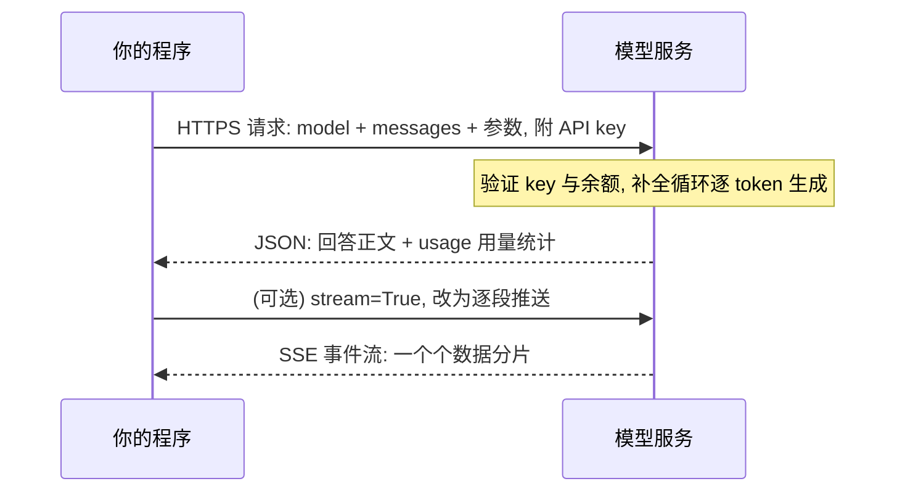
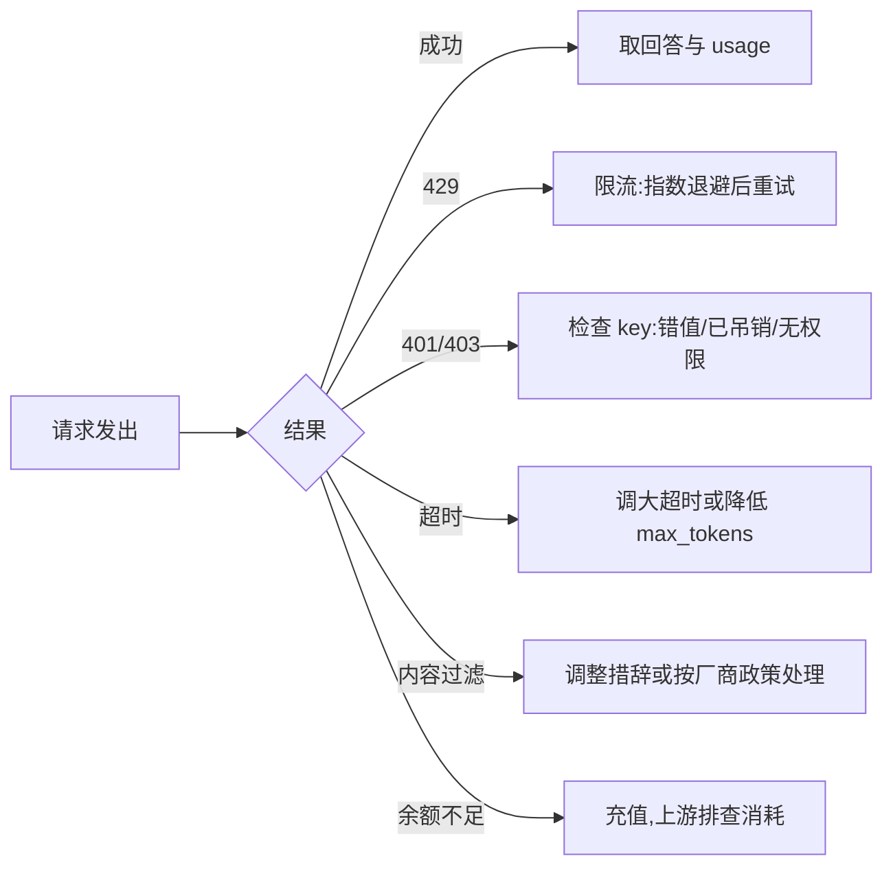

## 前置知识

- 读过 [LLM 是什么](/ai-llm/010-WhatIsLLM)：理解「下一个词预测器」与「上下文窗口」——本文的每个参数都是在调控这两个机制；
- 会基本的 Python：函数调用、字典、循环、`pip` 安装包（环境与虚拟环境管理可参考 [pyenv 与 uv](/python/030-PyenvUvManage)，不影响读懂本文代码）。

没读过也可以，本文会带上需要的部分。

## 学习目标

读完本文你将能够：

1. 解释 API key 的双重身份（身份凭证加钱包），并按纪律把它放进环境变量而不是代码；
2. 用「剧本早已写好开头的轮流发言」解释 messages 数组与 system、user、assistant 三角色的分工；
3. 用概率分布的语言说清 temperature 与 top_p 各自调控什么，以及 temperature=0 为什么仍非绝对确定；
4. 说出 max_tokens 与 stop 参数的作用，判断回答被截断时的原因；
5. 解释流式输出的机制（服务端逐段推送）与它改善的到底是什么体验；
6. 读懂 429 限流、超时、内容过滤、余额不足四类常见报错并知道各自的处理方向；
7. 写出并运行一个约 20 行的脚本，完成非流式与流式各一次调用，并读出 token 用量。

预计 30 到 45 分钟，含 1 个动手实验与 4 道练习。

## 1. 问题引入：网页聊天是玩具，API 是生产线

在网页里和模型聊天，人人都会。但当需求变成「给客服系统接一个自动分类」「批量把 500 篇文章生成摘要」，网页就没有用了：它不能被你的程序调用、不能自动化、也没有用量账单的概念。

程序调用模型走的是 **API**（应用程序接口）：你的代码发一个 HTTP 请求过去，服务上的模型补全出回答，以 JSON 形式返回。这一步跨过去，模型才从「玩具」变成「生产线上的一个工位」。

第一次调用前，有三类问题挡在路上：key 怎么拿、怎么保管；请求长什么样、那些参数什么意思；钱怎么算、出错怎么办。本文按这个顺序讲，最后把它们收进一个约 20 行的脚本。

## 2. 心智模型：一封寄给补全服务的信

一次 API 调用，就是给你的补全服务寄一封信：



信封上写三样东西：**密钥**（证明你是谁、从谁的账单扣钱）、**messages**（要求它补全什么）、**参数**（调控怎么补全）。回信里最重要的是两样：**回答正文**与 **usage**（这次消耗了多少输入、输出 token——那是钱的单位）。

记住这个模型，后文所有小节都只是拆写信封上的某一样东西。

## 3. API key：身份与钱包，先学会保管

key 是一串类似 `sk-` 开头的长字符串，在厂商的开发者平台注册后生成。它有两重身份：**凭证**（证明请求来自你）与**钱包**（所有 token 消耗记在它名下）。两重身份决定了它的两重风险：拿到它的人可以冒充你，也可以花你的钱。

保管纪律只有一条硬规则：**key 永远不进代码库**。放进环境变量：

```bash
# macOS / Linux (写入 ~/.bashrc 或 ~/.zshrc 可持久化)
export OPENAI_API_KEY="sk-你的密钥"
```

```powershell
# Windows PowerShell
$env:OPENAI_API_KEY = "sk-你的密钥"
```

项目里更常用 `.env` 文件加 `python-dotenv` 读取，但要配合一条铁律——`.gitignore` 里必须加上 `.env`。因为推送到远端代码库是密钥泄漏的头号来源，而公开仓库有机器人实时扫描新提交的 key，几分钟内就会被扫走滥用。一旦怀疑泄漏（误提交、误截图），立刻到平台后台**吊销并重发**，不要抱侥幸心理。

代码里只出现环境变量的名字，不出现值：

```python
import os
key = os.environ["OPENAI_API_KEY"]  # 从环境变量读,代码里永远没有明文 key
```

## 4. messages 数组：剧本早已写好开头的轮流发言

请求的核心是 messages，一个由消息组成的数组。每条消息有两个字段：`role`（谁在说话）和 `content`（说了什么）。角色有三种：

```python
messages = [
    {"role": "system", "content": "你是一名简洁的 Python 助手,回答不超过三句话"},
    {"role": "user", "content": "什么是列表推导式?"},
    {"role": "assistant", "content": "一种用一行循环表达式创建列表的语法。"},
    {"role": "user", "content": "举个例子"},
]
```

最好的心智模型是：**一场剧本早已写好开头的轮流发言**。messages 就是剧本，发言按顺序进行，而模型永远只能接最后一棒——它扮演的角色固定是 assistant，你给它多少行已写好的剧本，它就基于多少行往下接。

三种角色的分工由此清晰：

| 角色 | 在剧本里的位置 | 作用 |
| --- | --- | --- |
| system | 幕布后的舞台指示，用户「看不见」 | 定调：身份、规则、边界。整场戏的宪法 |
| user | 观众席递上来的台词 | 请求本身 |
| assistant | 模型的角色台词 | 要么是历史轮次里模型真实说过的话，要么是你**预写**的台词 |

两个关键细节，都是「轮流发言」模型的直接推论：

1. **assistant 台词可以由你手写**。模型接棒前并不知道那些话是谁写的——你可以预写一段 assistant 开头（比如强制它回答以 `{` 开头），或构造一段「它之前说过什么」的历史。各家对此（预填充）的支持程度不同，以官方文档为准；
2. **服务端不记得上一封信**。想让它「记得」第 1 轮说过的话，唯一的办法是你的程序把那轮消息放进这次请求的 messages 里。这个「每次重发全部历史」的协议本质，及其成本后果，在 [上下文工程](/ai-llm/050-ContextEngineering) 展开成整篇。

## 5. 采样参数：temperature 与 top_p 的概率直觉

回看 [LLM 是什么](/ai-llm/010-WhatIsLLM) 的补全循环：模型每一步输出的是**下一个 token 的概率分布**，采样器从里面挑一个。temperature 和 top_p 都是在调控这个「挑」的动作，但调控的位置不同。

**temperature 调控整条分布的形状**：把分布**削尖**还是**拉平**。低温把概率质量向头部候选集中——生成的词更保守、更可预期；高温把分布拉平——尾部候选也有机会被选中，文本更多样也更容易跑偏。写作创意场景调高，分类抽取场景调低，是经验起点。

**top_p 调控候选名单的长度**：只从**累积概率达到 p 的头部候选**里挑（比如 top_p=0.9 就是先按概率从高到低累加，凑够 0.9 的那批词入围，其余全部出局），再在入围者中按概率选。它是一条「候选门槛」。

| 参数 | 直觉类比 | 调高 | 调低 |
| --- | --- | --- | --- |
| temperature | 均衡器：整条分布曲线拉平或削尖 | 更多样、更有创意、更易跑偏 | 更保守、更稳定、更重复 |
| top_p | 门槛：只留头部候选 | 候选名单变长 | 候选名单缩短到几个头部词 |

实践建议：**两者调一个就好，另一个留默认值**，同时动两个会让问题无法归因。需要输出几乎稳定时把 temperature 调到 0 或接近 0。

**temperature=0 也非绝对确定**。它只是让采样永远挑最高概率词，但服务端的计算本身有非确定性来源：GPU 并行浮点运算的求和顺序不保证一致、批处理调度让同一请求的「同伴」不同从而影响内部计算路径。结果是你可能遇到「同样的输入，个别 token 偶尔不同」。工程含义：**对稳定性敏感的环节，靠的不是 temperature=0，而是输出校验与重试**，这正是 [结构化输出](/ai-llm/060-StructuredOutput) 的主题之一。

## 6. 刹车与路标：max_tokens 与 stop

**max_tokens** 给本次回答设一个 token 上限，是硬刹车：生成到上限立刻停止。它的两个用途：控制成本上限（防止单次失控的长回答）、控制延迟（输出 token 越多等待越久）。踩下刹车是有痕迹的：返回里的结束原因会变成 `length` 而不是 `stop`——**回答莫名缺了尾巴时，先查这个字段**，它告诉你不是模型「不想说」，而是你没让它说完。

**stop** 是路标：给定一个或多个字符串，生成过程中一旦出现就停止，且该字符串不计入输出。比如要求模型输出 JSON 时，把 `"\n\n"` 设为 stop，可以在它开始废话之前截住。它常和下一节的提示约束配合，是「让模型自己刹住」的手段——与 max_tokens 的「外部强行刹车」相对。

## 7. 流式输出：改善的不是速度，是等待感

默认情况下（非流式），服务端把全部 token 生成完才一次性返回。如果回答要生成 30 秒，你的用户就盯着空白等 30 秒。

`stream=True` 改变的是交付方式：**连接建立后不再关闭，服务端每生成一小段就立刻推送一段**（SSE，Server-Sent Events——一条不断开的长连接上持续到达的事件流），你的程序收到一段就可以展示一段。

必须纠正的期待：**流式不减少总时长**，同样的 token 总量、同样的生成速度。它压缩的是**首字延迟**——从「等全部生成完」变成「等第一个 token」：前者是几秒到几十秒，后者通常不足一秒。对交互界面这是体验的质变；对程序到程序的调用（自动批处理、Agent 内部步骤）则通常没必要，反而增加解析复杂度。

| | 非流式 | 流式 |
| --- | --- | --- |
| 交付方式 | 生成完毕，一个 JSON 返回 | 连接保持，逐段推送 |
| 首字可见 | 等于总时长 | 通常亚秒级 |
| 总时长 | 不变 | 不变 |
| 适合 | 程序间调用、批处理 | 面向人的实时界面 |

## 8. 换厂商 = 换 base_url + key

一个对工程影响深远的事实：**OpenAI Python SDK 定下的接口形状（messages 数组、参数名、返回结构）已成为行业事实标准**，绝大多数厂商——包括各家国产模型（如 GLM 系列）与本地推理框架——都提供 OpenAI 兼容端点。于是「换厂商」在代码层面常常只是两个变量的替换：

```python
from openai import OpenAI

# 官方 OpenAI:不传参数,默认读 OPENAI_API_KEY
client = OpenAI()

# 任意兼容厂商:换 base_url 与 key,其余调用代码一行不改
# base_url 与路径格式以各家文档为准
client = OpenAI(
    base_url="https://某厂商的兼容端点地址",
    api_key=os.environ["某厂商的_KEY"],
)
```

厂商原生的 SDK（如 Anthropic SDK）会提供一些独家能力与更地道的封装，值得在深度使用某家时学习；但接口形状的标准化的价值在于：**你的应用不必绑死任何一家**——这正是 [模型版图与选型](/ai-llm/020-ModelLandscapeSelection) 里「用评估集随时替换候选模型」在代码层的可行性来源。

## 9. 常见报错与计费意识



四个高频报错，各记一句处理方向：

1. **429 限流**：你的请求频率或 token 速率超过配额。不是异常而是常态——生产代码要有**指数退避重试**（失败后等 1 秒、2 秒、4 秒……再试），主流 SDK 已内置可配置的重试次数；
2. **超时**：长回答生成慢于你的等待上限。调大客户端超时，或用流式让连接保持活跃，或降低 max_tokens；
3. **内容过滤**：厂商的安全策略拦下了请求或回答，各厂商尺度与提示方式不同，以官方政策为准。应用侧要把它当作「会发生的情况」设计兜底，而不是当作 bug；
4. **余额不足**：钱包空了。顺带养成一个习惯——出错时先看账户消耗曲线，多数「突然不可用」是余额或配额问题。

**计费意识**：账单按 token 计，**输入与输出分开计价，输出单价通常更高**（具体倍数以各厂商定价页为准，不要背）。这带来两条工程直觉：其一，[上下文工程](/ai-llm/050-ContextEngineering) 里省的每一个输入 token 都是省在最高频的地方——每次请求都要重发全部历史；其二，usage 字段是成本观测的入口，每次调用都把它记进日志，成本问题才能在变成账单惊吓之前被发现。

## 10. 动手实验：一个脚本，两种调用，读出用量

先安装 SDK 并设置好环境变量里的 key：

```bash
pip install openai
```

下面约 20 行的完整脚本，非流式与流式各调用一次并打印 token 用量：

```python
import os
from openai import OpenAI

client = OpenAI()  # 默认读取环境变量 OPENAI_API_KEY
MODEL = "gpt-4o-mini"  # 示例型号,替换为你实际选用的模型

messages = [
    {"role": "system", "content": "你是一名简洁的 Python 助手,回答不超过一句话"},
    {"role": "user", "content": "用一句话解释什么是 token"},
]

# 一、非流式:一次请求,等服务端生成完毕
resp = client.chat.completions.create(model=MODEL, messages=messages)
print("非流式回答:", resp.choices[0].message.content)
print("token 用量:", resp.usage.prompt_tokens, "入 /", resp.usage.completion_tokens, "出")

# 二、流式:连接保持,回答逐段到达
stream = client.chat.completions.create(
    model=MODEL, messages=messages, stream=True,
    stream_options={"include_usage": True},  # 让最后一个分片携带用量统计
)
print("流式回答:", end="")
for chunk in stream:
    if chunk.choices and chunk.choices[0].delta.content:
        print(chunk.choices[0].delta.content, end="", flush=True)
    if chunk.usage:  # 只有最后一个分片才有 usage
        print("\ntoken 用量:", chunk.usage.prompt_tokens, "入 /", chunk.usage.completion_tokens, "出")
```

运行后观察三件事：流式回答是一点点「长」出来的而非一次性出现；两次调用回答的措辞可能不同（采样随机性）；输入 token 数大于你这句话的字数直觉（system 提示也算，且有分词开销）。把 max_tokens 改成 5 再跑一次流式，观察回答被硬刹车的样子。

## 11. 常见困惑

**问：为什么两次调用回答不一样？我都设 temperature=0 了。**
概率直觉可以解释：temperature=0 只保证「每次挑最高概率词」，但服务端并行计算的浮点顺序与批处理调度带来的微小数值差异，可能改变个别位置的胜者。工程上把它当作常态：关键流程靠输出校验加重试，不指望绝对确定。

**问：回答总是到一半就断，是模型「不想说」吗？**
先查返回里的结束原因：`length` 说明撞上了 max_tokens，调大即可；`stop` 才是模型自己说完。一个新手常见的坑是：把 max_tokens 设得刚好够「理想长度」，一旦回答比预期长就静默截断。

**问：流式输出既然不减少总时长，为什么人人都说它「快」？**
因为它改善的是首字延迟这个体感指标。人对「开始有反应」远比对「全部完成」敏感——这是交互设计的普遍规律，不只是 LLM 的特性。

**问：messages 里只放一条 user 行不行？**
行，最简单的调用就是一条 user。但 system 角色几乎总是值得写——它是你设定行为边界的唯一正规位置。为什么 system 该怎么写，[提示工程](/ai-llm/040-PromptEngineering) 整篇展开。

## 12. 小练习

1. 概念题：用「轮流发言」模型解释——为什么模型「记得」上一轮对话是错觉？是谁、以什么方式让它「记得」的？
2. 参数题：一个「给商品评论打正面/负面标签」的批处理任务，temperature 与 top_p 该怎么设？一个「给儿童写睡前故事」的任务呢？各说理由。
3. 排查题：你的调用返回的结束原因是 `length`，回答只有半截。列出三种不同的修复思路，并指出各自代价。
4. 成本题：你的应用每请求固定携带 2000 token 的历史，输出平均 200 token。用「输入输出分开计价、输出更贵」的定性规则说明：优化输入长度与优化输出长度，哪个更划算，为什么。

## 13. 与之前和之后的知识的关系

- 往前：[LLM 是什么](/ai-llm/010-WhatIsLLM) 的补全循环与概率分布在本文落地成 temperature、top_p 这些可调的旋钮；[模型版图与选型](/ai-llm/020-ModelLandscapeSelection) 选出的型号在这里变成 base_url 后面的那个 model 字符串；
- 往后：messages 里的 system 该怎么写、怎么迭代，是 [提示工程](/ai-llm/040-PromptEngineering) 的主题；让回答从「自由文本」变成「可解析的 JSON」，是 [结构化输出](/ai-llm/060-StructuredOutput) 的主题；「每次重发全部历史」的成本后果在 [上下文工程](/ai-llm/050-ContextEngineering) 展开；
- 更远：本文的报错处理与用量观测，是后续 Agent、评估、成本各篇的工程地基。

## 14. 自我检查

1. 能说出 key 的两重身份与两条保管纪律，并解释为什么 .env 必须进 .gitignore；
2. 能画出 messages 三角色在「剧本」里的位置，并说出 assistant 台词可以由你预写这个推论；
3. 能用概率分布的语言分别说清 temperature 与 top_p 调控的位置，并解释 temperature=0 仍非绝对确定的两个原因；
4. 能区分 max_tokens（硬刹车）与 stop（路标），并知道通过结束原因字段诊断截断；
5. 能解释流式输出压缩的是首字延迟而不是总时长；
6. 能对 429、超时、内容过滤、余额不足各说出一句处理方向，并说出输入输出分开计价的工程含义。

## 本章总结

API 调用是把模型从玩具变成生产线的一步：一封信（key + messages + 参数）寄给补全服务，换回回答与 usage。key 是身份加钱包，永远住在环境变量里；messages 是一场剧本早已写好开头的轮流发言，模型永远接 assistant 这一棒且服务端零记忆；temperature 削尖或拉平整条概率分布、top_p 圈定头部候选名单，temperature=0 也敌不过并行计算的非确定性；max_tokens 是硬刹车，stop 是路标，结束原因字段是诊断截断的入口；流式输出不缩短总时长，它压缩首字延迟。OpenAI SDK 的接口形状已成事实标准，换厂商等价于换 base_url 加 key。而所有 token 都是钱——输入输出分开计价、输出更贵，usage 字段就是你的成本仪表盘。

## 下一步

进入 [提示工程](/ai-llm/040-PromptEngineering)：messages 已经会发了，现在学里面的内容该怎么写——从许愿到规格说明。
