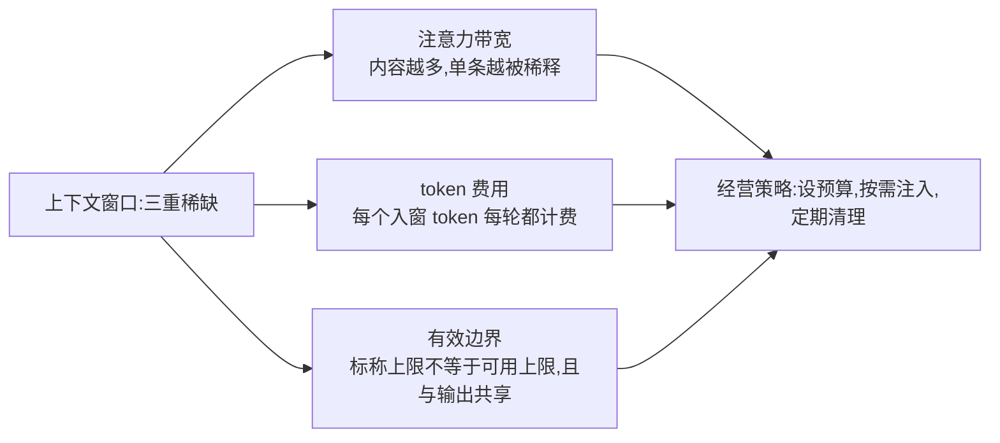
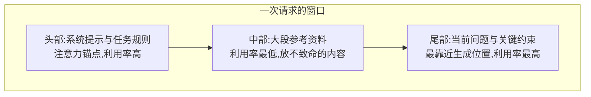
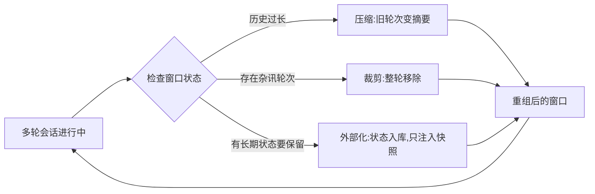

## 前置知识

- 读过 [提示工程](/ai-llm/040-PromptEngineering)：会写四件套齐全的结构化提示——上下文工程管理的对象正是由这类提示组装成的窗口；
- 建议读过 [第一次调用 LLM API](/ai-llm/030-FirstLlmApiCall)：知道「服务端零记忆、每次重发全部历史」的协议行为——本文的成本数学建立在这上面。

没读过也可以，本文会带上需要的部分。

## 学习目标

读完本文你将能够：

1. 用「三重稀缺资源」解释为什么「窗口越大越省事」是错觉：注意力带宽、单次 token 费用、有效窗口边界各约束什么；
2. 列出进入窗口的五类内容（系统提示、对话历史、检索资料、工具结果、长期记忆）各自的膨胀速度与治理手段；
3. 解释 lost-in-the-middle 现象，并据此把关键信息布置在窗口的头尾；
4. 解释上下文腐烂的机制——模型为什么会「被自己带偏」——并为三个症状开出对应药剂；
5. 推导「每次重发全部历史」导致的成本增长曲线：单轮输入随轮次线性涨、整场累计随轮次平方涨；
6. 说清上下文工程与提示工程的分工，并解释为什么业界共识是后者决定应用上限。

预计 30 到 45 分钟，含 1 个动手实验与 4 道练习。

## 1. 问题引入：一个越聊越差的助手

设想一个已经上线的客服助手，用户反馈随着会话变长，三种症状依次出现：

1. **变贵**：账单里每轮对话的输入 token 一轮比一轮多；
2. **变慢**：每轮响应时间越来越长——要处理的前缀越来越长；
3. **变笨**：聊到二十多轮，助手开始重复用户早就纠正过的说法，风格越来越油滑，偶尔还把几轮前自己编的细节当成事实继续引用。

三条线索指向同一个病根：这个应用的**上下文管理**是失控的——所有历史无差别堆积，窗口被杂讯填满。单条提示写得再好也救不了它，因为问题不在「一句话怎么写」，在「整个窗口里放了什么」。

这正是本文的主题。提示工程之上一层，有一门关于窗口的经营学：什么该进窗口、什么该挡在窗外、堆积了怎么清。2026 年的业界共识是：在模型能力日益同质化的背景下，**这层经营的质量决定了一个 LLM 应用的上限**。

## 2. 核心论点：窗口是三重稀缺资源

新手默认「上下文窗口越大，事情越好办」——把所有资料全塞进去就完了。这个想法在三个方向上同时破产：

**第一重：注意力带宽。** 窗口装得下，不等于模型看得全。模型的注意力是在全部内容上分配的，内容越多，每一条分到的「注意」越薄；对长的输入，模型对中间部分的利用率还会系统性下降（第 5 节展开）。一张塞满文件的桌子，不如一张摆着三份关键材料的桌子好干活。

**第二重：单次 token 费用。** 计费按输入输出 token 走，**每个进窗的 token 都是每次请求都要付钱的内容**。窗口从 4 千 token 膨胀到 40 千，你的账单上输入费用就涨十倍——哪怕模型答得一样好。

**第三重：有效窗口边界。** 商家标称的窗口上限不等于你能放心用到的上限：接近上限时，生成质量与指令遵循常常下滑（程度因模型而异）；而且**输入与输出通常共享同一个窗口**——你塞进去 95%，只剩 5% 给回答，max_tokens 都设不开。工程上的习惯是给输入设一个远小于标称值的预算，把尾部留给输出。



三重稀缺共同推出一个原则：**窗口是预算制，不是仓库**。每一类内容都要申请预算，超了就得清理。预算怎么在五类内容之间分配，是下一节。

## 3. 解剖：一次真实请求的窗口里有什么

抽象原则之前，先看实物。一个「带检索的客服助手」第 8 轮请求的 messages，加注释标注每段内容的身份与体量（内容为示意）：

```text
[system]    你是 XX 商城的售后助手,规则如下:...      ← 系统提示,约 300 token,几乎不变
[system]    (第 5 轮注入)用户是会员,偏好简洁回复     ← 长期记忆快照,约 50 token
[user]      第 1 轮:我的订单还没到                   ← 对话历史,逐轮累积
[assistant] 已为您查询,预计明天送达                   ← 同上
...(中间 6 轮,合计约 4000 token)...
[assistant] 可以,在订单页申请...                      ← 历史里模型的旧发言
[system]    <docs> 检索到的《发票政策》三条片段...     ← 检索资料,本轮新注入,约 1500 token
[user]      第 8 轮:那发票抬头写错了怎么办            ← 本轮新消息
```

这张图值得盯三处。其一，「多轮对话」是假象——assistant 的历史发言被你的程序原样存下来、每轮重发，服务端从不保存任何东西。其二，各内容的膨胀速度完全不同：历史线性爬坡，检索资料按次脉冲，系统提示几乎不动。其三，窗口里同时住着「每轮都付费的老住户」和「本轮才来的新住户」，账单的分母主要由前者决定。

## 4. 窗口的五类住客：谁该占多少

一个运行中的应用，窗口里通常住着五类内容。先认清各自的性格，再谈配比：

| 内容 | 作用 | 膨胀速度 | 治理手段 |
| --- | --- | --- | --- |
| 系统提示 | 角色与规则的宪法 | 几乎不膨胀（改版本才变） | 写精而不写长，占开头黄金位 |
| 对话历史 | 会话的来龙去脉 | **最快**，随轮次线性涨 | 摘要压缩、裁剪无关轮次 |
| 检索资料 | 补足模型没有的知识 | 单次注入可能很大 | 只取最相关片段，控制片段数与位置 |
| 工具结果 | 调用返回的原始数据 | 单条可能巨大（日志、JSON） | 裁剪、摘要**加工后**再入窗 |
| 长期记忆 | 跨会话的用户信息与偏好 | 缓慢但持续累积 | 存外部库，按需选择性注入 |

「各自该占多少」没有普适数字，但有普适方法：**给每类设 token 预算，并在日志里如实记录实际占用**。举一套常见量级的直觉（不是标准，按你的任务校准）：系统提示几百到一两千 token，小而稳定；对话历史设硬上限（例如窗口预算的三成），到线触发压缩；检索资料是弹性最大的一块，宁可多轮少量注入，不要一次灌满；工具结果必须加工——一次接口返回的 5000 token JSON，提炼成 300 token 的要点再入窗；长期记忆常驻外部，只在相关时注入几百 token 的快照。

一个值得内化的不对称：**系统提示是投资，历史与杂讯是开销**。前者每轮复用且收益稳定，值得花心思打磨；后者只服务当下轮次，过期就是负债。

预算的执行靠观测而不是自觉：把每次请求的五类内容 token 占用记进日志（从 usage 字段与本地分词估算均可），一周后你会得到自己应用的「窗口账本」——哪类内容在偷偷膨胀、哪次注入在烧钱，一目了然。没有账本的预算制，只是感觉良好的摆设。

## 5. lost-in-the-middle：中间的信息最容易被忽略

对长上下文的实证观察反复出现同一个模式：模型对窗口**开头**与**结尾**的信息利用率最高，**中间**部分最低——像一条 U 形曲线。这个现象常被称作 lost-in-the-middle。具体深浅因模型、任务、内容长度而异，但方向足够稳定，值得当作设计约束来用。

机制直觉：注意力资源有限且偏向「近端」与「任务锚点」——开头往往承载系统提示与角色设定（锚点），结尾最靠近当前要生成的位置。夹在长篇材料正中的事实，两头不靠，最容易被「看到但没看到」。

这直接给出一条布置原则：**关键信息放头尾，中间垫料**。



落到检索场景的两个常用手法：其一，把与当前问题最相关的片段放在资料区的尾部（靠近问题）；其二，对多条检索结果做重排（re-rank），让相关性高的进头尾，相关性低的要么出局要么垫中间。手法细节属于 RAG 专篇，这里只需带走布置意识：**资料的顺序不是无所谓的，它是一道布局题**。

把布置原则压成三行检查清单，每次注入前过一遍：最关键的约束或资料，是不是在窗口头或尾？低相关的大段材料，是不是该删而不是垫在中部？「当前问题」是不是永远处在窗口最末尾？三问都答好，lost-in-the-middle 的坑已避开大半。

## 6. 上下文腐烂：模型被自己带偏的机制

比「装不下」更隐蔽的是「装太多之后变味」。多轮会话中常见这样的滑坡：助手语气越来越油滑、开始反复使用几轮前的自造词、把某轮自己口误的细节当事实延续下去。这个过程可以叫**上下文腐烂**。

机制在 [LLM 是什么](/ai-llm/010-WhatIsLLM) 的补全模型里：**模型把窗口里的一切都当作「接下来该怎么写」的正例**。于是窗口里积累的每一轮旧输出——包括其中的错误、跑偏的风格、冗余的套话——都在为后续生成投票。它没有「那是我的旧错误，忘掉它」的机制，只有「上下文里有这个模式，延续它」的机制。杂讯同理：工具失败留下的报错堆、重复注入的内容、用户中途粘贴的无关税料，都在稀释并扭曲后续生成的方向。

腐烂的自我强化性让它在长会话里尤其危险：一次小跑偏写进历史，会在后续每一轮被加权复现——**旧输出是未来的提示词**。

三个自查信号，出现任何一条就该怀疑腐烂已经开始：模型开始复用几轮前的口头禅或自造词；它说「如前面所说」而你翻遍窗口找不到那段话；同一种错误在同一会话里第二次出现。信号一旦出现，别指望下一轮自愈——直接触发第 7 节的治理循环。

## 7. 三副药剂：压缩、裁剪、外部化

对症下药，三个手段各有明确的适用症状：

**药剂一：定期压缩摘要。** 症状是历史线性膨胀、成本与延迟同步上升。做法：把较早的 N 轮对话交给模型总结成几百 token 的摘要，替换掉原文。会话记忆从「逐字记录」变成「会议纪要」，方向感保留，账单瘦身。代价是细节丢失，所以适合换掉「过程性内容」（寒暄、来回试错），不适合换掉「结论性内容」——摘要提示里要明确保留哪些结论。

**药剂二：裁剪无关轮次。** 症状是杂讯污染：已完结的子任务、失败的工具调用、用户撤回的请求还赖在窗口里。做法是直接整轮移除——它比摘要更彻底，也更快。与药剂一常配合使用：先裁剪明显无关的，再压缩必须保留脉络的。

**药剂三：状态外部化。** 症状是「必须长期记住的东西太多，全塞窗口根本装不下」。这是最工程化的解法：把需要跨轮、跨会话保持的状态（用户偏好、任务进度、已确认的关键决策）**写进数据库或文件**，窗口里每一轮只注入一份当前状态的最新快照。模型需要历史时，看到的不是几十轮原始对话，而是被程序整理过的状态。



药剂落地的样子，看一次压缩前后的对照（示意）：

```text
压缩前(第 12 轮的窗口,约 9000 token):
  12 轮完整对话原文,其中 4 轮寒暄、3 轮试错改地址、
  2 轮重复提问、外加一次工具报错的整段堆栈

压缩后(同一场会话,约 2500 token):
  [摘要] 用户是会员,偏好简洁;订单 20260315 曾改址;
  已解决:发票补开(已拒,超期限);进行中:退款,等商家确认
  [保留] 最近 3 轮对话原文
```

注意保留下来的两类东西：结论性内容（已确认的事实与决策）进摘要，过程性内容（寒暄、试错、报错堆栈）被丢弃，最近的原文原样保留——摘要负责脉络，原文负责当下。

三副药剂合起来就是上下文工程的核心循环：**窗口不是只进不出的仓库，而是一个不断重组的工作台**。Agent 场景里这个循环更关键——几十步任务轨迹若无此治理，窗口几轮就被填满，这是 [Agent 记忆与状态](/ai-llm/130-AgentMemoryAndState) 的正面战场，本篇打下的是它的地基。

## 8. 协议本质与成本数学：为什么长会话越聊越贵

第 7 节的手段都建立在认清一个协议事实上：**LLM API 是无状态的——模型对上一次请求毫无记忆，所谓「多轮对话」是你的程序每次把全部历史重新发一遍**。这不是厂商偷懒，而是无状态协议让服务可以任意扩缩容；代价全部转嫁给调用方：历史是调用方的责任，成本也是。

由此可以推导长会话的成本曲线。设每轮新增约 1000 token（一问一答），会话进行到第 N 轮时：

- **单轮输入**：约为 N 千 token——第 40 轮时，一次请求的输入就是约 4 万 token。单轮成本随轮次**线性**上涨；
- **整场累计**：约 1000 × (1 + 2 + … + N) ≈ N × (N + 1) / 2 千 token——同样 40 轮，累计输入约 82 万 token。整场成本随轮次**平方**上涨。

平方增长是长会话成本失控的数学根源：会话长度翻倍，累计输入涨到约四倍。这也解释了第 1 节的「变贵」与「变慢」——两者是同一件事的账面与体感。把这套数学控制住的钥匙就是上一节的三副药剂：压缩把线性曲线的斜率压平，裁剪让平方项里的 N 变小，外部化把本该计入 N 的内容移出窗口。

厂商也清楚这笔重复账，普遍给了打折通道：**前缀缓存**——两次请求若共享同一段前缀（典型如长系统提示、尚未变化的历史），命中部分按大幅折扣计价（折扣力度与命中条件以各家定价页为准）。它不改写成本曲线，但给了「保持请求前缀稳定」一个直接动机：把不变的内容放前面、易变的内容放后面，缓存命中率就高——这与本篇的布置原则恰好同向。缓存与预取的完整玩法在 [token、成本与延迟](/ai-llm/180-TokenCostLatency) 展开。

## 9. 上下文工程与提示工程：分工与共识

最后把这两门学科的关系钉死，它们管的是同一扇窗口的两个尺度：

| | 提示工程 | 上下文工程 |
| --- | --- | --- |
| 管辖尺度 | 单条提示怎么写 | 整个窗口里放什么、不放什么 |
| 典型问题 | 这条约束怎么措辞可判定 | 这 20 轮历史该压缩还是裁剪 |
| 改动的杠杆 | 一句话的措辞 | 内容的取舍、布置与生命周期 |
| 失效表现 | 单次回答质量差、格式漂移 | 越用越贵、越聊越笨、长会话崩坏 |

一句话：**提示工程管「一句话怎么写」，上下文工程管「整个窗口里放什么、不放什么」**。前者是句子层面的手艺，后者是系统层面的架构——它决定每个轮次里有什么牌可打，所以上限更高：提示写得再好，也救不了一个塞满杂讯的窗口；而一个经营良好的窗口，能让中等水平的提示稳定发挥。

用一个对照收拢：同一个摘要任务、同一个模型。布置 A——系统提示 200 token，用户消息里塞着 30 轮未清理的历史、两条重复注入的文档片段和一次失败工具调用的报错全文；布置 B——系统提示同样 200 token，历史被压缩成 500 token 摘要、最近 3 轮原文、一条刚检索的文档片段。两者的提示内容一字未改，成绩通常却是两个档位：A 会被旧输出的风格带着跑，B 稳定贴合任务。差距不在「哪句话写得更好」，在「窗口里放了什么」——这就是两门手艺的权重之差。

这也是 2026 年业界把「上下文工程」从提示工程里独立出来单独命名的原因：当模型能力日益同质化，应用之间的差距不再主要来自「用了哪个模型」，而来自**谁的上下文经营得更好**——谁的窗口更干净、布置更合理、成本更可控。本模块后续的 RAG、Agent、记忆各篇，本质上都是上下文工程在具体场景的展开。

## 10. 常见困惑

**问：既然窗口已经能装几十万 token，为什么还要费劲管理？**
因为三重稀缺一个都没消失：塞满的窗口照样付全额费用、照样有 lost-in-the-middle、照样在接近上限时质量下滑。「装得下」只解决了存储问题，而工程问题从来不在存储。

**问：摘要会不会丢掉关键信息？**
会，所以摘要是选择性的：先想清楚哪些内容是「结论」（保留），哪些是「过程」（可压）。更稳的做法是配合药剂三——真正不能丢的进外部状态库，摘要只负责叙事脉络。永远不要指望一份摘要同时承担两种职责。

**问：我的 RAG 效果差，是检索不准还是上下文没布置好？**
两个都要查，但后者常被忽略：检索回来的片段放窗口正中间、一次注入二十条、工具原始 JSON 不加工——任何一条都能让「检索对了」变成「回答错了」。排查顺序建议先布置后检索：把最相关片段移到尾部、砍掉一半低相关片段，很多「检索不准」的假象会直接消失。

**问：压缩和裁剪的时机怎么定？**
按预算触发而不是凭感觉：给对话历史设 token 上限（比如窗口预算的三成），到达即触发；杂讯轮次（失败调用、已完结子任务）则随时可裁，不等预算。把触发条件写进代码，让清理成为流程的一部分而非事后的急救。

**问：图片、音频也占窗口吗？**
占，而且比文字贵得多：一张图通常折算成几百到几千 token，一段音频更高（折算规则因模型与分辨率而异，以官方文档为准）。多模态内容同样受窗口与预算约束，治理逻辑不变——能转写成文字的图表，常常比原图更省、也更准。

**问：清理历史，会不会把用户以为「它还记得」的东西弄丢？**
会，所以清理要有用户视角：被压缩或裁掉的内容里，凡是用户明确交代过的事项（「记住我对花生过敏」），必须先进长期记忆或状态库，再从窗口撤下。治理窗口是系统的内部事务，不该让用户为它买单——这正是「外部化先于丢弃」的顺序意义。

## 11. 动手实验：量一场会话的成本曲线

目标：亲眼看一次平方增长。需要 [第一次调用 LLM API](/ai-llm/030-FirstLlmApiCall) 的脚本作底子。

1. 构造一个会话：写 10 组「用户消息 + 固定的 assistant 回复」各约 200 token（不需要模型真的生成，手工写死即可），让会话累积到 10 轮；
2. 写一个循环：第 1 轮到第 10 轮，每轮把「全部历史 + 本轮新消息」作为 messages 发起一次真实调用，从返回的 usage 里记下 prompt_tokens；
3. 观察记录表：prompt_tokens 是否逐轮增加约 200？把 10 轮的用量加总，对比「如果每次只发最近 3 轮」的策略——手动算出后者 10 轮的累计输入，两者差多少倍；
4. 把第 10 轮的完整 messages 打印出来读一遍：标出哪些内容对回答本轮问题毫无必要，它们占这轮输入的百分之几。

做完你会得到两个数字：你的会话里「纯杂讯」的比例，以及「只带最近几轮 + 一份摘要」能省下的倍数。这两个数字就是你对三副药剂的估值。

## 12. 小练习

1. 归因题：一个 30 轮的会话在第 25 轮后开始重复用户第 8 轮就纠正过的要求。用「旧输出是未来的提示词」解释症状，并指出三副药剂中哪一副最对症。
2. 布置题：一次请求里有系统提示、20 条检索片段、用户问题三部分。片段内容质量相同，其中第 3 条与问题最相关。按 lost-in-the-middle 原则写出你认为最优的排列，并说明第 3 条该放哪。
3. 推导题：会话每轮新增 800 token。计算第 50 轮的单轮输入 token 与整场累计输入 token，并回答：若把「最近 5 轮 + 2000 token 摘要」作为每轮固定载荷，两种方案在 50 轮时累计输入差多少？
4. 设计题：为一个「连续工作数小时的编码 Agent」设计窗口预算表：五类内容各给多少 token 预算、各自的触发式清理规则是什么、长期状态存在哪里。只要求结构与理由，不要求具体数字精确。
5. 诊断题：你的应用每轮把工具返回的原始 JSON 全文入窗，平均 3000 token，真正被用到的约 100 token。设计一个「入窗前加工」流程，并说明这个改动同时改善第 2 节三重稀缺中的哪几重。

## 13. 与之前和之后的知识的关系

- 往前：[提示工程](/ai-llm/040-PromptEngineering) 解决「单条内容怎么写」，本文解决「内容们的取舍与布置」——四件套写出来的提示，正是本篇预算表里「系统提示」那一行；[第一次调用 LLM API](/ai-llm/030-FirstLlmApiCall) 揭示的无状态协议，是本篇成本数学的前提；
- 往后：[Agent 记忆与状态](/ai-llm/130-AgentMemoryAndState) 把「状态外部化」扩展成完整的记忆体系；[token、成本与延迟](/ai-llm/180-TokenCostLatency) 把本篇的 token 数学接入定价与优化的工程细节；RAG 与工具调用各篇，则是「检索资料」「工具结果」这两类住客的专门治理；
- 更远：评估篇里，「上下文配置」本身也是被测对象——同样的提示，不同的窗口布置，成绩可以差出一个档位。

## 14. 自我检查

1. 能说出窗口作为三重稀缺资源的三个约束，并反驳「窗口大就不用管理」；
2. 能列出五类住客、各自的膨胀速度与治理手段，并说出「系统提示是投资、历史与杂讯是开销」的配比观；
3. 能画出 lost-in-the-middle 的 U 形利用率曲线，并说出关键信息放头尾的布置原则；
4. 能用「窗口里的一切都是正例」解释上下文腐烂的自我强化，并复述三副药剂各自对症的症状；
5. 能推导长会话「单轮线性、累计平方」的成本曲线，并说出三副药剂各自压的是曲线的哪一项；
6. 能一句话说清提示工程与上下文工程的分工，以及「后者决定应用上限」共识的含义；
7. 能说出清理历史的用户视角纪律：明确交代过的事项先外部化、再撤下窗口。

## 本章总结

上下文窗口是三重稀缺资源：注意力带宽随内容增加被稀释，每个入窗 token 每轮都计费，有效边界远小于标称值且与输出共享。窗口里的五类住客各按本性治理：系统提示小而稳是投资，对话历史线性膨胀靠压缩与裁剪，检索资料讲布置，工具结果必须加工后入场，长期记忆住在外面按需注入。lost-in-the-middle 决定了关键信息要放头尾；上下文腐烂的机制是「窗口里的一切都是正例」，旧输出是未来的提示词，三副药剂——压缩摘要、裁剪轮次、状态外部化——把它控制住。无状态协议意味着全部历史每轮重发，单轮成本线性涨、整场成本平方涨，治理窗口就是在压这条曲线。提示工程管一句话怎么写，上下文工程管整个窗口放什么——模型同质化的年代，应用的胜负手在后者的经营质量上。

## 下一步

进入 [结构化输出](/ai-llm/060-StructuredOutput)：让模型的回答从「给人读的散文」变成「给程序读的数据」——窗口里另一类高频住客（工具结果）的反向出口。
