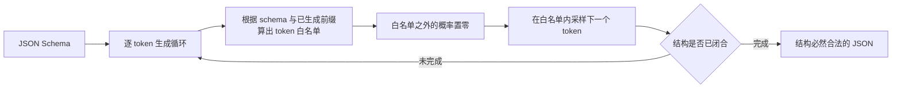
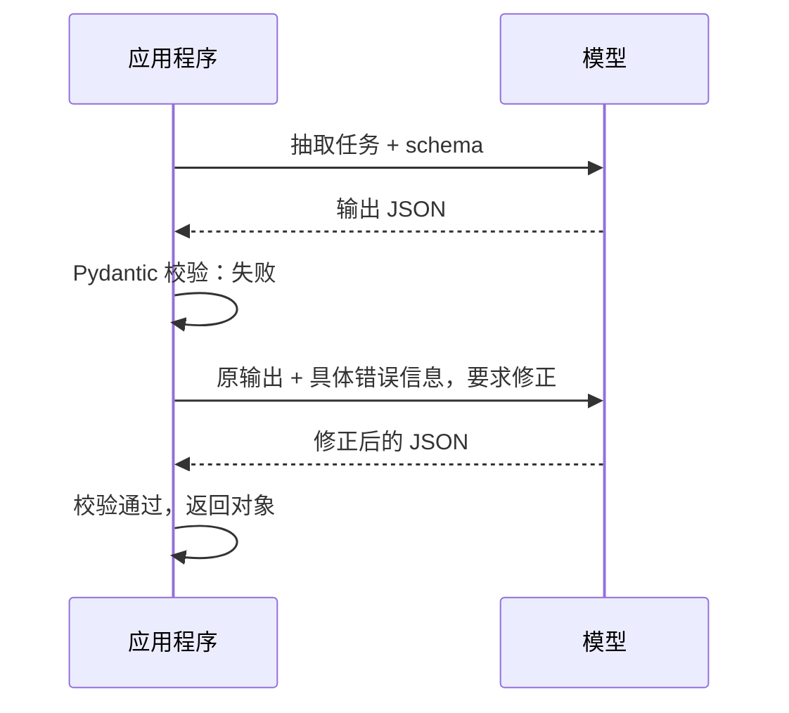

## 前置知识

- 读过 [第一次调用 LLM API](/ai-llm/030-FirstLlmApiCall)：知道 messages 数组的形状、role 的含义，能用 Python SDK 发出一次对话请求并取出回复文本。

没读过也可以，本文会带上需要的部分：本文用到的 API 知识只有一个「发请求、拿回文本」的函数调用，出现时会就地解释。

## 学习目标

读完本文你将能够：

1. 向别人解释「LLM 是不可靠的函数」的三种表现（同输入不同输出、夹带闲聊、结构不保证），以及为什么下游程序仍然需要确定的结构；
2. 画出约束解码的心智模型图，说清结构化输出与 JSON mode 的机制差异；
3. 用 Pydantic（Python）或 Zod（TypeScript）定义 schema 并校验模型输出，写出校验失败后把错误信息回传模型的重试回路；
4. 判断什么时候给字段加枚举约束，并说清枚举对输出空间的收敛作用；
5. 识别 markdown 围栏、多余说明文字、日期与数字格式漂移、嵌套过深这四类典型故障，并各说出至少一种对策；
6. 说清流式输出场景下「部分 JSON」的两种处理思路。

预计 30 到 45 分钟，含 2 个动手实验与 4 道练习。

## 1. 问题引入：程序调用了一个「不守规矩」的函数

设想你在做一个客服工单系统：每条用户留言进来后，调用 LLM 抽取出结构化信息——标题、优先级、涉及产品——交给下游的路由程序分发。你的提示词写得很清楚：「请以 JSON 格式输出，包含 title、priority、product 三个字段。」

第一天运行，你拿到的是干净的 JSON；第二天，同一条留言，模型回了这一段：

````text
好的，以下是为您提取的工单信息：

```json
{
  "title": "无法登录账户",
  "priority": "高",
  "product": "手机 App"
}
```

如果还有其他问题，欢迎随时告诉我！
````

内容完全正确，但你的 `json.loads()` 直接抛异常：外面裹了一层 markdown 代码围栏，前后各有一句客套话，priority 的值还是中文「高」而不是你约定的枚举值。三条问题同时出现：**围栏、闲聊、格式漂移**。

这就是本文要解决的核心矛盾：**LLM 是一个「不可靠的函数」，而你的下游程序是一个「只接受确定结构的机器」**。两者之间需要一座桥，这座桥就是结构化输出。

## 2. 心智模型：普通函数与 LLM 函数的对照

先把这个矛盾想透。你写过的所有函数都满足一个隐含契约：同样的输入，返回同样类型的输出。LLM 打破了契约的每一条：

| | 普通函数 | LLM 函数 |
| --- | --- | --- |
| 同输入同输出 | 确定 | 不保证（采样带随机性） |
| 输出类型 | 类型系统保证 | 只由「提示词里的礼貌请求」约束 |
| 内容正确性 | 逻辑保证 | 可能夹带闲聊、拒绝、道歉 |
| 出错方式 | 抛异常，栈清晰 | 「成功地」返回一段错误结构的文本 |

为什么会这样？回忆 [第一次调用 LLM API](/ai-llm/030-FirstLlmApiCall) 里的模型：它本质是一个「下一个 token 概率分布」，每一步按概率采样出一个 token。它的训练目标是「生成像样的文本」，而不是「生成合法的 JSON」——当「像样的助手回复」以「好的，这是您要的结果」开头时，模型就会真的这么开头。提示词里的请求只是软约束，**采样器没有义务遵守**。

所以工程上的思路不是「求模型自觉」，而是从两个方向加固：**生成侧硬约束**（让不合法的 token 根本采不出来）与**应用侧校验**（不合法的输出进不了下游）。

## 3. 第一条路：JSON mode

大多数主流平台都提供 JSON mode：在请求里声明「请输出 JSON」，OpenAI Python SDK 的写法是：

```python
resp = client.chat.completions.create(
    model="...",  # 模型名以所用平台文档为准
    messages=messages,
    response_format={"type": "json_object"},  # JSON mode 开关
)
```

JSON mode 的机制是在生成时约束输出必须是**语法上合法的 JSON**——不会出现围栏、不会出现「好的，」开头。但它只管语法，不管内容：你的字段名拼错了、值是中文枚举、缺了必填字段，JSON mode 一概不管。所以使用 JSON mode 时，仍然要在提示词里给出目标字段说明，相当于「语法交给 API 硬约束，结构靠提示词软约束」。

它是「够用的第一级」，但它还有个更硬的兄弟。

## 4. 第二条路：结构化输出与约束解码

结构化输出（Structured Outputs，各平台叫法略有差异，通常对应 `response_format` 的 json_schema 类型，或工具调用的 strict 模式）允许你直接传入一份 **JSON Schema**——精确到「有哪些字段、每个字段什么类型、哪些必填、取值范围是什么」。

它的底层机制值得专门建立一个心智模型：**约束解码（constrained decoding）**。生成仍然是逐 token 进行的，但每一步采样前，引擎会根据 schema 和「已生成的前缀」计算出一批**当前合法的 token**，把白名单之外 token 的概率直接清零，然后只在白名单内采样。



把这个循环在脑子里跑一遍：schema 说第一个字段必须是 `"title"` 字符串，那么生成完 `{` 之后，模型想输出 `好的` ——这个 token 不在白名单里，概率被置零，**根本采不出来**。字段类型是 number 时，引号开头的 token 同样被屏蔽。

这就是它和 JSON mode 的本质差异：

| | JSON mode | 结构化输出（JSON Schema） |
| --- | --- | --- |
| 约束层次 | 语法：是合法 JSON | 结构：符合你给的 schema |
| 围栏与闲聊 | 消失 | 消失 |
| 字段缺失、类型错 | 可能发生 | 被机制拦住 |
| 代价 | 几乎没有 | schema 需要满足平台限制；个别平台约束解码会轻微影响速度 |

一句话：**JSON mode 根治「JSON 不合法」，结构化输出根治「JSON 不符合我的 schema」**——从生成侧把问题类别整个消灭了。

但要泼一盆冷水：约束解码保证的是**结构的合法**，不保证**内容的正确**。schema 说 priority 是字符串，模型可以合法地填一个荒谬的值；说 date 是字符串，它可以合法地填「下周三」。所以应用侧校验不能省，这是下一节。

## 5. 应用侧仍要校验：Pydantic 与 Zod

为什么生成侧已经硬约束了，应用侧还要再校验一次？三个理由：

1. **结构合法不等于业务正确**。`start_date <= end_date`、`participants` 非空、金额为正——这类业务规则 schema 表达不了或表达得很别扭；
2. **不是所有平台、所有模型都支持约束解码**。你的代码早晚要接入不支持该特性的端点（部分开源模型部署、旧版本接口），此时唯一防线就是应用侧校验；
3. **schema 是给机器的，校验错误信息是给重试回路的燃料**——下一节你会看到，校验器抛出的错误本身就是修正输出的最佳提示词。

Python 生态的标配是 Pydantic，TypeScript 生态是 Zod。同一个抽取需求，两边各写一遍：

```python
from typing import Literal
from pydantic import BaseModel, Field

class MeetingInfo(BaseModel):
    """从会议通知里抽取的信息——schema 即文档，即校验器，即重试依据。"""
    title: str = Field(description="会议主题，不超过 20 字")
    date: str = Field(description="日期，ISO 8601 格式，例如 2026-03-01")
    participants: list[str] = Field(description="参会人姓名列表")
    priority: Literal["high", "medium", "low"] = Field(description="优先级")
```

```typescript
import { z } from "zod";

// 同一份 schema 的 TypeScript 版本
const MeetingInfo = z.object({
  title: z.string().describe("会议主题，不超过 20 字"),
  date: z.string().describe("日期，ISO 8601 格式，例如 2026-03-01"),
  participants: z.array(z.string()),
  priority: z.enum(["high", "medium", "low"]),
});
```

注意 `Field(description=...)` 与 `.describe(...)`：这些描述会随 schema 一起传给模型，等于**把校验规则提前翻译成了生成约束**。模型看得到「ISO 8601 格式」，格式漂移的概率就大幅下降——这是「定义 schema」这个动作同时买到的两份保险。

很多 SDK 封装（如 Python 的 instructor、各平台的 `parse` 辅助）做的事情就是：把 Pydantic/Zod schema 转成 JSON Schema 传给结构化输出接口，返回时自动实例化成对象。理解了本文的机制，这些封装对你就是透明的。

## 6. 校验失败的重试回路（动手实验一）

约束解码大幅降低了失败率，但生产系统要按「失败一定会发生」来设计。标准模式是**校验重试回路**：解析或校验失败时，把原始输出和错误信息一起回传给模型，让它自己修。错误信息非常具体（「第 4 行：priority 不在枚举取值内」），模型修正的成功率远高于笼统地「再试一次」。

先看回路形状：



下面是一个完整可跑的小例子（OpenAI Python SDK 风格；即使你的平台没有结构化输出特性，这个回路依然成立）：

```python
from typing import Literal
from pydantic import BaseModel, Field, ValidationError
from openai import OpenAI

client = OpenAI()  # 从环境变量读取密钥

class MeetingInfo(BaseModel):
    title: str = Field(description="会议主题")
    date: str = Field(description="ISO 8601 日期，例如 2026-03-01")
    participants: list[str]
    priority: Literal["high", "medium", "low"]

def extract(text: str, max_retries: int = 3) -> MeetingInfo:
    messages = [
        {"role": "system", "content": "从给定文本抽取会议信息，只输出符合 JSON Schema 的 JSON，不要任何其他文字。"},
        {"role": "user", "content": text},
    ]
    for attempt in range(max_retries):
        resp = client.chat.completions.create(
            model="...",  # 模型名以所用平台文档为准
            messages=messages,
            response_format={"type": "json_object"},  # 至少锁死语法层
        )
        raw = resp.choices[0].message.content
        try:
            return MeetingInfo.model_validate_json(raw)  # 校验 + 实例化一步完成
        except ValidationError as e:
            # 关键动作：把原始输出和错误细节都放回对话，让模型看着改
            messages.append({"role": "assistant", "content": raw})
            messages.append({"role": "user", "content": f"你的输出未通过校验，错误如下：\n{e}\n请修正后重新只输出 JSON。"})
    raise RuntimeError(f"重试 {max_retries} 次仍未得到合法输出")
```

三个工程要点藏在代码里：

1. **重试要有上限**。无限重试等于无限烧钱，上限通常 2 到 3 次；用尽后应走人工兜底或降级路径，而不是让请求挂死；
2. **错误信息要原样回传**。Pydantic 的 `ValidationError` 自带字段名、期望类型、实际值——把它格式化进提示词，模型一眼就知道改哪里；
3. **把失败输出 append 回去**。模型看到自己「上一步写了什么」才能做增量修正，只重发原问题的效果差得多。

动手实验一：把这段代码跑起来。测试文本用一条正常会议通知验证正路径；再故意构造刁钻输入（比如正文里写「优先级：看着办」）触发重试路径，观察第二次请求的 messages 里出现了什么。

## 7. 枚举字段：把输出空间钉死

上一例中的 `priority: Literal["high", "medium", "low"]`（Zod 里是 `z.enum([...])`）值得单独一节，因为**枚举是性价比最高的结构化约束**。

原理用第 4 节的模型一想就通：枚举把该字段的输出空间从「整个词汇表」收敛到 3 个 token 组合。约束解码开启时，模型在填写这个字段时只能在白名单里选；即使约束解码不可用，提示词与 schema 里的枚举列表也会把「自由发挥」的空间压到极小。

它天然适配一整类任务——**分类**。情绪分类、意图路由、工单分派、是否敏感，本质都是「把开放文本映射到一个有限集合」。写法上有两条经验：

1. **枚举值用英文小写、值本身无歧义**（`"high"` 而非 `"高"` 或 `"P0"`），并在 description 里给中文语义说明；
2. **当选项超过十几个时**，枚举的命中率会下降，考虑先让模型输出大类、再规则细分，或改用工具调用里带枚举参数的形式（见 [工具调用设计](/ai-llm/110-ToolCallingDesign)）。

## 8. 流式场景下的部分 JSON

前端要打字机效果，接口必须流式返回。但流式与 JSON 是天敌：token 一段段到达时，任何时刻手里的都是**残缺的 JSON**——可能 `{"title": "季度` 这样断在半截，`json.loads()` 每一帧都会失败。

两条处理思路，按实现成本从低到高：

**思路一：缓冲到完整再解析。** 前端展示原始文本增量，结构化解析只在收到结束信号后做一次。实现最简单，代价是「结构可用」的时刻推迟到了最后——对多数界面这已经够用。

**思路二：增量解析部分 JSON。** 用支持「残缺 JSON」的解析策略，把 `{"title": "季度` 尽力解析成 `{"title": "季度"}` 的部分对象，让下游在流式过程中就能消费已完整的字段。许多生态有现成实现（partial JSON 解析库、支持结构化流式的 SDK 封装），原理都是补全括号与引号后再走普通解析。选型时留意：**部分对象里的字段可能缺失，下游代码必须容忍 `None`/`undefined`**。

一个判断标准：如果消费方是「人」（界面上渐显），思路一足够；如果消费方是「程序」（每帧都要驱动逻辑），才需要思路二。别为用不上的能力引入复杂度。

## 9. 常见坑实录

四个高频坑，按「你早晚会撞上」的顺序排列。

**坑一：markdown 代码围栏包住 JSON。** 第 1 节已经演示过。开了 JSON mode 或结构化输出后基本消失，但老项目的兼容路径上依然常见。防御性写法是解析前剥围栏：

```python
import json

def parse_loose(raw: str) -> dict:
    # 剥掉可能的 ```json 围栏，只当应急绷带，不当长期方案
    text = raw.strip()
    if text.startswith("```"):
        text = text.split("\n", 1)[1].rsplit("```", 1)[0]
    return json.loads(text)
```

**坑二：多余说明文字。** 「好的，以下是结果：」「希望对你有帮助！」——围栏的裸奔版。对策按强度递增：系统提示词明确「只输出 JSON，第一个字符必须是 `{`」；JSON mode；结构化输出。解析端的应急手段是截取第一个 `{` 到最后一个 `}` 之间的内容，但要清楚这是在「赌输出里只有一个 JSON 对象」。

**坑三：日期与数字格式漂移。** 你要 ISO 日期，模型给「2026年3月1日」或「2026/3/1」；你要数字，模型给 `"1200"`（字符串）或 `"1,200"`（带千分位）。三道防线：schema 的 description 里写明格式并给例子；Pydantic 校验器做归一化：

```python
import re
from pydantic import field_validator

class MeetingInfo(BaseModel):
    date: str

    @field_validator("date")
    @classmethod
    def to_iso(cls, v: str) -> str:
        # 把 2026年3月1日 / 2026/3/1 归一成 2026-03-01
        m = re.match(r"(\d{4})[年/\-.](\d{1,2})[月/\-.](\d{1,2})日?", v)
        if not m:
            raise ValueError(f"无法解析的日期格式：{v}")
        y, mo, d = m.groups()
        return f"{y}-{int(mo):02d}-{int(d):02d}"
```

第三道是重试回路兜底。另外留意**相对日期**（「下周三」「明天下午」）：抽取类任务应在提示词里注入当前日期，否则模型只能猜。

**坑四：嵌套过深，模型断结构。** 两三层还能稳住，四层往上（对象套数组、数组里又是对象、对象里再套数组），漏字段、数组长度对不上、层级放错的问题开始成批出现——约束解码能保证「合你的 schema」，但如果模型「想不完整」，合法的错误照样产生。对策：把深层结构**拍平**（用带前缀的字段名代替嵌套）；或**拆成多次调用**，每层一个简单 schema，用前一层的输出作为后一层的输入。

## 10. 常见困惑

**问：把 temperature 设成 0，是不是就不需要这一切了？**
不是。温度 0 只是让采样变确定（每步取概率最高的 token），但「概率最高的补全」依然可能是「好的，以下是您要的 JSON：」。确定性解决「同输入不同输出」，结构化输出解决「输出不符合结构」，两件事正交。当然，两者常常一起用。

**问：约束解码会不会限制模型能力，让质量下降？**
会约束，但通常不是坏事。模型本来就要输出 JSON，约束只是提前拦住它「想输出别的东西」的岔路。真正要注意的代价是：过深、过碎的 schema 会把生成变成「戴着镣铐走钢丝」，表现为内容质量下降——这与坑四同源，解法也是拍平与拆分。

**问：结构化输出和工具调用（function calling）是什么关系？**
机制同源：工具调用的参数本身就是一份 JSON Schema，strict 模式下同样走约束解码。区别在语义：结构化输出回答「给我一个符合 schema 的结果」，工具调用回答「模型想请应用执行一个动作，参数符合 schema」。涉及「模型主动发起动作」的场景进 [工具调用设计](/ai-llm/110-ToolCallingDesign)。

## 11. 修改实验

在动手实验一的代码上做三处修改，每处先预测再验证：

1. 给 `participants` 加一个约束：至少 1 人（提示：Pydantic 里用 `Field(min_length=1)`），构造一条没有参会人的文本，观察是约束解码层拦住还是校验层拦住（视平台支持情况，两种都可能）；
2. 把 `priority` 从枚举改回普通 `str`，用「优先级：看着办」的文本重跑，对比失败率与重试回路的行为差异；
3. 把重试次数改成 1，体会「重试用尽」异常的触发条件，然后思考：你的业务里，降级路径应该做什么？

## 12. 小练习

预测题：第 4 节的约束解码循环里，schema 要求第一个字段名是 `"title"`，模型在 `{` 之后最可能想采样哪些 token？其中哪些会被白名单拦下？

修改题：给 `MeetingInfo` 增加字段 `location: str | None`（可空），并在 description 里说明「线上会议填 null」。思考：为什么可空字段要在 description 里特别交代？

修 Bug 题：下面的解析代码对第 1 节的输出会失败，说出两个原因，并指出坑一、坑二中哪段应急代码能救它：

```python
import json
data = json.loads(resp.choices[0].message.content)
```

挑战题：把第 6 节的重试回路封装成通用函数 `extract_with_retry(schema_model, text, max_retries)`，接受任意 Pydantic 模型。验收清单：不依赖具体模型类；错误信息完整回传；重试用尽抛出带上下文的异常。

## 13. 与之前和之后的知识的关系

- 往前：[第一次调用 LLM API](/ai-llm/030-FirstLlmApiCall) 里「发请求、拿回文本」的那条直线，在本文被升级成「发请求、校验、修正」的回路；
- 往后：[工具调用设计](/ai-llm/110-ToolCallingDesign) 把「schema 约束参数」从「应用要数据」翻转成「模型要执行动作」；[进阶 RAG](/ai-llm/090-RagAdvanced) 里的评估与生产链路中，结构化输出是让 RAG 答案带引用、让评估可量化的地基。

## 14. 官方文档

- OpenAI 结构化输出：https://platform.openai.com/docs/guides/structured-outputs
- Anthropic 消息与工具使用（结构约束的对应能力以此为准）：https://docs.anthropic.com
- Pydantic：https://docs.pydantic.dev/
- Zod：https://zod.dev/

## 15. 自我检查

- 能不看资料说出「LLM 是不可靠的函数」的三种表现，并解释为什么提示词只是软约束；
- 能画出约束解码的白名单循环图，并说出它与 JSON mode 的约束层次差异；
- 能写出「校验失败后回传错误信息」的重试回路，并说出重试上限与降级路径两个工程要点；
- 能说出枚举字段收敛输出空间的原理，以及枚举适配哪类任务；
- 看到输出被围栏包裹、priority 变成中文、日期变成「2026年3月1日」时，能立刻各说出至少一种对策。

## 本章总结

LLM 是不可靠的函数：同输入不同输出、偶尔夹带闲聊、结构只受提示词软约束，而下游程序需要确定结构。工程解法是三层纵深：生成侧用 JSON mode 锁语法、用结构化输出（约束解码：每步只在 schema 允许的 token 白名单内采样）锁结构；应用侧用 Pydantic/Zod 校验业务规则，失败则把错误信息回传模型走有上限的重试回路。枚举字段是性价比最高的约束；流式场景在「缓冲到底」与「部分 JSON 增量解析」之间按消费方选择；围栏、闲聊、格式漂移、深嵌套是四个必踩的坑，每个都有已知的对策。

## 下一步

进入 [工具调用设计](/ai-llm/110-ToolCallingDesign)：把「模型给数据」升级成「模型发起动作」，schema 的思想会在那里复用并放大。
