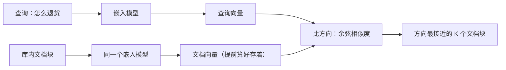
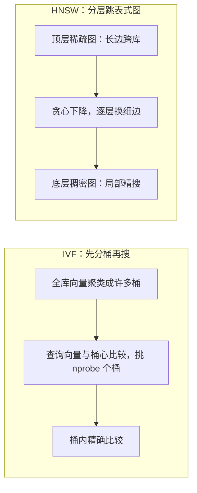

## 前置知识

- 读过 [LLM 是什么](/ai-llm/010-WhatIsLLM)：知道大模型把文本当 token 序列处理、内部用高维向量表示含义这些基本事实。

没读过也可以，本文会带上需要的部分：只需要「文本在模型内部是一串数字」这一直觉，开头就会补上。

## 学习目标

读完本文你将能够：

1. 向别人解释 embedding 是什么：文本被映射为高维向量，「方向相近 = 含义相近」；
2. 说清余弦相似度为什么用夹角而不用直线距离，以及归一化之后点积与余弦的关系；
3. 分清嵌入模型与生成模型是两类各司其职的模型，并说出双塔结构的直觉；
4. 用「牺牲一点召回换百倍速度」解释 ANN，画出 HNSW 与 IVF 的机制示意图；
5. 说清向量数据库的本质是「向量字段 + ANN 索引 + 元数据过滤」，并判断什么场景其实轮不到它上场；
6. 识别「相似度不等于相关性」：专有名词精确匹配场景 BM25 关键词检索仍占优。

预计 30 到 45 分钟，含 1 个动手实验与 4 道练习。

## 1. 问题引入：关键词检索接不住「意思」

你肯定用过文档站的搜索框，也大概率体会过它的笨。用户在客服知识库里搜「怎么退货」，库里明明有一篇《退换货政策》，搜索却排不出它——因为文档里一个「退货」的字面都没有，写的是「售后申请流程」。反过来搜「退货流程」，又会把每篇含「流程」二字的无关文档都拽进来。

关键词检索的原理是把 query 和文档都看成一袋词，比的是**词有没有对上**。它接不住同义（退货/退换/售后）、接不住换种说法（怎么退款/钱能退吗）、更接不住跨语言。可「意思相近」恰恰是人对「找得到」的定义。

要把「意思」变成可以计算的量，得先回答一个问题：**含义能不能表示成数字？**

## 2. 心智模型：语义的几何

答案是能，而且这正是 embedding（嵌入）的定义：**用一个嵌入模型把任意一段文本映射成一个高维向量**——比如 1024 个浮点数组成的数组。这个映射经过海量文本的训练，练出了一个惊人的性质：

> **两段文本的含义越相近，它们向量的方向就越接近。**

「怎么退货」和「退换货政策」含义相近，两个向量在 1024 维空间里几乎指向同一个方向；「怎么退货」和「今天股市大涨」含义无关，两个方向近乎垂直。于是「找语义相近的文档」这个看似玄学的问题，被转换成一个纯几何问题：**在高维空间里，找出方向最接近查询向量的那 K 个点**。



整个向量检索的地基就这一个转换。后面所有名词——相似度、维度、归一化、索引、向量数据库——都是给这张图上的某条边做工程加固。

一个立刻要用到的推论：**查询和文档必须用同一个嵌入模型**。两个不同模型的向量空间互不相通，跨模型比余弦相似度是无意义词——就像用两套不同的地图坐标系算距离。因此「换嵌入模型」不是换个名字，而是**全库重新嵌入**，这是选型时最贵的约束。

## 3. 余弦相似度：看夹角，不看距离

比方向，数学上用的几乎都是**余弦相似度**：两个向量夹角的余弦值，$\cos(\theta) = \frac{A \cdot B}{|A|\,|B|}$——点积除以两个模长的乘积。

直觉上分三种情况：同方向，值为 1（含义一致）；垂直，值为 0（无关）；方向相反，值为 -1（语义对立，实际中很少见，大多数文本对的分数落在 0 到 1 的区间里）。

你可能会问：比相似为什么不直接用**距离**——两个点挨得近不就近？因为嵌入向量的**长度没有可靠含义**。文本长短、词频高低都会影响向量的模长，一篇长文档的向量天然比一句话「伸得更远」，但含义未必更近。余弦相似度在计算时把两个向量都除以自己的模长，等于**只比较方向、把长短归零**——这正是我们想要的：「含义」藏在方向里，不在长度里。

由此引出一个工程惯例：很多系统在入库前就把每个向量**归一化**成单位长度。归一化之后，余弦相似度退化成一次点积（$A \cdot B = \cos\theta$），省掉两次开方除法——在几百万向量上比相似度时，这点节省非常可观。第 6 节的索引也依赖这个性质。

一个常见的实践疑问：**0.8 算相似吗？** 分数的绝对值没有通用标准——不同模型、不同语言的分数分布差异很大，同一个模型内部「相关文档对」与「无关文档对」的分数差才是可用的信号。工程上不要抄别人的阈值，用自己的数据标注一小批，看分数分布再定。

## 4. 两类模型各司其职：嵌入模型与生成模型

容易混淆的一点必须先钉死：**嵌入模型和生成模型是两类模型**，虽然都出自大模型技术，分工完全不同。

| | 生成模型（GPT 系列、Claude 系列、GLM 系列等） | 嵌入模型（文本嵌入系列模型） |
| --- | --- | --- |
| 输出 | 逐 token 自回归生成文本 | 一次前向计算，吐出一条定长向量 |
| 回答的问题 | 「接下来该说什么」 | 「这段文本在语义空间的坐标是哪」 |
| 体量与成本 | 大，贵，慢 | 小得多，便宜，快（常便宜一到两个数量级） |
| 典型用途 | 写作、问答、代码 | 检索、聚类、分类、去重 |

双塔（two-tower）结构的直觉由此而来：检索系统里有两座「塔」，其实常常是**同一个编码器**分别处理两路输入——左塔编码查询（在线，每次查询算一次），右塔编码文档（离线，入库时算好存起来）。因为两边各自独立编码，查询时**不需要跑生成模型**，只需要便宜快速的嵌入模型加一次向量比较，这就是语义检索能做大的成本基础。

本文后面说的「嵌入模型」都指右塔那类模型。它不懂生成，不会对话，你没法「问」它问题——它只负责报坐标。

选型时还会看到嵌入模型的细分标签：检索用、对称/非对称相似度、是否需要指令前缀等。这些是「编码任务不同、几何用法不变」的变体，具体要求以所用模型的官方文档为准，但「方向相近即含义相近」这一定位永远不变。

## 5. 维度与归一化：向量的两个基本量

**维度**是嵌入向量的长度，常见从几百到几千（不同模型各有取值，以官方文档为准）。直觉上维度越高，能表达的语义细节越多，但存储与计算成本也线性上涨——一条 1536 维的向量按 4 字节浮点存是 6 KB，一亿条文档就是几百 GB 起。维度不是越大越好，是**效果与成本的折中**，各嵌入系列通常提供多档维度可选。

**归一化**是把向量缩放到长度为 1，第 3 节说过它的好处：点积即余弦。多数嵌入模型本身输出的就是归一化向量，但**不要依赖这个默认**——自己算相似度前先归一化一次，成本可忽略，换来的是永远正确的比较。

两个量合起来就是向量检索的全部「数学负担」：一个定长数组 + 一种只看方向的比较函数。剩下的都是工程。

## 6. ANN：用一点点召回，换百倍速度

现在看检索这条边。库里有一千万条向量，查询向量来了，要找方向最接近的 K 个——最朴素的办法是**每一条都比一遍**（精确 KNN）。一千万次点积，单次几十微秒，累起来就是秒级，生产环境等不起。

近似最近邻（ANN，Approximate Nearest Neighbor）索引的思路是：**预先组织数据结构，查询时只看一小部分候选，牺牲一点召回率（偶尔漏掉真正的最近邻），换取成百上千倍的速度**。两大主流方案的心智模型：

**HNSW——分层跳表式的图。** 把所有向量组织成一张图，并且分成多层：顶层稀疏、边很长（相当于高速公路，几步就能横跨全库），越往下越稠密、边越短。查询从顶层进入，贪心地走向「离查询更近的邻居」，走不动了就下一层继续，到最底层完成精搜。熟悉跳表的话，这就是跳表思想从一维链表搬到高维图。它的查询快且准，代价是内存占用大、建图慢。

**IVF——先分桶，再搜桶。** 入库时用聚类把全库切成几百到几万个桶（每个桶有个「桶心」）；查询时先比较查询向量与所有桶心，挑出最近的 `nprobe` 个桶，只在桶内做精确比较。像在图书馆找书：不逐本翻，先确定去哪几个书架。它的内存友好、实现简单，代价是桶切得糙时容易漏（真正的近邻恰好躺在没被选中的桶里）。



两者的共性值得记住：**召回率与速度是一个旋钮的两端**（HNSW 拧搜索宽度，IVF 拧 `nprobe`），调参的本质是在你的延迟预算内把召回顶到最高。具体参数行为以所用引擎的文档为准；pgvector 上的实操见 [KNN 向量索引](/postgresql/320-KNNVectorIndex)。

还要补一句反方向的常识：ANN 是买给大数据量的。库里只有几千条向量时，暴力精确搜索的延迟完全可接受，直接精确搜，召回率 100%，还省掉了建索引与调参的全部心智负担——索引是规模的压力产物，不是必需的仪式。

## 7. 向量数据库的本质：不必神化

聊到这里，「向量数据库」这个听起来很玄的产品可以拆成三件事：

1. **一个向量字段**——把定长浮点数组当一列存起来；
2. **一个 ANN 索引**——就是第 6 节的那张图或那些桶，建在这一列上；
3. **元数据过滤**——按普通条件（时间、类目、租户）先筛或同时筛，再在子集内做向量搜索。

就这么多。它没有超越关系型数据库的魔法，本质是「给一列特殊数据建了一种特殊索引」。理解这一点有几个直接推论：

- 你在用的 PostgreSQL 加个扩展就能当向量库（pgvector 路线），不必为「向量」两个字单独引入一套新中间件；
- 「元数据过滤 + 向量搜索」的组合质量差异很大（先过滤后搜，还是先搜后过滤，效果与实现都不同），选型时要真测；
- 数据量在几万条以内时，**暴力精确搜索**可能完全够用——没有索引的 KNN 慢是相对几千万条说的，小库上精确搜索既简单又零召回损失。工具跟着数据规模走，不要倒过来。

## 8. 相似度不等于相关性：BM25 的守区

最后是本篇最重要的一个清醒剂：**方向相近 = 含义相近，但「含义相近」不等于「是你要的答案」**。

两个典型反例。反例一：用户搜报错码 `ERR_CONN_RESET`。嵌入模型会把它嵌入到「网络连接」「错误处理」的语义区，于是《网络编程入门》《常见连接问题排查》都得了不低的相似分，而那篇唯一精确讨论这个错误码的文档可能排不到前面——**专有名词、错误码、型号、函数名这类符号串，精确匹配就是相关，语义泛化反而是噪音**。反例二：搜人名「张伟」，语义检索会把「同音名」「类似年代感的名字」都拉高分。

在这些场景，老派的关键词检索 BM25 依然占优：它就是比词项对不对得上，`ERR_CONN_RESET` 这个词在哪个文档出现、出现几次、文档多长，算得清清楚楚。语义与词面，各守一片盲区——dense 检索抓不住精确符号，BM25 抓不住同义改写。

所以现代检索系统的共识不是二选一，而是**两路都跑、结果融合**——这就是混合检索（hybrid search），它的融合公式 RRF 与实践细节在 [进阶 RAG](/ai-llm/090-RagAdvanced) 展开；本文只需要你带走这句话：**嵌入检索是语义层的利器，不是关键词检索的替代品**。

## 9. 与 Python 向量数据库篇的分工

本模块与 [Python 与向量数据库](/python/950-PythonVectorDatabase) 是概念与操作的两半：

- **本篇（概念体系）**：向量、余弦、维度、ANN、索引取舍、与关键词检索的边界——回答「是什么、为什么、怎么选」；
- **那篇（Python 操作）**：用具体的客户端库建 collection、插入向量、执行搜索、管理过滤条件——回答「怎么用代码做出来」。

读那篇时如果对「为什么是 cosine 而不是欧氏距离」「HNSW 的 ef 参数在拧什么」有疑问，回到本篇第 3、6 节。

## 10. 动手实验：算几对句子的相似度并排序

任何一个提供 embeddings 接口的服务都能跑（OpenAI 兼容接口、开源嵌入模型均可，模型名以所用平台文档为准）。核心代码刻意手写了余弦相似度，不放库——亲手算一遍，第 3 节才算真正落地：

```python
import math
from openai import OpenAI

client = OpenAI()  # 兼容 OpenAI embeddings 接口的服务均可

def embed(texts: list[str]) -> list[list[float]]:
    resp = client.embeddings.create(
        model="your-embedding-model",  # 嵌入模型名，以所用平台文档为准
        input=texts,
    )
    return [d.embedding for d in resp.data]

def cosine(a: list[float], b: list[float]) -> float:
    dot = sum(x * y for x, y in zip(a, b))            # 点积
    norm_a = math.sqrt(sum(x * x for x in a))         # 模长
    norm_b = math.sqrt(sum(x * x for x in b))
    return dot / (norm_a * norm_b)                    # 夹角余弦

queries = [
    "怎么退货",
    "ERR_CONN_RESET 报错怎么解决",
]
documents = [
    "退换货政策：签收后 7 天内可申请退货退款",
    "今天股市大盘走势分析",
    "ERR_CONN_RESET 表示连接被对端重置，常见于超时配置过短",
    "网络编程入门：TCP 与 UDP 的区别",
]

q_vecs = embed(queries)
d_vecs = embed(documents)

# 把每个 query 对全部文档的相似度排个序
for qi, q in enumerate(queries):
    scores = [(cosine(q_vecs[qi], d_vecs[di]), d) for di, d in enumerate(documents)]
    scores.sort(reverse=True)
    print(f"\n查询：{q}")
    for score, doc in scores:
        print(f"  {score:.4f}  {doc}")
```

运行后先别看下面，自己解读输出：

- 「怎么退货」应该把《退换货政策》排到第一，且与股市文档的分数明显拉开——语义检索的正面样本；
- 「ERR_CONN_RESET 报错怎么解决」的真实文档《连接被对端重置》大概率第一，但注意第二名是谁：《网络编程入门》很可能靠「网络、连接」的语义相似挤在前面，分数与正例差距不大——这就是第 8 节说的「相似但不精确」；
- 顺手验证一个几何事实：打印任意一条向量的模长 `math.sqrt(sum(x*x for x in v))`，接近 1.0 说明模型默认输出归一化向量；
- 再做一个小破坏：删掉余弦分母里的两个模长（变成纯点积），重跑一遍看排序是否不变——不变的原因正是归一化向量上点积等价于余弦。

实验变体：把「怎么退货」换成「钱能退吗」再跑一遍，观察排序不变——同义改写在向量空间里方向几乎不变，这正是关键词检索做不到的事。

## 11. 常见困惑

**问：余弦相似度 0.75 和 0.80 差多少？有绝对标准吗？**
没有通用标准。分数分布是「每个模型自己的方言」，同一个模型里看相对差距才有意义：正例对的分数簇与随机对的分数簇之间有没有清晰间隔。跨模型比较分数同样无意义。

**问：两段文本嵌入后向量很近，就说明模型「理解」了它们吗？**
说明模型在训练分布上学到了它们的用法相近——这是统计意义上的相近，不是人类意义的理解。代价是反直觉场景会失效：否定句（「退货」与「不退货」）、细节相反（「支持 7 天退货」与「支持 30 天退货」）的向量可能非常接近。**涉及数字、否定、条件的判断，不能只依赖向量相似度**，要在检索后交给生成模型去读原文。

**问：向量数据库和传统数据库是对立关系吗？**
不是。向量检索能力正在被传统数据库以扩展形式吸收（如 PostgreSQL 的 pgvector），很多场景「在既有数据库上加一列向量 + 一个索引」比引入独立向量库更划算。独立的专用向量库的优势在高吞吐、大规模与专用过滤算法上，按数据规模与团队运维能力选，不要按名词的新旧选。

**问：同一个文本在库里存了两份（原文和摘要），两个向量谁说了算？**
都算，这正是常见的多向量策略：同一条记录按不同粒度各嵌一个向量（整篇、章节、句子），检索时用粒度合适的那个去找，命中后仍回溯到同一条原文。理解了「向量只是文本的坐标」这一定位，这类设计就只是普通的工程选择，而非什么新机制。

## 12. 小练习

预测题：不运行代码，预测「怎么退货」与「如何申请退款」「退货与退款是两回事」这两个句子的相似度谁高谁低，写下理由再实测。（提示：一句是同义改写，一句只是「字面上都含退货」。）

修改题：把实验代码中的查询换成你专业领域的一对「同义改写」与一对「字面相近但语义无关」，验证语义检索的强弱边界。

计算题：向量 $A = (1, 0)$，$B = (0, 1)$，$C = (2, 0)$。手算 $A$ 与 $B$、$A$ 与 $C$ 的余弦相似度，并回答：为什么 $C$ 是 $A$ 的两倍长，余弦却认为它们完全同向？

分析题：你的知识库里大量文档形如「错误码 E-4103：含义与处理方式」。纯语义检索上线后用户反馈「搜错误码经常搜不到」，用第 8 节的知识解释原因，并给出最小改动的补救方案。

## 13. 与之前和之后的知识的关系

- 往前：[LLM 是什么](/ai-llm/010-WhatIsLLM) 里「文本在模型内部是数字」的抽象说法，在本文落成了「可计算的语义几何」；
- 往后：[RAG 基础](/ai-llm/080-RagFundamentals) 把本篇的向量检索装进「检索-增强-生成」的完整管线，本篇的「相似度不等于相关性」会在那里变成真实的失败模式；数据库侧的两条支线是 [KNN 向量索引](/postgresql/320-KNNVectorIndex)（pgvector 实操）与 [Python 与向量数据库](/python/950-PythonVectorDatabase)（客户端操作）。

## 14. 官方文档

- OpenAI embeddings 指南：https://platform.openai.com/docs/guide
- pgvector（PostgreSQL 向量扩展）：https://github.com/pgvector/pgvector
- Faiss（ANN 索引研究参考实现）：https://github.com/facebookresearch/faiss

## 15. 自我检查

- 能用一句话向别人解释 embedding 是什么，并画出查询与文档各自过嵌入模型再比方向的示意图；
- 能解释余弦相似度为什么把模长除掉，以及归一化后点积为什么等价于余弦；
- 能分清嵌入模型与生成模型各自的输出、成本与用途，并说出「两塔必须同源」的原因；
- 能分别用一句直觉解释 HNSW 与 IVF，并说出它们共同的交换条件（召回换速度）；
- 能说出向量数据库的三件事（向量字段、ANN 索引、元数据过滤），并判断小数据量场景何时可以不用它；
- 能举出至少一个 BM25 仍优于语义检索的具体场景。

## 本章总结

embedding 把文本映射为高维向量，含义藏在方向里：方向相近即含义相近，于是语义检索变成一个几何问题。余弦相似度只看夹角不看模长，归一化后点积即余弦。嵌入模型与生成模型是两类各司其职的模型——一个报坐标，一个产文本；查询塔与文档塔必须同源。ANN（HNSW 的分层图、IVF 的先分桶再搜）用一点召回换百倍速度，向量数据库的本质只是向量字段加 ANN 索引加元数据过滤，不必神化。最后，相似度不等于相关性：错误码、型号、人名这类精确匹配场景 BM25 依然占优，这为混合检索埋下了伏笔。

## 下一步

进入 [RAG 基础](/ai-llm/080-RagFundamentals)：把本篇的向量检索装进「检索-增强-生成」管线，解决「模型不知道你的私有文档」这个大问题。
