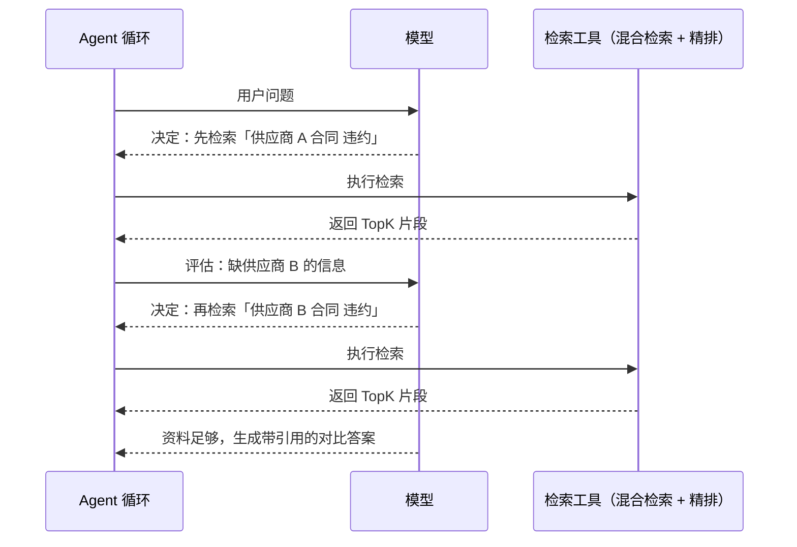
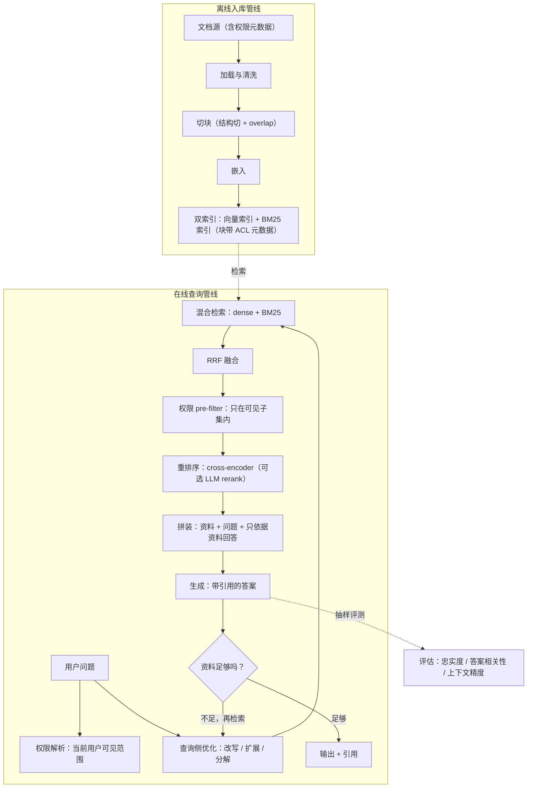

## 前置知识

- 读过 [RAG 基础](/ai-llm/080-RagFundamentals)：知道入库与查询两条管线，记得朴素 RAG 的三大失败模式（检索不到、检索到了但没用、拼接破坏）——本文就是逐个消灭它们。

没读过请先读，本文不再解释切块、TopK、开卷考试这些基础概念。

## 学习目标

读完本文你将能够：

1. 解释为什么混合检索是生产基线而非可选项，说出 dense 检索与 BM25 各自的盲区，并用倒数排名融合（RRF）的直觉公式手工合并两路结果；
2. 说出两阶段检索「召回求全、精排求准」的分工，比较 bi-encoder、cross-encoder 与 LLM rerank 三者的准确与代价；
3. 针对一个糟糕的查询，选择改写、多查询扩展、HyDE、查询分解中的合适手段并说明理由；
4. 判断一个场景该用固定管线的 RAG 还是 agentic RAG，并描述 agentic RAG 的检索决策循环；
5. 用忠实度、答案相关性、上下文精度三个维度设计 RAG 的评估，并说出每个维度分别对应管线哪一段；
6. 解释权限过滤为什么必须发生在检索层而非生成层，以及 post-filter 的坑在哪里。

预计 30 到 45 分钟，含 1 个动手实验与 4 道练习。

## 1. 问题引入：朴素 RAG 撞上生产环境

按 [RAG 基础](/ai-llm/080-RagFundamentals) 搭的朴素 RAG 在演示里很漂亮，接入真实文档、真实用户后，坏消息按固定顺序到来：错误码搜不到（dense 检索不认识符号串）；「年假几天」的答案排在一堆考勤打卡文档后面；用户问法千奇百怪，「那个钱什么时候到账」检索命中率惨淡；更糟的是，A 部门的员工查到了 B 部门的薪酬文档——检索层根本没做权限。

这些不是实现 bug，是朴素管线的结构性短板。2026 年生产级 RAG 的共识补法是一组相对固定的增强：**混合检索打底、重排序提纯、查询侧预处理、按需 agentic 化、评估贯穿、权限前置**。本文逐个拆开。

## 2. 混合检索：基线，而非可选项

[嵌入与向量检索](/ai-llm/070-EmbeddingsAndVectorSearch) 结尾留过一个伏笔：dense 检索与 BM25 各守一片盲区。现在把它补全成一张对照：

| | dense（向量）检索 | BM25（关键词）检索 |
| --- | --- | --- |
| 强项 | 同义改写、跨措辞、跨语言：「钱能退吗」接住「退款政策」 | 专有名词、错误码、型号、人名的精确匹配 |
| 盲区 | 符号串被语义「稀释」：ERR_CONN_RESET 搜不回那篇专讲它的文档 | 同义与改写全灭：「怎么退货」接不住「售后申请流程」 |
| 出错的样子 | 找回来一堆「话题像」但不含关键词的文档 | 找回来一堆「字面像」但答非所问的文档 |

两类错误几乎不重叠——这是混合检索成立的根本原因：**两路并跑，互为对方的眼镜**。所以生产系统的基线不是「选一个」，而是 dense 与 BM25 都建索引、都出一份 TopK。

接下来的问题是两份榜单怎么合并。它们**分数不可比**：余弦相似度在 0 到 1，BM25 分数是无界的正值，直接加权等于让两个单位的物理量相加。工业界标准答案是**倒数排名融合（RRF，Reciprocal Rank Fusion）**：

文档 d 的融合分，等于它在每一路榜单上「名次加 k 后取倒数」的求和：$\text{score}(d) = \sum_{r} \frac{1}{k + \text{rank}_r(d)}$，k 常取 60，用于压平头部的差距。直觉读法有三层：

1. **只看名次，不看分数**——名次天然可比，两个不可比的分数体系被规约成一个可比的序数体系，这是 RRF 最聪明的地方；
2. **名次越靠前贡献越大，但衰减平缓**（1/61、1/62 差别不大）——头部的小抖动不会翻转结果，对「排序本来就带噪声」的两路输入很鲁棒；
3. **两路都认可的文档得分叠加**——同时出现在两份榜单的文档天然浮上来，这正是我们想要的「语义与字面双确认」。

第 9 节有它的二十行实现。

## 3. 重排序：召回求全，精排求准

混合检索解决了「召回的多样性」，但融合后的排序仍然只是**廉价的初排**。生产系统的标准姿势是两阶段：**第一阶段用便宜的方法召回求全（比如 TopK 取 50），第二阶段用贵但准的方法对这 50 个候选精排，只留前几名**进提示词。

两阶段的分工像招聘：简历筛选宁可多放人过（召回求全，漏了真命天子代价最大），面试严格挑（精排求准，人多也不怕，反正面试官一次只看几个）。精排之所以「准」，主角是 **cross-encoder**：

| | bi-encoder（双塔，检索用的 dense 模型） | cross-encoder（交叉编码器） |
| --- | --- | --- |
| 编码方式 | 查询、文档各自独立编码成向量，再比方向 | 查询与文档**拼在一起**过模型，逐 token 交互后直接输出相关分 |
| 准确度 | 较低——两段文本从未「见面」，交互细节丢失 | 高——「问的是 A、文里答的是 B」这种细粒度匹配它看得见 |
| 速度 | 极快：文档向量提前算好，查询时一次点积 | 慢：每个「查询-文档」对都要跑一次完整前向 |
| 用在哪 | 第一阶段：全库召回 | 第二阶段：只对几十个候选精排 |

cross-encoder 慢在结构上无解——候选多了就是拿准确性换不做完不成的计算，所以它永远只伺候第一阶段的幸存者。这个「快的在前面筛、准的在后面裁」的组合，是精度与延迟兼顾的标准解。

还有一个位置细节：精排应发生在权限过滤**之后**——无权内容连被精排的资格都不该有，否则精排算力花在了永远不能用的候选上，又回到第 7 节的老问题。两阶段的顺序本身就是权限设计的一部分。

第三种精排手段是 **LLM rerank**：把查询和候选文档直接交给生成模型，让它按相关性打分或排序。取舍很清晰：最灵活（可携带业务指令，比如「含最新版本的文档优先」），无需训练专门模型；但最贵、最慢，且受上下文窗口限制（候选一多塞不下）。常见用法是当最后一道小规模裁剪（对 cross-encoder 精排后的前 5 到 10 个再裁一次），或在没有现成 cross-encoder 服务的场景顶替。一句话：**cross-encoder 是性价比主力，LLM rerank 是灵活但奢侈的补位**。

## 4. 查询侧优化：先把问题变成好查询

三大失败模式里最难缠的是「检索不到」，很多时候**错的不是索引，是查询本身**——用户嘴里的话和文档里的写法隔着一道鸿沟。查询侧优化在检索之前先加工查询，四个手段按常用度排列：

**改写（rewrite）。** 多轮对话里最致命的是指代：「那它怎么申请？」——脱离上下文，任何检索器都无能为力。改写用模型把口语查询还原成自包含查询（结合对话历史把「它」解析成「年假」），顺带去掉语气词。成本一次轻量调用，收益立竿见影，多轮场景几乎必配。顺带一个成本常识：改写、扩展这类查询侧加工不必动用最强模型——它们是结构明确的轻任务，小而快的模型足够。

**多查询扩展（multi-query expansion）。** 让模型把一个查询生成 N 个不同说法（或不同角度的子问题），各自检索，结果合并去重。对付「用户词与文档词的系统偏差」：一个说法没踩中，N 个说法总有踩中的。代价是检索量乘 N，通常 3 到 5 个变体就够。

**HyDE（假设文档检索）。** 最反直觉的一招：先让模型**假装回答**这个问题，生成一段假想答案，然后**拿假想答案的向量去检索**。原理是几何的：用户查询是「问句风格」，文档是「陈述风格」，两者在向量空间天然有间距；假想答案与真实文档是同一种「陈述风格」，方向更接近。用「假设的答案」当检索的桥。风险同样明确：假想答案里的幻觉会把检索带偏，所以它适合「文档专业、查询口语」的场合，且必须与原始查询的检索结果合并使用，不能单飞。

**查询分解（decomposition）。** 复合问题「A 方案的报价和 B 方案的实施周期分别是多少」对单次检索是灾难——没有一个文档块能同时匹配两个子问题。分解让模型把复合问题拆成多个原子子问题，各自检索、各自回答，最后汇总。它也是通往 agentic RAG 的桥。

四个手段不互斥，生产系统常按查询特征路由：带指代的先改写，复合的先分解，其余的看失败统计决定上不上扩展与 HyDE。

## 5. Agentic RAG：让模型决定何时检索

到此为止，所有管线都是**固定流程**：改写、检索、精排、生成，每一步是写死的。固定管线高效、可控、易调试，但它有一个盲区：**检索几次、检索什么，本来应该取决于问题**。

「公司年假几天」一次检索足够；「对比我们两个供应商合同的违约条款差异」可能需要检索四次（两份合同各自两次），还要根据第一次的结果决定下一步搜什么。固定管线要么一刀切地多检索（浪费），要么一刀切地少检索（漏）。

**Agentic RAG** 把检索变成模型的**工具**（工具调用机制见 [工具调用设计](/ai-llm/110-ToolCallingDesign) 的原理、循环骨架见 [AI Agent 基础](/ai-llm/100-AiAgentsFundamentals)）：模型在循环里自己决定何时检索、构造什么查询、评估召回质量、要不要换个角度再检索，判断资料足够了才作答。



代价必须诚实：每多一轮决策就是多一次模型调用，延迟、费用、出错面全部上涨，且循环可能空转。所以选择标准是问题形态，不是技术时髦度：**单跳、意图清晰的知识库问答，固定管线仍然是对的；多跳、开放式、检索策略需要边走边定的问题，才值得为 agentic 买单**。并且 agentic 循环里跑的检索器，仍然需要本文前几节的一切增强——agentic 解决「检索策略」，不替代「检索质量」。

## 6. 评估是一等公民

前面所有增强都是「可能有效」的手段，**哪些在你的数据上真的有效，只有评估能回答**。生产级 RAG 与玩具的分水岭，就是有没有一条可持续运行的评估线。评估围绕三个维度展开，每个维度精准对应管线的一段：

| 维度 | 问的问题 | 对应管线段 | 坏了的症状 |
| --- | --- | --- | --- |
| 忠实度（faithfulness） | 答案的每条论断是否都能被召回的资料支撑 | 生成段 | 编造、脑补、把资料没说的说成有的 |
| 答案相关性 | 答案是否真的回应了用户的问题 | 生成段 | 正确但答非所问：问流程答定义 |
| 上下文精度（context precision） | 召回块里相关的是否排在前面、信噪比够不够 | 检索与排序段 | 噪声块挤占提示词预算，相关信息垫底 |

与上下文精度孪生的还有**上下文召回（context recall）**：该召回的资料召回齐了没有。精度看的是排上来的干不干净，召回看的是漏没漏——前者坏是噪声淹没，后者坏是无米下锅，修法不同，别混为一谈。

读这张表的方式：答案错了先定位是哪一段坏——**上下文精度低，先修检索；精度高而忠实度低，修生成侧的约束与提示**。没有这个分解，RAG 调优就是对着黑盒许愿。三者的量化通行做法是 LLM-as-judge（用强模型按标准给答案打分），具体指标定义、judge 提示词设计与防 judge 幻觉，在 [LLM 评估](/ai-llm/150-LlmEvaluationEvals) 展开。

工程上的落点是：建一小批带标准答案的评测集（几十条起步），每次改切块、换模型、调 K、加新检索路数，都在评测集上跑一遍三维度对比——**把「感觉效果好了」变成「忠实度从 0.81 到 0.89」**。运行节奏上离线在线两条腿：评测集在每次变更前跑（保底线），线上持续抽样真实查询复核（抓长尾）。

## 7. 权限感知检索：过滤必须发生在检索层

企业场景有一票否决权的硬需求：A 部门员工不能通过问答系统看到 B 部门的薪酬文档。新手方案是在生成层加约束——「只使用用户有权查看的资料」。这个方案错在三个层面：

1. **泄露已经发生**：无权文档的原文已经被检索出来、拼进了提示词、发给了模型服务商——数据出了你的信任边界，后面怎么约束都晚了；
2. **模型不是权限系统**：「只使用有权看的」靠模型自觉执行，召回十块它可能引用第八块；即便这次答对了，日志、缓存、Trace 里全是无权内容；
3. **不可审计**：权限规则散落在提示词里，安全团队无法验证「谁能看到什么」。

正确做法是**权限感知检索（permission-aware retrieval）**：权限作为元数据（部门、密级、用户组）在入库时就挂到每个块上，查询时先按当前用户的权限**过滤出可见子集，检索只发生在子集内**——无权内容从物理上就进不了候选池。权限规则由存储层统一执行，可审计、可测试。

实现上有一个著名的坑要认识：**post-filter 陷阱**。如果先按向量相似度取 TopK、再过滤权限，一次查询可能只 returned 两三块（其余被过滤掉了），更糟的是真正该命中却没排进 TopK 的有权文档永远失去了机会。正确姿势是 **pre-filter**——过滤在检索之内完成，在可见子集里选 TopK。不同引擎对两种模式的实现与效果差异很大（过滤字段要不要建索引、过滤后召回率怎么变），以所用向量库的文档为准，并且**必须用不同权限身份做真实测试**。

## 8. 2026 年的生产级 RAG 架构全景

把前七节装进一张图——离线管线与在线管线分开看：



读图要点：AG 那个「资料足够吗」的菱形就是第 5 节 agentic RAG 的位置——简单实现里它不存在（固定一轮），agentic 实现里它是一个完整循环。EVAL 那条虚线同样不可省：评估结果反馈回来，驱动切块、K 值、精排模型的每一轮迭代。

## 9. 动手实验：二十行实现 RRF

RRF 是本文性价比最高的动手点：不调任何 API，纯逻辑，跑通后第 2 节的直觉公式就长在手里了。

```python
def rrf(rankings: list[list[str]], k: int = 60) -> list[tuple[str, float]]:
    """rankings：每一路检索的名次榜，如 ["d3", "d1", "d7"] 表示 d3 排第一。"""
    scores: dict[str, float] = {}
    for ranking in rankings:
        for rank, doc_id in enumerate(ranking, start=1):
            # 名次倒数求和：第 1 名贡献 1/(k+1)，第 2 名贡献 1/(k+2)……
            scores[doc_id] = scores.get(doc_id, 0.0) + 1.0 / (k + rank)
    return sorted(scores.items(), key=lambda x: -x[1])

dense = ["d3", "d1", "d7", "d2"]      # dense 检索的 Top4
bm25 = ["d9", "d3", "d1", "d4"]       # BM25 检索的 Top4

for doc_id, score in rrf([dense, bm25]):
    print(f"{doc_id}  {score:.5f}")
```

运行前先做两个预测并写下来：

1. d3 与 d1 都在两路榜单里出现，d3 在两路都更靠前——它的分数一定高于 d1 吗？算一遍（d3 = 1/61 + 1/62，d1 = 1/62 + 1/63）验证；
2. d9 只在 BM25 出现且排第一，d7 只在 dense 出现排第三——谁分高？这告诉你「单路冠军」与「双路都认可」在 RRF 眼里孰轻孰重。

然后做两个变体实验：把 k 从 60 改成 1，观察头部名次的差距被拉开（d9 的单路冠军分更接近双路认可的 d3 了）；把 bm25 榜单里塞一个两路都出现的 d2，看它如何凭「双确认」反超单路更高的 d9。做完你会自己得出结论：**RRF 奖励共识，k 控制名次差距的话语权**。

## 10. 常见困惑

**问：既然上了 cross-encoder，第一阶段还认真调它干嘛？**
两个阶段是接力不是覆盖：第二阶段只能对送进来的候选精排，**第一阶段漏掉的文档第二阶段永远看不见**。精排再准也救不了召回的洞——所以召回阶段的评测（上下文精度、结合标准答案看该召回的召回没有）依然是主战场。

**问：HyDE 的假想答案带着幻觉，把错的向量喂进检索，不会越搜越歪吗？**
会，所以 HyDE 从不单飞。幻觉内容影响的是「检索方向的起点」，不是最终答案——答案仍由真实召回的资料支撑。实践原则：假想答案与原始查询**两路都检索再融合**，HyDE 提供语义桥，原查询锚住真实意图。

**问：评估集只有几十条，统计上可信吗？**
几十条足以拦截大部分「改坏了没发现」的事故，不足以精确定位小差异。它的价值是**回归测试**（改动前后不能变差）而非精确度量——起步阶段这个定位完全够用，评测集随系统一起长大即可。

**问：权限过滤加了之后检索效果变差，是不是只能接受？**
先查是不是 post-filter 陷阱（先取 TopK 后过滤导致候选骤减），改 pre-filter；再查权限元数据的过滤字段有没有建索引。仍有差距时，评估差距是「可见子集本身小」的合理结果还是实现问题——前者不是 bug。

**问：这些增强全上就是最优吗？**
不是。每一层增强都同时引入延迟、成本与新的出错面，而收益依赖你的数据形态。正确顺序是：朴素管线先跑通评估基线，按失败模式点名加 enhancements，每加一层过一遍评估对比——第 6 节的评测集就是为这个决策服务的。

## 11. 小练习

预测题：第 9 节的 RRF 实验中，若 BM25 榜单变成 ["d9", "d4", "d3", "d1"]（d3、d1 都被压到后两位），预测最终榜首是谁，再运行验证。

修改题：把实验改成三路融合（dense、BM25、再自造一路「按文档更新时间排序」的榜单），观察新鲜度路数如何影响结果，并思考：这种「业务规则当第三路」的做法适合你们的什么场景？

分析题：评估报告显示忠实度 0.95、答案相关性 0.60、上下文精度 0.92。答案不编造、召回也靠谱，但用户还是不满意——最可能的坏因是什么？对应第几节哪个手段？

设计题：你的文档库含「全员可见」与「HR 限定」两类文档。画出权限元数据的字段设计，并写出用两个不同身份各跑一次检索的验收清单。

对比题：同一个知识库，A 团队固定管线每问必检索一次，B 团队 agentic 循环模型自决检索次数。列出一类问题让 A 胜、一类让 B 胜，并说明你的判据来自第几节。

## 12. 与之前和之后的知识的关系

- 往前：[RAG 基础](/ai-llm/080-RagFundamentals) 的三大失败模式，分别被混合检索（检索不到）、重排序（检索到了但没用）、元数据与查询路由（拼接破坏）接管；
- 侧向：检索循环的骨架在 [AI Agent 基础](/ai-llm/100-AiAgentsFundamentals)，agentic RAG 是「检索即工具」的特例；评估的方法论本体在 [LLM 评估](/ai-llm/150-LlmEvaluationEvals)，本文只取了 RAG 特有的三个维度；
- 往后：所有增强手段在 [文档问答助手实战](/ai-llm/200-CapstoneDocQaAssistant) 中组装成完整应用。

## 13. 官方文档

- OpenAI 检索增强与 embeddings 指南：https://platform.openai.com/docs/guide
- Anthropic 检索增强指南：https://docs.anthropic.com
- pgvector（混合检索与过滤的落地参考）：https://github.com/pgvector/pgvector
- RRF 原始论文（Cormack 等，2009）：https://plg.uwaterloo.ca/~gvcormac/cormack_sigir09.pdf

## 14. 自我检查

- 能画出 dense 与 BM25 的盲区对照，并徒手算一个两路榜单的 RRF 融合分；
- 能说出两阶段检索的分工，以及 cross-encoder 为什么准、为什么慢、为什么只伺候候选集；
- 能为一个带指代的复合查询设计处理路径（先改写还是先分解，为什么）；
- 能说出 agentic RAG 的适用判据，以及它为什么不替代检索质量本身；
- 能把一个坏答案按忠实度、答案相关性、上下文精度三个维度定位到管线的具体段；
- 能解释权限过滤为什么必须 pre-filter 在检索层完成，以及 post-filter 陷阱的具体表现。

## 本章总结

朴素 RAG 与生产级 RAG 之间的台阶是一组 2026 年的实践共识：混合检索是基线——dense 与 BM25 盲区互补，RRF 用名次倒数求和把不可比的分数体系融合，奖励双路共识；重排序两阶段分工——召回求全、精排求准，cross-encoder 逐对打分准但慢只伺候候选集，LLM rerank 灵活但贵做补位；查询侧四招——改写治指代、多查询扩展治用词偏差、HyDE 用假想答案搭语义桥、分解治复合问题；agentic RAG 把检索变成模型在循环里自主决策的工具，适合多跳问题但不替代检索质量本身；评估是一等公民——忠实度、答案相关性、上下文精度分别看守生成与检索段；权限必须以 pre-filter 方式在检索层过滤，生成层的自觉不是权限系统。每一项增强都应经过评估线的检验后再上线。

## 下一步

进入 [AI Agent 基础](/ai-llm/100-AiAgentsFundamentals)：把「模型决定何时检索」的特例推广成「模型自主使用工具完成任务」的一般形态，agentic 循环的全貌在那里展开。
