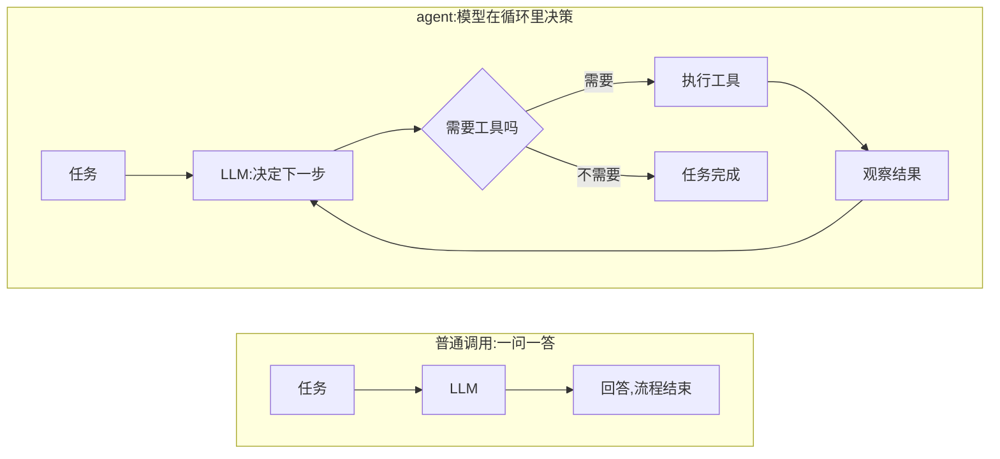
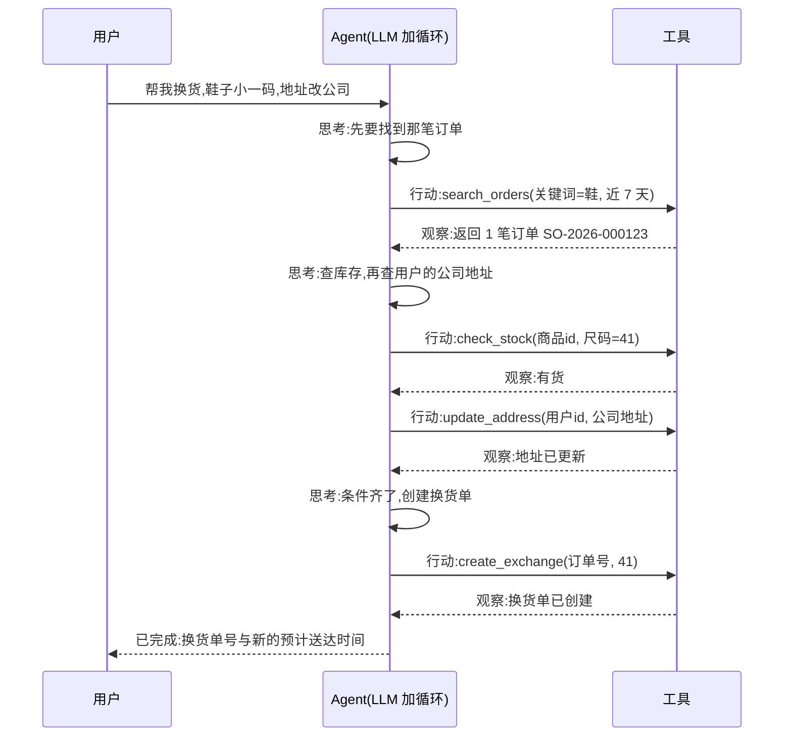
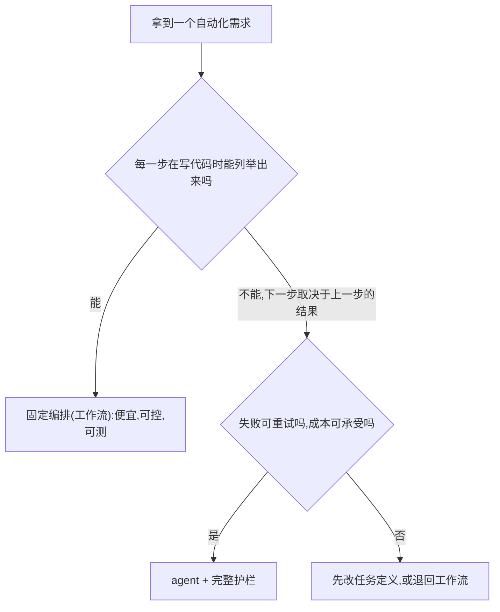

## 前置知识

- 读过 [结构化输出](/ai-llm/060-StructuredOutput)：知道「LLM 是不可靠的函数」以及工具参数本身就是一份 JSON Schema——agent 循环里每一次工具调用都建立在这个认知上；
- 建议读过 [进阶 RAG](/ai-llm/090-RagAdvanced)：那里出现过「agentic RAG 把检索变成模型在循环里自主决策的工具」，本文就是把那个特例推广成一般形态。

没读过也可以，本文会带上需要的部分。

## 学习目标

读完本文你将能够：

1. 用「agent = LLM + 工具 + 循环」向别人解释 agent 与普通 API 调用的本质差异，并画出两条路径的流程图；
2. 走一遍 ReAct 循环：说出思考、行动、观察三步各自由谁完成、以什么形式落在 messages 里；
3. 读懂并亲手跑通一个不依赖任何框架的 30 行级 agent 循环，说出工具表、说明书、循环三块各自的职责；
4. 给一个自动化需求判断该用固定编排还是 agent，并说出分界线的判据；
5. 为 agent 循环装上三件护栏：最大循环次数、费用熔断、危险操作人工确认；
6. 解释为什么「演示顺利」推不出「生产可靠」，以及可靠性的缺口靠什么补上。

预计 30 到 45 分钟，含 2 个动手实验与 4 道练习。

## 1. 问题引入：一问一答的天花板

设想你的电商客服助手接到这样一个请求：「上周买的那双鞋小了，帮我换大一码，收货地址改成公司。」

这不是一个能一次调用完成的问题。助手得先查订单（用户没说订单号，得从「上周」「鞋」里找）；查到订单再看库存（大一码有货吗）；有货还得改地址（先查用户资料里存的公司地址）；都顺利才能创建换货单。每一步依赖上一步的结果——查不到订单就谈不了库存，库存没货就得改谈退款。**第几步、调什么、参数是什么，写代码时全都无法预知**。

到这里为止，本模块前九篇给你的是一条直线：发请求、拿回答（[第一次调用 LLM API](/ai-llm/030-FirstLlmApiCall)），最多再让回答变成可靠的数据或动作意图（[结构化输出](/ai-llm/060-StructuredOutput)）。直线撑不住上面的任务。撑住它的东西，就是本文的主角。

## 2. 心智模型：agent = LLM + 工具 + 循环

先把这个等式的三个零件摆清楚：

- **LLM**：决策者。它每一步回答的不是「答案」，而是「下一步该干什么」；
- **工具**：手脚。查询、写入、计算、发请求——模型自己只会产出文本，一切真实操作都靠工具（机制见 [工具调用设计](/ai-llm/110-ToolCallingDesign)）；
- **循环**：把前两者串起来的骨架。做完一步、看到结果、再决定下一步，直到任务完成。

普通调用与 agent 的差别，全在「谁决定步骤」：



| | 普通 API 调用 | agent |
| --- | --- | --- |
| 谁决定步骤 | 你的代码，写代码时已确定 | 模型，运行中临场决定 |
| 调用次数 | 一次 | 不定，循环若干轮 |
| 何时结束 | 返回即结束 | 模型不再要求调用工具 |
| 成本 | 确定 | 不确定，必须设上限 |

一句话：**普通调用是「模型答一句话」，agent 是「模型在循环里自己决定下一步干什么，直到任务完成」**。「自己决定」三个字既是 agent 的全部价值（能处理写死代码处理不了的任务），也是它的全部风险（决策错了也会一路跑下去）——所以本文后半部分全是护栏。

## 3. ReAct：思考、行动、观察

循环里每轮发生什么，有个经典的名字：**ReAct**（Reasoning + Acting，推理与行动）。它把模型的每一步拆成三拍：

1. **思考**：我现在的目标是什么？缺什么信息？（例：「我还不知道订单号，得先查」）
2. **行动**：调用一个工具，带上参数（例：`search_orders(keyword="鞋")`）；
3. **观察**：拿到工具返回的结果，回到思考（例：「查到两个订单，得问用户是哪双，还是按时间取最近一个？」）。

在今天的 LLM API 里，这三拍不是三段神秘文本，而是你已经在 [第一次调用 LLM API](/ai-llm/030-FirstLlmApiCall) 见过的 messages 数组里的具体内容：思考与行动合成模型的一次返回（可带 `tool_calls`），观察是你回填的 `role: "tool"` 消息。走一遍完整任务：



注意第三拍「观察」里模型的纠结（「问用户还是自己定」）——**循环里的每一步都是一次真实决策，也对应一次真实的模型调用与费用**。轮数不由你控制，这正是下一节要用代码把它钉死的原因。

## 4. 动手实验一：30 行写一个最小 agent

agent 不需要框架。下面的代码是完整的 agent，三块结构：工具表（名字到函数的映射）、给模型看的说明书、十几行的循环。（OpenAI Python SDK 风格；机制讲解留给 [工具调用设计](/ai-llm/110-ToolCallingDesign)，这里先跑通。）

```python
import json
from openai import OpenAI

client = OpenAI()   # 密钥从环境变量读取
MODEL = "..."       # 模型名以所用平台文档为准

# 第一块:工具表。工具就是一个函数,函数名是钥匙。
def get_weather(city: str) -> str:
    return f"{city} 今日多云,气温 12 到 19 度"   # 示例:真实实现里调天气接口

TOOLS = {"get_weather": get_weather}

# 第二块:说明书。模型完全靠它决定选不选、怎么选这个工具。
TOOL_SPECS = [{
    "type": "function",
    "function": {
        "name": "get_weather",
        "description": "查询中国城市当日天气。用户问到天气时调用。",
        "parameters": {
            "type": "object",
            "properties": {
                "city": {"type": "string", "description": "城市名,例如 杭州"}
            },
            "required": ["city"],
        },
    },
}]

# 第三块:循环本身。
def run_agent(question: str, max_steps: int = 8) -> str:
    messages = [{"role": "user", "content": question}]
    for _ in range(max_steps):                  # 护栏:循环上限(第 6 节展开)
        resp = client.chat.completions.create(
            model=MODEL, messages=messages, tools=TOOL_SPECS)
        msg = resp.choices[0].message
        if not msg.tool_calls:                  # 模型不再要工具:任务完成
            return msg.content
        messages.append(msg)                    # 思考与行动:记入历史
        for call in msg.tool_calls:             # 行动:执行模型点的每个工具
            args = json.loads(call.function.arguments)
            result = TOOLS[call.function.name](**args)
            messages.append({                   # 观察:结果回填历史
                "role": "tool",
                "tool_call_id": call.id,
                "content": str(result),
            })
    return "已中止:达到最大步数"                 # 护栏触底:体面退出,不抛异常
```

对照第 3 节读这段代码，三件事值得盯住：

1. **「下一步干什么」完全由 `msg.tool_calls` 是否为空表达**。模型想用工具就返回调用意图，想收工就返回普通文本——循环的终止条件就是这一行的判断，没有任何额外魔法；
2. **模型从不执行任何东西**。它只发出「我想调用 get_weather，参数是杭州」的 JSON，真正执行的是你的 `TOOLS` 字典。模型的权力边界 = 你给的工具表；
3. **循环的燃料是 messages 的滚动**。每轮把模型的调用请求和工具结果都 append 进去，模型永远「看着自己走过的路」决定下一步——这直接衔接 [上下文工程](/ai-llm/050-ContextEngineering) 的窗口治理：步数一多，这个窗口就是本篇最需要经营的东西。

动手实验一：把代码跑起来，问它「杭州和上海哪个城市今天更热」。观察打印出的 messages：模型应该先调一两次工具，再给出比较后的回答。给 `get_weather` 的返回加上你所在的两个真实城市，看看它的比较是否合理。

## 5. 工作流还是 agent：一条工程分界线

看完循环的灵活，很容易觉得「以后什么都用 agent」。先把冷水浇了：大多数生产系统里，agent 只占一小块，其余是**固定编排**（workflow）——用代码写死的调用序列，LLM 至多出现在其中某几步。

分界线只有一条判据：**步骤在写代码时能否预知**。

- 发票处理管线：提取字段、校验格式、入库——三步固定，永远三步。**工作流**：便宜、可控、能用普通单元测试；
- 「帮用户查为什么订单没到，并给出补偿方案」：可能查一次物流就够，也可能查库存、查系统日志、比对承诺时效——步骤取决于每一步查到什么。**agent**；
- 现实中的大多数应用是混合体：工作流为主体，个别不可预知的环节嵌一个 agent。



| | 工作流（固定编排） | agent |
| --- | --- | --- |
| 步骤 | 写代码时已知 | 运行时由模型决定 |
| 单次成本 | 确定、低 | 不定、可能很高 |
| 可测试性 | 普通单元测试 | 需要评估集（见 [LLM 评估](/ai-llm/150-LlmEvaluationEvals)） |
| 失败模式 | 局部、可定位 | 连锁传播、需要护栏兜底 |
| 适用 | 流程稳定的管线 | 步骤依赖中间结果的开放任务 |

由此得到本模块的一条工程纪律：**能用工作流就不上 agent**。理由不是 agent 不好，而是这张表的后四行——agent 在成本、可测性、失败模式上全面劣于工作流。用它，只是因为那条分界线左边的写法根本做不了这类任务。

## 6. 护栏三件套：循环上限、费用熔断、人工确认

「模型自己决定下一步」意味着你也失去了「步骤数和花费在写代码时确定」的保证。三件护栏把这层不确定钉死：

**护栏一：最大循环次数。** 防止模型围着同一个工具打转（一个真实故障：连续十轮用相近关键词调同一个搜索）。上限按任务定，8 到 20 轮是常见区间；触底时返回一句明确的中止说明，而不是抛异常——调用方（往往是用户）需要知道发生了什么。

**护栏二：费用熔断。** agent 的成本在运行前不可知，唯一硬上限是运行中记账：累计 token（从每次响应的 usage 里取）或换算成钱，超过预算即中止。熔断同样要「体面」——返回说明，留好日志。

**护栏三：危险操作人工确认。** 删数据、付款、发邮件、改生产配置——模型可以提议，人必须裁决。执行前暂停、展示操作内容、等确认；用户拒绝时，拒绝本身也要作为工具结果回传给模型（它才能改走别的路）。确认流的代码骨架在 [工具调用设计](/ai-llm/110-ToolCallingDesign) 的 human-in-the-loop 一节。

```python
def run_agent_guarded(question: str, max_steps: int = 12,
                      token_budget: int = 100_000) -> str:
    messages = [{"role": "user", "content": question}]
    spent = 0
    for _ in range(max_steps):                    # 护栏一:循环上限
        resp = client.chat.completions.create(
            model=MODEL, messages=messages, tools=TOOL_SPECS)
        spent += resp.usage.total_tokens
        if spent > token_budget:                  # 护栏二:费用熔断
            return "已中止:本任务消耗超出预算"
        msg = resp.choices[0].message
        if not msg.tool_calls:
            return msg.content
        messages.append(msg)
        for call in msg.tool_calls:
            result = execute_tool(call)           # 护栏三在这里:危险操作先过人
            messages.append({"role": "tool", "tool_call_id": call.id,
                             "content": result})
    return "已中止:达到最大步数"
```

三件护栏的共同气质：**假设模型会犯错、会失控、会烧钱，用确定性的代码兜住不确定性的模型**。护栏不降低模型能力，它限定模型能力的爆炸半径。

## 7. 冷静面：演示顺利不等于生产可靠

2025 到 2026 年是 agent 的热潮期：演示里 agent 行云流水地订机票、写报告、改代码。作为工程学习者，你需要一组对抗性算术：**假设每一步决策的正确率是 95%，一个 20 步的任务全程正确率约等于 0.95 的 20 次方，约 36%**——比抛硬币还差。步数越多，可靠性衰减越狠，这是所有链式系统的通病，agent 只是把链条交给了概率性的模型。

演示与生产的差距，不在模型，在任务分布：演示是精心挑过的任务、有人在旁边随时兜底；生产是长尾输入、无人值守、错误会真实花钱。所以对热潮的正确姿势不是不信，而是**把「可靠」当成一个工程量来对待**：任务成功率多少、轨迹质量如何、单次成本分布怎样——这些都要用评估集度量，而不是看三场演示。这套方法论（评估集怎么建、指标怎么定、agent 任务怎么评）是 [LLM 评估与 Evals](/ai-llm/150-LlmEvaluationEvals) 的主题，也是 agent 从玩具到生产之间真正的门槛。

把本篇的结论收成一句话：agent 的自主性是借来的——LLM 借给它的，护栏收着抵押，评估决定能不能续借。

## 8. 常见困惑

**问：agent 和 RAG 是什么关系？**
RAG 是「检索增强生成」，回答问题前先查资料（见 [RAG 基础](/ai-llm/080-RagFundamentals)）；agent 是「模型在循环里自主决策」。两者相交于 agentic RAG：把检索变成 agent 的一个工具，模型自己决定查不查、查什么、查几轮（见 [进阶 RAG](/ai-llm/090-RagAdvanced)）。可以说 agentic RAG 是 agent 在检索场景的特例。

**问：需要 LangChain 之类的框架吗？**
入门不需要——本文的 30 行循环就是 agent 的全部本体，框架提供的是工程外围：状态管理、可观测、护栏组件、多 agent 编排。建议路径是先写裸循环理解本体，等项目需要那些外围时再评估框架；届时你会发现框架做的事，就是把你已经在第 6 节手写的护栏做厚。

**问：推理模型（会「思考」的模型）是不是就不需要 ReAct 循环了？**
正交的两件事。推理模型把「思考」内化到单次生成里，但工具执行永远在模型外部——模型再会想，也不能自己查数据库。思考能力提升的是循环里「决策」的质量，循环本身一个都少不了。

**问：agent 完成任务后会「记住」这次经验吗？**
不会。协议层模型零记忆，循环结束一切归零；跨会话延续靠的是把决策与偏好显式存下来、下次注入——那是 [Agent 记忆与状态](/ai-llm/130-AgentMemoryAndState) 的主题。

## 9. 修改实验

在动手实验一的代码上做三处修改，每处先预测再验证：

1. 给 `TOOLS` 和 `TOOL_SPECS` 各加一个 `get_now` 工具（返回当前日期时间），问它「现在杭州适合穿什么」——观察模型会不会先调时间再调天气。想一步：如果不加这个工具，模型对「现在」只能怎么处理？（这正是 [提示工程](/ai-llm/040-PromptEngineering) 里相对日期问题的根源。）
2. 把 `max_steps` 改成 2，给一个明显要多步的任务（「先查两个城市天气，再写一段旅游建议」），观察触底返回——确认护栏二、护栏一的行为与预期一致。
3. 故意把 `TOOL_SPECS` 里的名字改成 `get_weather_v2`（工具表里没有这个名字），观察会发生什么：模型会请求一个不存在的工具，你的 `TOOLS[...]` 直接 KeyError。修复方式不是祈祷模型别错，而是执行层用 `TOOLS.get(name)` 兜住、把「工具不存在」作为错误结果回传——这个手法在下一篇会反复出现。

## 10. 小练习

1. 归因题：某 agent 执行「查三个竞品定价并写对比表」，连续五轮调用同一个搜索工具、关键词几乎相同。说出两种可能原因（提示：工具返回的信息是否够用？循环是否缺护栏？），各配一个对策。
2. 判断题：以下哪些适合工作流、哪些适合 agent，说出判据：(a) 每天定时抓取固定 URL 列表并摘要；(b) 帮用户规划下周成都三日行，预算 3000 元；(c) 用户上传合同，提取甲乙方与金额；(d) 在代码库里定位一个性能问题并修复。
3. 计算题：单步正确率 0.9 的 agent 跑一个 10 步任务，全程正确率约多少？把每步提到 0.97 呢？（连乘即可，答案分别约 0.35 与 0.74。）由这两个数字，说出「提升单步正确率」与「减少步数」哪个杠杆更大。
4. 设计题：为「自动整理收据并记账」的 agent 设计护栏：哪些操作需要人工确认？费用预算设多少、依据是什么？循环上限设几轮？只要求判据与理由，不要求精确数字。

## 11. 与之前和之后的知识的关系

- 往前：[结构化输出](/ai-llm/060-StructuredOutput) 提供工具参数的 schema 机制，[进阶 RAG](/ai-llm/090-RagAdvanced) 预告了循环骨架，[上下文工程](/ai-llm/050-ContextEngineering) 的窗口治理直接用于 agent 的长轨迹；
- 往后：[工具调用设计](/ai-llm/110-ToolCallingDesign) 把本文一笔带过的「说明书与返回值」展开成设计纪律；[Agent 记忆与状态](/ai-llm/130-AgentMemoryAndState) 处理循环结束后的延续问题；[多智能体系统](/ai-llm/140-MultiAgentSystems) 讨论什么时候该把一个循环拆成多个；
- 更远：[LLM 评估与 Evals](/ai-llm/150-LlmEvaluationEvals) 是「演示到生产」那道门槛的方法论本体。

## 12. 官方文档

- OpenAI function calling 指南（本文代码的机制层）：https://platform.openai.com/docs/guides/function-calling
- Anthropic 工具使用（同机制在另一家的形态，可对照读）：https://docs.anthropic.com
- Model Context Protocol 规范（工具的跨应用生态，见本模块 [MCP 协议](/ai-llm/120-McpProtocol)）：https://modelcontextprotocol.io

## 13. 自我检查

1. 能不看资料说出「agent = LLM + 工具 + 循环」三个零件各自的职责，并画出与普通调用的对照流程图；
2. 能走一遍 ReAct 的思考、行动、观察，说出三步分别落在 messages 的哪些位置；
3. 能白写出 30 行级最小循环的三块结构（工具表、说明书、循环），并说出终止条件藏在哪一行；
4. 能对一个新需求用「步骤可否预知」判据决定用工作流还是 agent，并复述「能用工作流就不上 agent」的理由；
5. 能说出护栏三件套各自的防什么，以及「熔断与触底都要体面返回」的原因；
6. 能用 0.95 的 20 次方这道算术向别人解释「演示顺利不等于生产可靠」，并指出缺口的补法在评估。

## 本章总结

agent = LLM + 工具 + 循环：普通调用是一问一答，agent 是模型在循环里自己决定下一步干什么、直到任务完成，ReAct 的思考、行动、观察三拍就落在 messages 的滚动里。30 行代码足以写出 agent 本体——工具表是模型的手脚清单，说明书决定模型选不选它，循环的终止条件是模型不再要求工具。工程分界线只有一条：步骤可预知用固定编排（便宜、可控、可测），步骤依赖中间结果才上 agent（贵、需护栏），能用工作流就不上 agent 是纪律。护栏三件套——最大循环次数、费用熔断、危险操作人工确认——用确定性代码兜住不确定性模型。最后记住那组算术：每步 95% 的 20 步任务全程只剩约 36%，演示顺利推不出生产可靠，可靠性靠评估说话。

## 下一步

进入 [工具调用设计](/ai-llm/110-ToolCallingDesign)：循环骨架你已经有了，下一篇把循环里每一次流转的「说明书、参数、返回值」写成纪律——agent 的可靠性，一大半是在工具设计上挣来的。
