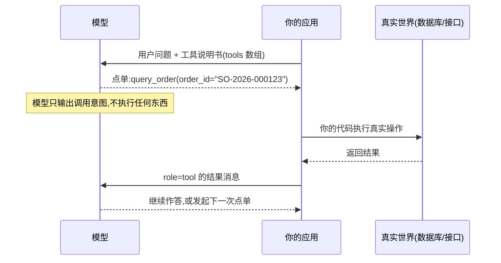
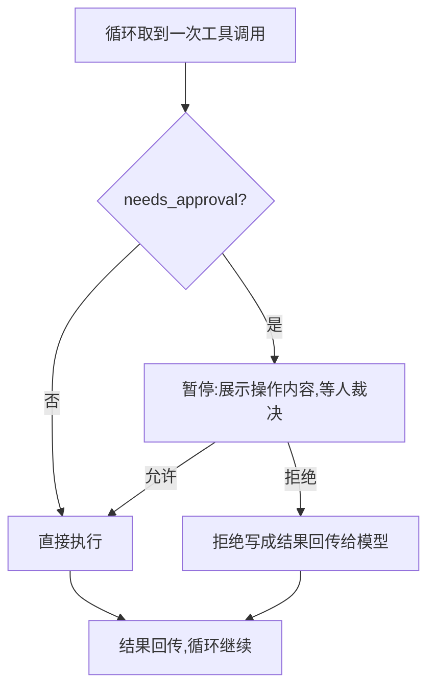

## 前置知识

- 读过 [结构化输出](/ai-llm/060-StructuredOutput)：知道 JSON Schema 与约束解码——工具的参数就是一份 schema，strict 模式下走同一套机制；
- 建议读过 [AI Agent 基础](/ai-llm/100-AiAgentsFundamentals)：知道 agent 循环的形状——本文设计的每一个细节，都是循环里真实流转的东西。

没读过也可以，本文会带上需要的部分。

## 学习目标

读完本文你将能够：

1. 说出工具三要素（名称、描述、参数 schema）各自的作用，并解释「描述即提示词」为什么成立；
2. 把一份含糊的工具描述改写成合格描述：说清何时用、何时不适用、参数语义与格式；
3. 应用参数设计三条纪律：类型收敛、必填最少化、一个工具干一件事；
4. 设计工具返回值：结构化、信息完整、错误也回传给模型，并解释抛异常为什么会让循环卡死；
5. 正确处理并行工具调用：按 tool_call_id 而不是顺序对应结果；
6. 为删库、付款、发邮件类操作搭起人工确认流，并说出「拒绝也要回传」的原因。

预计 30 到 45 分钟，含 2 个动手实验与 4 道练习。

## 1. 问题引入：模型点了菜，厨房却没对上单

你给日程助手接了第一个工具 `create_event`。用户说「下周三下午三点约张总开会」。三个故障依次发生：

1. 模型调用的却是 `search_event`——它没搞清两个工具的边界，选错了；
2. 选对了的那次，参数 `date` 里填的是「下周三」三个字——模型不知道你要 ISO 格式；
3. 有一次全部正确，但你的代码把数据库返回的 2000 字 JSON 原文塞回给模型，下一轮它开始对着无关字段自由发挥，输出逐渐跑偏。

三个故障分别指向工具设计的三大块：**描述**（模型怎么选工具）、**参数**（模型怎么填参数）、**返回**（模型怎么消化结果）。[AI Agent 基础](/ai-llm/100-AiAgentsFundamentals) 告诉你循环长什么样，本文把循环里每一次流转的这三块写成纪律——agent 的可靠性一大半是在工具设计上挣来的。

## 2. 心智模型：模型点单，应用执行

先把机制钉死：**工具调用分两半，模型只负责前一半**。请求里带一份工具说明书（`tools` 数组），模型返回的不是执行结果，而是一段结构化的「点单」：我想调用某工具，参数是这些。执行永远发生在你的应用里，执行结果作为一条 `role: "tool"` 的消息回填对话，模型看到结果后继续。



这个模型推出工具设计的核心事实：**模型对你系统的全部认知，就是请求里那几行说明书**。它看不到你的代码、数据库、业务规则——描述写什么，它就「活」在什么世界观里。这就是本文标题那句话的含义，下一节展开。

## 3. 工具三要素与「描述即提示词」

每个工具由三要素构成：

1. **名称**：模型的「菜单名」，要具体到能从名字猜出用途（`search_orders` 而不是 `search_data`）；
2. **描述**：说明书正文，模型决定选不选、何时选的唯一依据；
3. **参数 schema**：JSON Schema，每个字段的类型与语义，strict 模式下约束解码保证结构合法（机制见 [结构化输出](/ai-llm/060-StructuredOutput)）。

核心观点一句话：**描述即提示词**。你为用户问题写提示词时有多讲究，给工具写描述就该有多讲究——因为对模型而言，工具描述就是一段「教它何时用这个工具」的提示词，只是换了个位置。对照着感受一下：

```python
# 反面教材:三要素都在,但模型基本靠猜
{
    "name": "search_data",
    "description": "搜索数据",
    "parameters": {
        "type": "object",
        "properties": {"q": {"type": "string"}},
        "required": ["q"],
    },
}
```

```python
# 改进版:何时用、何时不适用、参数语义,全部说清
{
    "name": "search_orders",
    "description": (
        "按条件搜索商城订单,返回订单号、状态、金额与下单时间。"
        "当用户询问订单、售后进度时使用;"
        "不适合查物流轨迹(用 query_logistics),不适合查商品(用 search_products)。"
    ),
    "parameters": {
        "type": "object",
        "properties": {
            "keyword": {"type": "string",
                        "description": "商品名或订单号片段"},
            "status": {"type": "string",
                       "enum": ["pending", "paid", "shipped", "closed"],
                       "description": "订单状态过滤,不确定时省略"},
            "limit": {"type": "integer",
                      "description": "返回条数,默认 10,最大 50"},
        },
        "required": ["keyword"],
    },
}
```

反面教材里模型只能对 `search_data` 这个名字做字面联想——查什么数据、和别的工具怎么分工、参数 `q` 该填什么，全靠脑补，选错与填错只是概率问题。改进版多了三样东西，对应三条写法经验：

1. **说清「何时用」**：把用户可能会说的话翻译成触发条件（「询问订单、售后进度时」）；
2. **说清「何时不适用」**：负向边界比正向描述更防选错——告诉它相近工具的分工（「不适合查物流，用 query_logistics」）；
3. **参数 description 写格式与示例**（「形如 SO-2026-000123」）：这一条治第 1 节的「下周三」故障，效果立竿见影。

还有一个常被忽略的成本视角：说明书每轮请求都要随窗口发给模型，是 [上下文工程](/ai-llm/050-ContextEngineering) 里的常驻住户。工具越多，这份「菜单」越厚——第 8 节处理这个问题，先把单个工具写好。

## 4. 参数设计三条纪律

**纪律一：类型收敛。** 能用枚举不用自由字符串，能用数字不用字符串数字。原理在 [结构化输出](/ai-llm/060-StructuredOutput) 已经证明过：枚举把该字段的输出空间从整个词汇表钉死到几个值。订单状态、操作类型、优先级，全都该是枚举；日期在 description 里给格式与示例。

**纪律二：必填最少化。** 必填越多，模型填错的面积越大、调用失败率越高。判据一句话：**缺了这个参数，调用注定失败吗？不会就别必填。** 收件人是发邮件的必填；抄送、页码、排序方式都可以给默认值、写进 description（「默认 10」）。让默认值工作，别让必填清单膨胀。

**纪律三：一个工具干一件事。** 万能工具的诱惑是「一个接口覆盖所有情况」：

```python
# 反面教材:万能工具。模型要猜对「实体 + 动作 + 载荷」的全部组合
{
    "name": "update_record",
    "description": "更新记录。支持订单、用户、商品,支持创建、修改、删除。",
    "parameters": {
        "type": "object",
        "properties": {
            "entity": {"type": "string"},
            "action": {"type": "string"},
            "payload": {"type": "object"},
        },
        "required": ["entity", "action", "payload"],
    },
}
```

`entity` 和 `action` 两个自由字段一张口就把组合空间炸开了（3 个实体 × 3 个动作 × 任意 payload），每种组合的合法 payload 还各不相同——模型猜错一个组合，你的执行层就要多写一层校验来接住。拆成 `update_order_status`、`cancel_order`、`create_user` 这样的小工具，每个工具的 schema 自己说话，组合空间归零。判据：**描述里出现「和、或者、也可以」，就该拆**。

三条纪律合起来是一句话：参数 schema 不是接口文档的复制品，而是**给概率性模型的约束清单**——约束做得越好，模型越难做错。

## 5. 返回值设计：错误也是给模型看的信息

工具返回值有四条设计要求，后两条最常被做错：

1. **结构化**：返回 JSON，字段名自解释，别返回给人看的排版文本；
2. **完整**：给模型看的信息要完整到足够决策——省略看似省 token，实际诱发模型编造缺失的部分（「完整」不等于「全部」，大结果先加工再回传，见 [上下文工程](/ai-llm/050-ContextEngineering) 的工具结果治理）；
3. **错误也要回传**：这是本节的核心；
4. **控制体量**：2000 字的原始 JSON 提炼成要点再回传，既是省 token，也是防跑偏。

先看反面。第 1 节的循环里如果工具直接抛异常：

```python
# 反例:异常炸穿循环——agent 死在半路,模型什么都不知道
def query_order(order_id: str) -> str:
    order = db.find(order_id)
    if order is None:
        raise ValueError("订单不存在")   # 模型看不到这句话,循环直接崩
    return json.dumps(order, ensure_ascii=False)
```

在 [AI Agent 基础](/ai-llm/100-AiAgentsFundamentals) 的循环里，这个异常会让整个任务中断，模型甚至没有机会说一句「抱歉，订单号可能有误」。而「告诉模型哪里错了」，它是有能力自救的——换参数、换工具、或回头问用户：

```python
# 正解:错误也是返回值,让模型看得见、能自救
def query_order(order_id: str) -> str:
    order = db.find(order_id)
    if order is None:
        return json.dumps({
            "error": "order_not_found",
            "message": f"订单号 {order_id} 不存在。请检查格式(形如 SO-2026-000123),"
                       "或先用 search_orders 确认订单号。",
        }, ensure_ascii=False)
    return json.dumps(order, ensure_ascii=False)
```

注意 `message` 的写法：不只报错，还给**下一步建议**（检查格式 / 先用搜索工具）。错误信息写得越像「给模型的提示词」，自救成功率越高——这和 [结构化输出](/ai-llm/060-StructuredOutput) 重试回路里「把校验错误原样回传」是同一个思想：**错误回传不是失败的终点，而是修正回路的起点**。超时、部分结果、权限不足，一律照此办理：写成结构化错误返回，绝不让异常裸奔到循环里。

## 6. 并行工具调用：一次点多道菜

模型可以在一次返回里同时请求多个工具调用（`msg.tool_calls` 是一个列表）——比如「比较杭州和上海天气」会同时点两单。执行与回传的对应关系**靠 id，不靠顺序**：

```python
results = []
for call in msg.tool_calls:            # 多个调用:顺序无关,各查各的
    args = json.loads(call.function.arguments)
    result = TOOLS[call.function.name](**args)
    results.append({
        "role": "tool",
        "tool_call_id": call.id,       # 对应关系全靠这个 id
        "content": str(result),
    })
messages.extend(results)               # 全部结果一次回齐,模型再继续
```

两个工程要点：

1. **真并行要用线程或异步**：上面只是逐个执行，工具慢时可以并发跑（`ThreadPoolExecutor` 之类），结果按 id 回填即可——id 机制天然支持乱序完成；
2. **有依赖时禁用并行**：「先搜索订单再查详情」这种后一步参数依赖前一步结果的调用，并行只会得到废参数。多数平台提供开关（如 `parallel_tool_calls=False`），或在工具描述里写明「调用本工具前需先获得 X」。

## 7. human-in-the-loop：危险操作必须过人

[AI Agent 基础](/ai-llm/100-AiAgentsFundamentals) 把人工确认列为第三件护栏，这里给出代码骨架。先定清单——**模型可以提议、必须人裁决**的操作：删除数据、资金操作（付款、退款）、对外发送（邮件、消息、发布）、改生产环境配置。

实现思路：给工具注册表加一个权限标注，循环执行前检查，需要时暂停等人：

```python
import json

# 工具注册表:函数之外多一列「是否需要人工确认」
TOOLS = {
    "send_email": {"fn": send_email, "needs_approval": True},
    "search_docs": {"fn": search_docs, "needs_approval": False},
}

def execute_tool(call) -> str:
    """agent 循环里所有工具执行的唯一入口:先确认,再执行。"""
    tool = TOOLS[call.function.name]
    args = json.loads(call.function.arguments)
    if tool["needs_approval"]:
        print(f"模型请求执行 {call.function.name},参数:{args}")
        answer = input("允许执行吗? [y/N] ").strip().lower()
        if answer != "y":
            # 关键:拒绝也要作为结果回传,不是抛异常、不是静默丢弃
            return json.dumps({
                "status": "denied",
                "message": "用户拒绝了本次操作。请改用其他方案,"
                           "或直接询问用户希望如何处理。",
            }, ensure_ascii=False)
    return json.dumps(tool["fn"](**args), ensure_ascii=False)
```



「拒绝也要回传」值得单独强调：如果拒绝只是不执行、不吭声，模型会以为操作成功了，接着往下走；如果抛异常，循环卡死。写成结构化结果回传，模型才知道此路不通、换路走——与第 5 节的错误回传是同一个原理。

生产环境下 `input()` 换成审批队列或前端确认框，骨架不变。另外警惕：这些危险工具同时是 [提示注入](/ai-llm/190-PromptInjectionSecurity) 的头号目标——外部内容可能诱导模型调用它们，确认流是最后防线而不是唯一防线。

## 8. 工具太多怎么办：先检索工具，再用工具

工具超过三四十个，两件事同时发生：说明书把窗口撑肥（每轮都付费的常驻内容），模型的工具选择准确率开始下降——菜单太厚，谁都点错菜。两个成熟解法，都遵循「两层」思想：

**解法一：先检索工具，再用工具。** 第一层让模型（或用向量检索，见 [Embeddings 与向量检索](/ai-llm/070-EmbeddingsAndVectorSearch)）根据任务从工具目录里挑出 top-k 个候选；第二层只把这 k 个工具的完整说明书放进请求。工具目录本身可以做成一个元工具（返回候选工具列表），第一层照常走一遍循环。

**解法二：按场景分组。** 根据会话阶段或用户身份挂载不同工具集：浏览阶段只有只读工具，管理员会话才有运维工具；调试对话不挂生产工具。分组的额外收益是安全——权限面跟着场景收窄，与第 7 节的确认流互补。

注意区分两个问题：本文处理的是「**单应用内**工具过多」；而工具要**跨多个应用复用**（同一个订单工具，编辑器里的 agent 和桌面助手都要用），那是协议层的问题，交给 [MCP 协议](/ai-llm/120-McpProtocol)。

## 9. 常见困惑

**问：strict 模式是什么，要不要开？**
strict 模式让参数 schema 走约束解码（[结构化输出](/ai-llm/060-StructuredOutput) 的机制），从生成侧保证参数结构合法、枚举必中。能开就开；但它只保证「结构对」，不保证「语义对」——该写进描述的触发条件与格式说明一样都不能省，应用侧校验照旧。

**问：模型选错了工具，是模型的错还是我的错？**
多数情况是你的错。选错的高频原因是描述没写边界、相近工具没有互相「指路」。修复顺序：先改描述（第 3 节三条经验），再收敛参数（第 4 节），都不行才考虑换模型或减少工具。把「改提示词」的本能用在工具描述上，往往是性价比最高的一步。

**问：工具调用和 MCP 是什么关系？**
本文是机制层：模型与应用之间「点单—执行—回传」的协议。MCP（下一篇）是生态层：工具从哪来、怎么跨应用复用、怎么授权。MCP server 暴露的工具，最终仍以 `tools` 数组的形状进入模型 API——本文的全部设计纪律原样适用于 MCP 工具。

**问：流式输出时工具调用怎么办？**
`tool_calls` 的参数也是逐段流式到达的，任何时刻都可能是残缺 JSON。常规做法是缓冲到本轮结束再执行（工具执行本来就在你的代码里，不差这一会儿）；执行结果消息不参与流式——它来自你的程序，一次性回填即可。

## 10. 修改实验

**实验一：把反面教材改成合格描述。** 以第 3 节的 `search_data` 为起点，按三条经验改写（说清何时用、何时不适用、参数格式）。准备 10 条测试问题（其中故意混 3 条该用别的工具的，如「查物流」「查商品价格」），改造前后各跑一遍，手工记录工具选择正确率的变化——你会亲手看到「描述即提示词」的杠杆。

**实验二：让模型在你设计的错误上自救。** 给 `query_order` 加上三种错误路径：订单不存在、订单号格式错误、无权限查询，全部按第 5 节返回结构化错误与下一步建议。构造三种输入跑 agent 循环，记录模型在收到错误后的行为：它是否按建议换了参数或换了工具？把 `message` 里的建议删掉再跑一次，对比自救成功率。

## 11. 小练习

1. 找茬题：指出下面工具描述的三个问题——「send_notification：发送通知。参数：type（string）、target（string）、content（string）。」（提示：何时用？type 是什么取值？target 是邮箱、用户 id 还是频道？）
2. 判断题：下列参数哪些该必填，说出判据：(a) 发邮件的收件人；(b) 发邮件的抄送；(c) 订单搜索的页码；(d) 转账的金额。
3. 修 Bug 题：agent 循环里工具抛出 `KeyError` 导致整个服务 500。说出根因（第 5 节的哪条被违反了），并给出两种修法：执行层兜底的一种、调用前预防的一种。
4. 设计题：一个运维助手有 60 个工具，分属监控、部署、工单、财务四类。用两层策略设计工具暴露方案，画出结构，并说明哪些工具无论怎么分组都必须挂人工确认。

## 12. 与之前和之后的知识的关系

- 往前：[结构化输出](/ai-llm/060-StructuredOutput) 的 schema 与约束解码直接复用在参数上；[AI Agent 基础](/ai-llm/100-AiAgentsFundamentals) 的循环是本文所有设计的用武之地；[上下文工程](/ai-llm/050-ContextEngineering) 解释了为什么说明书与返回值都要省着用窗口；
- 往后：[MCP 协议](/ai-llm/120-McpProtocol) 解决工具「从哪来、怎么复用」的生态问题，本文的纪律在 MCP 工具上一字不改地适用；[提示注入安全](/ai-llm/190-PromptInjectionSecurity) 展开第 7 节埋下的安全伏笔；[多智能体系统](/ai-llm/140-MultiAgentSystems) 里，「每个 agent 一套专属工具」正是分工的手段之一。

## 13. 官方文档

- OpenAI function calling 指南（协议形状与 strict 模式以此为准）：https://platform.openai.com/docs/guides/function-calling
- Anthropic 工具使用（同机制另一形态，tool_choice 与并行开关细节以各家文档为准）：https://docs.anthropic.com

## 14. 自我检查

1. 能说出工具三要素，并用「模型对你系统的全部认知就是说明书」解释「描述即提示词」；
2. 能把一份含糊描述按三条经验改写：何时用、何时不适用、参数格式与示例；
3. 能复述参数设计三纪律，并说出万能工具的错在哪（组合空间爆炸）；
4. 能解释为什么「抛异常只会让循环卡死」，并写出错误即返回值、带下一步建议的返回设计；
5. 能说出并行调用的结果按 tool_call_id 对应，以及何时该禁用并行；
6. 能搭出人工确认流骨架，并解释「拒绝也要回传」与错误回传是同一个原理；
7. 能说出工具过多时的两个两层解法，以及它们与 MCP 解决的问题有什么不同。

## 本章总结

工具调用是「模型点单、应用执行」的两半协作：模型只输出调用意图，执行永远在你的代码里，所以模型对系统的全部认知就是那几行说明书——描述即提示词，说清何时用、何时不适用、参数格式，工具才能被选对、填对。参数设计三纪律：类型收敛（该枚举就枚举）、必填最少化（缺了注定失败才必填）、一个工具干一件事（描述里出现「或者」就拆）。返回值四要求：结构化、完整、控制体量、错误也回传——抛异常只会炸穿循环，把错误写成带下一步建议的结构化结果，模型才能自救。并行调用按 tool_call_id 对应结果，有依赖就禁用。删库、付款、发邮件必须人工确认，拒绝也要作为结果回传。工具过多时先检索工具再用工具或按场景分组；跨应用复用是 MCP 的题目，不改变本文的任何纪律。

## 下一步

进入 [MCP 协议](/ai-llm/120-McpProtocol)：同一个订单工具，编辑器里的 agent、桌面助手、团队的自建系统都想用——重复接线十几次不是办法。MCP 把「工具怎么交付给模型应用」这件事标准化，就像 USB-C 统一了充电与数据线。
