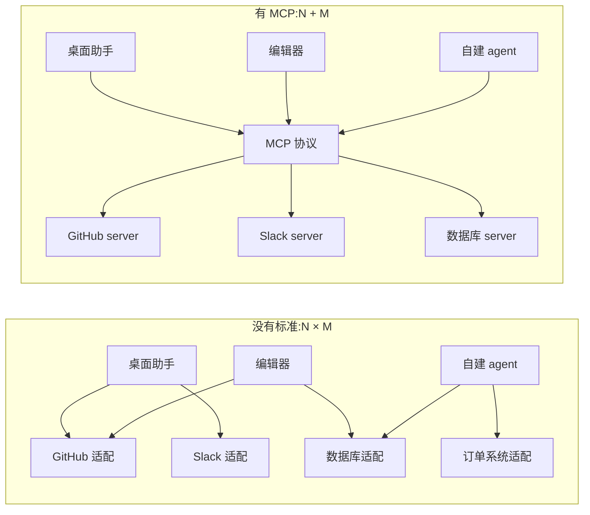
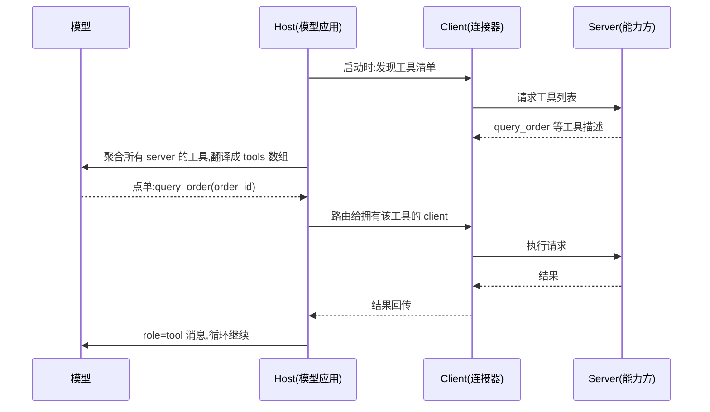

## 前置知识

- 读过 [工具调用设计](/ai-llm/110-ToolCallingDesign)：知道工具三要素与「模型点单、应用执行」的机制——MCP server 暴露的工具，最终仍以那个形状进入模型 API。

没读过也可以，本文会带上需要的部分：只要求你知道「模型调用工具要靠应用代为执行」这一件事。

## 学习目标

读完本文你将能够：

1. 用 N × M 变 N + M 的算术解释 MCP 解决的问题，并说出 USB-C 类比的准确与不准确之处；
2. 说出 Host、Client、Server 三角色的分工与连接关系；
3. 区分三原语 tools、resources、prompts 各自暴露什么、由谁控制；
4. 为本地工具与远程服务选对传输：stdio 与 Streamable HTTP；
5. 说出 2026-07-28 规范的关键变化：传输无状态化、OAuth 2.1 授权、网关路由头、Tasks 等新能力；
6. 判断一个工具该做成 MCP server 还是留在应用内的函数表。

预计 30 到 45 分钟，含 1 个动手实验与 4 道练习。

## 1. 问题引入：N × M 的集成地狱

上一篇你学会了把一个查询封装成工具（[工具调用设计](/ai-llm/110-ToolCallingDesign)）。现在把视角抬高一层：**工具要被多少个模型应用使用？**

假设市场上有 3 类 AI 应用（桌面助手、编码编辑器、你公司的自建 agent），它们都需要接入 4 类能力（GitHub、Slack、数据库、内部订单系统）。没有公共标准时，每一对「应用 × 能力」都要专门写一次适配：认证方式、消息格式、错误处理各不相同。3 × 4 = 12 份适配代码；应用涨到 10 个、能力涨到 50 个，就是 500 份。每一份都要人维护，能力方改一次接口，N 个应用跟着改。



MCP（Model Context Protocol，模型上下文协议）干的就是把左边那张网换成右边那个插座：**应用实现一次 client，能力方实现一次 server，协议在中间保证互通**。3 × 4 的矩阵塌缩成 3 + 4 的两条边——应用越多、能力越多，这笔账省得越狠。

## 2. 心智模型：AI 应用的 USB-C

官方类比是「AI 应用的 USB-C」，这个类比的准确与局限都值得说清。

准确的部分：**接口标准化，两头各自演进**。USB-C 之前，每个设备一根专用线；之后，手机、硬盘、显示器只管说自己的话，线缆只管标准。MCP 同理——能力方把自己的功能包成标准 server，不必关心谁来用；应用方实现一次 client，就能接上整个生态。能力方改了内部实现，只要协议面不变，应用无感。

不准确的部分（也是防误解的关键）：USB-C 统一的是物理插口，MCP 统一的是**「应用发现工具、调用工具」这一层对话协议**。它不改变工具本身的质量，也不改变模型的能力——一个写得含糊的 MCP 工具描述，和一篇写得含糊的函数描述一样废（[工具调用设计](/ai-llm/110-ToolCallingDesign) 的「描述即提示词」原样生效）。**MCP 解决的是接线问题，不是设计问题**。

顺带把协议名字读通：Model Context Protocol——为什么叫「上下文」协议？因为它标准化的三样东西（工具、数据、提示模板），本质都是**喂给模型上下文的方式**：模型能做什么取决于上下文里有什么。这层命名视角能帮你看懂第 4 节三原语的分类逻辑——它们是「上下文的三个来源」，而不是三种功能。

还有一个容易混淆的层次：模型 API 里的工具调用协议（`tools` 数组、`tool_calls`）没有变化。MCP 生活在应用层——host 应用把从 MCP server 拿到的工具，翻译成模型 API 的 `tools` 数组；模型的「点单」回来后，host 再转交给对应的 server 执行。模型从头到尾不知道 MCP 的存在。

## 3. 架构三角色：Host、Client、Server

| 角色 | 是什么 | 例子 |
| --- | --- | --- |
| Host | 模型应用本体：跑模型、管对话、决定何时调工具 | 桌面 AI 助手、编码编辑器、你的自建 agent |
| Client | Host 内部的连接器：与某一个 server 保持 1 对 1 会话 | Host 进程里的一个连接对象 |
| Server | 提供能力的轻量服务：包装一类工具、数据或模板 | GitHub server、订单查询 server |

两个容易答错的连接细节：

- **Client 与 Server 一一对应**。Host 同时连 5 个 server，就有 5 个 client 实例，各自独立会话——一个 server 挂了不影响其他 4 个；
- **Server 不直接对话模型**。server 的能力先经 host 聚合（翻译成 `tools` 数组），模型的决策也先经 host 路由（点单转给对应 client）。host 是枢纽，也是权限与安全的守门人。

这套分工回答了「MCP server 和普通工具函数有什么区别」：函数长在应用进程里（进程内调用），server 是独立进程或服务（跨进程协议调用）——换来的是复用与解耦，付出的是一层协议成本。第 8 节把这笔账算清。

把一次真实调用在三角色之间的完整旅程走一遍，枢纽感会非常具体：



看这张图就明白前面两个连接细节为什么成立：工具清单与执行结果都要经过 host 中转——它是权限的守门人（哪些工具进 `tools` 数组、哪些调用放行，host 说了算）；而 client 与 server 一一对应，让任何一个 server 的故障被隔离在自己的会话里。

## 4. 三原语：tools、resources、prompts

server 能向 host 提供三类东西，协议里叫三个原语：

| 原语 | 暴露什么 | 谁控制 | 例子 |
| --- | --- | --- | --- |
| tools | 模型可调用的动作 | **模型**决定何时用 | 查订单、建工单、发消息 |
| resources | 可读的数据内容 | **应用**决定注入什么 | 文件、数据库行、日志、API 响应 |
| prompts | 可复用的提示模板 | **用户**主动选用 | 「代码审查」模板、「周报生成」模板 |

区分三者的钥匙是**控制权**——同一个数据库，三种原语对应三种用法：包成 tool，模型在循环里自己决定查不查；暴露成 resource，应用决定把哪段数据放进上下文；写成 prompt template，用户点一下才展开。这正是 [上下文工程](/ai-llm/050-ContextEngineering) 五类住客的协议化：resources 对应「检索资料」，tools 对应「工具结果」，prompts 是「系统提示」的模板库。

多数场景下 tools 是主角（与 [工具调用设计](/ai-llm/110-ToolCallingDesign) 直接衔接），resources 与 prompts 按需了解即可。

## 5. 两种传输：stdio 与 Streamable HTTP

client 与 server 之间说什么话、走什么通道，由传输层定义。协议当前定义两种：

| | stdio | Streamable HTTP |
| --- | --- | --- |
| 形态 | 本地子进程，标准输入输出传消息 | 远程 HTTP 服务，请求响应式 |
| 适合 | 本机能力：文件系统、本地命令、个人配置 | 共享服务：团队共用、需要集中鉴权审计 |
| 生命周期 | host 启动它，随 host 退出 | 独立部署，可横向扩容 |
| 典型例子 | 桌面助手读你本地的笔记目录 | 公司统一的订单查询 server |

选择判据一句话：**能力住在本机就用 stdio，能力要被多人或多地共享就用 Streamable HTTP**。stdio 的好处是零部署（host 把 server 当子进程拉起），坏处是每个用户各自一份；HTTP 的好处是集中管控，坏处是要正经做部署与鉴权——鉴权这件事，下一节的规范修订动了不少手术。

远程 server 在 host 里的配置形状与 stdio 不同：不再是「拉起一个命令」，而是「连一个地址」：

```json
{
  "mcpServers": {
    "order-queries": {
      "url": "https://mcp.internal.example.com/orders",
      "headers": {
        "Mcp-Name": "order-queries"
      }
    }
  }
}
```

地址背后的服务按 Streamable HTTP 传输应答，鉴权走 OAuth 2.1 流程（第 6 节），`Mcp-Name` 这类路由头由网关消费——本地与远程两种形态，覆盖了从「个人玩具」到「公司级共享服务」的完整谱系。

## 6. 2026-07-28 规范：这次改了什么

MCP 的协议规范按日期版本化，本文以 **2026-07-28 规范**为事实基线（写作时点 2026-10）。这一版相对早期草案的关键变化，按工程影响排序：

1. **传输无状态化**：去掉了必须长期维持的连接流，server 可以像普通 HTTP 服务一样无状态部署、随时横向扩容；需要流式回传时仍可用流式响应，但不再依赖「一条一直挂着的通道」。早期方案里「server 要维护大量长连接」的运维负担由此解除；
2. **授权统一到 OAuth 2.1**：远程 server 须发布 **RFC 9728** 定义的保护资源元数据（告诉 client「我是谁、该去哪里授权」）；client 申请 token 时须带 **RFC 8707** 的 resource 参数，把 token 绑定到目标 server——防止给 A 服务申请的 token 被转手投递给 B 服务（token 混淆攻击）；
3. **请求须带 Mcp-Method 与 Mcp-Name 头**：网关、限流器、监控不用解析消息体，凭两个 HTTP 头就能路由、限流与统计——这是给「生产可运维」补的课，大团队部署 MCP 网关时尤其关键；
4. **能力面扩展**：Tasks（长任务的异步跟踪——发起后轮询状态，不再霸占一次请求）、elicitation（server 在操作中向用户征询补充信息，经 host 转达）、sampling（server 反过来借用 host 的模型完成一次推理）等，server 从「被动应答」走向「主动协作」。

协议仍在快速演进，上述细节与新增能力以官方规范为准：https://modelcontextprotocol.io/specification/2026-07-28 。学习时抓不变的骨架（三角色、三原语、两传输），易变的细节现场查。

## 7. 动手实验：20 行写一个 MCP server

用官方 Python SDK，一个可被任何 MCP host 加载的查询 server 不到 20 行：

```python
from mcp.server.fastmcp import FastMCP

mcp = FastMCP("order-queries")   # server 名字:宿主界面上显示的就是它

@mcp.tool()
def query_order(order_id: str) -> dict:
    """按订单号查询订单状态、物流与售后进度。

    Args:
        order_id: 订单号,形如 SO-2026-000123
    """
    # 真实实现里查数据库;示例返回固定结构
    return {"order_id": order_id, "status": "shipped", "eta": "2026-11-02"}

if __name__ == "__main__":
    mcp.run()   # 默认 stdio 传输:作为 host 的子进程,经标准输入输出通信
```

逐块对照你已经学过的东西：`@mcp.tool()` 装饰器读函数签名与 docstring，自动生成工具三要素——函数名、docstring 即描述、类型标注即参数 schema，与 [工具调用设计](/ai-llm/110-ToolCallingDesign) 的手工说明书一一对应；docstring 里写格式与示例的纪律（「形如 SO-2026-000123」）在这里照样是第一优先级。

把它交给 host，只需一段配置（各家 host 的配置文件位置不同，形状大体如此）：

```json
{
  "mcpServers": {
    "order-queries": {
      "command": "python",
      "args": ["C:/tools/order_server.py"]
    }
  }
}
```

动手实验：安装官方 SDK（`pip install "mcp[cli]"`），跑起这个 server；用 SDK 自带的 inspector 调试器（`mcp dev order_server.py`）连上它，在网页界面里手动调用 `query_order`，观察它生成的工具描述长什么样——你会看到 docstring 与类型标注如何被翻译成三要素。如果手头有支持 MCP 的模型应用（如主流桌面助手或编码编辑器），把它配进去，直接用自然语言问一笔订单，看完整链路。

## 8. 自建 server 还是直接函数调用

MCP 解决复用，但复用不是免费的：独立进程、配置管理、协议版本、部署运维，一层都不少。判据一句话：**工具要跨多个 host 复用，才值得上 MCP**。

| | 应用内函数表（上一篇） | MCP server |
| --- | --- | --- |
| 给谁用 | 只有你这个应用 | 多个 host：编辑器、桌面助手、其他 agent |
| 接入成本 | 进程内一行注册 | 独立进程或服务 + 配置 |
| 演进成本 | 改完即生效 | 协议面要向后兼容，版本要管理 |
| 复用范围 | 一个代码库 | 团队、公司、乃至生态 |

对照到场景：你的 RAG 应用里那个「查知识库」工具，只有自己用，写成函数表更简单（[RAG 基础](/ai-llm/080-RagFundamentals) 的管线里直接调）；而「查订单」这个能力，公司里编辑器里的编码 agent、桌面助手、值班机器人都想用——做成 server，一次实现、处处接入，还顺带获得集中鉴权与审计。反过来，只有自己用的工具包一层 MCP，是把函数调用写成了分布式系统。

## 9. 生态现状与冷静面

到 2026 年，MCP 已是工具生态的事实标准：主流模型应用（桌面助手、编码编辑器、agent 框架）普遍内置了 client，公开的 server 覆盖开发工具、企业系统、数据源等门类，两头的实现都在快速迭代——支持程度与配置方式各家不同，写作时点之后的细节以官方文档与各家文档为准。

热情之外保持三句冷静：

1. **MCP 不改变工具设计纪律**。server 只是工具的另一种壳，描述即提示词、错误回传、确认流的纪律在 server 上一字不改；接上一堆描述糟糕的 server，得到的是一团更乱的 agent；
2. **第三方 server 是新的信任边界**。它运行在你机器或你的网络里，能访问你授权的数据与操作——装 server 前问一句「我信得过它的作者吗」，权限最小化原则照常适用；注入风险（恶意内容诱导模型调用工具）是另一条独立的攻击线，见 [提示注入安全](/ai-llm/190-PromptInjectionSecurity)；
3. **协议是活的标准**。今天背细节不如明天会查文档：三角色、三原语、两传输这副骨架多年稳定，版本化细节让它留在官方规范里。

还有一条运维层面的提醒：MCP 让「接入新工具」变得便宜，也让**接入的泛滥**变得便宜——host 里随手加十几个 server，工具说明书就会把窗口撑肥（[上下文工程](/ai-llm/050-ContextEngineering) 的账单逻辑不变），工具选择准确率随之下滑。接了什么、为什么接，和接本身一样值得记录：工具清单也是需要经营的资产，不是越多越好。

## 10. 常见困惑

**问：用了 MCP，模型会变得更聪明吗？**
不会。MCP 是接线标准，不触碰模型能力，也不改善工具设计。它改变的是接入成本结构——从 N × M 到 N + M；工具好不好用，仍然取决于三要素写得怎么样。

**问：MCP server 和 function calling 是什么关系？**
两层协议：function calling 是「模型与应用」之间的机制（[工具调用设计](/ai-llm/110-ToolCallingDesign)），MCP 是「应用与工具源」之间的协议。host 把 server 的工具翻译成模型 API 的 `tools` 数组，把模型的点单路由给 server——模型不知道 MCP 存在。

**问：stdio server 能给远程同事用吗？**
不能直接用。stdio 是本地子进程，只活在它自己的 host 里。要共享，就用 Streamable HTTP 传输把能力发布成一个远程服务，配好 OAuth 2.1 授权，同事在自己的 host 里加一条远程 server 配置即可。

**问：一个 server 里该放多少工具？**
server 是发布单位，不是工具数量的上限——上一篇「工具太多怎么办」的两层策略（先检索工具再用工具、按场景分组）在 MCP 场景下同样成立。一个 server 装一类能力（如「全部订单相关」），比一个装一百个杂项工具的「超级 server」好维护得多。

## 11. 小练习

1. 算术题：一个公司有 6 个 AI 应用、20 类内部能力。没有 MCP 时最多要维护多少对适配？全部走 MCP 后是几条边？比例下降到原来的几分之一？
2. 归属题：下列需求各属于哪个原语——「模型自己决定何时查库存」「用户点选『周报生成』模板」「应用启动时把项目文档注入上下文」？
3. 设计题：团队的密码管理器要做成 MCP server，应该选哪种传输？需要哪些安全设计（提示：授权标准、权限最小化、与 [提示注入安全](/ai-llm/190-PromptInjectionSecurity) 的关系）？
4. 判断题：以下工具该做 MCP server 还是留函数表，说判据——(a) 你个人 RAG 应用的知识库检索；(b) 公司统一的 Jira 工单创建；(c) 只在你的 demo 脚本里用的一次性转换函数。

## 12. 与之前和之后的知识的关系

- 往前：[工具调用设计](/ai-llm/110-ToolCallingDesign) 的三要素与返回值纪律是 server 工具的质量标准；[AI Agent 基础](/ai-llm/100-AiAgentsFundamentals) 的循环解释了 host 为什么是枢纽；[上下文工程](/ai-llm/050-ContextEngineering) 的五类住客帮你看懂三原语各自注入什么；
- 往后：[多智能体系统](/ai-llm/140-MultiAgentSystems) 里，MCP 是「给 agent 一套跨系统手脚」的基础设施选项；[提示注入安全](/ai-llm/190-PromptInjectionSecurity) 处理第三方工具带来的新攻击面。

## 13. 官方文档

- MCP 规范（2026-07-28 基线，传输、授权、头部与本篇全部协议细节的唯一权威）：https://modelcontextprotocol.io/specification/2026-07-28
- MCP 官方文档与示例（client/server 实现指南、inspector 用法）：https://modelcontextprotocol.io
- 官方 Python SDK（本篇实验所用）：https://github.com/modelcontextprotocol/python-sdk

## 14. 自我检查

1. 能画出 N × M 与 N + M 两张图，并算出应用与能力都增多时省下的适配倍数；
2. 能说出 USB-C 类比准确在哪（两头各自演进）、不准在哪（不解决工具设计与模型能力问题）；
3. 能说出 Host、Client、Server 的分工，以及「Client 与 Server 一一对应、Server 不直接对话模型」两个细节；
4. 能用「控制权」区分三原语：tools 归模型、resources 归应用、prompts 归用户；
5. 能为「本地笔记目录」与「公司订单服务」各选对传输，并说出 2026-07-28 规范四项关键变化；
6. 能判断一个工具该上 MCP 还是留函数表，判据一句话：跨 host 复用才值得。

## 本章总结

MCP 把 N 个应用乘 M 个能力的集成地狱塌缩成 N + M：应用实现一次 client，能力方实现一次 server，协议居中保证互通——USB-C 的实质是接口标准化、两头各自演进，但它不改变工具设计纪律，模型也不知道 MCP 存在。架构三角色：Host 是模型应用与安全守门人，Client 与 Server 一一对应，Server 永不直接对话模型。三原语按控制权区分：tools 归模型、resources 归应用、prompts 归用户。传输二选一：本机能力走 stdio 子进程，共享服务走 Streamable HTTP。2026-07-28 规范的四件事：传输无状态化让 server 可横向扩容，OAuth 2.1 加 RFC 9728 与 RFC 8707 绑死 token 去向，Mcp-Method 与 Mcp-Name 头让网关可路由限流，Tasks、elicitation、sampling 扩展了能力面。20 行可写一个 server；判据只有一条——工具要跨 host 复用才值得上 MCP。

## 下一步

进入 [Agent 记忆与状态](/ai-llm/130-AgentMemoryAndState)：工具让 agent 能「做事」，循环让 agent 能「做完事」——但会话一关，一切归零。下一篇处理 agent 的另一半工程：这次会话里的事，下次怎么还记得。
