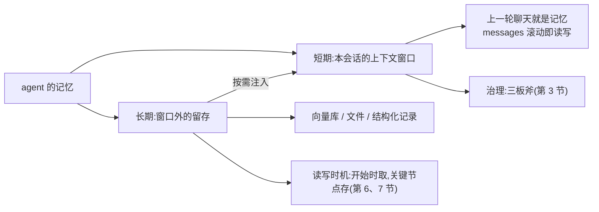
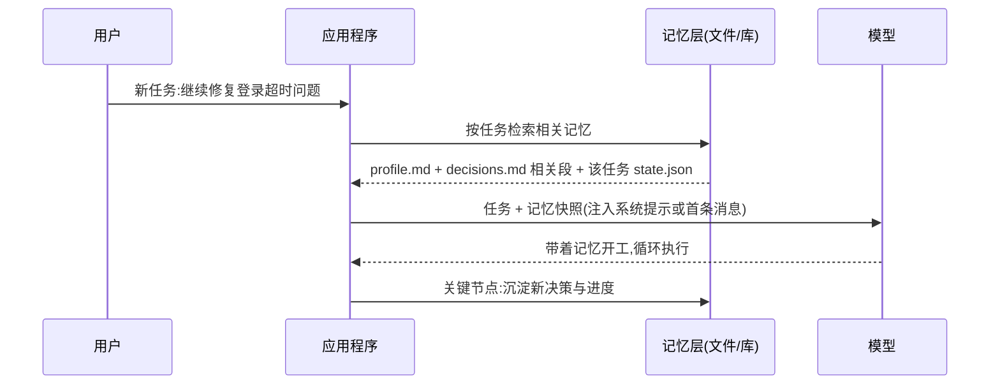

## 前置知识

- 读过 [AI Agent 基础](/ai-llm/100-AiAgentsFundamentals)：知道 agent 循环与 messages 滚动——记忆工程的全部问题都从这个循环里长出来；
- 建议读过 [上下文工程](/ai-llm/050-ContextEngineering)：短期的「窗口治理」那边已经打了一半地基（压缩、裁剪、外部化三副药剂），本文补上另一半。

没读过也可以，本文会带上需要的部分。

## 学习目标

读完本文你将能够：

1. 把「记忆」拆成短期（本会话窗口）与长期（跨会话留存）两层，并说出模型本身哪一层都没有；
2. 为短期记忆选用三板斧：滑动窗口裁剪、历史摘要压缩、结构化状态提取，并说出各自的代价；
3. 在向量库、文件、结构化记录三种长期形态间做选型，并解释为什么 2026 年主流 agent 的共同选择是文件系统即记忆；
4. 用「未来会用到的决策与偏好」判据决定记什么、不记什么，并说出垃圾记忆的代价；
5. 设计记忆的读写时机：任务开始时检索注入，任务结束（或关键节点）沉淀写入；
6. 处理记忆的脏问题：过时信息、自相矛盾、隐私与用户删除权。

预计 30 到 45 分钟，含 2 个动手实验与 4 道练习。

## 1. 问题引入：关掉窗口，它全忘了

你花了二十分钟向一个编码 agent 交代背景：项目用哪个框架、测试命令是什么、你不喜欢哪类写法、上次重构改到哪一步。任务完成得不错。第二天你开一个新会话问它继续，它客气地说：「好的，请先介绍一下你的项目。」

模型没有背叛你，它**本来就没有任何记忆**——[第一次调用 LLM API](/ai-llm/030-FirstLlmApiCall) 讲过，协议层模型零状态，每一轮都靠你的程序重发全部历史；[AI Agent 基础](/ai-llm/100-AiAgentsFundamentals) 的循环也一样，跑完即归零。所谓「AI 有记忆」，在产品层是厂商替你做了记忆工程，在自建应用里，这份工程是**你的**责任。

本文的任务就是把「记忆」这个被用滥的词拆开、称重、归位：哪些东西本来就该在窗口里、怎么管；哪些东西要活到窗口之外、怎么存、怎么取、怎么扔。

## 2. 心智模型：记忆 = 窗口里的 + 窗口外的

拆成两层，一层管当下，一层管未来：



**短期记忆 = 这次会话的上下文窗口。** 「上一轮聊天就是记忆」——模型显得记得你，只是因为程序把历史又发了一遍。它的治理就是 [上下文工程](/ai-llm/050-ContextEngineering) 的正面战场：窗口是预算制，历史线性膨胀，杂讯会腐烂。

**长期记忆 = 跨会话留存的一切。** 窗口关掉就消失的东西不够用，于是把该留的东西写进外部存储（文件、数据库、向量库），下次任务开始时**挑相关的注入回来**。注意这个定义里的两个动词：留存靠「写」，取用靠「注入」——长期记忆从不直接参与生成，它永远要经过窗口这一道门。

| | 短期记忆 | 长期记忆 |
| --- | --- | --- |
| 住在哪 | messages 数组（窗口内） | 外部存储（窗口外） |
| 生命周期 | 一次会话 | 跨会话，直到删除 |
| 谁在管 | 窗口治理（050 篇） | 本文的主角 |
| 失效表现 | 越聊越笨、越贵 | 明天开启一切归零 |

一个常见的误解在此顺带纠正：**「记忆」不是模型的能力，是程序的架构**。下面两节分别处理两层。

## 3. 短期记忆三板斧：裁剪、压缩、提取

短期记忆的病只有一种——历史堆积（单轮线性涨、整场平方涨，数学在 [上下文工程](/ai-llm/050-ContextEngineering) 推导过）。三副药剂按侵入性从低到高：

**板斧一：滑动窗口裁剪。** 只保留最近 N 轮原文，更早的整轮移除。实现最简单、零成本，代价是**硬遗忘**——被裁掉的内容彻底消失。适合过程性内容（寒暄、试错），不适合带结论的轮次。

**板斧二：历史摘要压缩。** 把较早的 N 轮交给模型总结成几百 token 的摘要，替换原文。保留脉络、丢掉细节，适合「改地址改了三轮」这类过程；摘要提示里要明确**结论必须保留**。

**板斧三：结构化状态提取。** 前两斧处理「聊天记录」，第三斧换思路：**把聊天变成字段**。每 N 轮跑一次抽取（用 [结构化输出](/ai-llm/060-StructuredOutput) 的 schema 与重试回路），把会话中散落的信息沉淀成一份结构化状态——任务是什么、走到哪、用户定了什么。之后窗口里的原始轮次可以放心裁掉，因为事实已经住了新家：

```python
from pydantic import BaseModel, Field

class TaskState(BaseModel):
    """从会话中提取的结构化状态——短期记忆的第三板斧"""
    task: str = Field(description="当前任务的一句话描述")
    done: list[str] = Field(description="已完成的步骤与关键结论")
    next_step: str = Field(description="下一步要做什么")
    user_prefs: list[str] = Field(description="用户在会话中表达的偏好与纠正")
```

三斧的分工不是三选一，是梯队：**滑动窗口保最近，摘要保脉络，状态提取保事实**。一个典型配置：最近 5 轮原文 + 一份 500 token 摘要 + 每轮请求注入的最新状态快照——这正是 050 篇「压缩前后的对照」里那个窗口的工程实现。

值得点破的是：第三板斧其实是**短期记忆向长期记忆借的桥**。状态文件写在窗口外，本会话注入、下会话还能接着用——会话恢复的秘密全在这里（第 8 节）。

## 4. 长期记忆三种形态

长期记忆要回答「存在哪」。三种主流形态，各有所长：

| 形态 | 存什么 | 怎么取 | 弱点 |
| --- | --- | --- | --- |
| 向量库 | 语义化的段落（笔记、对话片段） | 按语义相似度检索（[Embeddings 与向量检索](/ai-llm/070-EmbeddingsAndVectorSearch)） | 模糊：检索回「相关」不等于「正确」 |
| 文件 | 事实、决策、偏好（md/json） | 按路径与关键词读，人直接可读 | 需要约定文件结构与更新纪律 |
| 结构化记录 | 精确事实（用户 id、偏好键值、实体关系） | 数据库按主键精确查 | 僵硬：schema 外的信息放不进去 |

**向量库存语义**：适合「量大、边界模糊、按意思找」的内容——用户三个月前随口说过的一段需求描述，靠关键词搜不到，靠语义能召回。代价是它的不确定性：召回是「相似」不是「准确」，注入前最好再过一道筛选。

**结构化记录存精确事实**：适合「必须一字不差」的内容——用户的会员等级、订阅到期日、明确授权过什么。这类东西进向量库等于故意降级，按主键查库才是正路。

**文件存事实**：介于两者之间，也是 2026 年一个显著的主流选择——主流编码 agent 与通用 agent 的共同做法是**文件系统即记忆**：把工作状态与关键事实写成 md 或 json 文件，放在约定目录里。它为什么赢，下一节单独说。

选型不是单选，是分工：**精确事实进数据库，可读可审的事实与决策进文件，海量的模糊语义进向量库**。小项目往往一张文件目录就够，别让基建先于需求。

## 5. 文件系统即记忆：2026 的主流为什么是它

向量库听起来更「AI」，为什么主流 agent 集体选了最朴素的文件？四个理由，每个都硬：

1. **人可读可改**。记忆出错时，你能直接打开文件看它记了什么、亲手改掉——向量库里的记忆是黑盒，文件里的记忆是明文。可审计性在出问题时价值千金；
2. **版本化免费获得**。记忆文件放进 git，谁改的、何时改的、改了什么，历史齐全——这直接回应了第 9 节的脏问题；
3. **零额外基建**。不需要数据库服务、不需要嵌入模型，agent 现有的读写文件工具（[工具调用设计](/ai-llm/110-ToolCallingDesign) 里的普通函数）就能完成全部读写——记忆系统不需要新轮子；
4. **对模型天然友好**。md 文件本身就是为「被阅读」设计的结构，注入窗口后模型理解得和读文档一样好。

一套典型布局：

```text
memory/
  profile.md          # 用户偏好:语言、代码风格、常踩的坑
  project-facts.md    # 项目事实:构建命令、目录结构、部署方式
  decisions.md        # 决策日志:每条带日期与理由
  tasks/
    2026-10-27-refactor-auth/
      state.json      # 任务进度:已完成、下一步、待确认项
      transcript.md   # 会话原文(可选,供回放与审计)
```

两个使用要点。其一，**记忆文件就是提示词**：它会被注入窗口、参与塑造模型行为——所以写记忆要像写提示一样讲究（明确、无歧义、不堆砌），[提示工程](/ai-llm/040-PromptEngineering) 的标准在这里继续适用。其二，**记忆文件也是普通文件**：可以用 git 管理、可以加个定期复核的工具、可以让 agent 自己「整理记忆」（把过时条目归档）——工程手段全部现成。

里面具体长什么样？两个代表，先是用户偏好（profile.md）：

```markdown
- 回复语言:简体中文(2026-08 记录)
- 代码风格:类型标注齐全,拒绝裸 dict(2026-08 记录)
- 沟通偏好:先给结论再给理由,不用客套话(2026-09 记录)
```

再是决策日志（decisions.md）——只增不改，新覆盖旧时归档旧条目：

```markdown
- 2026-09-12:测试框架定为 pytest。理由:CI 与本地统一入口,团队已有积累。
- 2026-09-30:鉴权沿用网关层,业务代码不重复实现。理由:审计要求集中。
```

注意这两个文件的共同点：**每条都短、都带时间、都不解释情绪只记事实**——这正是第 6 节写入判据在文件形态下的落法。

## 6. 写入时机纪律：记什么，不记什么

长期记忆最大的风险不是「记不住」，是「什么都记」。写入判据一句话：**记「未来会用到的决策与偏好」，其余放行**。

落到操作层，写入前三问：

1. **未来会话会用到吗？** 「用户对花生过敏」会；「用户今天先问了天气又问了物流」不会；
2. **能从别处重新得到吗？** 能从代码库、数据库、文档里查到的，不记——记一份副本就多一份会过时的副本；
3. **是事实还是过程？** 「决定用 PostgreSQL 而不是 MySQL，因为运维团队只维护 PG」是事实（决策+理由）；「我们讨论了十分钟数据库选型」是过程，丢弃。

垃圾记忆的代价比没有记忆更贵：**记忆是跨会话注入的，一条坏记忆会污染后续所有会话**——050 篇「旧输出是未来的提示词」的规律在跨会话尺度上加倍成立，因为旧记忆拿不到「那是当时情境」的现场语境，模型只能全信。一个真实故障样例：早期会话里 agent 记下「该项目不用写测试」（当时是临时 demo），三个月后它持续劝阻一切补测试的尝试，且语气笃定。

写入时机同样有纪律：不是每轮都写。**在关键节点写**——任务完成时沉淀结论、用户明确纠正时记录偏好、做出有理由的取舍时记录决策。把「记什么」的判据写进系统提示，让 agent 在循环里自己提议写入、由你在护栏层把关（高危记忆操作过人工确认，同 [工具调用设计](/ai-llm/110-ToolCallingDesign) 第 7 节的确认流）。

## 7. 检索时机：任务开始时取相关记忆注入

存的目的是取。取的时机有一条主线：**任务开始时，取与任务相关的记忆注入上下文**。



三点工程说明：

1. **不是全量注入**。记忆总量小（几个文件）就整读；大了就按任务相关性取（关键词、或语义检索——与 [RAG 基础](/ai-llm/080-RagFundamentals) 的检索同构，只是检索对象从文档换成了记忆）。全量注入是窗口的灾难；
2. **注入位置有讲究**。用户偏好与项目事实放系统提示（几乎每个任务都用），任务专属状态放首条用户消息附近——lost-in-the-middle 的布置原则（050 篇）原样适用；
3. **这个动作和 RAG 是同一个模式**：检索、注入、生成。区别只在对象——RAG 检索的是别人写的文档，记忆检索的是与这个用户、这个项目互动中沉淀的内容。所以 RAG 的质量纪律（检索不准先修检索）在记忆上同样成立。

## 8. 会话恢复与多任务并行

状态外部化（第三板斧）买到的两个衍生能力，单独点一节。

**会话恢复。** 中断的会话不用从零开始：恢复 = 读快照重建窗口。把 [AI Agent 基础](/ai-llm/100-AiAgentsFundamentals) 的循环加一个装载步骤：

```python
def resume_task(task_dir: str) -> list:
    """从中断的任务目录重建窗口——状态文件是唯一可信来源"""
    state = read_json(f"{task_dir}/state.json")      # 任务进度:done / next_step
    summary = read_file(f"{task_dir}/transcript.md") # 可选:脉络摘要
    messages = [
        {"role": "system", "content": f"你正在恢复一个未完成任务。进度:{state}"},
        {"role": "user", "content": f"继续任务。上下文摘要:{summary}\n下一步:{state['next_step']}"},
    ]
    return messages   # 从这里接着跑 agent 循环
```

注意恢复的不是「逐字历史」而是「状态 + 脉络」——原始对话在窗口里本来就该被三板斧治理掉了，恢复逻辑复用同一份治理成果。

**多任务并行。** 多个任务同时跑时，铁律是**状态文件隔离**：一个任务一个目录（见第 5 节的 `tasks/` 布局），各自读写自己的 `state.json`，互不越界。共享的只有 `memory/` 顶层的公共记忆（用户偏好、项目事实），而且并行任务同时写公共记忆会产生冲突——处理原则与 [多智能体系统](/ai-llm/140-MultiAgentSystems) 的共享状态一节相同：能隔离就隔离，必须共享就明确谁有权写。隔离还有个安全红利：任务 A 的临时上下文（比如某个客户的数据）不会泄进任务 B 的窗口。

最后补一条判断：会话恢复与并行隔离用的都是同一招——**状态外部化的边界划分**。窗口内外以什么粒度切分状态（一份全局记忆、每任务一份工作状态），决定了恢复是否干净、并行是否安全。这个粒度设计没有标准答案，但有一条自查标准：随手关掉任意一个会话，另一个会话与长期记忆里的内容是否完全够你重建现场？答案为是，粒度就切对了。

## 9. 记忆的脏问题：过时、矛盾、隐私

记忆系统上线三个月后，真正的考验才开始。三类脏问题，各配治理手段：

**过时信息。** 用户换了团队、项目迁了库，旧记忆还在 confidently 指挥。治理：每条记忆**带时间戳与来源**（「2026-07 记录，来自会话」）；定期复核（人工或让 agent 列出「最久未验证的记忆」请你确认）；对易变信息优先「从源头现查」而不是信记忆（写入三问的第二问就是为此）。

**自相矛盾。** 新记忆说「测试框架换成 pytest」，旧记忆还写着 unittest。治理：**明确裁决规则并留痕**——默认新覆盖旧，但覆盖时保留旧条目的归档（文件系统 + git 天然支持），矛盾出现时可追溯。比规则更重要的是让矛盾可被发现：记忆文件按主题集中（同一主题不散落多处），定期让 agent 通读自查冲突。

**隐私与删除权。** 记忆里有用户说过的话、项目的敏感事实。三条底线：其一，**记忆必须可枚举、可删除**——用户说「忘掉它」，系统要能定位并删干净（这是文件优于向量库的又一票：明文可枚举）；其二，敏感信息（密钥、身份证号）**不该进记忆**，写入判据里加一条红线；其三，用户明确要求「本次不要记住」的内容，写入层直接拦截——尊重的不只是隐私，还有用户对自己数据的控制权。把删除权当功能设计，别当事故处理。

## 10. 常见困惑

**问：长期记忆和 RAG 到底是不是一回事？**
模式同构（检索、注入、生成），对象不同：RAG 检索文档——别人写的、相对稳定的知识；记忆检索的是互动中沉淀的、关于这个用户与这个项目的内容。工程上可以共用一套检索设施，但记忆多出两个 RAG 没有的环节：写入治理（第 6 节）与删除权（第 9 节）。

**问：一定要上向量库才显得「有记忆」吗？**
不。记忆量在几百条以内，文件加关键词检索足够，还附赠可读可改可版本化。先文件后向量，让「按语义搜不到」这个真实痛点来推动基建，而不是让架构焦虑推动。

**问：模型厂商的「记忆功能」和我做的是一回事吗？**
厂商记忆是产品功能，替你做了写入与注入的决策，效果因产品而异；协议层模型依旧零记忆（030 篇）。自建应用时不能指望它，而且你的记忆工程可以做得比通用产品更贴业务——记什么、不记什么的判据（第 6 节）只有你自己知道。

**问：记忆会不会越攒越多，最后全是垃圾？**
会——这正是本文一半篇幅在讲纪律的原因。没有遗忘机制的记忆系统是垃圾堆：写入有判据（三问）、过时有复核、矛盾有裁决、用户有删除权。健康的记忆系统是流动的：有沉淀，也有归档与清理。

## 11. 修改实验

**实验一：给最小 agent 装上记忆。** 以 [AI Agent 基础](/ai-llm/100-AiAgentsFundamentals) 的 30 行循环为底子：加一个 `memory/profile.md`，任务开始时读进系统提示；给 agent 一个 `save_memory(path, content)` 工具，系统提示里写明「仅当用户表达明确偏好或做出决策时使用」。跑一场对话，中途说「以后回答都用要点列表」，关掉进程，重开新会话问个问题——看它是否还记得。然后打开 profile.md 检查：它记的措辞准确吗？有没有把不该记的也记了？

**实验二：污染与清除。** 在 profile.md 里手动写一条过时偏好（「用户喜欢冗长正式的回复」），再跑一场对话观察它的行为；然后实践第 9 节的治理：改成正确偏好、用 git 记录这次修改。体会「人可读可改 + 版本化」在排障时的实际手感。

## 12. 小练习

1. 归类题：下列信息各该进短期治理的哪一板斧、长期记忆的哪种形态——「用户要求回复用中文」「这轮调试试了三种参数都失败」「订单号 SO-2026-000123」「用户是会员、偏好简洁回复」。
2. 判断题：用写入三问审这些候选记忆，哪些该记——(a) 「用户确认 UI 文案用简体中文」；(b) 「今天用户上线时间比平时早」；(c) 「构建命令是 make test，因为 CI 用同一入口」；(d) 「用户语气好像不太高兴」。
3. 设计题：为一个「每周帮你整理邮件的 agent」设计记忆方案：目录结构、每次运行开始读什么、结束时写什么、哪类信息坚决不进记忆。
4. 推导题：记忆里同时存在「项目用 MySQL」（6 月记录）与「项目已迁到 PostgreSQL」（9 月记录）。按第 9 节的规则写出裁决过程，并说明为什么归档而不是删除旧条目。

## 13. 与之前和之后的知识的关系

- 往前：[上下文工程](/ai-llm/050-ContextEngineering) 的三副药剂是短期记忆治理的地基，本文的第三板斧（状态提取）正是「状态外部化」的完整展开；[AI Agent 基础](/ai-llm/100-AiAgentsFundamentals) 的循环与无状态协议是全部问题的起点；[结构化输出](/ai-llm/060-StructuredOutput) 提供 schema 抽取的工具；
- 往后：[多智能体系统](/ai-llm/140-MultiAgentSystems) 把「状态文件隔离」推进到「多个 agent 争抢共享状态」的冲突问题；[LLM 评估与 Evals](/ai-llm/150-LlmEvaluationEvals) 提供度量手段——记忆质量（「注入相关记忆后任务成功率变化」）也可以也应该被评估。

## 14. 官方文档

- Anthropic 文档（memory tool、上下文编辑等记忆相关产品能力以此为准，可与自建方案对照）：https://docs.anthropic.com
- OpenAI function calling 指南（记忆读写作为工具的机制层）：https://platform.openai.com/docs/guides/function-calling

## 15. 自我检查

1. 能把「记忆」拆成两层并说出模型本身哪一层都没有；
2. 能说出三板斧各自的机理与代价，以及「滑动窗口保最近、摘要保脉络、状态提取保事实」的分工；
3. 能用「控制权」之外的另一把钥匙——存什么、怎么取——区分长期记忆三形态，并说出文件系统即记忆的四个理由；
4. 能用写入三问审一条候选记忆，并解释「一条坏记忆污染所有后续会话」的机制；
5. 能画出「任务开始检索注入、关键节点沉淀写入」的时序，说出它与 RAG 的同构与差异；
6. 能说出会话恢复恢复的是「状态 + 脉络」而非逐字历史，以及多任务并行为什么必须状态文件隔离；
7. 能针对过时、矛盾、隐私三类脏问题各说出至少一种治理手段，并说出用户删除权为什么要求记忆可枚举。

## 本章总结

记忆不是模型的能力，是程序的架构，拆开是两层：短期记忆就是本会话的上下文窗口——上一轮聊天就是记忆，治理靠三板斧，滑动窗口保最近、摘要压缩保脉络、结构化状态提取把聊天变成字段；长期记忆是窗口外的留存，三形态分工——向量库存语义、结构化记录存精确事实、文件存可读可审的事实与决策，2026 年主流 agent 的共同选择是文件系统即记忆：明文、可改、可版本化、零基建。写入纪律是记「未来会用到的决策与偏好」，写入前三问挡住垃圾记忆——一条坏记忆会污染所有后续会话；检索纪律是任务开始时取相关记忆注入，与 RAG 同构而对象不同。会话恢复恢复的是状态加脉络，多任务并行必须状态文件隔离。最后三类脏问题各有治理：过时靠时间戳与复核，矛盾靠新覆盖旧并留痕，隐私靠可枚举、可删除与用户控制权——记忆系统没有遗忘机制，就是垃圾堆。

## 下一步

进入 [多智能体系统](/ai-llm/140-MultiAgentSystems)：一个 agent 的记忆与工具都齐了，什么时候值得把任务拆给多个 agent？下一篇给出三个真实的动机、两种编排模式，以及 2026 年那句泼冷水的工程共识。
