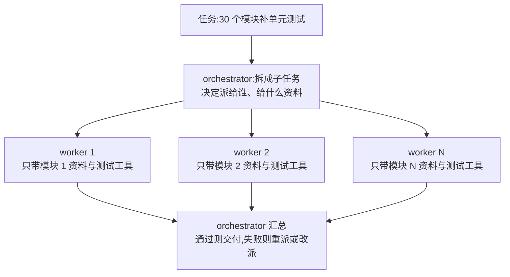
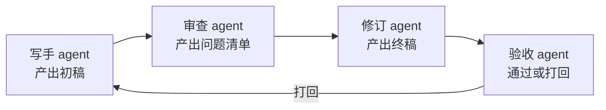

## 前置知识

- 读过 [AI Agent 基础](/ai-llm/100-AiAgentsFundamentals)：知道单个 agent 的循环与护栏——多 agent 就是把这套东西组合两份以上；
- 读过 [工具调用设计](/ai-llm/110-ToolCallingDesign)：知道工具说明书与确认流——「每个 agent 一套专属工具」是本文分工的手段；
- 建议读过 [Agent 记忆与状态](/ai-llm/130-AgentMemoryAndState)：状态文件隔离的思路，本文把它推进到多 agent 争抢共享状态的场景。

没读过也可以，本文会带上需要的部分。

## 学习目标

读完本文你将能够：

1. 说出需要多个 agent 的三个真实动机——上下文隔离、并行、分工——并识别「为了多而多」的伪需求；
2. 画出 orchestrator-worker 与流水线两种编排模式的图，并说出各自的适用场景；
3. 比较三种 agent 间通信形态：共享消息历史、结构化消息、A2A 类协议，并说出各自的窗口代价；
4. 为共享状态设计所有权规则，说出写冲突的三种裁决方式；
5. 复述 2026 年的工程共识：单 agent 加一组好工具能解决大多数问题，上多 agent 前先证明卡在上下文或并行上；
6. 用「每步落盘」的轨迹文件调试多 agent 系统。

预计 30 到 45 分钟，含 1 个动手实验与 4 道练习。

## 1. 问题引入：一个 agent 干大活的三种累

给一个 agent 派个真活：「把这个代码库里 30 个模块的单元测试补齐，全部跑通。」

一个 agent 会以三种方式累垮：

1. **上下文累**。它要读几十个模块的源码与测试，窗口几轮就被填满——[上下文工程](/ai-llm/050-ContextEngineering) 讲过，塞满的窗口更贵、更容易 lost-in-the-middle，还会上下文腐烂：早前读过的模块细节被后面的操作冲淡，模型开始「忘了初衷」，改着改着跑偏；
2. **时间累**。30 个模块理论上互相独立，但单 agent 只能串行——一个一个来， wall time 是 30 份的总和；
3. **提示累**。一个系统提示被迫身兼数职：既是决定先改哪个的调度员，又是写测试的工程师，又是跑测试的运维。每个角色需要的工具集与行为模式都不同，挤在一份提示里互相干扰。

三种累对应三个药方，就是本文的三个关键词。但先把丑话说在前面：**这三个药方各自都有明确的适用前提，不满足就别吃**——多 agent 不是「更高级」，是「更贵」。

## 2. 三个真实动机：隔离、并行、分工

**动机一：上下文隔离。** 每个 agent 只带自己需要的资料。改模块 3 的 agent 不必知道模块 17 的源码——拆开后，每个 agent 的窗口小而干净，从根上躲开过载与腐烂。这是三个动机里最常被低估、也最有价值的一个：多 agent 买到的第一样东西不是「更多智力」，是**更多干净的窗口**。

**动机二：并行。** 独立子任务同时跑。30 个模块的测试天然独立，拆给 8 个并行 worker，墙钟时间从 30 份变约 4 份（假设均匀）。前提同样要硬：**子任务真的独立**——会互相改同一个文件的「并行」是灾难现场（第 6 节）。

**动机三：分工。** 不同 agent 不同提示、不同工具集。写测试的 worker 只带读写代码与跑测试的工具；审查 agent 只读不写，系统提示专注挑毛病。分工的收益有两层：提示更专注（每个角色只被告知一件事），权限面更小（只读的 agent 想闯祸也难——这是 [工具调用设计](/ai-llm/110-ToolCallingDesign) 确认流思想的延伸）。

对应的伪需求也摆在这里对照：**「多 agent 更智能」**——不是。模型还是那几个，多 agent 改变的是组织方式，解决的是上下文、时间与职责问题；单步推理能力一分没涨。判断一个需求真伪的试金石：它能否还原成「单 agent 窗口装不下」「单 agent 串行太慢」「单 agent 提示职责过载」三者之一？还原不了，多半是伪需求。

## 3. orchestrator-worker：主管分派，工人干活

最常用的模式。一个**主管 agent**（orchestrator）负责把任务拆成子任务、派给多个**工人 agent**（worker）、汇总结果：



三个工程要点：

1. **主管也是 agent**：拆解「30 个模块怎么分组、每个 worker 给哪些文件」这件事本身需要理解任务，交给 LLM 合理；但重试上限、并发数、超时这些**控制流必须用代码**——让 LLM 管「什么是对」，代码管「怎么跑稳」，与 [AI Agent 基础](/ai-llm/100-AiAgentsFundamentals) 的护栏思想一脉相承；
2. **worker 可以很轻**：它常常就是一个标准 agent 循环（30 行级那种）加一套专属工具与一段专属提示，不需要任何「多 agent 框架」；
3. **汇总要看产物不看过程**：worker 回报给主管的应该是「改了哪些文件、测试是否通过、遇到什么」，而不是几十轮完整轨迹——把过程灌回主管窗口，等于把隔离挣来的窗口又还了回去。

worker 并行不神秘，一个线程池加上 [AI Agent 基础](/ai-llm/100-AiAgentsFundamentals) 的循环就够：

```python
from concurrent.futures import ThreadPoolExecutor

def run_worker(task_desc: str, files: list[str]) -> dict:
    """一个 worker = 一段专属提示 + 专属工具 + 标准循环"""
    messages = [
        {"role": "system", "content":
            "你是测试补齐工人。只处理分派给你的文件,只写测试,"
            "完成后回报改动清单与测试结果,不要越界改其他模块。"},
        {"role": "user", "content": f"任务:{task_desc}\n文件:{files}"},
    ]
    return run_agent_loop(messages, tools=TEST_TOOLS)   # 复用单体 agent 循环

with ThreadPoolExecutor(max_workers=8) as pool:
    futures = [pool.submit(run_worker, t["desc"], t["files"])
               for t in orchestrator_plan]              # 主管拆好的子任务
    results = [f.result() for f in futures]             # 全部收齐再汇总
```

三个值得盯住的细节：worker 之间不共享任何窗口（隔离是真的隔离）；每个 worker 的工具集与提示写死在自己的函数里（分工落在代码上）；线程数、超时、重试上限都在这段编排代码里硬编码（控制流不交给 LLM）。

## 4. 流水线模式：按阶段接力

第二种编排：阶段固定、单向流动，每个阶段的 agent 接力处理上一阶段的产物：



与 orchestrator-worker 的分工判据：**子任务同质且独立，用 worker**（30 个模块互为镜像，谁先谁后无所谓）；**阶段异质且有序，用流水线**（先写才能审，先审才能改）。流水线的常见变体是阶段间打回循环（上图「打回」边）——打回次数要设上限，这是 [AI Agent 基础](/ai-llm/100-AiAgentsFundamentals) 护栏一在模式层的翻版。

流水线还有一个隐蔽的优点值得点名：**上下文天然瘦身**。沿流水线传递的是产物（初稿、问题清单、终稿）而不是全部过程——审查 agent 看到的只是初稿与审查标准，不需要知道写手挣扎了多久；对比共享消息历史那种「全员围观全程」的形态，每个阶段的窗口都小而专注。代价是**信息丢失也是单向的**：上游丢弃的细节下游永远看不到，所以「传什么产物」本身就是设计决策——丢过程、留结论，与 [Agent 记忆与状态](/ai-llm/130-AgentMemoryAndState) 的压缩原则同源。

两种模式常混合使用：一条流水线的「写」阶段内部，又是三个 worker 并行——模式服务于动机，动机（第 2 节）才是设计原点。选型拿不准时回到那个问题：**拆开是为了什么？** 为了同时开工，选 worker；为了逐段把关，选流水线；两者都要，就嵌套——但嵌套层数本身也是一种复杂度，同样要过第 7 节的证明题。

## 5. agent 间通信的三种形态

agent 之间怎么传话？三种形态，成本与可靠性递增：

| 形态 | 怎么做 | 适合 | 代价 |
| --- | --- | --- | --- |
| 共享消息历史 | 所有 agent 读写同一段对话 | 小规模、强关联的协作 | 窗口迅速膨胀，互相的杂讯引发腐烂 |
| 结构化消息 | 每步传递 schema 化的任务卡 | orchestrator-worker、流水线 | 要定义 schema 与校验 |
| A2A 类协议 | 跨服务发现与委托对方 agent | 不同厂商、不同框架的 agent 互操作 | 协议与基建成本 |

**共享消息历史**最直觉也最危险：多 agent 的轮次全部堆进同一个窗口，等于集体共享一个会腐烂的上下文——050 篇的「旧输出是未来的提示词」在这里被多方放大。只适合两三个 agent 短程协作。

**结构化消息**是 2026 年的主流实践：agent 之间不传「聊天」，传**任务卡**——用 [结构化输出](/ai-llm/060-StructuredOutput) 的 schema 定义「目标、输入、产出、状态、遇到的问题」几个字段，接力的双方各取所需。它的本质是把 [Agent 记忆与状态](/ai-llm/130-AgentMemoryAndState) 的状态提取，用在了 agent 与 agent 的边界上。一张任务卡长这样：

```python
from pydantic import BaseModel, Field

class TaskCard(BaseModel):
    """agent 之间的交接单:字段即契约,校验即关卡"""
    goal: str = Field(description="本阶段要达成什么,一句话")
    inputs: list[str] = Field(description="收到的产物或文件路径")
    outputs: list[str] = Field(description="产出的文件路径或结论")
    status: str = Field(description="done / partial / failed")
    issues: list[str] = Field(description="遇到的阻塞与疑似原因")
```

用任务卡交接有两个立刻兑现的好处：主管汇总时读的是五个字段而不是几千字轨迹（窗口账立省）；`status` 是显式的，失败不会被「客气话」掩盖——一个 worker 说「基本完成了，不过有些细节……」，拆成字段后就是 `status: partial` 加 `issues` 列表，没处藏。

**A2A 类协议**解决的是最外圈的问题：你的 agent（Z 框架写的）要委托另一个团队的 agent（另一个厂商的）干活。直觉上它对 agent 做的事，类似 [MCP 协议](/ai-llm/120-McpProtocol) 对工具做的事——MCP 统一「模型到工具」的接线，A2A 类协议统一「agent 到 agent」的发现与委托：把对方当成一种可发现、可调用的服务。这一层生态仍在快速演进，细节以各协议官方文档为准；记住定位即可——同进程内的多 agent 用结构化消息足够，跨组织的互操作才轮到协议。

## 6. 共享状态与冲突：谁有权写哪个文件

多个 agent 并行时，最经典的翻车现场：两个 worker 同时要改同一个文件。后写的覆盖先写的，谁都不知道自己丢活儿了——**写冲突不会报错，只会悄悄吞掉工作成果**，这比崩溃难排查得多。治理从两个问题入手：

**问题一：谁有权写哪个文件？** 首选**所有权划分**：按目录或资源把写权限切成互不重叠的块，每个 agent 只写自己的地盘、读别人的（worker 各管一个模块目录，是最自然的切法）。切不开的场景，把写操作**收归主管串行化**：worker 提交修改请求，orchestrator 统一落盘——牺牲一点并行度，换来确定性。

**问题二：真冲突了谁裁决？** 三种裁决方式按可靠度排序：

1. **所有权制**（上段）：冲突在设计上不可能发生，最优先；
2. **主管裁决**：冲突双方把修改意图交给 orchestrator，由它合并或决定顺序，适合无法物理隔离的少量共享资源；
3. **最后写入者胜**：谁后写谁生效——等于放弃裁决，只在「写入原子且可丢」的场景（如互相独立的日志）勉强可用，生产里看到它就该警惕。

原则收拢成一句：**能隔离就隔离，必须共享就最小化共享面，并对每一处共享明确书面规则**。这与第 2 节动机一互为镜像：多 agent 的上下文隔离做得越好，需要共享的状态就越少。

所有权规则还要落到工具层才算真落地——「读别人的地盘、写自己的地盘」不该只是提示词里的请求，而应是工具集的事实：给 worker 的工具清单里，写操作工具只暴露它名下的路径（路径作为工具参数用白名单校验），只读工具才开放全库。规则写在提示里会被模型偶尔违反，规则焊死在工具里没人能违反——这是 [工具调用设计](/ai-llm/110-ToolCallingDesign) 确认流思想的又一次复用：**把纪律从「拜托模型」下沉到「代码强制」**。

## 7. 泼冷水：2026 年的工程共识

把本模块第一次出现的 agent，和此刻的多 agent，用同一条纪律串起来。2026 年工程圈经过一轮多 agent 热潮与退潮后的共识是：**单 agent 加一组好工具，能解决大多数问题**；多 agent 让**成本、调试难度、失败模式全部翻倍**——每次模型调用乘以 agent 数，失败方式从「一个循环跑偏」变成「多个循环互相跑偏」，第 6 节那类静默冲突更是单 agent 世界不存在的病。

所以上多 agent 之前，先做一道证明题：**单 agent 真的卡住了吗？卡在哪？**

- 卡在上下文？先确认三板斧（裁剪、压缩、状态提取）都用过且不够——很多「窗口不够」其实是「窗口治理没做」；
- 卡在并行？先确认子任务真的独立、真的耗时——「感觉会慢」不是证据，测出来才是；
- 卡在职责过载？先试试把一个臃肿系统提示拆成阶段化的单 agent 流程——它常常已经够了。

三问都有肯定答案，才轮到本文的编排模式上场。把这道证明题写成一段可以贴在工位上的决策清单：**动机写不出来，不上；单 agent 的药没吃过，不上；测不出并行收益，不上；说不清谁有权写哪个文件，不上**。四条全过，才动手。

顺序记住：**先工具，后循环，再多 agent**——每上一级台阶都要有上一级确实不够的证据。这与 [AI Agent 基础](/ai-llm/100-AiAgentsFundamentals) 「能用工作流就不上 agent」是同一条纪律在更高台阶上的重申：复杂度永远要花在刀刃上。

## 8. 调试多 agent：每步落盘是唯一实用手段

单 agent 出问题，翻对话日志就够；多 agent 出问题，时序是交错的——worker 2 的失败引发主管的重派，重派又撞上 worker 5 的写入，靠记忆或控制台滚动还原现场基本不可能。唯一实用的手段：**每个 agent、每一步，结构化落盘**。

```python
import json
import time

def trace(agent: str, record: dict) -> None:
    """每个 agent 一个轨迹文件,每步追加一行 JSON——多 agent 的黑匣子"""
    with open(f"traces/{agent}.jsonl", "a", encoding="utf-8") as f:
        f.write(json.dumps({"ts": time.time(), **record},
                           ensure_ascii=False) + "\n")

# 两个必须记录的点:模型的每次点单,工具的每次执行
trace("orchestrator", {"kind": "dispatch", "worker": "w2",
                       "task": "为模块 auth 补测试", "files": ["src/auth"]})
trace("w2", {"kind": "tool_call", "tool": "write_file",
             "args": {"path": "tests/test_auth.py"}})
trace("w2", {"kind": "tool_result", "ok": True,
             "summary": "写入了 14 个测试,12 通过 2 失败"})
```

三条使用纪律：

1. **记录什么**：派发（谁、干什么、给了什么资料）、工具调用与结果、每个 agent 的关键产出摘要。控制流事件（重试、超时、熔断）同样要记——它们是失败模式的指纹；
2. **一个 agent 一个文件**：按 agent 分文件便于追踪单个角色的行为；排查跨 agent 问题时，用时间戳把多份 jsonl 合并重放，交错时序一目了然；
3. **轨迹本身也是状态**：与 [Agent 记忆与状态](/ai-llm/130-AgentMemoryAndState) 的任务目录放在一起，中断恢复时顺便读轨迹摘要——调试与恢复共用同一份基础设施。

没有轨迹文件的多 agent 系统不是不能建，是**不敢上生产**——出了问题你连「谁在什么时候干了什么」都说不清。

## 9. 常见困惑

**问：多 agent 是不是更智能、效果一定更好？**
不是。模型没变，多 agent 是组织方式：买到的是隔离的窗口、并行的时间、专一的职责，付出的是成本、调试与协调。效果是否更好，完全取决于第 2 节的三个动机是否真的成立。

**问：编排逻辑该用代码还是 LLM？**
分工而非二选一：拆任务、判断产出质量、决定重派给谁——这些语义判断交给 orchestrator 的 LLM；并发数、重试上限、超时、熔断——这些控制流必须用代码硬编码。让 LLM 出现在「需要理解内容」的每一步，让代码出现在「需要确定性」的每一步。

**问：agent 数量越多是不是越强？**
不是。每加一个 agent：多一份系统提示与工具说明的 token、多一条可能出错的链路、多一种协调失败的模式。从 1 开始，每次加一个，且必须说出它对应第 2 节哪个动机——说不出就不加。

**问：多 agent 之间会「吵架」吗？**
会，两种形式：抢共享资源的写冲突（第 6 节的裁决规则管这个），以及结论互相矛盾（两个 worker 对同一问题给出不同答案）。前者的解法是所有权，后者的解法是让主管带判断标准去汇总——「谁的证据更硬听谁的」要写进主管的提示里，而不是指望它临场公道。

## 10. 动手实验

目标：亲手完成一次「单 agent 到双 worker」的改造，验证并行与隔离的实际收益与代价。

1. **先跑单 agent 基线**：用 [AI Agent 基础](/ai-llm/100-AiAgentsFundamentals) 的循环，给两个独立子任务（如「总结文本 A 的要点」「总结文本 B 的要点」，各配一个 summarize 工具），记录总耗时与总 token；
2. **改成 orchestrator-worker**：主管不再自己调工具，而是把两个子任务塞进线程池，各起一个 worker 循环并行跑；汇总产物回填主管窗口，由主管生成最终答案。记录总耗时与总 token；
3. **对比并回答**：并行省了多少时间？多花了多少 token（主管的拆解与汇总都是新开销）？如果把两个子任务改成「先总结 A，再基于 A 总结 B」，还能并行吗？为什么？
4. **故意制造一次冲突**：让两个 worker 同时往同一个汇总文件追加内容（不加锁跑几次），观察丢写；然后加上所有权或串行化修复。这一步是为了让第 6 节的规则从文字变成手感。

## 11. 小练习

1. 判断题：以下需求哪些真的需要多 agent？说出它对应哪个动机，或是伪需求——(a) 同时给 50 个客户各写一封个性化周报；(b) 「写一份更长的报告」；(c) 长文写作中的初稿、事实核查、修订三阶段；(d) 「让三个 agent 投票显得更严谨」。
2. 模式题：把「用户反馈分析」拆成「分类、深访、汇总」三步，且分类可并行处理上千条反馈。画出你的编排设计（哪种模式为主、哪里嵌并行、哪里需要打回上限）。
3. 排障题：worker 3 汇报「测试全部通过」，主管交付后用户发现模块 7 的测试根本没跑。说出轨迹文件里你最先查的三样东西，以及第 6 节哪条规则本可以预防它。
4. 推导题：一个任务单 agent 要 20 步完成，每步一次模型调用。改成主管 + 4 worker 后：主管拆解 3 步、每 worker 各 6 步、主管汇总 2 步。总调用次数变成多少？结合第 7 节，说出这次拆分在什么条件下才值得。

## 12. 与之前和之后的知识的关系

- 往前：[AI Agent 基础](/ai-llm/100-AiAgentsFundamentals) 的循环与护栏是每个 agent 的单体形态，护栏纪律在多 agent 下逐级加码；[工具调用设计](/ai-llm/110-ToolCallingDesign) 的专属工具集让「分工」落地，确认流思想延伸成权限面控制；[Agent 记忆与状态](/ai-llm/130-AgentMemoryAndState) 的状态文件与结构化消息是通信与调试的地基；[MCP 协议](/ai-llm/120-McpProtocol) 提供跨系统的工具底座；
- 往后：[LLM 评估与 Evals](/ai-llm/150-LlmEvaluationEvals) 是验收多 agent 的唯一裁判——任务成功率、成本分布、轨迹质量都要在评估集上说话，「演示顺利不等于生产可靠」在多 agent 场景加倍成立。

## 13. 官方文档

- OpenAI function calling 指南（每个 agent 单体的机制层）：https://platform.openai.com/docs/guides/function-calling
- Anthropic 工程博客（多 agent 系统的实战复盘：并行编排、成本核算与轨迹落盘，与本篇第 7、8 节互证）：https://www.anthropic.com/engineering

## 14. 自我检查

1. 能说出三个真实动机（上下文隔离、并行、分工）各自的适用前提，并用试金石识别伪需求；
2. 能画出 orchestrator-worker 与流水线两张图，说出「子任务同质用 worker、阶段异质用流水线」的判据；
3. 能比较三种通信形态并说出共享消息历史的腐烂风险，以及结构化消息是状态提取在 agent 边界上的应用；
4. 能为共享状态写出所有权规则，并按可靠度排序三种冲突裁决方式；
5. 能复述 2026 年工程共识与上多 agent 前的三问证明，说出「先工具、后循环、再多 agent」的台阶顺序；
6. 能说明轨迹文件记录什么、为什么一个 agent 一个文件，以及为什么没有轨迹的多 agent 不敢上生产。

## 本章总结

多 agent 是组织方式不是智力加成。三个真实动机各有前提：上下文隔离买到更多干净的窗口、并行买到时间、分工买到专注的提示与更小的权限面；还原不成这三者的都是伪需求。两种编排模式：orchestrator-worker 管同质独立子任务——主管也是 agent 但控制流必须用代码、worker 可以轻到只剩 30 行循环、汇总看产物不看过程；流水线管异质有序阶段——打回要设上限。通信三形态递进：共享消息历史便宜但集体腐烂，结构化任务卡是主流，A2A 类协议解决跨厂商互操作（MCP 管模型到工具，它管 agent 到 agent）。共享状态按所有权划分写权限，冲突裁决按可靠度排序：所有权、主管裁决、最后写入者胜。2026 年的工程共识是单 agent 加一组好工具解决大多数问题，多 agent 让成本、调试、失败模式全翻倍——上之前先证明单 agent 真的卡在上下文或并行上；而每步落盘的轨迹文件，是调试多 agent 的唯一实用手段，也是敢上生产的前提。

## 下一步

进入 [LLM 评估与 Evals](/ai-llm/150-LlmEvaluationEvals)：循环、工具、记忆、多 agent——本模块搭完了全部工程构件，「搭出来了」和「真的可靠」之间隔着一整套评估方法论。那是从演示走向生产的最后一座桥。
