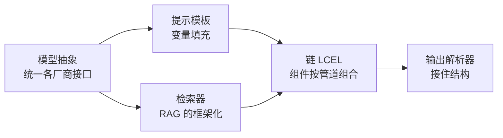
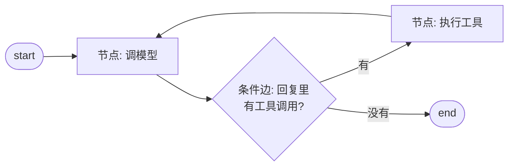

## 前置知识

- 读过 [AI Agent 基础](/ai-llm/100-AiAgentsFundamentals)：知道 agent = LLM + 工具 + 循环，亲手写过或读懂过一个最小 agent 循环；
- 读过 [工具调用设计](/ai-llm/110-ToolCallingDesign)：知道工具描述即提示词、错误要回传给模型——框架里工具的定义方式正是这套纪律的产物。

没读过也可以，本文会带上需要的部分：第 1 节会先声明本文与那两篇的分工，概念不够用时会现场补足。

## 学习目标

读完本文你将能够：

1. 解释框架解决的是什么问题：把 agent 循环的样板代码标准化，而不是替代概念本身；
2. 画出 LangChain 的五层组件图，说出每层对应你已学的哪个概念；
3. 解释 LangChain 的链为什么装不下 agent 循环，LangGraph 的状态图为什么装得下；
4. 读懂一个约 30 行的最小 LangGraph agent：状态、节点、条件边各司其职；
5. 用「要不要人审中断、要不要多 agent、分支多不多」三条判据决策用框架还是裸写循环；
6. 列出框架的真实代价，并说出「框架加裸调用混用」的工程理由。

预计 30 到 45 分钟，含 1 个动手实验与 3 道练习。

## 1. 问题引入：循环写了三遍之后

[AI Agent 基础](/ai-llm/100-AiAgentsFundamentals)里你见过那个 30 行的最小 agent 循环：取模型回复、解析要调的工具、执行、把结果塞回消息列表、再来一轮。第一次写它很有成就感，第三次写它就开始烦了——每个项目都在重写同样的取用与判停逻辑，而且每个项目重写的版本细节都不一样，报错方式也不一样。

框架的动机就在这里：**把这段反复出现的样板代码标准化**。LangChain 把「怎么调模型、怎么拼提示、怎么解析输出、怎么接工具」固化成组件，LangGraph 把「循环、分支、中断」固化成图结构。它们没有发明任何新概念——你在前面几篇学的模型、提示、工具、循环，一个都没变；变的是这些概念的工程载体。

所以本文的立场先立在这里：**先懂概念，再用框架**。顺序反了，框架就成了「黑盒咒语集」——能跑起来，但一出错就束手无策。判断自己顺序对不对很简单：遮住本文所有代码，第 2 节的每句话你应该都能对应到已学概念。

## 2. LangChain：五个分层组件

LangChain 的组件按数据流分层，每层都能对号入座：



| 组件 | 对应已学概念 | 框架做了什么 |
| --- | --- | --- |
| 模型抽象 | [第一次调用 LLM API](/ai-llm/030-FirstLlmApiCall) | 统一接口形状，换厂商不换调用代码 |
| 提示模板 | [提示工程](/ai-llm/040-PromptEngineering) | 把提示做成带变量的函数，便于复用与版本化 |
| 链（LCEL） | —— | 用管道符把组件串成一条声明式流水线 |
| 输出解析器 | [结构化输出](/ai-llm/060-StructuredOutput) | schema 定义与校验重试的标准化 |
| 检索器 | [RAG 基础](/bigdata/080-RagFundamentals) 同款概念 | 检索逻辑抽象成统一接口，向量库可插拔 |

链（LCEL）值得多说一句：它是 LangChain 的「胶水语法」，用管道符把组件连起来——`prompt | model | parser` 的意思是「提示喂给模型，输出喂给解析器」。它本质上就是函数组合，好处是引擎能对整条链做统一的流式处理与异步适配；局限也在这里——**链是单向流水线，从左流到右，没有回头路**。

这就引出了 LangGraph。

## 3. LangGraph：链装不下循环

回头看 agent 的定义：模型在循环里自主决定下一步。循环意味着「可能回到上一步重来」，分支意味着「根据观察结果走不同路」——这两件事，单向流水线的链在结构上就表达不了。硬用链拼 agent，只能在外面包一层 while 循环（最早期的做法），结果就是第 1 节那三遍样板代码。

LangGraph 的答案是**状态图**：

- **状态（State）**：一个共享的数据对象，装着消息历史、中间结果等，随图流动——每个节点读它、改它；
- **节点（Node）**：一个函数，接收当前状态，返回更新（通常是「调一次模型」或「执行一个工具」）；
- **边与条件边**：固定边从 A 节点到 B 节点；条件边由函数判断「这一步之后该去哪个节点」——agent 的「模型决定下一步」就落在这里。



对照 [agent 循环](/ai-llm/100-AiAgentsFundamentals)的那张 ReAct 图，你会发现这是同一张图——LangGraph 没有改变 agent 的形状，它只是把「循环怎么写、状态怎么存、分支怎么判」从你的 while 循环里搬进了声明式的图定义。搬过去的好处立刻显现：图结构可序列化，于是**每一步天然可以落盘、恢复、人工接管**——这些在裸写循环里要自己造轮子的能力，框架白送。

## 4. 最小图 agent：30 行看懂结构

下面用伪代码级别的 Python（框架 API 细节以官方文档为准）表达一个最小 agent 图，注意力放在结构而不是语法：

```python
from langgraph.graph import StateGraph, MessagesState, START, END

# 状态:沿用消息列表这个最简形态(链 050 的上下文管理原则在这里适用)
def call_model(state: MessagesState):
    # 模型抽象层:同一份代码可换厂商;工具定义沿用 110 篇的描述纪律
    reply = model_with_tools.invoke(state["messages"])
    return {"messages": [reply]}

def run_tools(state: MessagesState):
    # 执行模型要求的工具;错误要回传而不是抛异常(110 篇的纪律)
    results = execute_tool_calls(state["messages"])
    return {"messages": results}

def should_continue(state: MessagesState) -> str:
    last = state["messages"][-1]
    return "tools" if last.tool_calls else END

graph = StateGraph(MessagesState)
graph.add_node("agent", call_model)
graph.add_node("tools", run_tools)
graph.add_edge(START, "agent")
graph.add_conditional_edges("agent", should_continue, ["tools", END])
graph.add_edge("tools", "agent")          # 循环在这里闭合

app = graph.compile()                      # 编译成可运行单元
```

逐行对回已学概念：`call_model` 是「思考」，`run_tools` 是「行动 + 观察」，`should_continue` 是条件边的判停逻辑，`add_edge("tools", "agent")` 闭合了 ReAct 循环。框架的「魔法」到此为止——剩下的护栏（最大循环次数、费用熔断、危险操作确认）在裸循环里怎么加，在图里也怎么加：要么做成节点，要么用 LangGraph 内置的递归上限与中断参数。

## 5. 框架白送的三个能力

除了标准化样板代码，图结构本身带来三个裸循环里要自己造的能力，也是「什么时候值得上框架」的直接答案：

1. **人审中断（human-in-the-loop）**：编译时声明「执行到工具节点前先停」，框架把状态存盘、等你确认后恢复——[110 篇](/ai-llm/110-ToolCallingDesign)的确认流在图里是一行配置级别的存在；
2. **持久化与恢复**：图的每一步可以自动 checkpoint（与 [记忆与状态](/ai-llm/130-AgentMemoryAndState)的会话恢复同一件事），断点续跑、跨进程恢复都是内置能力；
3. **多 agent 编排**：一个 agent 图可以作为另一个图的节点——[多智能体系统](/ai-llm/140-MultiAgentSystems)的 orchestrator-worker 模式在框架里有直接的结构对应。

反过来，如果你的需求只是「模型加两个工具加一个循环」，[100 篇](/ai-llm/100-AiAgentsFundamentals)的 30 行裸循环已经够了——为它引入一个框架，得到的是依赖、抽象层和更深的报错栈，付出的比得到的多。

## 6. 框架的代价：诚实清单

框架不是免费午餐，三笔账要提前算：

- **抽象泄漏**：所有框架都逃不掉 Leaky Abstraction——链路出问题时，报错栈穿过多层包装，你需要在脑中把「框架概念」翻译回「HTTP 请求与消息数组」才能定位。概念不熟的人在这一步永久卡死，这是「先懂概念再用框架」的第二个理由；
- **版本漂移**：LLM 应用层迭代极快，框架的 API 面貌跟随模型能力一起变，两年前的教程代码经常跑不起来。对策是把业务逻辑尽量放在「模型抽象之外」——提示、工具、评估是你自己的资产，框架只是搬运工，换搬运工不该动仓库；
- **调试绕层**：中间每一步的输入输出都被框架收走了，需要显式开启 verbose/tracing 才能看见。生产实践里「框架 + 裸调用混用」很常见：主链路用框架图，关键工具与解析用裸函数——牺牲一点统一性，换回可调试性。

比赛与学习场景的用法恰好相反：**用框架快速搭出可演示的 agent，同时确保自己能徒手写出那个 30 行循环**——前者让你交得出作品，后者让你答得上原理。

## 7. 动手实验与常见困惑

**动手实验**：安装框架（`pip install langchain langgraph`，版本以官方文档为准），把上面第 4 节的最小图跑起来：给 agent 一个「查询本地 JSON 文件」的工具，问一个需要两步才能答的问题，打开 verbose 观察每一轮的消息数组变化；然后把同一个 agent 徒手改写成 [100 篇](/ai-llm/100-AiAgentsFundamentals)的裸循环版本。两边跑通后，你对「框架到底包了什么」的理解会从名词变成体感。

**Q：LangChain 一套框架里为什么又分出 LangGraph？**
A：第 3 节的结构性原因——链与图的拓扑不同。理解了「单向流水线装不下循环」，这个分裂就不再像营销名词，而是必然的架构演进。

**Q：比赛项目里该用框架还是裸写？**
A：看评分点。要展示工程成熟度（会话恢复、人审、多 agent 协作），框架的内置能力直接对上评分表；要展示原理理解（答辩追问「agent 到底怎么工作」），裸循环能让你把每一行讲清楚。最稳的组合是两者都备：演示用框架，答辩备裸循环。

**Q：框架会把我的提示与工具「绑死」在它身上吗？**
A：不会，前提是你遵守第 6 节的资产纪律：提示模板、工具 schema、评估集都放在自己仓库里，框架侧只留组装代码。这样框架只是运行时依赖，升级与替换都不伤业务资产。

## 8. 自检清单

1. 向别人解释「框架解决了什么、没解决什么」——各用一句话；
2. 画出 LangGraph 状态图的三要素，并指出 agent 循环闭合的那条边；
3. 说出「值得上框架」的三条判据，以及「不值得」的那一条；
4. 解释为什么「先懂概念再用框架」——用抽象泄漏举例；
5. 你的项目要加「删库前人工确认」，框架里怎么实现？（提示：第 5 节第一个能力。）

下一站回到工程主线：用 [LLM 评估](/ai-llm/150-LlmEvaluationEvals)为你的 agent 建立质量门禁——无论框架还是裸写，没有评估的 agent 都谈不上可靠。
