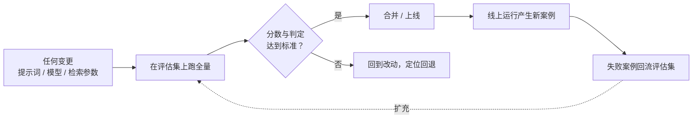
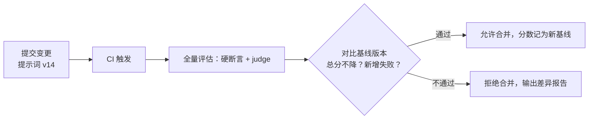

## 前置知识

- 读过 [结构化输出](/ai-llm/060-StructuredOutput)：知道 JSON Schema 与应用侧校验（Pydantic）的用法——本文第一层评估（硬断言）直接建立在这套技术上，动手实验要用。

没读过也可以，本文会带上需要的部分：只需记住「模型的输出可以被 schema 描述、被程序检查」这一句话，10 分钟可补齐。

## 学习目标

读完本文你将能够：

1. 说出 vibes 评估（凭感觉）的三大问题，并向团队解释为什么「感觉变好了」不是工程结论；
2. 从线上真实失败案例出发，写出一条合格评估样本的结构，并解释为什么 20 条精心挑选的案例胜过 200 条随手造的；
3. 为一个 LLM 功能设计三层评估：硬断言、LLM-as-judge、人工抽检，并说出每层各管什么、管不了什么；
4. 识别 LLM-as-judge 的位置偏差、长度偏差与自我偏好，写出随机化顺序与校准集两个对策；
5. 解释回归门禁为什么必须像 CI 一样卡在合并前，并列出哪些变更必须触发全量评估；
6. 用样本量与波动的直觉判断一次 A/B 结果能不能下结论，并描述线上反馈回流评估集的飞轮。

预计 30 到 45 分钟，含 2 个动手实验与 4 道练习。

## 1. 问题引入：两个版本，谁更好？

一个客服问答机器人，同事小王改了一版提示词，兴冲冲跑来找你：「你试试，感觉比之前好多了。」你试了三条，确实顺了一些，上线。一周后客服主管找上门：退款流程的回答开始编造政策细节——恰好是小王没测到、你也没试到的那一类问题。

复盘会上大家发现三件事：没人说得清「旧版到底多少分」；「感觉变好」的那三条样例已经找不到是哪三条；新版比旧版好的断言，既没有数据支撑，也没有人能为它负责。这不是粗心，是**评估方式本身不成立**——只要继续用「试几条、感觉一下」的方式，同样的故事必然重演，无论换成谁、改哪个参数。

[提示工程](/ai-llm/040-PromptEngineering) 结尾说过：提示工程负责提出假设，评估负责裁决假设。本篇就是把「裁决」这一环从手感升级为工程。

## 2. vibes 评估的三大问题

「vibes 评估」指改完之后自己随便试几条、凭整体印象下结论的做法。它有三个结构性问题，每一个都无法靠「更认真一点」解决：

| 问题 | 机制 | 后果 |
| --- | --- | --- |
| 不可复现 | 试哪些样例、什么顺序、什么心情，每次都不同 | 今天觉得好，明天觉得一般，结论随试的样例漂移 |
| 被最近印象带偏 | 人对最近看到的案例记忆最深（近因效应） | 上一个 bug 修好了，就觉得整体都好了；老问题被新修复遮住 |
| 团队无法对齐 | 「好」没有定义，各人的标准不可传递 | 你说 90 分他说 60 分，评审会变成口才比拼，决策没有依据 |

三个问题指向同一个缺失：**一份固定、可复现、带判定标准的记分牌**。这就是评估集（eval set）加自动评估脚本——它们对 LLM 应用的意义，等价于单元测试对传统代码的意义。

## 3. 心智模型：评估集就是这套系统的单元测试

传统代码里你不会靠「跑起来点点看」来保证质量，因为有测试兜底：改动任何一行，`pytest` 告诉你有没有破坏已有行为。LLM 应用也一样——提示词、模型版本、检索参数，每一处都是「会改变全部输出的代码」，所以更需要一份固定测试集。



这张图里有两个部件，本篇依次展开：

1. **评估集**：一组固定的输入，每条带判定标准——对应单元测试的用例与断言；
2. **评估的执行**：三层自动程度不同的判分方式，对应从「程序能断言的」到「必须人看的」。

## 4. 评估集建设：从真实失败案例出发攒 golden set

评估集最常见的死法是闭门造车：开发者在会议室里想出 200 条「用户可能会问的问题」，写上自认为对的答案。这些案例有两个致命伤——**它们是构造出来的，分布不等于真实用户**；**它们是开发时能想到的，而真实失败恰恰长在想不到的地方**。

正确的攒法是把评估集当仓库，不当作业：

- **第一来源是线上真实失败案例**：用户点了踩的、客服介入的、回答错误被纠正的。每一条失败都是产品真实弱点的免费样本，失败案例天生就是高价值评估样本；
- **第二来源是边界与危险区**：与知识库无关的问题、诱导编造的问题、超长输入、一个词的输入——系统「应该怎么表现」恰恰在这些地方最模糊，最值得写死成标准；
- **第三来源是回归保护**：每次修好一个 bug，把它连同当时的输入固化进评估集，保证它永远不会再悄悄坏掉。

一条合格的样本长这样（结构比数量重要）：

```json
{
  "id": "refund-003",
  "input": "上个月买的鞋能退吗？盒子丢了",
  "expectation": "答案必须包含 7 天无理由退货期限；必须提到不影响二次销售；不得编造具体金额",
  "source": "2026-09 线上真实差评 #4821"
}
```

注意判定标准 `expectation` 写的是**可检查的行为**（必须包含什么、不得出现什么），而不是「回答要好」这种不可判定的形容。来源字段同样重要：它让每条样本可追溯、可解释为什么值得存在。

关于数量，有一个反直觉的共识：**20 条精心挑选、覆盖真实失败模式的样本，胜过 200 条随手造的**。原因有二：其一，评估的价值在于「区分好坏版本」，随手造的简单案例新旧版本都能通过，区分度为零，白花运行成本；其二，低质量样本会稀释信号——200 条里 180 条人人满分，你真正关心的那 20 条差异被淹没在 90% 的通过率里。从小而精开始，让飞轮（第 9 节）慢慢把它喂大。

最后一个纪律：**留一份「锁死」的测试子集**。调提示时反复跑的那份会不知不觉被你迁就（过拟合），所以把它拆成两半——常跑的调参集，与只在重大变更前跑、从不当调参依据的封存测试集。这和机器学习里训练集与测试集分离是同一个道理。

## 5. 评估第一层：硬断言——能自动的先自动

拿到判定标准后，先问一句：**这条能不能不经过任何模型，直接用代码判？** 大量评估项其实可以：

```python
import re

def check_answer(answer: str, sources: list[str], cases: dict) -> list[str]:
    """硬断言评估：返回失败项列表，空列表即通过。"""
    failures = []
    # 断言一：引用了来源（回答必须给出依据编号）
    cited = re.findall(r"\[(\d+)\]", answer)
    if not cited:
        failures.append("missing_citation")
    # 断言二：所有引用编号真实存在于检索结果中
    valid_ids = {s.split(":")[0] for s in sources}
    if any(c not in valid_ids for c in cited):
        failures.append("fabricated_citation")
    # 断言三：不得出现的编造信号词
    for bad in ["我记得", "大概可能", "一般来说应该"]:
        if bad in answer:
            failures.append(f"banned_phrase:{bad}")
    return failures
```

硬断言覆盖的面比想象中大：包含与排除（必须提、不得提）、正则匹配（日期格式、工单号）、schema 校验（JSON 能否解析、字段类型对不对、枚举值合法与否——这正是 [结构化输出](/ai-llm/060-StructuredOutput) 里 Pydantic 校验的复用）、数值比较（字数上限、引用数量）。它的优点是**零成本、零噪声、永远可复现**，缺点是只够得着「形式」，够不着「内容对不对」。

所以第一层的原则是：**先把所有能自动判定的项搬进代码，剩下的才交给上层**。很多团队上 LLM-as-judge 上了很久才发现，一半的评估项本来一个正则就能解决。

## 6. 评估第二层：LLM-as-judge——用强模型按 rubric 打分

硬断言管不了的问题——「这个回答是否忠实于资料」「语气是否符合规范」——交给一个更强的模型当裁判：给它待测输出、判定标准（rubric），让它按标准逐项打分或判定通过与否。

```python
JUDGE_PROMPT = """你是严格的质量审核员。根据标准判定答案是否忠实于资料。

[资料]
{context}

[答案]
{answer}

判定标准（逐条检查，全部满足才算通过）：
1. 答案中的每个事实都能在资料中找到原文依据；
2. 答案没有添加资料中不存在的数字、日期或政策条款；
3. 资料不足以回答时，答案明确说了无法回答。

输出 JSON：{{"pass": true/false, "violations": ["违反的标准编号"], "reason": "一句话依据"}}"""
```

三个工程要点。**第一，rubric 越具体，judge 越可靠**：「给这段回答的忠实度打 1 到 5 分」是坏 rubric，上面这种「逐条可验证的标准加 JSON 输出」是好 rubric——它把主观打分换成了逐项事实核对。**第二，judge 本身也是 LLM，会出错**，所以 judge 的输出同样要过 schema 校验。**第三，也是最容易翻车的地方——judge 有系统性偏差**：

| 偏差 | 表现 | 对策 |
| --- | --- | --- |
| 位置偏差 | 对比两个答案时，偏爱出现在前面的那个 | 随机化顺序，同一样例正反各评一次，不一致即作废 |
| 长度偏差 | 偏爱更长的答案，把啰嗦当详尽 | rubric 里显式写「冗余扣分」；必要时长度归一后再评 |
| 自我偏好 | judge 认得自家模型的文风，偏袒同门 | 换异构厂商的模型当 judge；重要场景用两个 judge 交叉 |

「怎么知道 judge 可不可靠」这个问题有一个标准答案：**校准集**。抽 30 到 50 条样本，你自己（或团队）人工标好通过与否，然后让 judge 跑同一批，算它和人工的一致率。一致率高（比如九成上下），judge 可用；一致率低，先修 rubric，修不好就换 judge 模型。**没有经过校准的 judge 分数不该参与任何决策**——你不知道它在替你做决定时错得有多离谱。

## 7. 评估第三层：人工抽检——每周抽 N 条当标尺

自动评估再完善也有一条盲区：新长出来的失败模式。评估集里没有的坏法，断言查不出、judge 的 rubric 也想不到。所以最上面一层永远是人工：

- **固定节奏**：每周从线上抽样固定条数（比如 50 条）人工审阅，雷打不动。抽样的意义不在「这 50 条的分数」，而在**发现自动评估覆盖不到的新失败模式**；
- **发现即固化**：人工审出的每一类新失败，沉淀成评估集新样本加一条新断言或新 rubric 项——这是人审的真正产出；
- **标尺作用**：人工标注同时持续校准 judge（第 6 节的校准集就来自这里），防止 judge 随着模型升级悄悄漂移。

三层各自的分工就此清晰：**硬断言看守形式（每条必跑、零成本），judge 看守内容质量（可量化、需校准），人审看守盲区（发现新模式、校准标尺）**。用金字塔记：底座断言最厚，judge 居中，人审最薄但握着最终解释权。

## 8. 回归门禁：像 CI 一样卡住每一处变更

传统项目里，「改了代码但没跑测试就合并」是不可接受的。LLM 应用里，提示词、模型版本、检索参数（TopK、切块大小、重排开关）每一个都是「会改变全部输出的代码」，所以规矩完全相同：**任何一处变更，合并前必须跑全量评估，分数不达标不许进主干**。



落地时三件事让它真正起作用：**有基线可对比**（每次合并后记录分数，变更前后比的是数字不是印象）；**失败输出留档**（评估报告里附上每个失败案例的实际输出，让人不用复现就能定位）；**门槛务实**（总分不许降，个别指标允许小幅波动但失败模式清单不许变长）。「模型厂商悄悄更新了版本」这种你没主动改的变更同样会被门禁抓住——这正是它的隐藏价值。

## 9. 线上监控与飞轮：让失败案例喂养评估集

评估集建得再好，上线第一天就开始过时。线上需要两条监控线回填它：

- **抽样人审**：按固定比例抽取线上真实请求送人工审阅（第 7 节的节奏），产出新失败模式与新样本；
- **用户信号**：点赞点踩、重新生成率（重试率是「用户不信这个答案」的直接信号）、会话放弃率。这些信号单条不可靠（用户可能乱点），但聚集起来能指出哪类问题最值得优先补进评估集。

于是闭环转起来：**线上失败 → 沉淀为评估样本 → 驱动断言或 rubric 更新 → 防止同类失败再次上线**。评估集不是一次性的工程产物，而是一个只进不出的知识库——每一周它都比上一周更懂这个系统的弱点。这也是第 4 节「从 20 条开始」能成立的底气：起点小没关系，飞轮会补上规模。

## 10. A/B 测试与统计显著性的直觉

评估集回答「固定考卷上谁分高」，A/B 测试回答「真实流量里谁表现好」：把新旧两版各分到一部分真实用户，比真实表现。它更接近真相，也更容易被噪声骗——**样本量小时，波动是主人**。

直觉模型：假设系统真实通过率是 80%。抽 20 条，得到 13 条通过还是 16 条通过，很大程度上是运气——80% 的真实水平下，20 条样本的结果在 12 到 18 之间晃是常态。所以「新版本 20 条对了 14 条，旧版对了 12 条」这种差距，**大概率只是抖动，不构成结论**。什么时候能下结论？记住两条直觉：

1. **差距要明显大于波动**：样本越小，波动越大，需要看到的差距就越大。20 条样本上的 2 条差距约等于没差；几百条上的稳定差距才开始有意义；
2. **方向一致比单点领先更可信**：新版本在连续几批样本上都略好，比某一批突然好 10 个点可信得多——后者往往是某几条特定案例在作怪。

严格的显著性检验（样本量估算、p 值）属于统计课的内容，工程上先用这两条直觉挡住大部分误判：**看到提升，先问样本量够不够、是不是稳定复现，再决定要不要庆祝**。

## 11. 常见困惑

**困惑一：评估集越跑越熟，会不会被「应试教育」过拟合？**
会，这正是第 4 节要求拆分调参集与封存测试集的原因。另外记住飞轮的作用：评估集不断有线上失败案例流入，新样本会稀释「背题」的空间。当封存测试集与调参集的分数明显背离时，就是过拟合警报。

**困惑二：judge 给的分数，能直接拿去和别的系统比较吗？**
不能直接比。judge 分数是「这个 judge、这份 rubric」下的相对量，换了 judge 模型或改了 rubric 文案，分数就不可比。跨系统比较要么换算成硬断言的通过率（客观可复现），要么用同一套校准过的人工标注做锚。judge 分数最合法的用途是**同一配置下的纵向回归对比**。

**困惑三：评估集到底要多少条才够？**
没有绝对数，有判断法：数一数产品的失败模式有几类，每类至少要有几条代表样本；然后看「再加 50 条，通过率还动不动」——新增样本不再改变分数时，规模就暂时够了。起点永远是第 4 节那句话：20 条精的，好过 200 条水的。

**困惑四：模型厂商的官方榜单分数那么高，为什么还要自己评估？**
[模型选型](/ai-llm/020-ModelLandscapeSelection) 讲过榜单的三个失真来源：榜单不等于你的任务分布、可能被针对性优化、版本与你的调用配置未必一致。榜单用于圈定候选，最终结论只能来自你自己的评估集。

## 12. 动手实验：三十行搭一个迷你评估器

实验一：为本模块 [RAG 基础](/ai-llm/080-RagFundamentals) 实验里的问答系统建一个 10 条的迷你评估集。5 条从你真实使用中挑（至少 2 条是它答错的），3 条边界问题（知识库里没有的），2 条回归保护（修过的 bug）。每条写清 `expectation`，把文件存成 `evals.json`。

实验二：跑通下面的骨架，体会三层中前两层的衔接：

```python
import json
from openai import OpenAI

client = OpenAI()  # key 从环境变量读取

with open("evals.json", encoding="utf-8") as f:
    cases = json.load(f)

results = []
for case in cases:
    answer = ask_my_rag(case["input"])          # 你自己的问答函数
    hard = hard_assertions(answer, case)        # 第 5 节的硬断言
    if hard:
        results.append((case["id"], "FAIL", hard))
        continue                                # 断言不过，不必再花 judge 的钱
    verdict = judge(case["input"], answer)      # 第 6 节的 judge，校验其 JSON
    results.append((case["id"], verdict["pass"], verdict["reason"]))

passed = sum(1 for r in results if r[1] is True)
print(f"通过率：{passed}/{len(results)}")
for r in results:
    if r[1] is not True:
        print("失败：", r[0], r[2])
```

做完你会得到本模块方法论的核心实物：一条命令复现的分数、一个失败清单、一份可对比的基线。第 10 节那个「20 条对 14 条」的陷阱，现在你可以亲手复现一次——把同一版本跑 5 遍，观察通过率的晃动。

## 13. 小练习

预测题（5 分钟）：同事说「我把评估集从 50 条扩到 500 条，通过率从 88% 掉到 71%，说明系统变差了」。指出这个推理至少两个可能的问题。

修改题（10 分钟）：把下面这条坏样本改合格：`{"input": "怎么退货", "expectation": "回答得好"}`。要求 expectation 至少含两条可检查行为，并补上 source 字段。

修 Bug 题（10 分钟）：团队的 judge 评测 A、B 两版答案，A 版固定放在前面，连续 30 条 A 全胜。说出这个实验设计的漏洞，并给出 5 行以内的修正方案。

分析题（15 分钟）：产品上线两周，点踩率 3%，主要集中在「问发票抬头相关」。按第 9 节的飞轮，写出接下来 48 小时内你要做的三件事及其顺序。

## 14. 与之前和之后的知识的关系

- 往前：[结构化输出](/ai-llm/060-StructuredOutput) 的 schema 校验是硬断言的直接来源；[提示工程](/ai-llm/040-PromptEngineering) 的对照实验法是本篇的雏形，评估体系把它工程化；
- 侧向：[进阶 RAG](/ai-llm/090-RagAdvanced) 的忠实度、答案相关性、上下文精度三维度，是本篇方法论在 RAG 上的特化；LLM-as-judge 也是它的量化手段；
- 往后：[微调](/ai-llm/160-FinetuningWhenHow) 的训练-评估回路（验证集、过拟合信号）是同一思想在训练侧的形态；[文档问答助手实战](/ai-llm/200-CapstoneDocQaAssistant) 会把本篇的评估层原样装进完整应用。

## 15. 官方文档

- OpenAI 评估（Evals）指南：https://platform.openai.com/docs/guides/evals
- Anthropic 评估工具：https://docs.anthropic.com
- OpenAI API 文档：https://platform.openai.com/docs

## 16. 自我检查

- 能不看资料说出 vibes 评估的三大问题，并各配一个真实场景；
- 能写出一条合格评估样本的三个字段，并解释为什么「20 条精心挑胜过 200 条随手造」；
- 能为给定功能把评估项分配到三层（断言、judge、人审），并说出 judge 的三种偏差与对策；
- 能列出必须触发全量评估的四类变更，并画出回归门禁的流程；
- 面对「20 条样本上 14 比 12」的结果，能说出为什么不能下结论。

## 本章总结

「感觉变好了」不是工程结论——vibes 评估不可复现、被近因带偏、无法对齐，三宗罪的解药是同一套东西：固定评估集加自动评估脚本。评估集从线上真实失败案例攒起，20 条精选胜过 200 条随手造，判定标准必须写成可检查的行为，且要拆分调参与封存两份防过拟合。评估分三层：硬断言看守形式且零成本，LLM-as-judge 按具体 rubric 打内容分但必须用随机化顺序与校准集防住位置、长度、自我偏好三种偏差，人工每周抽检看守自动评估的盲区并持续校准标尺。提示词、模型、检索参数任何变更都要过全量评估的回归门禁，像 CI 一样卡在合并前；线上点踩与重试信号回流评估集形成飞轮；A/B 结论要过样本量与波动两道直觉关。

## 下一步

进入 [微调：要不要做、何时做、怎么做](/ai-llm/160-FinetuningWhenHow)：把「评估」的思想带进训练侧——什么时候真的需要动模型本身，以及微调不会帮你解决什么问题。
