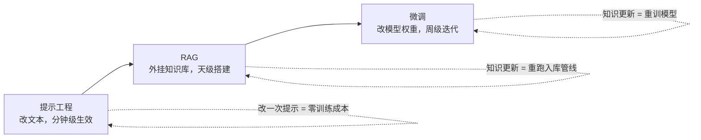

## 前置知识

- 读过 [LLM 是什么](/ai-llm/010-WhatIsLLM)：知道「下一个词预测器」的心智模型，记得训练三阶段（预训练、微调对齐、指令微调）的分工——本文讲的微调是第三阶段的定制版。

没读过也可以，本文会带上需要的部分：只需带着「模型的行为可以被它见过的样本改变」这一句话来，10 分钟可补齐。

## 学习目标

读完本文你将能够：

1. 画出「提示工程、RAG、微调」三级阶梯，为给定场景判断该停在哪一级，并说出继续升级的代价；
2. 区分微调擅长改变的四种东西（风格、格式、行为一致性、token 效率）与它不擅长的（注入事实知识），并解释后者为什么会让幻觉更自信；
3. 用「整本书与小批注」的类比解释 LoRA 的低秩补丁思想，以及 QLoRA 把底模量化后单卡可训的意义；
4. 按质量纪律准备微调数据集：格式统一、去重去脏、覆盖边界，并解释为什么几百条好样本胜过几十万条脏样本；
5. 读训练损失与验证损失的走势图，识别过拟合信号并决定何时早停；
6. 说出 LoRA 权重的两种部署方式，以及「基模升级后微调重做」这笔持续账对决策的影响。

预计 30 到 45 分钟，含 1 个动手实验与 4 道练习。

## 1. 问题引入：「咱也微调一个吧」

需求评审会上，老板听完客服问答机器人的方案，说出了那句在无数团队出现过的台词：「别绕弯子了，咱直接微调一个自己的模型吧，用咱的数据，训练个懂咱们业务的。」

这个提议听起来高效——跳过提示词打磨、跳过检索管线，直接炼一个「专属模型」。但它基于两个错觉：其一，微调不擅长把业务知识塞进模型（下文详述），而客服问答的第一需求恰恰是知识；其二，微调是三级阶梯里最贵、最慢、最难回退的一级，大多数场景根本不必爬到那一级。本文先讲**要不要**，再讲**怎么做**——顺序不能反，因为微调 80% 的失败发生在决定做它的那一刻。

## 2. 心智模型：一条从便宜到昂贵的阶梯

把定制 LLM 行为的所有手段排成一条阶梯，每上一级，成本、周期、工程复杂度、回退难度都上一个量级：



| | 提示工程 | RAG | 微调 |
| --- | --- | --- | --- |
| 改的是 | 输入的文本 | 模型能查到的资料 | 模型参数本身 |
| 生效周期 | 分钟 | 天 | 周级起 |
| 回退难度 | 删掉提示即可 | 下线检索即可 | 要回退就得换回旧权重 |
| 擅长 | 规定任务与格式 | 注入与更新事实知识 | 固化风格与行为 |
| 失败代价 | 重写一遍 | 调检索参数 | 一轮数据、算力、时间全沉没 |

决策纪律因此很清楚：**每一级的问题先用本级手段榨干，榨不干净才升下一级**。风格不合，先写角色与 few-shot；知识缺失，先上 RAG。经验规律是：大多数场景走到 RAG 就该停——「模型不知道」的问题，本质是「模型查不到」，不是「模型笨」。真正剩下给微调的，只有第 3 节那几类需求。

## 3. 微调擅长什么：改「怎么做」，不是改「知道什么」

微调在机制上是继续调整模型参数，用你给的样本反复训练，直到它在这些样本型任务上的输出分布向你的期望收拢。它擅长的是四类「行为」层面的改变：

| 擅长改变 | 典型场景 | 为什么微调是对的 |
| --- | --- | --- |
| 风格与语气 | 客服话术、品牌口吻、固定人设 | 风格靠提示词维持不稳定，长对话会漂；调进权重后是默认行为 |
| 输出格式 | 稳定产出某种 JSON 结构、特定标记协议 | 大幅减少格式违规率与重试成本 |
| 行为一致性 | 总是先拒答敏感问题、总是引用规范条款 | 把「规则」从每次请求的提示里搬进权重 |
| token 效率 | 用微调过的小模型顶替大模型干窄活 | 窄任务上小模型被调教后逼近大模型，省下的是钱与延迟 |

第四条值得展开，它是微调最实在的回报：一个大模型处理「把工单分类到 12 个类目」这种窄任务，是在用大炮打蚊子——为不需要的通用能力付费。把几千条分类样本调教给一个几 B 的小模型，它在这一个任务上可以达到可用的准确率，而推理成本与延迟低一个量级。注意这里的分工：**微调不是让小模型变聪明，是让它把一件事练成肌肉记忆**。

## 4. 微调不擅长什么：事实注入是 RAG 的活

现在回应第 1 节老板的提议。微调最常被误用的场景是「把我们的产品手册、政策文档、知识库灌进去训练」。这条路有两个机制性的坑：

**坑一：幻觉会更自信，而不是更少。** 微调改变的是输出分布的倾向，不是给模型装一个可核查的记忆。用几百几千条样本往一个百亿参数的模型里「塞事实」，它学到的是「这个话题大概长这样」，而不是「这条事实为真」。结果是它谈起你的产品时语气更笃定了——错的时候也一样笃定。LLM 是什么那篇讲过：流畅度优先于真实性是机制性后果，微调不改变这个机制，只会给幻觉换上你业务的专业口音。

**坑二：知识更新等于重训。** 政策改了一条、价格调了一档，微调模型里的旧知识还焊在权重里。你要么全量重训，要么做增量微调——后者还可能把新旧知识搅在一起。对比 RAG：改的是库里的文档，明天生效，模型一行不动。

所以分工铁律是：**事实知识（会变的、需要溯源的、要求准确的那部分）交给 RAG；微调负责「拿到资料之后怎么说话、什么格式、什么风格」**。两者是搭档，不是竞品——生产系统里「微调过的模型加 RAG」是常见组合，各干各的。

## 5. LoRA 与 QLoRA：不整本重写，只训一个小补丁

决定了微调，下一个问题是怎么训。全量微调（更新模型全部参数）意味着每个参数都要一份梯度与优化器状态——显存开销是参数量的好几倍，几十 B 的模型单卡想都不用想。工程界的标准答案是 **LoRA（Low-Rank Adaptation，低秩适配）**，直觉是一个类比：

> 微调不必把整本书重写一遍，只需在书页边贴一批「透明批注页」。原书（预训练权重）完全冻结不动，训练只更新批注（低秩矩阵）；推理时原书与批注一起读。

技术上：在模型的权重矩阵旁挂一对小矩阵（秩 r 通常取 8 到 64，远小于原矩阵维度），训练时只动这对小矩阵。可训练参数量降到原模型的百分之一量级，效果在绝大多数下游任务上逼近全量微调。它带来三个实际好处：训练显存骤降、每任务一套小补丁互不干扰（同一个底模可挂多个「人格」）、补丁文件只有几十到几百 MB，分发与版本管理像管理一个插件一样轻。

补丁贴在哪些层也有讲究：早期实践默认只挂在注意力层的投影矩阵上，后来的共识是把 LoRA 铺到全部线性层，同样的秩通常效果更好、代价只是补丁稍大。这属于「用默认配置能跑，调优时知道有这个旋钮」的知识——具体挂法与各家实现的支持范围，以所用训练框架的文档为准。

**QLoRA 再进一步**：底模以 4 bit 量化加载（量化本身见 [本地推理与 Ollama](/ai-llm/170-LocalInferenceOllama)），LoRA 批注仍以高精度训练。显存需求降到原来的几分之一，**几 B 到十几 B 的模型从此一张消费级显卡（甚至 24 GB 级单卡）就能调**——这是「个人与小团队能正经微调」的时代分水岭。

## 6. 数据准备：质量纪律压倒一切

LoRA 解决「算力从哪来」，数据决定「效果到哪去」。微调数据是输入输出对：

```json
{"input": "用户问：盒子丢了还能七天无理由退货吗？", "output": "可以。依据售后政策：商品自签收起 7 日内不影响二次销售即可申请，包装缺失不影响二次销售判定。需要提供订单号。"}
```

四条纪律，按杀伤力排序：

1. **质量胜过数量**：几百到几千条高质量样本，往往已经够把一个窄行为调到位。模型对坏例子的学习能力与好例子一样强——标注格式抖动的、语气前后不一的、答案互相矛盾的脏数据，教出来的就是不稳定的行为。先精后多，永远如此；
2. **格式完全统一**：输入输出对的结构、字段名、语气、长度分布保持一致。微调是高保真模仿，你给它什么，它就学成什么样——数据里的不一致会原样成为模型行为的不一致；
3. **去重去脏**：重复样本会让模型过拟合到那几句话；错别字、复制粘贴残留、机密信息混入，都是上线后才被发现的事故；
4. **覆盖边界情况**：除了正常流，把拒答样例、超长输入、易混淆类目的对比样例都放进去。模型只见过正例时，边界处的行为是你赌不出来的。

还有一个省力的正解：**数据可以先用强模型批量生成再人工审**。让强模型按你写好的规范产出候选样本，人工逐条把关修改——效率高，但人工审核这道工序不能省，否则生成模型的偏差会原封不动蒸馏进你的模型。

要多少条？按任务类型建立量级感（经验值，以自己的验证集实测为准）：

| 任务类型 | 常见有效量级 | 说明 |
| --- | --- | --- |
| 输出格式固化 | 几百条 | 模型只需学会「长什么样」 |
| 分类与路由 | 几百到两三千条 | 每个类目都要有足量代表样本 |
| 风格与语气 | 一千到几千条 | 风格是统计特征，量太少学不稳 |
| 多步流程行为 | 几千条起步 | 步骤组合多，边界情况成倍增加 |

## 7. 训练-评估回路：盯着两条损失曲线

训练不是一键炼丹，而是一个带仪表盘的回路。动手前先切一块验证集（比如 10%）封存，**它绝不参与训练**——这就是 [LLM 评估](/ai-llm/150-LlmEvaluationEvals) 里「调参集与测试集分离」的同一纪律，搬到训练侧。

训练中会看到两条损失曲线：训练损失（模型在见过的样本上的误差）与验证损失（模型在没见过的验证集上的误差）。四种典型走势：

| 训练损失 | 验证损失 | 诊断 | 动作 |
| --- | --- | --- | --- |
| 降 | 降 | 健康学习中 | 继续训 |
| 降 | 平 | 开始记题，收益递减 | 接近停止点，观望 |
| 降 | 升 | **过拟合**：在背你的样本，不是在学行为 | 早停，取验证损失最低的那一版 |
| 不降 | 不降 | 没学动：学习率、数据格式或数据量有问题 | 停下来查配置，别硬训 |

过拟合的直觉：模型把训练样本背下来了，泛化能力反而开始损坏——问法稍变它就露馅。验证损失止跌回升的那一刻，就是「记忆」压过「学习」的时刻，也是该早停的时刻。所以**每一版训练都要存档**，最终上线的往往是中途某一步的存档，而不是最后一步。

训练完还有最后一关：把模型放进你自己的评估集跑一遍（同样的评估集，同样的门禁）。训练损失与业务指标不是一回事——损失降了不等于答案好，[评估](/ai-llm/150-LlmEvaluationEvals) 才是裁决。

## 8. 部署：小补丁怎么挂回去

训好的 LoRA 产出是一个小体积的适配器文件，部署有两种形态：

- **挂载（adapter 加载）**：底模不动，运行时叠加 LoRA 权重。好处是一个底模服务多套补丁，多任务多客户共享底模、按请求选 adapter；代价是推理时多一层合并计算；
- **合并（merge）**：把 LoRA 权重数学上融进底模，导出一个完整模型。好处是推理路径与普通模型完全一样，任何推理框架直接用，后续放进 [本地推理](/ai-llm/170-LocalInferenceOllama) 的流程（量化成 GGUF、Ollama 跑）都顺畅；代价是一个任务一份完整权重，不再共享。

选择线索很直接：多任务共享底模选挂载，单任务求部署简单选合并。合并后的模型就走普通模型的分发路径，量化、压缩、本地运行那一整套都适用。

部署还有最后一道工序：**上线前跑冒烟评估**。部署形态换了（挂载换合并、推理框架更换、量化档变化）都可能悄悄影响输出，把评估集在「部署后的真实环境」里再跑一遍小样，确认与训练侧的表现一致——「训练时很好、部署后变差」的悬案，多数栽在这一步没做。

## 9. 成本与维护：这是一笔持续账，不是一次性买卖

微调最容易被漏算的是维护。底模厂商会持续升级（升能力、换架构、调许可），而你的 LoRA 补丁绑定在具体的底模版本上——**基模升级，微调基本要重做**：换底模、重新跑数据、重新调超参、重新过评估。此外每次业务行为要调整，都是一轮新的数据修订加训练加评估，周期以周计。

维护的节奏由此可预期：底模的每次大版本升级都是一个「重训窗口」，团队要预留的不是一个训练任务的预算，而是**每年若干轮「数据体检加重训加评估」的持续投入**。把这笔账写进立项文档，比事后向上级解释为什么「训练完了还要再花钱」体面得多。

把这笔账放进决策清单，当且仅当能同时打上这些勾时，微调才值得做：

1. 提示工程已榨干：风格、格式、行为目标在提示里试过且确实达不到稳定要求；
2. 知识类需求已由 RAG 承担：微调只背「怎么做」，不背「是什么」；
3. 有可持续的优质数据源：能持续产出并维护几百条以上的高质量样本，而非一次性凑数；
4. 收益可量化：要么质量提升可被评估集证实，要么成本下降（小模型替大模型）算得清账，且收益能覆盖训练与后续每次基模升级的重训成本；
5. 有评估门禁兜底：训练-评估回路（第 7 节）有人负责运行，而不是「训完感觉还行」。

五个勾打不满，正确答案就是留在阶梯的低层。更深的数据与训练工程，属于 [数据与 MLOps 路线](/roadmap/147-DataAndMlopsRoute) 的版图，本文只负责让你在该不该迈出这一步上不犯错。

## 10. 训练执行层：聊天模板与超参数的直觉

决定「要不要」与「数据好不好」之后，训练执行层还有两个容易翻车的细节。

**第一个细节是聊天模板（chat template）。** 开放权重模型在训练时见过一套固定的对话包装——系统消息、用户消息、助手消息各有约定的起止标记。微调数据进入训练器时同样要套上这套模板，推理时更要套同一套。模板不一致是「训练完美、上线报废」的第一大原因：模型在训练时学的是「带 A 包装的应答」，推理时你却给它裸文本，它自然答非所问。纪律只有一条：**训练、评估、推理三处用同一个模板，且以模型官方文档给出的为准**。用训练框架时，确认它读取的是模型自带的模板定义，而不是框架默认值。

**第二个细节是几个超参数的直觉。** 不需要会调参工程师的全部手艺，但要知道每个旋钮往哪边拧会发生什么：

| 超参数 | 常用量级 | 拧大了 | 拧小了 |
| --- | --- | --- | --- |
| 学习率 | LoRA 常在 1e-4 量级 | 损失震荡或飞出（NaN 的常见来源） | 学不动，损失纹丝不动 |
| 训练轮数（epoch） | 窄任务 1 到 3 轮 | 过拟合：背样本、损通用能力 | 欠拟合：行为没固化 |
| LoRA 秩 r | 8 到 64 | 补丁更厚，能学更复杂的行为，易过拟合 | 学不动复杂行为，但更省更稳 |
| 批大小 | 显存不够就用梯度累积凑 | 训练更稳，显存吃不消 | 梯度噪声大，曲线毛糙 |

读表的方式：这四个旋钮都在「学得动」与「背得下」这条轴上做权衡，而裁决它们的仪表盘就是第 7 节的两条损失曲线——**先看曲线再拧旋钮，不要凭感觉调**。

## 11. 训练中的常见错误与调试实录

错误一：损失死活不降。排查顺序：数据格式对不对（字段错位、输入输出颠倒，模型学的是乱码）；学习率是不是太小；模板是不是把标签都套错了。八成是第一项——打印一条套好模板的训练样本亲眼看看，是微调世界里的「重启试试」。

错误二：损失中途变 NaN。通常是学习率过大或数值精度配置问题，先把学习率降一个量级重跑；数据里若有异常长的样本也会引爆，先查数据长度分布。

错误三：训完效果像没训过。三连问：推理时套模板了吗？adapter 真的挂上了吗（很多人加载了底模却忘了挂补丁）？挂的是不是这一版的存档？三个都确认无误再怀疑训练本身。

错误四：只在训练问法上表现好，换个问法就崩。这是过拟合的声音——回看第 7 节，取验证损失最低的存档，而不是最后一步；同时检查训练集里是否有大量重复样本放大了记忆效应。

错误五：训练与评估指标全绿，上线后用户却不买账。指标没测到用户在意的东西——评估集与真实分布脱节了。这不是训练问题，是评估问题：回到 [LLM 评估](/ai-llm/150-LlmEvaluationEvals)，把真实使用中的失败案例补进评估集，下一轮训练以新版评估为准。

## 12. 常见困惑

**困惑一：微调之后还需要 RAG 吗？**
几乎总是需要。微调解决行为与风格，知识仍要外挂：事实会更新、需要溯源、要求准确，这三件事都指向 RAG。「微调加检索」是生产组合的常态，二者不是二选一。

**困惑二：几百条数据真的够吗？官网不是说最好几万条？**
全参数训练时代的经验数字，在 LoRA 与窄任务上不适用。行为风格类任务几百到几千条精样本常见够用；任务越窄、格式越明确，需要得越少。判断标准不是条数，是你自己的验证集与评估集分数——够用与否只问它们。

**困惑三：QLoRA 的 4 bit 量化会伤效果吗？**
底模量化到 4 bit 的质量损失在中小模型上可感知但通常可接受（这正是 [本地推理](/ai-llm/170-LocalInferenceOllama) 一篇的量化结论），而 LoRA 部分始终以高精度训练。QLoRA 论文与大量复现显示其效果与标准 LoRA 相当；真正的效果瓶颈几乎总在数据质量，不在底模量化。

**困惑四：微调会不会让模型「忘记」原有能力（灾难性遗忘）？**
会存在这个风险：训练过度时，模型在窄任务上变好、通用能力变差。LoRA 因底模冻结而天然缓解；数据里掺一定比例的通用样本也有帮助；最终靠验证集与评估集发现——又回到那个回路。

**困惑五：能让模型「记住」我们内部的 API 文档或业务术语吗？**
拆开回答。API 的**调用格式**（参数怎么排、错误码什么结构）可以微调固化——那是行为，微调的正当业务；文档的**内容本身**不行——会更新、要溯源、怕编造，是 RAG 的活。判断口径就用第 3 节那句话：微调改「怎么做」，RAG 管「知道什么」。同理，让模型「背下」产品价格表是错误用法，让模型「永远按三段式报价模板输出」是正确用法。

## 13. 动手实验：走一遍不花钱的完整决策

本篇的核心不是训练代码，是决策。实验：为你手头（或假想）的「工单自动分类」需求走一遍流程，产出三样东西。

1. **阶梯论证**：分别写出「纯提示工程版」与「RAG 版」的方案草案各三条要点，明确指出它们解决不了、必须靠微调的那个具体行为目标（写不出来就停手，这本身就是结论）；
2. **数据规范**：写出 12 类工单的类目表，手写 5 条完全符合格式的样本对，再故意写 1 条脏样本（字段缺失加语气不一致），标注它会在训练时教坏什么；
3. **回路预案**：确定验证集切分比例、早停判据（验证损失连续 N 步回升即停）、评估门禁的通过标准，写成 10 行以内的文档。

有余力与一张显卡（或云 GPU）时，用 QLoRA 对一个几 B 的开源小模型跑一次真实微调：LoRA 秩取 16，用几百条分类样本，训练几百步，观察两条损失曲线——亲手看到验证损失拐头的那一次，胜过十篇讲过拟合的文章。

## 14. 小练习

预测题（5 分钟）：同事提议「把公司全部历史工单（约 50 万条）灌进去微调，让模型记住所有业务知识」。用第 4 节的机制指出这个方案的两个必然结局。

修改题（10 分钟）：下面这条微调样本有三处问题，找出来并改好：`{"input": "帮我查下订单", "output": "好的亲，请提供订单号哦！祝您生活愉快~"}`（该数据集用于工单分类，输出应为类目名）。

修 Bug 题（10 分钟）：训练日志显示训练损失从 1.8 一路降到 0.3，验证损失从 1.9 降到 1.5 后回升到 1.8，同事建议「损失还在降，多训几轮更好」。用第 7 节的表格诊断并给出正确动作。

分析题（15 分钟）：对照第 9 节的五条决策清单，逐条评估「微调一个写周报的小模型」这个需求（数据源：团队过去两年的周报）。哪几条过、哪几条不过，最终结论是什么。

## 15. 与之前和之后的知识的关系

- 往前：[LLM 是什么](/ai-llm/010-WhatIsLLM) 的训练三阶段交代了微调在模型生命周期里的位置；[模型选型](/ai-llm/020-ModelLandscapeSelection) 把微调列为三种获取形态之一，本文回答的是「何时值得选它」；
- 侧向：[LLM 评估](/ai-llm/150-LlmEvaluationEvals) 的评估集与门禁纪律贯穿训练-评估回路；[本地推理与 Ollama](/ai-llm/170-LocalInferenceOllama) 的量化知识是 QLoRA 的前置，也是合并后模型的落地球场；
- 往后：更宽的数据管线、训练平台与版本治理，属于 [数据与 MLOps 路线](/roadmap/147-DataAndMlopsRoute)。

## 16. 官方文档

- Hugging Face PEFT（LoRA 与 QLoRA 的标准实现库）：https://huggingface.co/docs/peft
- Hugging Face Transformers 训练文档：https://huggingface.co/docs/transformers
- Unsloth 等单卡 QLoRA 工具链以官方文档为准：https://github.com/unslothai/unsloth

## 17. 自我检查

- 能画出三级阶梯并为给定场景指出停止点，说出升一级的四种代价；
- 能说出微调擅长与不擅长的各两项，并解释「微调塞事实让幻觉更自信」的机制；
- 能用批注页类比讲清 LoRA，说出 QLoRA 在显存上的意义；
- 能列出数据准备四条纪律，并解释脏样本教坏模型的路径；
- 能说出聊天模板为什么必须「训练、评估、推理三处一致」，以及它不一致时的典型症状；
- 能看着两条损失曲线判断健康、过拟合、没学动三种状态并给出动作；
- 能说出挂载与合并的取舍，以及基模升级对微调决策的约束；
- 能区分「微调固化 API 调用格式」与「微调背 API 文档内容」哪个成立哪个不成立，并给出理由。

## 本章总结

微调的决策框架是一条阶梯：提示工程、RAG、微调逐级变贵变慢变难回退，每一级的问题先在本级榨干，大多数场景到 RAG 就该停。微调擅长改行为——风格、格式、一致性、以及用小模型顶替大模型干窄活的 token 效率；不擅长注入事实——塞事实得到的是更自信的幻觉与重训才能更新的知识，事实知识归 RAG。技术上，LoRA 用冻结底模加低秩批注把可训练参数降两个量级，QLoRA 再把底模量化到 4 bit，单卡可训由此成立。数据纪律压倒一切：几百条格式统一、去重去脏、覆盖边界的高质量样本胜过海量脏数据。训练盯两条曲线，验证损失拐头即早停，上线前过自己的评估门禁。最后记住这是一笔持续账：基模升级微调重做——五个决策勾打满之前，留在阶梯低层。

## 下一步

进入 [本地推理与 Ollama](/ai-llm/170-LocalInferenceOllama)：把「模型跑在自己机器上」变成日常——量化的心智模型、GGUF 生态、Ollama 与 vLLM 的分工、显存怎么估算。
