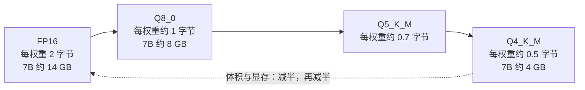

## 前置知识

- 读过 [模型版图与选型](/ai-llm/020-ModelLandscapeSelection)：知道「调 API、本地部署、微调定制」三种获取形态，知道 GPT 系列、Claude 系列、Gemini 系列、GLM 系列与 Llama、Qwen、DeepSeek 这些开放权重系列的存在——本文把「本地部署」这一形态落成可操作的现实。

没读过也可以，本文会带上需要的部分：只需知道「有一类模型公开了权重、可以下载到自己机器上跑」这个事实，10 分钟可补齐。

## 学习目标

读完本文你将能够：

1. 说出本地推理的四个动机与两个代价，并为给定场景判断「该不该本地」；
2. 用「小数压缩」的心智模型解释量化：FP16 到 Q8、Q4 时体积与显存怎么变、质量怎么变；
3. 读懂 Q4_K_M 这类模型名的含义，说出 GGUF 格式与 llama.cpp 生态在本地推理中的位置；
4. 在 Ollama、LM Studio、vLLM 三类工具间按场景做选择，并说出各自适合谁；
5. 用「参数量乘每权重量化字节，再加 KV cache」估算一个模型要多少显存，判断自己的机器跑得动什么规模；
6. 解释 OpenAI 兼容端点的意义，并把应用代码从云端模型切换到本地模型。

预计 30 到 45 分钟，含 1 个动手实验与 4 道练习。

## 1. 问题引入：这三段对话，不能发给任何云厂商

三个真实需求：一家医院想让 LLM 帮医生整理病历摘要——病历是个人敏感信息，出内网就可能有合规问题；一个工厂车间要离线查询设备手册——网络时断时续，云端服务不可依赖；一个个人开发者要给自己的笔记软件加自动摘要——功能免费提供，按 token 计费的账单没法接受。

它们指向同一个解法：**把模型权重下载下来，让推理发生在自己的机器上**。开放权重模型（Llama、Qwen、DeepSeek、GLM 等系列）让「拥有模型」成为可能，本文要解决的是剩下三件事：模型怎么塞进有限的显存（量化）、用什么工具跑（Ollama 及其伙伴们）、应用代码怎么接（OpenAI 兼容端点）。

## 2. 为什么本地：四个动机与两个代价

| 动机 | 说明 | 典型场景 |
| --- | --- | --- |
| 数据不出门 | 提示与回答全程不离开你的机器 | 医疗、法务、金融等隐私与合规敏感场景 |
| 离线可用 | 不依赖网络与云厂商的可用性 | 车间、舰船、边远部署、演示现场 |
| 边际成本为零 | 硬件买断后，每次推理不再按 token 付费 | 高频调用、免费增值产品、个人项目 |
| 可魔改 | 权重在你手里：微调、改系统层、嵌入自己的管线 | 定制化实验、研究、与本地数据深度集成 |

两个代价同样明码标价：**质量**——同等体验下，本地跑得动的模型通常小于云端旗舰，能力有可感知的差距（云端的旗舰模型与几十 B 以下的开放权重模型之间仍有一段距离）；**运维**——显存自己管、升级自己搞、吞吐自己扛，这些事云端 API 都替你做过了一遍。本地与否不是技术崇拜问题，是上面这张表与两条代价的权衡。[模型选型](/ai-llm/020-ModelLandscapeSelection) 的四维决策表可以直接复用，本篇补的是「选了本地之后」的全部工程细节。

还有一个常被忽略的折中形态：**敏感数据本地处理、通用任务云端处理**的数据分层模式——隐私字段在本地小模型上脱敏或摘要，脱敏后的内容才交给云端旗舰处理。它保留了云端的质量，又把最敏感的一段留在了门内，是很多合规场景的真实落点。

## 3. 心智模型：量化——把小数压得更粗

本地推理的第一道坎是显存。模型权重本质上是一大堆小数（0.02、-1.37 这样的浮点数），训练出来时通常是 FP16——每个数用 16 bit 存储。量化（quantization）做的事很朴素：**把每个小数用更少的比特近似表示**。



直觉类比是图片压缩：原始 PNG 换成 JPEG，文件小一个量级，正常观看几乎看不出差别，放大细看才有损失。量化同理——**压得越狠，模型越瘦，但细看（复杂推理、生僻领域）的损失越可感知**。经验规律以社区共识为准：Q8 接近无损；Q5、Q6 是质量与体积的甜点区；Q4 损失可感知但多数日常任务可接受，是「消费级硬件跑得起来」的主力档位。对中小模型（几 B 级），从 Q8 到 Q4 的质量差异常可察觉；对本来就小的模型，过度量化会把模型压「残」，宁可换更小的模型用更高精度档。

一个必须建立的条件反射：**看到「7B 模型」，先问「什么量化档」再谈显存**——同一模型 FP16 与 Q4 的显存需求差四倍，「跑不跑得动」的答案完全不同。

常见档位连成一张对照表（字节数为近似值，具体以模型卡为准）：

| 档位 | 每权重字节 | 相对 FP16 体积 | 质量直觉 |
| --- | --- | --- | --- |
| FP16 / BF16 | 2.0 | 1x | 原版精度 |
| Q8_0 | 约 1.0 | 约 0.5x | 接近无损 |
| Q6_K | 约 0.65 | 约 0.33x | 甜点区，几乎无感 |
| Q5_K_M | 约 0.57 | 约 0.28x | 甜点区，细微损失 |
| Q4_K_M | 约 0.5 | 约 0.25x | 主力档，损失可感知但常可接受 |
| Q3 / Q2 | 0.25 到 0.35 | 约 0.15x | 明显损失，小模型慎用 |

## 4. 读命名：Q4_K_M 之类的字符串怎么拆

在 Ollama 模型库或 Hugging Face 上你会见到 `qwen3:14b-q4_K_M` 这样的名字。拆开读，每段都是一条信息：

| 片段 | 含义 |
| --- | --- |
| `14b` | 参数量约 140 亿（b = billion） |
| `q4` | 主体权重量化到约 4 bit |
| `_K_M` | llama.cpp 的 K-quant 方案、M = medium——同一比特数下的具体打包策略，S 小于 M 小于 L，通常同档下越大质量越好 |

不需要背方案细节，掌握读法即可：**数字是比特位（粗细），字母是方案（包装）**。实际选择时，社区常用默认档如 Q4_K_M 作为入门，追求质量上探 Q5、Q6。这些文件绝大多数以 **GGUF** 格式分发——llama.cpp 生态的单文件模型格式，权重、分词器、配置打包在一起，下载即用。llama.cpp 本身是整个本地推理的群众基础：它用 C/C++ 写的推理引擎，最擅长**CPU 与 GPU 混合推理**——显存装不下的层放内存用 CPU 算、装得下的放 GPU，让没有大显存的机器也能跑大模型。Ollama 底层就是它。

## 5. 工具分工：Ollama、LM Studio、vLLM 各守一段

| | Ollama | LM Studio | vLLM |
| --- | --- | --- | --- |
| 形态 | 命令行服务 | 桌面 GUI 应用 | Python 推理服务框架 |
| 一句话定位 | 本地模型的 Docker | 本地模型的图形界面 | 生产级高吞吐 GPU 服务 |
| 面向谁 | 开发者、服务器、脚本 | 想点鼠标的用户 | 有并发流量的线上服务 |
| 核心能力 | 一条命令拉模型跑模型，自带模型库，内置 OpenAI 兼容端点 | 浏览与下载模型、对话测试、参数调节 | PagedAttention 显存管理、持续批处理（continuous batching），把 GPU 吞吐吃满 |
| 上生产 | 个人与内部工具可以 | 不适合 | 可以，这是它的主场 |

Ollama 值得多说一句，它的心智模型就是 Docker：`ollama pull` 类似 `docker pull`，`ollama run` 类似 `docker run`，模型以镜像式的名字管理（`ollama pull qwen3:8b`），进程起来后常驻内存提供服务。对个人开发与小团队，「先 Ollama 跑通，流量大了换 vLLM」是标准路径——而应用代码在两者之间不需要改，原因见第 7 节。

还值得一提的是环绕它们的前端生态：因为大家都说 OpenAI 方言，任何符合该接口形状的聊天界面（如 Open WebUI 一类自托管前端）都可以直接挂在 Ollama 或 vLLM 的端点上，给团队一个网页版对话入口。工具栈因此可以分层组合——推理引擎（llama.cpp、vLLM）、服务封装（Ollama）、图形界面（LM Studio、Web 前端）各选各的，拼装即可，这份模块化正是 OpenAI 兼容生态的红利。

## 6. 显存估算：参数量乘字节，再加上 KV cache

估算公式只有两段：

$$\text{显存} \approx \text{参数量} \times \text{每权重量化字节} + \text{KV cache}$$

第一段用参数量乘上量化档的单权重字节数（FP16 约 2 字节、Q8 约 1 字节、Q4 约 0.5 字节）。第二段是新手最常漏掉的 **KV cache**：模型逐词生成时，已处理 token 的中间状态（键与值）要全部留在显存里，**它随上下文长度线性增长**——窗口开多长，缓存就长多长。长上下文、多轮会话、大并发批量场景，KV cache 可以从「零头」涨成「大头」，有些模型与框架支持压缩或分页管理 KV cache（vLLM 的 PagedAttention 正是干这个的），但估算时先按「随上下文涨」建立直觉。

走一遍完整的估算示例：一个 8B 模型、Q4 档、上下文 8K。权重约 8 × 0.5 = 4 GB；KV cache 随模型结构与上下文长度变化，量级在 1 到 2 GB；再加推理运行时的零头，**结论是按 6 GB 左右规划显存**——这正是它能在 8 GB 显存的入门卡上舒服运行的原因。估算的意义不在精确，在「数量级对了，再留两成余量」。

以常用档位建立量级感（粗估，实际以模型卡与工具实测为准）：

| 模型规模 | Q4 权重体积 | 显存起步（含少量上下文） | 典型硬件 |
| --- | --- | --- | --- |
| 1B 到 3B | 1 到 2 GB | 2 到 3 GB | 无独显的笔记本也能跑 |
| 7B 到 8B | 4 到 5 GB | 约 5 到 8 GB | 8 GB 显存入门独显 |
| 13B 到 14B | 8 到 9 GB | 约 10 到 14 GB | 12 到 16 GB 显存 |
| 32B 级 | 约 18 到 20 GB | 约 24 GB 起 | 24 GB 单卡 |
| 70B 级 | 约 40 GB | 48 GB 起或 CPU 混合 | 多卡或大内存混合推理 |

读表的方式比数字重要：**7B 级模型量化后 4 到 5 GB 起步，这是一条把「本地推理」从科幻拉进消费级硬件的分界线**。超过显存的模型，llama.cpp 生态的 CPU/GPU 混合推理能跑，但速度明显下降——「能跑」与「好用」之间隔着一个显存余量，给 KV cache 留出至少一到两成的余量是稳妥的默认。

## 7. OpenAI 兼容端点：一行 base_url 切换云端与本地

这里有一个让本地推理真正变得「无摩擦」的生态事实：几乎所有的本地推理服务（Ollama、vLLM、LM Studio 的服务模式）都提供 **OpenAI 兼容端点**——请求与响应的 JSON 形状与 OpenAI API 相同。它的重要意义在 [第一次调用 LLM API](/ai-llm/030-FirstLlmApiCall) 已经埋下伏笔：应用代码里模型厂商被抽象成「base_url 加 key」两个变量。

```python
from openai import OpenAI

# 云端：client = OpenAI()  # 默认指向 OpenAI 官方端点
# 本地：只改 base_url，key 用占位串即可
client = OpenAI(base_url="http://localhost:11434/v1", api_key="ollama")

resp = client.chat.completions.create(
    model="qwen3:8b",           # 本地已拉取的模型名
    messages=[{"role": "user", "content": "用一句话解释什么是量化"}],
)
print(resp.choices[0].message.content)
```

同样的 messages、同样的采样参数、同样的 usage 结构——开发时连本地小模型快速迭代（零成本、零延迟风险），上线时把两行配置切回云端旗舰；或者反过来，敏感数据场景把整套应用原样搬进内网。**应用逻辑与模型来源解耦**，这是 OpenAI 接口形状成为事实标准的最大红利，也是本模块所有代码示例以它为基线的原因。 Anthropic SDK 的原生接口形状与之不同，但本地工具链普遍只承诺 OpenAI 兼容，需要时通过兼容层对接即可。

## 8. 硬件现实表：什么配置跑什么

把第 6 节的估算落成保守的选购与预期建议（以 2026 年消费级市场为背景，具体以硬件与模型官方文档为准）：

| 你的配置 | 合理预期 |
| --- | --- |
| 16 GB 内存、无独显的轻薄本 | 1B 到 3B 的 Q4 模型，快问快答级任务；7B 靠 CPU 也能跑但慢 |
| 8 GB 显存独显（桌面主流） | 7B 到 8B 的 Q4 是甜点档，日常助手与摘要够用 |
| 12 到 16 GB 显存 | 14B 级 Q4，质量明显上一个台阶 |
| 24 GB 显存（高端单卡） | 32B 级 Q4，接近「本地小旗舰」 |
| 48 GB 以上或多卡 | 70B 级或 MoE 大模型，本地体验逼近云端中档模型 |

两条务实提醒：**显存比算力名头更重要**——同一张卡，显存决定你能装多大的模型；**速度看 token 生成速率**，动手前用真实的任务长度试跑，别只看「能不能出结果」。

## 9. 速度直觉：什么决定每秒吐多少字

显存决定「能不能装」，速度决定「好不好用」。理解速度要先把一次请求拆成两段，这与 [token、成本与延迟](/ai-llm/180-TokenCostLatency) 里的延迟解剖是同一套语言：

- **读取输入（prefill）**：模型并行读完整段提示，为每个 token 算出中间状态。这段是并行的，快，但与输入长度成正比——几千 token 的长文档会让首字时间明显变长；
- **逐字生成（decode）**：每生成一个 token 都要做一次完整前向，这是慢的那段，**总生成时间与输出长度成正比**。

生成速率的四个影响因素，按杠杆从大到小：

1. **模型大小**：参数量是第一决定因素，14B 天然比 7B 慢，这是买不回来的物理；
2. **显存带宽**：decode 阶段的瓶颈是「把权重从显存搬进计算单元」的搬运速度，所以显存带宽常常比算力峰值更能预测体感速度——这也是同显卡家族里带宽更高的卡跑 LLM 更划算的原因；
3. **量化档位**：权重更小，搬运更快，Q4 通常比 FP16 快一截；
4. **已积累的上下文长度**：KV cache 越长，每一步生成要「回看」的内容越多，速度随会话变长而衰减——长会话越聊越慢是机制性的，不是故障。

并发是另一把尺子：Ollama 面向少量并发，多请求会互相排队；vLLM 的持续批处理能把多个请求拼进同一批计算，**总吞吐高得多，代价是单请求延迟略有波动**——「低延迟单人」与「高吞吐多人」是两种优化目标，选型（第 5 节）时想清楚你要哪个。

## 10. 本地不等于安全：本地方案的合规边界

「数据不出门」很容易被听成「本地就安全了」，这层误解值得单独拆掉。

**数据不出门管的是网络边界，不管端上风险。** 模型文件、会话日志、缓存都在你的磁盘上，谁有这台机器的访问权，谁就有这些数据。内网部署的机器同样要做访问控制、日志治理与磁盘加密——合规是数据治理问题，部署位置只是其中一个变量。

**模型文件本身也是供应链。** 从模型社区下载的权重与转换脚本可能被植入恶意代码，下载渠道以官方模型库与官方发布为准，验证校验和；来路不明的「合并版」「魔改版」量化文件要格外警惕。

**许可证是本地方案的法律层。** 开放权重不等于无限制许可：各系列的许可条款对商用、再分发、品牌使用各有约束，上生产前读一遍模型卡的许可章节，这一步没有技术替代品。

**注入与滥用风险一点没少。** 本地跑的模型照样会被提示注入（[190](/ai-llm/190-PromptInjectionSecurity) 的全部内容原样适用），而且中小模型的抗注入对齐通常弱于云端旗舰——「本地」降低的是数据出行的风险，提高的是模型被绕过的概率，两个账户要分开记。

## 11. 动手实验：三分钟把模型装进电脑

实验：用 Ollama 跑通「拉取、对话、API 调用」三步。

```bash
# 安装后（官网下载对应平台的安装包），第一步：拉模型
ollama pull qwen3:8b

# 第二步：命令行直接对话，/bye 退出
ollama run qwen3:8b

# 第三步：确认服务在监听（默认 11434 端口）
curl http://localhost:11434/v1/models
```

第三步返回已安装模型列表的 JSON，说明 OpenAI 兼容端点已经就绪。接着用第 7 节的 Python 代码把请求打过去，先预测「量化」的两个解释——一个来自本地 8B 模型、一个来自你熟悉的云端模型——再对比两者在你任务上的差距。把同一个问题分别用 `qwen3:8b` 与它的 4B 版本各问一遍，亲眼看一次「规模与质量」的权衡，这比读十遍选型文章都有效。有余力的话，对话时另开一个终端用 `nvidia-smi`（或任务管理器）盯住显存占用，你会看到第 6 节那道估算题在真实硬件上兑现。

## 12. 常见困惑

**困惑一：同样标 7B，为什么本地跑起来比某云端的同尺寸感觉笨？**
三个变量要逐一核对：量化档（Q4 与 FP16 有可感知差距）、提示与采样参数（temperature、系统提示与云端默认不同）、以及模型本身的代次差异（不同系列的 7B 能力不同）。先把量化档提到 Q5、Q6 对比一次，再谈结论。

**困惑二：显存够装权重，为什么跑长对话还是报显存不足？**
KV cache 漏算了。权重是静态占用，KV cache 随上下文与并发增长。把上下文长度调小、缩短会话、或换支持分页管理的推理服务，都是出路。

**困惑三：GGUF 与 Hugging Face 上的 safetensors 是什么关系？**
safetensors 是通用的权重存储格式，GGUF 是 llama.cpp 生态面向本地推理的格式（含量化权重与运行所需元数据）。多数本地工具直接吃 GGUF；从 HF 下载的未量化权重需要转换或直接找现成的 GGUF 量化版。

**困惑四：Ollama 跑得挺好，什么时候必须上 vLLM？**
看并发与吞吐。Ollama 面向单用户与轻量服务；当多个请求同时打进来、你需要持续批处理把 GPU 吃满、并精细管理显存时，vLLM 才是主场。个人工具与小流量内部服务，停留在 Ollama 没有任何问题。

**困惑五：MoE 模型（总参数几百 B、激活几十 B）显存按哪个算？**
按总参数算显存，按激活参数估速度。所有专家的权重都要装进显存（哪怕每次只用一部分），所以显存门槛看总量；而每步计算只走激活的那部分，所以速度比同参数量的稠密模型快。MoE 因此是「大显存换旗舰体验」的典型形态，小显存机器不必强行尝试。

**困惑六：模型标了 128K 上下文，本地就敢拉满吗？**
不敢。上下文拉满意味着 KV cache 按上限吃显存（第 6 节的第二段公式），同时每步生成变慢（第 9 节的第四因素）。本地的务实做法是把上下文设置为业务真实需要的长度并留出显存余量，「支持的窗口」与「你负担得起的窗口」是两个数字。

## 13. 小练习

预测题（5 分钟）：一个 14B 模型分别以 FP16 与 Q4_K_M 提供，你的显存是 12 GB。判断各自能否运行并说出理由；再判断「显存刚好装下权重」为什么还不够。

修改题（10 分钟）：把 [第一次调用 LLM API](/ai-llm/030-FirstLlmApiCall) 里你写过的云端调用脚本，改成同时支持云端与本地（base_url 从环境变量读取），并写清两套配置各自的适用场景。

修 Bug 题（10 分钟）：同事反馈「本地模型跑了几轮长对话后报错显存不足，重启又好了」。用 KV cache 机制解释现象，并给出两个不改硬件的缓解办法。

分析题（15 分钟）：为「医院病历摘要（合规敏感）」「个人笔记自动打标签（高频、免费产品）」「面向公众的智能客服（高并发）」三个场景各选一种获取形态与工具组合，用第 2 节的动机与代价表说明理由。

## 14. 与之前和之后的知识的关系

- 往前：[模型版图与选型](/ai-llm/020-ModelLandscapeSelection) 决定了「选本地」这个方向，本篇负责落地；[第一次调用 LLM API](/ai-llm/030-FirstLlmApiCall) 的 base_url 抽象是「一行切换」的伏笔；
- 侧向：[微调](/ai-llm/160-FinetuningWhenHow) 的 QLoRA 用的正是本文的量化思想，合并后的模型也走本文的分发路径；[token、成本与延迟](/ai-llm/180-TokenCostLatency) 里「本地零边际成本」是成本方程的一个特殊解；
- 往后：把本地模型当作评估与开发的高速迭代工具，是 [LLM 评估](/ai-llm/150-LlmEvaluationEvals) 实验环节的省钱的用法。

## 15. 官方文档

- Ollama 文档（安装、模型库、API）：https://docs.ollama.com
- llama.cpp（GGUF 与量化方案的上游）：https://github.com/ggml-org/llama.cpp
- vLLM 文档（PagedAttention 与部署）：https://docs.vllm.ai

## 16. 自我检查

- 能说出本地推理的四个动机与两个代价，并对给定场景给出倾向判断；
- 能画出 FP16 到 Q4 的体积缩水链，并说出各量化档的质量直觉；
- 能拆解 `14b-q4_K_M` 每一段的含义，说出 GGUF 与 llama.cpp 在生态中的位置；
- 能用公式估算给定模型与上下文的显存需求，并解释 KV cache 为什么随上下文涨；
- 能不改业务代码，把应用从云端切换到本地端点并说出背后的生态事实。

## 本章总结

本地推理的动机是数据不出门、离线可用、零边际成本、可魔改，代价是质量上限与自担运维——且「本地」不等于「安全」，磁盘治理、模型供应链、许可证与注入风险一样都不能省。量化的心智模型是把权重小数压粗：FP16 到 Q8 到 Q4，体积与显存近似减半再减半，中小模型上损失可感知但 Q4 到 Q5 档常可接受。读模型名先看比特位与方案（Q4_K_M 即约 4 bit 的 K-quant 中档），文件多为 llama.cpp 生态的 GGUF。工具分工：Ollama 是「本地模型的 Docker」，一条命令拉起模型并自带 OpenAI 兼容端点；LM Studio 给了图形界面；vLLM 用 PagedAttention 与持续批处理守住生产级吞吐。显存估算等于参数量乘量化字节再加随上下文线性增长的 KV cache，7B 级 Q4 约 4 到 5 GB 起步是消费级硬件的分界线；速度上读取输入快而逐字生成慢，生成速率由参数量、显存带宽、量化档与已积累的上下文共同决定。OpenAI 兼容端点让应用代码与模型来源解耦——一行 base_url，云端本地自由切换。

## 下一步

进入 [token、成本与延迟](/ai-llm/180-TokenCostLatency)：回到云端 API 的世界算另一笔账——token 怎么计价、缓存与批处理怎么省钱、首字延迟为什么决定体感。
