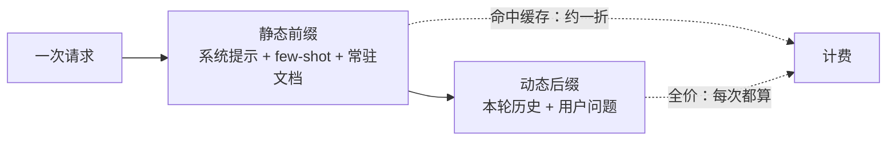

## 前置知识

- 读过 [第一次调用 LLM API](/ai-llm/030-FirstLlmApiCall)：会发请求、会读响应里的 `usage` 字段（prompt_tokens 与 completion_tokens），知道流式输出的开关在哪——本文的全部账都记在这些字段上。

没读过也可以，本文会带上需要的部分：只需知道「每次请求都返回本次消耗的 token 数」这一点，10 分钟可补齐。

## 学习目标

读完本文你将能够：

1. 用输入与输出分开计价的定价结构，手工算出一次请求乃至一个月的成本量级；
2. 解释为什么「输出贵、生成越长越贵」直接改变产品设计，并举出让模型少说废话的具体手段；
3. 说出 prompt caching 的机制（服务端缓存 KV 状态）、静态在前动态在后的布置原则、缓存窗口与命中价的量级；
4. 判断哪些任务适合 batch API（半价但要等），哪些不适合；
5. 设计一个模型路由方案（规则或分类器），并解释为什么成本大头常是那部分「本可用小模型」的请求；
6. 把一次请求的延迟拆成网络、排队、生成三段，解释 TTFT 为什么决定体感、流式为什么改善体感但不降低总量，并搭起记账、告警、熔断三件护栏。

预计 30 到 45 分钟，含 2 个动手实验与 4 道练习。

## 1. 问题引入：两张截图引发的复盘

产品上线一个月，两张截图摆上复盘会。第一张是账单：比预估高了近十倍。第二张是用户反馈：这个功能「有点卡」。排查发现两件事：其一，每次请求都把三份长文档全文塞进提示，而回答只有两三句——**为几句输出支付了几千 token 的输入费，还有相当一部分输入重复付费**；其二，等待整个回答生成完才展示，用户盯着空白页面熬八秒。

两件事都不是「API 太贵」或「模型太慢」，而是**没按定价结构与延迟结构设计产品**。token 是这个行业的计量货币，定价与延迟都挂在它身上；本文把货币、定价、时间三条线拆开讲清，再合成为一套护栏。

## 2. token 经济学：输出是输入的好几倍价

复习一句 [LLM 是什么](/ai-llm/010-WhatIsLLM)：模型按 token 读写文本，账单也按 token 计。关键在计价结构——**输入与输出分开计价，且输出单价通常是输入的三到八倍**（具体倍数随厂商与模型而变，以各家定价页为准）。为什么输出贵？因为机制不对称：输入的 token 可以**并行**处理（一次前向计算全部看完），输出的 token 必须**逐个自回归生成**——每个 token 都要走一遍完整前向，谁也替不了谁。贵的是这份「一个字一个字往外蹦」的计算。

这个结构直接推出几条产品与工程结论：

1. **生成越长越贵，且是按最贵的单价在贵**。让模型少说废话不是文风偏好，是直接的省钱手段：约束输出长度（max_tokens 与提示里明确「不超过 N 字」）、要求要点式而非成段输出、砍掉「这是一个好问题，让我为您……」的客套开场；
2. **输入贵在重复**。系统提示、few-shot 例子、长文档——这些每次请求原样重发的内容是输入账单的常驻大头。它们的解法是下一节的 prompt caching；
3. **先算账再上线**。用 `usage` 字段的典型值乘单价，一行乘法就能预估月成本量级，这个动作应该在写代码之前做。

输入侧还有一笔「隐藏账」值得盘一次：你的请求里那些本可以不发的 token。系统提示里冗长的说明书、few-shot 里重复的大段例子、多轮会话滚雪球的历史、检索环节捞回来的低相关 chunk——四类常驻乘客各占多少，值得在上线前用 `usage` 数据盘一遍（多轮历史的滚法见第 8 节，上下文的裁剪手艺在 [上下文工程](/ai-llm/050-ContextEngineering)）。很多团队的第一次成本优化，就是把一份 8000 token 的系统提示精简到 3000，一行代码没改，账单先降四成。

一个量级练习：假设某模型输入 1 元每百万 token、输出 5 元每百万 token（数字为示例，实际以定价页为准）。每天 1 万次请求，每次输入 3000 token（含重复的系统提示与文档）、输出 300 token：输入费约 30 元、输出费约 15 元，一天 45 元，一个月约 1350 元。注意两处可优化的空间已经藏在数字里：3000 的输入里有 2500 是每请求重复的前缀；300 的输出里常有 100 是可以裁掉的废话。这两个数字正是后面三节的主角。

## 3. prompt caching：把不变的前缀变成近乎白送

第 2 节留下了输入侧的重复账。厂商给了打折通道：**prompt caching（提示缓存）**——你的请求若与最近请求共享同一段前缀（典型的如系统提示、few-shot 样例、常驻文档），服务端对命中部分大幅打折计价，命中价的量级约为一折上下（各家不同，以定价页为准）。

机制值得懂一半，因为它解释了使用条件：模型处理输入时，token 要逐层算出中间状态（KV 状态），服务端把这段**前缀的 KV 状态缓存下来**，下次共享前缀的请求直接复用，不再重算。所以打折的不是存储，是那笔重复的计算。由此得出使用它的全部要点：



1. **静态内容放前面，动态内容放后面**——缓存按前缀命中，前缀里只要混进一个变化字节，从那里往后全部作废。把日期、用户名、随机数这类易变内容放到前缀末尾之外，是唯一要紧的布置纪律；
2. **缓存窗口是分钟级到小时级**（以各家文档为准），窗口内无请求命中就失效——它是给高频重复流量的折扣，不是永久存档；
3. **前缀越长越值得缓存**。几百 token 的系统提示收益有限，上万 token 的常驻知识则是数量级的差距。 [上下文工程](/ai-llm/050-ContextEngineering) 里「保持请求前缀稳定」的布置原则，在这里兑现成真金白银。

## 4. batch API：半价，但要等

第二张打折券面向**不在乎实时**的任务：batch API 把一批请求在离线时段提交，厂商在窗口期内（常以小时计）跑完，价格通常是同步调用的一半（以各家定价页为准）。适用与否只看一个问题：**这个结果需要现在拿到吗？**

| 适合 batch | 不适合 batch |
| --- | --- |
| 夜间批量给 10 万条历史工单打标签 | 用户正在输入框前等答案 |
| 整库文档批量生成摘要入库 | 多轮对话的每一轮 |
| 评估集跑分（见 [LLM 评估](/ai-llm/150-LlmEvaluationEvals) 的回归门禁） | 流式输出场景 |

评估是一条容易被忽略的 batch 大户：全量评估动辄几百上千条请求，本就不需要实时，走 batch 直接对折，回归门禁的成本焦虑立减一半。

工程上 batch 有三点小讲究：任务是**异步提交、异步取回**的，要写好结果拉取与失败重查的脚本；单条失败不影响整批，但要对失败子集做重试；提交前把任务 id 与业务键对齐，取回结果时才能对上号——batch 脚本 bugs 的经典形态就是「结果回来了，不知道是谁的」。

## 5. 模型路由：把简单请求送去小模型

[模型选型](/ai-llm/020-ModelLandscapeSelection) 说过旗舰、中档、小模型的价格差可达一个量级。路由（routing）就是给每个请求先做一次分诊：**简单的发给小模型，复杂的才上旗舰**。

分诊器本身要便宜，三种常用实现，按工程量递增：

1. **规则**：字数短、无明显推理特征、命中白名单意图的走小模型。零成本、可解释，覆盖不了语义难度；
2. **小模型分类器**：用一个廉价模型先判断难度或意图类别，再分发。多一次往返延迟，但判断贴近语义；
3. **级联（cascade）**：先让小模型答，规则或 judge 检查置信信号（格式合规、检索命中、自评分数），不达标再升级旗舰重答。最省，但复杂请求付出双倍延迟。

为什么路由值得做？看一个反直觉的分布事实：**成本的大头，往往是那 20% 本可以用小模型完成的请求**。用一个示意算术看清它——设某产品月请求 10 万次，旗舰模型单次成本 1 个单位，小模型 0.1 个单位（倍数量级示意，实际以定价页为准）：

| 流量构成 | 占比 | 全走旗舰 | 路由后 |
| --- | --- | --- | --- |
| 寒暄、格式改写、简单查询 | 60% | 60000 | 6000 |
| 常规问答 | 25% | 25000 | 25000 |
| 复杂推理、长文任务 | 15% | 15000 | 15000 |
| 合计 | 100% | 100000 | 46000 |

一半以上的账单来自「本可以便宜十倍处理的流量」，这就是路由的杠杆所在。去掉这部分错配，账单常能砍掉一半上下；反过来，剩下真正需要旗舰的请求一个没少，[评估](/ai-llm/150-LlmEvaluationEvals) 在这里的职责是给路由画红线：**哪些请求类型降级后质量会破线，必须由评估数据说了算，不许拍脑袋**。

## 6. 延迟解剖：三段旅程与一个体感指标

一次请求的总等待，拆成三段：

1. **网络**：请求从你的服务器到厂商端点往返。量级几十到几百毫秒，受地理距离与网络波动影响；
2. **排队**：请求在厂商侧等 GPU。负载高峰时它会显著变长，且不受你控制——这是延迟抖动的主要来源；
3. **生成**：模型逐 token 输出的时间。它近似「输出 token 数除以生成速率」，**与输出长度成正比**——这是三段里你最能控制的一段。

体感由什么决定？用户体验研究发现并反复验证：**等待的前几秒最煎熬，之后人进入「已读模式」耐受度上升**。所以衡量体感的指标不是总时长，而是 **TTFT（Time To First Token，首字时间）**——从发出请求到第一个字出现的时长。它等于网络加排队加第一个 token 的生成，覆盖了两段你控制力最弱的旅程。

**流式输出**的原理由此清晰：它不生成得更早、不减少任何 token（总量与总耗时不变），只是把「憋八秒后一口气给出」改成「第 1 秒开始逐字吐出」。TTFT 从总时长缩短到首段时长，用户从「空白页焦虑」变成「正在阅读」——**改善的不是速度，是等待的形状**。配套手段都围绕压缩 TTFT：输出更短（生成段本身变短）、前缀缓存（服务端少算前缀，首 token 更早）、就近接入与合理超时重试（网络与排队段）。而 [第一次调用 LLM API](/ai-llm/030-FirstLlmApiCall) 讲过流式的开关在哪，这里补上它为什么值得。

手段收拢成一张速查表，用时按「你控制哪段」来挑：

| 延迟段 | 手段 | 原理 |
| --- | --- | --- |
| 网络 | 就近接入、复用连接（HTTP keep-alive） | 缩短物理往返 |
| 排队 | 错峰重试、多厂商备援 | 避开负载高峰 |
| 生成 | 更短输出、前缀缓存、小模型路由 | 少生成、少算前缀、换快模型 |
| 体感 | 流式输出、进度提示、先出框架后填内容 | 改变等待的形状 |

## 7. 预算护栏：记账、告警、熔断

上面的手段都是「把单价做低」，护栏解决的是「失控时的止损」。三件套从财务到技术层层设防：

- **记账**：每次请求把 `usage`、模型名、功能标签、用户标识落库。有了按功能与按用户两个维度的账，你才能回答「钱花在哪个功能、哪个用户异常」——没有记账的优化都是猜。按用户维度同时服务计费与限额。一条最简的账目记录长这样：

```json
{
  "ts": "2026-10-28T10:21:00Z",
  "feature": "doc_qa",
  "user_id": "u_4821",
  "model": "...",
  "route": "small_model",
  "prompt_tokens": 3200,
  "completion_tokens": 210,
  "cache_hit_tokens": 2900,
  "cost_estimate": 0.014
}
```

字段里 `route` 与 `cache_hit_tokens` 是两个容易漏掉的高价值列：前者让路由的省钱效果可审计，后者让缓存策略的调优有数据可依。
- **告警**：给账设预算线，日消耗、单用户消耗、单功能消耗越过阈值即通知。目的是在「月底截图」之前几天发现异常，比如某个循环 bug 在一小时内烧掉一周预算；
- **熔断降级**：预算击穿时自动执行预案，而不是躺平宕机。常用降级阶梯：把旗舰切到小模型、压缩注入的上下文长度、临时关闭非核心的 AI 功能、对超额用户启用严格限流。降级本身要预先写好并演练，事故现场没有时间设计。

三件套合起来的立场是：**成本是设计出来的，不是月末审计出来的**。本文的每个手段——短输出、缓存、batch、路由——都应作为架构的一部分在第一天就位，而不是账单爆炸后的补救。

## 8. 多轮会话的成本曲线：账单是怎么滚起来的

单次请求的账好算，多轮会话的账会滚。[上下文工程](/ai-llm/050-ContextEngineering) 讲过窗口的机制：**对话 API 没有记忆，每一轮都要把全部历史重新发一遍**。于是第 N 轮请求的输入是前 N-1 轮的全部消息加新问题——输入随轮次线性增长，账单随之滚雪球：

| 轮次 | 本轮输入 token（示意） | 累计输入账（相对值） |
| --- | --- | --- |
| 1 | 600 | 600 |
| 3 | 1800 | 3600 |
| 6 | 3600 | 12600 |
| 10 | 6000 | 33000 |

读这张表的两个推论：其一，**十轮会话的总账约等于单轮的几十倍**，成本与延迟（prefill 要读完全部历史）同时被历史拖累；其二，滚雪球的大头是重复的历史，而重复恰好是 prompt caching 的主场——把会话前缀保持稳定、每轮只往后追加，历史部分就能吃到命中折扣。但缓存治不了「历史本身太长」，所以治理还要叠加 [上下文工程](/ai-llm/050-ContextEngineering) 的手段：历史压缩、裁剪、状态外部化。

产品侧因此有三条常见约定：给会话设轮数或 token 上限，超限就摘要重启；把「一次性可完成」的任务尽量设计成单轮（表单与结构化输入比聊天更能省钱）；长任务的中间结果落库，而不是全靠会话历史背着走。

## 9. 账单异常排查实录

预算告警响了，排查按五步走，每一步都依赖第 7 节的记账数据：

1. **下钻定位**：按功能与用户两个维度切账单，找到异常桶——是某个功能、某个用户，还是全局水位上涨；
2. **看用量结构**：异常桶里拆 `usage`，是输入涨了还是输出涨了？输入涨通常是上下文被塞了不该塞的东西（用户上传的全文、失控的检索结果），输出涨通常是提示允许了废话或陷入重复生成；
3. **查调用链**：有没有循环调用与重试风暴——重试没设上限、递归任务没设退出条件，一个 bug 就能把一次请求放大成千次；
4. **查配置漂移**：最近一次发布改了什么？TopK 调大、系统提示加长、模型换到贵的一档，都是常见肇事者——这正是变更门禁（[评估](/ai-llm/150-LlmEvaluationEvals)）要覆盖成本维度的原因；
5. **验证护栏**：修复后确认告警阈值、熔断预案是否按预期工作，把这次的成因写进预案清单。

这套流程的本质是：**成本事故和线上事故一样需要可观测性**——没有记账的事故排查，只能靠猜。

## 10. 常见困惑

**困惑一：max_tokens 设小了，回答被截断怎么办？**
max_tokens 是硬刹车，截断发生在中途时 JSON 都可能不完整（所以结构化输出场景要配合重试与校验）。更好的组合是：提示里明确期望长度，max_tokens 作为防止失控的上限而非目标长度。多数「废话多」的问题源头在提示允许了废话。

**困惑二：缓存是不是只要开了就自动省钱？**
不是。缓存命中依赖前缀完全一致与窗口内复用。动态内容混进前缀（比如把当前时间拼在系统提示开头）会让缓存永远不命中，等于白付缓存写入的溢价。布置不当时甚至可能比不用更贵（部分厂商对写缓存收少量费用），所以「静态在前、动态在后」要当作硬约束过 code review。

**困惑三：路由用小模型，质量下降谁负责？**
路由的质量红线必须由评估集划定：每类请求在小模型上的通过率达标才允许降级。同时给线上留观测（点踩率、重试率按路由桶分开统计），发现某类请求降级后指标恶化，立即把它拉回旗舰名单。

**困惑四：本地部署是不是成本优化的终极答案？**
它是方程的一个特殊解：边际成本为零，但换成硬件折旧、运维人力与质量损失（见 [本地推理与 Ollama](/ai-llm/170-LocalInferenceOllama) 的两个代价）。流量稳定巨大、质量要求允许时成立；流量稀疏时，闲置硬件可能比 token 账单更贵。先算总量级，再选形态。

**困惑五：TTFT 低但总时长长，先优化哪个？**
看交互形态。流式对话类体验，体感由 TTFT 主导，先压首字（缓存、路由、短开场）；一次性交付类（生成报告、批量任务），体感看总时长，先砍输出长度与上下文。两个指标都记账，按产品形态定权重，不要拿单一数字当北极星。

## 11. 动手实验：给一次真实请求记账并量一次 TTFT

实验一（成本核算）：挑你项目里（或设想中）的一个真实功能，从定价页取一组真实单价（以官方页面为准），用 `usage` 字段的典型值完成第 2 节那道算术：日请求量、平均输入输出、月成本。然后依次回答：输入里有几成是重复前缀？输出能砍几成？哪些请求可以走 batch？重算一遍月成本，把两个数字都写下来——这个差距就是本文的价值。

实验二（体感测量）：用流式请求测量 TTFT 与总时长，各跑 5 次取中位数：

```python
import time
from openai import OpenAI

client = OpenAI()
start = time.perf_counter()
stream = client.chat.completions.create(
    model="...",                # 模型名以所用平台文档为准
    messages=[{"role": "user", "content": "写 200 字的产品介绍"}],
    stream=True,
)
first = None
chunks = 0
for event in stream:
    if first is None and event.choices[0].delta.content:
        first = time.perf_counter() - start    # 首字时间 TTFT
    chunks += 1
total = time.perf_counter() - start
print(f"TTFT {first:.2f}s，总时长 {total:.2f}s，分块 {chunks} 个")
```

把 max_output 调大一倍再跑，观察总时长与 TTFT 各自怎么变——你会亲眼确认「生成段与输出长度成正比，而 TTFT 几乎不动」，这个不对称正是体感设计的支点。

## 12. 小练习

预测题（5 分钟）：输入 2 元、输出 10 元每百万 token（示例价）。功能 A 每次输入 8000、输出 200；功能 B 每次输入 500、输出 1500。各跑 1 万次，哪个贵？分别指出每个功能的第一优化方向。

修改题（10 分钟）：下面这条请求永远命中不了缓存，指出原因并改好：`messages` 的系统提示以「今天是 2026-10-28，用户张三，你好」开头，随后是 5000 token 的固定规范文档。

修 Bug 题（10 分钟）：复盘会的账单是预估的 8 倍。排查发现：每次请求都重新上传 6000 token 的产品手册、回答平均 1200 token 且以三段客套话开头。给出三个按性价比排序的优化动作与各自的预期效果。

分析题（15 分钟）：为「客服问答」产品设计路由方案：写出分流规则（哪些走小模型、哪些走旗舰）、质量红线的验证方法、以及预算护栏三件套各自的阈值思路。

## 13. 与之前和之后的知识的关系

- 往前：[第一次调用 LLM API](/ai-llm/030-FirstLlmApiCall) 提供了 usage 字段与流式开关，本文的账都记在那里；[上下文工程](/ai-llm/050-ContextEngineering) 的 token 数学与「前缀稳定」原则，在本文兑现成缓存折扣；
- 侧向：[LLM 评估](/ai-llm/150-LlmEvaluationEvals) 给路由划质量红线，也用 batch API 省下回归门禁的账单；
- 往后：[提示注入与安全](/ai-llm/190-PromptInjectionSecurity) 里你会看到，成本护栏还有一个安全维度的兄弟——注入攻击最常见的破坏之一就是刷爆你的 token 预算。

## 14. 官方文档

- OpenAI 定价与 batch API（价格事实以此为准）：https://platform.openai.com/docs/pricing
- Anthropic 文档（prompt caching 机制与定价）：https://docs.anthropic.com
- OpenAI API 文档：https://platform.openai.com/docs

## 15. 自我检查

- 能用输入输出分开计价的结构手工算出一次请求与一个月的成本量级；
- 能解释输出为什么比输入贵（并行与自回归的机制差异），并举出三个「少说废话」的手段；
- 能画出静态前缀与动态后缀的请求结构图，说出缓存机制、窗口与布置纪律；
- 能判断一个任务该不该走 batch API；
- 能说出三种路由实现与「20% 请求是成本大头」的原因；
- 能把延迟拆成三段，解释 TTFT 与流式「改变等待形状」的原理，并搭起记账、告警、熔断三件护栏；
- 能算清多轮会话的成本曲线，说出缓存与上下文治理分别治什么；
- 能按五步法排查一次账单异常，并说出每一步依赖什么数据。

## 本章总结

token 是 LLM 应用的计量货币：输入输出分开计价，输出因逐 token 自回归而比输入贵三到八倍，于是「生成越长越贵」成为产品约束——约束输出长度、要点式作答、砍掉客套。输入侧的重复前缀用 prompt caching 化解：服务端缓存前缀的 KV 状态，命中约一折，条件是静态内容在前、动态内容在后、窗口内复用；不实时的批量任务交 batch API 半价换等待。模型路由把寒暄与简单任务分给小模型——成本大头常是那 20% 本可用小模型的请求，质量红线由评估数据划定。延迟三段中网络与排队不受你控制，生成段与输出长度成正比；TTFT 决定体感，流式不减少总量但改变等待的形状。多轮会话的输入随轮次线性增长，账单滚雪球——缓存治重复的历史，上下文治理治历史本身；账单异常与线上事故一样，靠记账数据五步下钻排查。最后，记账、告警、熔断三件护栏保证失控时有序降级——成本是设计出来的，不是月末审计出来的。

## 下一步

进入 [提示注入与 AI 应用安全](/ai-llm/190-PromptInjectionSecurity)：钱和延迟之外，还有一类风险更致命——有人要让你的模型做你不想让它做的事。
