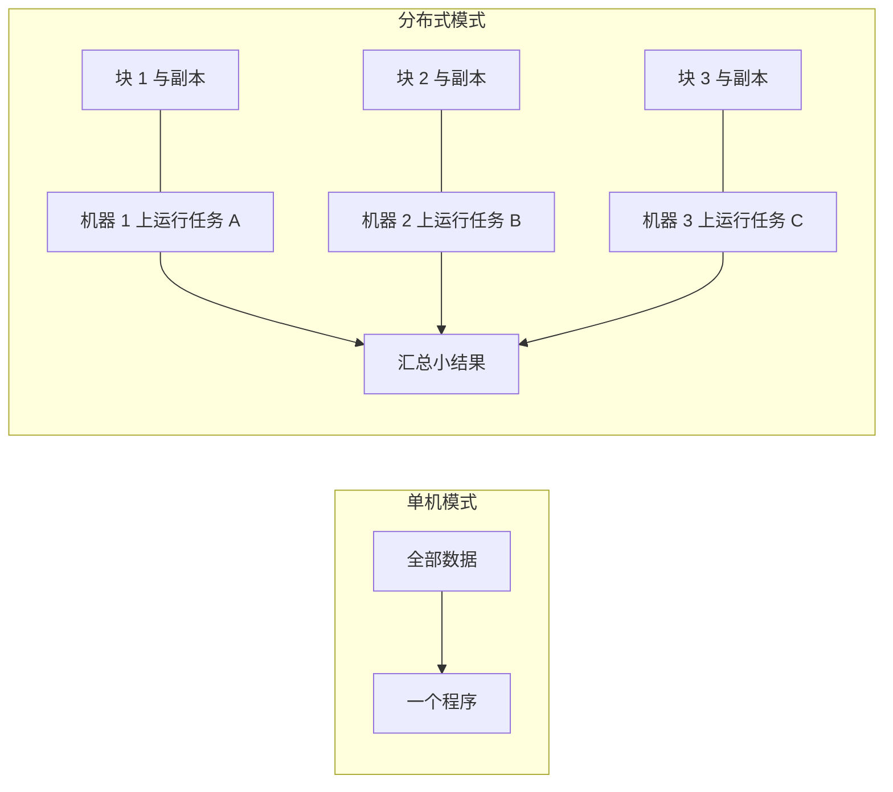
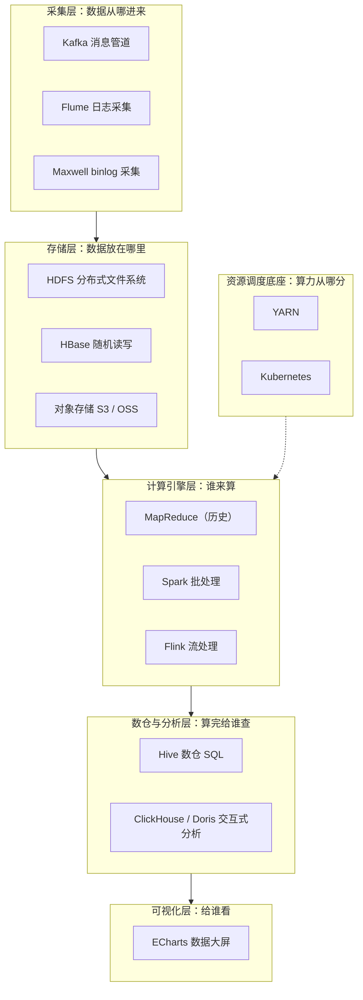
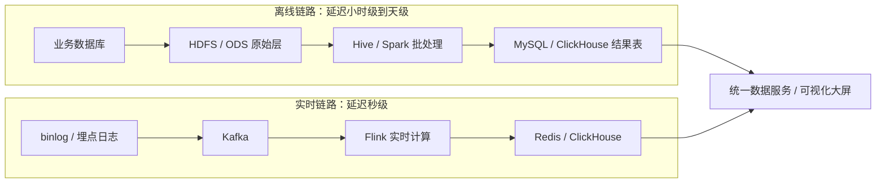

## 前置知识

- 读过 [SQL 是什么](/sql/010-WhatIsDatabase)：知道关系型数据库用表组织数据，会写基本的查询；
- 读过 [Java 构建工具](/java/740-JavaBuildTool)：知道 Maven、Gradle 负责依赖管理，见过多模块工程的样子。

没读过也可以，本文会带上需要的部分：你只需要知道「MySQL 是一台机器上跑的数据库」和「Java 项目靠 Maven 拉依赖」这两件事，各花 10 分钟即可补齐。

## 学习目标

读完本文你将能够：

1. 用具体数字解释单机 MySQL 为什么装不下 PB 级数据、算不动日增 TB 级的写入；
2. 用「分而治之」与「移动计算不移动数据」两句话概括大数据技术的本质；
3. 画出大数据生态的分层地图，并说出每一层的职责与代表组件；
4. 区分离线链路与实时链路的分工，说出它们在哪里汇合；
5. 说出 2026 年版图迁移的三个趋势，以及它们对学习顺序的影响；
6. 把「离线分析、实时看板、数据管道」三类比赛题型映射到完整的技术路径。

预计 30 到 45 分钟，含 2 个动手实验与 4 道练习。

## 1. 问题引入：单机 MySQL 的三堵墙

你可能给学校写过选课系统，用 MySQL 存几万条学生记录，得心应手。现在把场景换到一家电商平台：每天产生 5 TB 用户行为日志（点击、加购、下单），历史数据积累到 1 PB，运营每天要看昨天的成交额、转化率、热销商品排行。

把这套需求塞进单机 MySQL，会连续撞上三堵墙。

第一堵是**存储墙**。1 PB 约等于一百万 GB。按单块硬盘 4 TB 算，光是把数据摊开就需要 256 块盘；而 MySQL 的数据文件和索引都长在一台机器上，单表到千万行量级就要精心设计索引，一万亿行（1 KB 一行的日志）连想都不敢想——B+ 树的层数、索引的体积、内存缓冲池，全都先于容量崩掉。

第二堵是**计算墙**。运营的报表需要对全量数据做聚合。一块盘顺序读的速度大约 200 MB/s，扫完 1 PB 需要将近两个月。索引只加速「按条件定位少数行」的查询，而对「每一行都要参与计算」的聚合，索引帮不上忙——这就是扫描型查询的天性。

第三堵是**写入墙**。日增 5 TB，折算下来大约每秒 6 万行持续写入（1 KB 一行）。写入不只是追加：MySQL 要维护 B+ 树、写 redo log、处理锁竞争，持续高压写入会让延迟越来越高。

```text
单机的账本：
  存 1 PB 需要约 256 块 4 TB 硬盘，但数据库只能用一台机器的盘
  扫描 1 PB：单盘约 200 MB/s × 近两个月 = 一次全表聚合
  写入 5 TB/天：约 6 万行/秒，持续 24 小时
```

怎么办？换一台更强的机器（垂直扩展）有物理上限，而且顶级服务器贵得离谱。唯一现实的路是**水平扩展**：把 1 PB 摊到几百台普通机器上，让几百块盘同时转。大数据技术栈的全部内容，本质上都在回答「摊开之后怎么管、怎么算」。

## 2. 心智模型：大数据的本质是分而治之

把「一台机器装不下、算不动」翻译成两个子问题，就有了大数据的两块基石。

**存储的答案：切块、复制、摊开。** 把 1 PB 切成固定大小的块（Block），分散存到几百台机器的盘上；每块再复制几份放到不同机器，坏一台不丢数据。负责管这一堆机器和块的软件，就是分布式文件系统——HDFS（Hadoop Distributed File System）。

**计算的答案：数据不动，程序动。** 每个计算任务只处理一小块数据，与其把 TB 级的数据搬到程序所在的机器，不如把几十 MB 的程序（jar 包）发到数据所在的节点，就地计算，只把算完的小结果传回来。这就是「移动计算不移动数据」，大数据最重要的设计原则。



顺着这两条原则往下想，还能推出两件事：机器一定会坏，所以要有人盯着几百台机器的生死，于是有了**资源调度系统**（YARN、Kubernetes）；算完的中间结果要在机器之间按规则重新归组，于是有了**分布式计算引擎**（MapReduce、Spark、Flink）。整个生态就是这三个推论的长出来的枝叶。

还有一个容易被忽略的推论：**SQL 和单机思维没有作废**。分布式的本质是把「扫描」并行化，你写的仍然是一条 SQL、一个函数，只是执行它的机器从一台变成了一千台。

## 3. 生态版图：按层分工的一张地图

大数据组件多到劝退初学者，但如果按「数据从哪来、放哪里、谁来算、算完给谁看」分层，地图立刻清晰：



逐层看一遍，每层记住一句话：

- **采集层**：数据从业务世界进入大数据世界。Kafka 是高吞吐的消息管道，起削峰填谷和解耦的作用；Flume 收集服务器上的日志文件；Maxwell 伪装成 MySQL 的从库读取 binlog，把每一行数据变更变成一条 JSON 消息——实时链路的源头大多是它。
- **存储层**：HDFS 存大文件，至今仍是事实标准；HBase 提供毫秒级随机读写，适合存画像、风控名单这类「按 key 查」的数据；云上的项目则越来越多地用对象存储（S3、OSS）替代自建 HDFS。
- **资源调度层**：几百台机器的 CPU 和内存是一口大池子，YARN（Hadoop 时代）或 Kubernetes（新一代）负责把算力打包成容器分配给各个作业。
- **计算引擎层**：MapReduce 是鼻祖但已淡出；Spark 统治批处理；Flink 主攻流处理，兼做批。
- **数仓与分析层**：Hive 让你用 SQL 操作 HDFS 上的表，适合吞吐优先的批处理；ClickHouse 和 Doris 自带存储引擎，面向「点开页面秒级出图」的交互式分析。
- **可视化层**：ECharts 把结果表的数字变成图表大屏，是比赛里「看得见的分数」。

这张地图最重要的读法是**分层即解耦**：同一份数据可以被多个引擎反复消费，每一层都可以单独替换（Kafka 换成别的消息队列、HDFS 换成对象存储），相邻层不用改代码。你不需要背下所有组件，只需要记住数据流过哪几层。

## 4. 两条主线：离线链路与实时链路

真实生产环境里，数据分两条链路流动，分工明确：



**离线链路**每天凌晨把前一天的数据汇到 HDFS，Hive 或 Spark 跑批，算出指标写入结果表。它追求的是准确和吞吐，延迟以小时计，行话叫 T+1（今天算昨天的数）。像「月度报表」「用户画像标签」这类不着急但数据量大的活，都是它的主场。

**实时链路**让数据一产生就进入 Kafka，Flink 秒级聚合，结果写进 Redis 或 ClickHouse 供大屏刷新。它追求的是低延迟，代价是工程复杂度更高：数据会乱序、机器会故障，还要保证重启后统计不重不漏。

两条链路最终**在对外服务处汇合**：同一张大屏上，「昨日累计成交额」来自离线链路修正后的准确数字，「今日实时成交额」来自 Flink 的秒级统计。实时先出数、离线后校正，是行业通行的做法——这个组合的直觉叫 Lambda 架构，本文不展开，你记住「两条链路各管一段，最后拼在一个页面」即可。

## 5. 2026 年的趋势：版图重心在迁移

这张地图不是静态的，2026 年有三条清晰的迁移线：

- **Hadoop 让位存储层**。Hadoop 3.4.x 仍在维护，但它的定位逐渐收缩为「存储层」：HDFS 依然是事实标准，而 MapReduce 计算引擎基本退出新项目。学 HDFS 与 MapReduce 是为了地基，不是为了日常写它。
- **计算归于 Spark 与 Flink**。Spark 4.x 是当前批处理主力（2026 年 7 月发布 4.2.0，要求 Java 17），Flink 2.x 主攻流处理（最新 2.3.0）。两者的 API 也趋于稳定，学习投资不会白费。
- **湖表格式兴起**。Iceberg、Delta Lake 这类「湖表格式」给 HDFS 或对象存储上的裸文件补上了「表」的语义：事务、schema 演进、时间旅行。新建数仓越来越多地用湖表替代传统 Hive 表。另外 Kafka 4.x 已彻底移除 ZooKeeper，改为纯 KRaft 架构，部署模型大幅简化。

| 组件 | 写作时基线 | 一句话定位 |
| --- | --- | --- |
| Hadoop | 3.4.x | HDFS 存储底座仍是事实标准，MapReduce 引擎淡出 |
| Spark | 4.x（4.2.0，要求 Java 17） | 批处理与数仓计算主力 |
| Flink | 2.x（最新 2.3.0） | 流处理主力，流批一体 |
| Kafka | 4.x（纯 KRaft） | 实时数据管道事实标准 |
| Hive | 4.x | 数仓 SQL 入口，与湖表格式共存 |

版本号不需要背，具体小版本与依赖要求以官方文档为准；这张表的作用是让你看到「谁在上位、谁在让位」，从而判断学习投资的优先级。

## 6. 学习路线：先 SQL 与 Java，再 Spark，后 Flink

有了地图，路线就不是玄学而是拓扑排序——先学前置依赖，再学上层建筑。

**第一步：把 SQL 学扎实。** 数仓的通用语是 SQL，比赛里七成代码是 SQL（建表、清洗、聚合、窗口函数）。[SQL 模块](/sql/010-WhatIsDatabase)的查询、聚合、连接是后面 Hive 与 Spark SQL 的直接地基。

**第二步：Java 补到位。** Spark 和 Flink 都长在 JVM 上，比赛常用 Java 或 Scala 写作业，工程化离不开 Maven。[Java 构建工具](/java/740-JavaBuildTool)里学的多模块与依赖管理，在这里直接派上用场。注意一个版本事实：Spark 4 要求 Java 17，你在 Java 线按 17+ 学的语法正好够用。

**第三步：学 Spark。** 批处理是一切的基线：先理解 HDFS 与 MapReduce 打下的「分片、洗牌」概念（下一篇），再进入 RDD 与 DataFrame。Spark 的世界观（惰性求值、宽窄依赖）可以原样平移到 Flink。

**第四步：学 Flink。** 流处理在批之上新增了时间、水位线、状态、一致性这些概念。有了批的底子，这些新概念你才知道它们「修正的是批里的什么问题」。

一条贯穿始终的练习方法：每学一个引擎，都用同一份电商订单日志算同一组指标（日成交额、品类 TopN），对比写法与耗时——你会发现「思路不变，只是引擎换代」。

## 7. 与比赛场景的映射：三类题型

职业技能大赛「大数据应用开发」赛项的题目，无论怎么包装，骨架都能归到三类：

| 题型 | 输入 | 产出 | 典型技术路径 | 在地图中的位置 |
| --- | --- | --- | --- | --- |
| 离线分析 | CSV、日志、数据库导出 | 指标表、分析报告 | HDFS 入库，Hive 分层建模，Spark 算指标，结果写 MySQL，图表呈现 | 存储层 → 数仓层 |
| 实时看板 | Kafka 持续推送的流数据 | 秒级刷新的大屏 | Kafka 接入，Flink 聚合，写 Redis 或 ClickHouse，ECharts 呈现 | 采集层 → 计算层 → 可视化 |
| 数据管道 | 多源异构数据 | 干净的湖表或仓表 | Flume 或 Maxwell 采集，清洗转换，落入 HDFS 或 Iceberg | 采集层 → 存储层 |

判断题目属于哪一类的方法很简单：看**输出的时效要求**——要「昨天的完整数据」是离线，要「此刻的数字」是实时，只要求「把数据洗干净放对地方」是管道。三类题型的综合实战与工程化细节，见 [离线与实时综合项目](/bigdata/120-CapstoneOfflineRealtime)。

## 8. 常见困惑

**问：大数据就是 Hadoop 吗？**

答：不是。Hadoop 是起点与地基——HDFS 和 YARN 今天仍在服役，但 2026 年的计算主力已是 Spark 与 Flink，表层正被 Iceberg 这类湖格式接棒。「Hadoop 生态」这个说法更多是历史惯性，你可以把它理解为「以分布式存储为底座的这一整套技术」。

**问：既然 MapReduce 被淘汰了，为什么还要先学它？**

答：因为它是理解一切分布式计算的心智模型起点：数据怎么切、任务怎么分发、中间结果怎么归组、坏了怎么重算——这些概念在 Spark 里换了名字但一个都没少。先懂 MapReduce 再学 Spark，你才说得出 Spark 到底优化了什么，否则只会觉得「API 挺方便」，说不出为什么。

**问：Hive、ClickHouse、Doris 都能写 SQL，差别在哪？**

答：Hive 本身不存数据，它把 SQL 翻译成分布式作业去扫 HDFS，适合吞吐优先的批处理，查询延迟分钟级；ClickHouse 和 Doris 自带列式存储引擎，面向交互式分析，秒级返回。一个解决「算得完」，一个解决「问得快」，比赛里经常两个都用：Spark 或 Hive 算指标，ClickHouse 承接大屏查询。

**问：这些版本号需要背吗？**

答：不需要。记牢基线即可——Spark 4、Flink 2、Kafka 4、Hadoop 3.4、Hive 4；具体小版本、系统要求、配置参数以官方文档为准。面试或比赛写技术方案时，能说出「版本基线与迁移趋势」比背数字更能体现水平。

## 9. 动手实验

**实验一：亲手撞一次计算墙（20 分钟）。** 用 Java 生成一个 1 GB 的访问日志 CSV（约 1000 万行），写程序统计每个 URL 的出现次数并计时，再按数据量比例外推 1 PB 的耗时。

```java
import java.io.*;
import java.nio.file.*;
import java.util.*;

public class GenLog {
    public static void main(String[] args) throws Exception {
        // 生成 1000 万行模拟访问日志：用户 ID,URL,时间戳
        try (PrintWriter out = new PrintWriter(Files.newBufferedWriter(Path.of("access.log")))) {
            Random r = new Random(42);
            for (int i = 0; i < 10_000_000; i++) {
                out.printf("u%d,/item/%d,%d%n", r.nextInt(100000), r.nextInt(1000), System.currentTimeMillis());
            }
        }
    }
}
```

```bash
javac GenLog.java && java GenLog
# 用 time 或 System.nanoTime 给统计程序计时，记录 1 GB 的耗时
```

把 1 GB 的耗时乘以一百万，就是单机扫 1 PB 的量级——你会直观理解为什么必须并行。

**实验二：体会扫描的代价（15 分钟）。** 在本机 MySQL 里导入 100 万行数据（任何公开数据集均可），分别执行 `SELECT COUNT(*)` 和一条多列聚合，用 `EXPLAIN` 查看扫描行数并记录耗时，同样做外推。思考题：这两条查询里，索引分别帮上忙了吗？

## 10. 自检清单

1. 不看笔记，能说出三堵墙分别是什么，并各配一个数字直觉吗？
2. 能用「分而治之」与「移动计算不移动数据」两句话，向同学解释大数据在干什么吗？
3. 能默画生态六层图，每层说出至少一个代表组件吗？
4. 能说出离线与实时链路的延迟量级、优先目标，以及它们在哪里汇合吗？
5. 能说出 2026 年版图迁移的三个趋势，并解释为什么 MapReduce 仍值得先学吗？
6. 拿到一道「实时大屏」题，能写出从采集到可视化的完整技术路径吗？

## 11. 本章总结

单机 MySQL 撞上存储墙、计算墙、写入墙，答案是水平扩展：数据切块复制摊开（分布式文件系统），程序发到数据所在节点（移动计算不移动数据），算力由调度系统统一分配。生态按采集、存储、调度、计算、分析、可视化分层解耦；数据走离线（T+1、重准确）与实时（秒级、重延迟）两条链路，在对外服务处汇合。2026 年的趋势是 Hadoop 收缩为存储底座、Spark 4 与 Flink 2 承担计算、湖表格式接棒表层。学习顺序遵循依赖关系：先 SQL 与 Java，再 Spark，后 Flink；比赛题目归为离线分析、实时看板、数据管道三类。

## 12. 下一步

进入 [HDFS 与 MapReduce](/bigdata/020-HadoopHdfsMapReduce)：把本文地图中的存储层与鼻祖计算引擎拆开看个究竟——切块、副本、账本，以及那场改变了计算方式的「移动计算不移动数据」。

## 13. 官方文档

- Apache Hadoop：https://hadoop.apache.org/docs/stable/
- Apache Spark：https://spark.apache.org/docs/latest/
- Apache Flink：https://nightlies.apache.org/flink/flink-docs-stable/
- Apache Kafka：https://kafka.apache.org/documentation/
