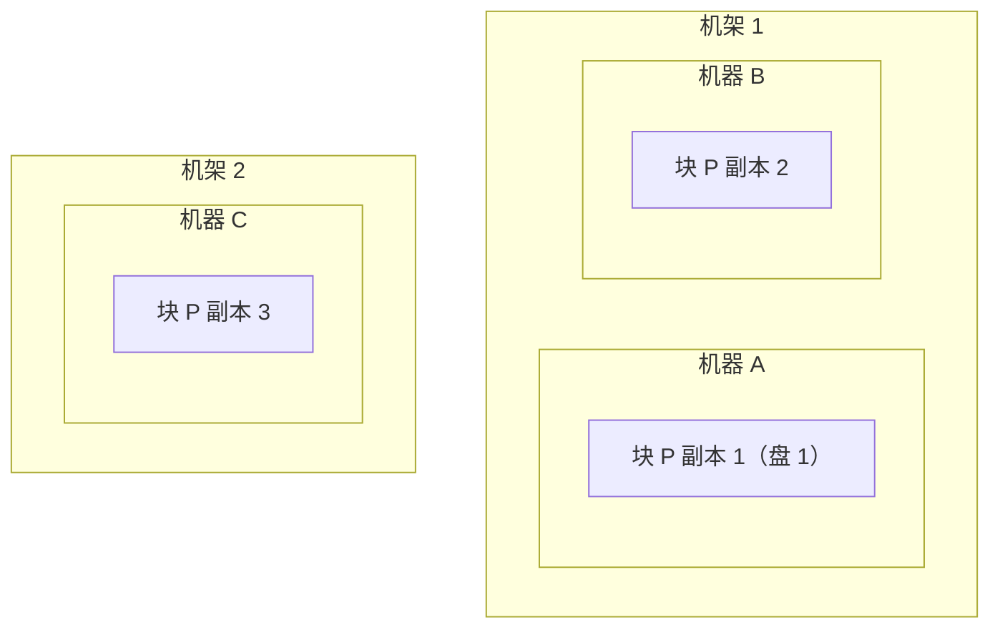
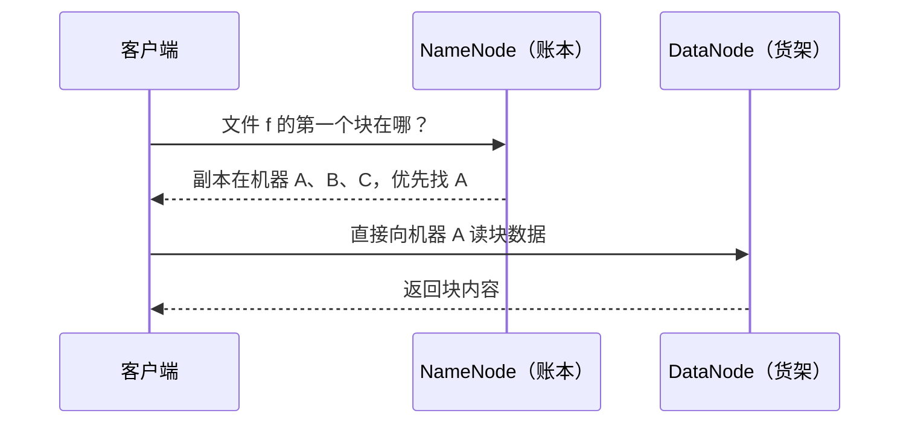
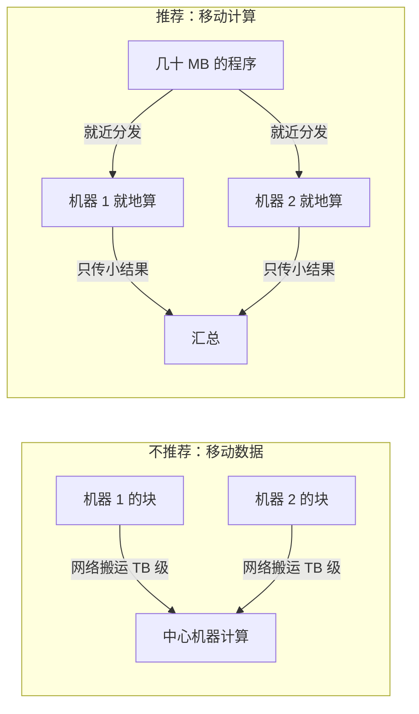
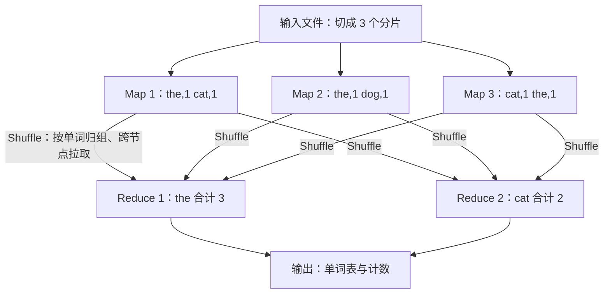

## 前置知识

- 读过 [大数据版图与学习路线](/bigdata/010-BigDataLandscape)：知道「分而治之」与「移动计算不移动数据」这两句话的含义，见过生态分层地图；
- [分布式系统基础](/cs-fundamentals/410-DistributedSystem) 若读过更好：会用到「部分失败」「网络不可靠」这类概念。

没读过也可以，本文会带上需要的部分：只需接受「集群由几百台会坏掉的普通机器组成」这一个前提，其余概念全部现场建立。

## 学习目标

读完本文你将能够：

1. 解释 HDFS 为什么把文件切成 128 MB 级的 Block、为什么要复制三份、副本为什么要跨机架放置；
2. 说出 NameNode 与 DataNode 各管什么，以及为什么元数据必须常驻内存；
3. 用矿石与冶炼厂的类比解释「移动计算不移动数据」的成本逻辑；
4. 用词频统计为例，画出 Map、Shuffle、Reduce 三步的数据流，并说出 Shuffle 为什么最贵；
5. 解释 MapReduce 被淘汰的根本原因，并由此推出 Spark 要解决的问题；
6. 判断哪些场景适合 HDFS、哪些是它的禁区（小文件、随机读、低延迟修改）。

预计 30 到 45 分钟，含 2 个动手实验与 4 道练习。

## 1. 问题引入：10 TB 日志摊给 100 台机器，谁来管

上一篇结尾，我们把 1 PB 摊到了几百台机器上。现在追问第一个具体问题：一个 10 TB 的日志文件，切开放进 100 台机器之后，麻烦立刻来了——

- 想读这个文件，客户端怎么知道数据在哪几台机器上？
- 一台机器磁盘坏了，它那份块丢了，文件不就缺了一角？
- 三台机器同时要读，谁响应快该找谁？

这些问题不可能让每个使用者自己解决，必须有一个专门的系统统一管理。它就是 HDFS。而有了存储，第二个问题随之而来：程序怎么在这些机器上协同计算？MapReduce 是历史上第一个大规模 answering 这个问题的引擎，虽然今天已被 Spark 取代，但它定义的概念框架至今有效。

## 2. 心智模型：切块、复制、跨机架摊开

HDFS 管理文件的方式可以浓缩成三个动作。

**第一刀：切块（Block）。** 文件被切成固定大小的块，Hadoop 3.x 默认 128 MB。最后一块不足 128 MB 就按实际大小存。块是 HDFS 分配和调度的最小单位——一个 10 TB 文件就是约 8 万个 Block。

**第二刀：复制（Replication）。** 每个块默认复制 3 份，放到不同的机器（DataNode）上。任何一份丢失，NameNode 都会指挥别的机器再补一份，把副本数恢复到 3。

**第三刀：跨机架放置（Rack Awareness）。** 副本不是随机乱放的，经典策略是：第一份在本机，第二份放在同一机架的另一台机器，第三份放到另一个机架。为什么这么讲究？因为故障有等级：



三级故障，三份副本各管一级：**单盘坏了**，同机的 RAID 或其他盘、同机架副本顶上；**整台机器坏了**（内存、主板、系统盘故障），同机架的另一份顶上；**整个机架断电或交换机故障**，跨机架的第三份顶上。副本数是 3 不是 2，正是为了同时覆盖这三级故障——机架级故障要求至少有一份副本活着离开这个机架。

还有一个初学疑问：块为什么这么大（128 MB，而 Linux 文件系统的块是 4 KB）？因为块越小、块的总数越多，管块的元数据就越庞大，调度也越碎；大块让「一次顺序读一大段」成为常态，正好匹配磁盘顺序读远快于随机读的物理特性。

## 3. NameNode 与 DataNode：账本与货架

HDFS 是典型的主从架构：一个 NameNode（名字节点）加一群 DataNode（数据节点），分工是**账本与货架**。

**DataNode 管数据本体。** 每台机器上运行一个进程，负责本机盘上块的读写，并周期性地向 NameNode 汇报「我这有哪些块」。

**NameNode 管元数据，而且元数据常驻内存。** 文件目录树、每个文件由哪些块组成、每个块的三个副本分别在哪些机器上——这些「账」全部记在 NameNode 的内存里。为什么必须放内存？因为每一次读写请求都要查账：客户端每打开一个文件、每定位一个块都要问 NameNode，放在盘上每次查账都是一次磁盘 IO，整个集群会被拖死。代价也很直白：每条块元数据约占上百字节内存，1 亿个块就是十几 GB——这直接决定了后面要讲的「小文件问题」。

客户端读写数据时，与 NameNode 之间只传「地址」，数据本体直接在客户端与 DataNode 之间流动：



账本丢了货架还在，但没人找得到货——所以 NameNode 的持久化极其重要：内存里的元数据定期落成 fsimage 镜像，期间的增量的改动记在编辑日志（edits log）里，重启时合并恢复；生产环境再配一个热备 NameNode 做高可用（HA）。这些机制细节以官方文档为准，你先记住结论：**数据有副本兜底，账本有镜像与日志兜底**。

## 4. 移动计算不移动数据

存储问题解决后，回到计算。一个直觉做法是：把数据全部搬到一台「计算中心」机器上再算。算一笔账就知道这有多亏：一个 MapReduce 程序的 jar 包通常几十 MB，而它要处理的数据是 TB 级——搬运成本是程序体积的一万倍以上，还要走广域网络、占满集群出口带宽。

正确做法是把方向反过来：**把程序发到数据所在的节点，就地计算，只传回小结果**。



这个原则带来的额外好处叫**数据本地性（locality）**：调度器知道每个块在哪台机器，会优先把任务派到副本所在的机器上执行，读取直接走本机盘，连集群内网都不过。Spark、Flink 都继承了这一原则——它是整个大数据领域最省钱的物理直觉。

## 5. MapReduce：Map、Shuffle、Reduce 三步

引擎的核心问题只有一个：一段在单机上几行代码的统计逻辑，怎么变成几百台机器协同的分布式作业？MapReduce 的答案是把它拆成两个阶段、中间夹一次归组。用词频统计（统计每个单词出现次数）做贯穿示例，这是分布式计算界的「Hello, World」。

输入是一个大文本文件，被切成多个分片（split，通常一片对应一个块）。三步走：

**第一步 Map：分发到各数据节点，各自处理一片。** 每个分片启动一个 Map 任务，逐行读入，把每个单词变成一个键值对 `(单词, 1)` 输出。Map 们互不知道彼此存在，各算各的。

**第二步 Shuffle：按 key 归组，最贵的一步。** 「the」这个单词在所有机器上都出现过，要统计总数就必须把散在各处的 `(the, 1)` 集中到同一个 Reduce 任务。Shuffle 做的就是这件事：对 Map 的输出按 key 分区排序、写到本机磁盘，Reduce 任务再跨网络把属于自己的那份全部拉走。

**第三步 Reduce：汇总。** 每个 Reduce 任务拿到一个单词对应的全部计数列表 `(the, [1,1,1,...])`，求和输出 `(the, 3)`。



写成 Java 代码，骨架其实很短——这正是 MapReduce 设计的高明之处：用户只填两个函数，分发、容错、调度全由框架接管：

```java
public class WcMapper extends Mapper<LongWritable, Text, Text, IntWritable> {
    private static final IntWritable ONE = new IntWritable(1);
    private final Text word = new Text();

    @Override
    protected void map(LongWritable key, Text value, Context ctx) throws IOException, InterruptedException {
        // 每行切出单词，逐个输出 (单词, 1)
        for (String w : value.toString().split("\\s+")) {
            word.set(w);
            ctx.write(word, ONE);
        }
    }
}

public class WcReducer extends Reducer<Text, IntWritable, Text, IntWritable> {
    @Override
    protected void reduce(Text word, Iterable<IntWritable> counts, Context ctx)
            throws IOException, InterruptedException {
        int sum = 0;
        for (IntWritable c : counts) {   // 同一单词的所有计数已归组到此处
            sum += c.get();
        }
        ctx.write(word, new IntWritable(sum));
    }
}
```

现在能看清 Shuffle 为什么是最贵的一步：它同时要付三笔钱——Map 输出要先**排序写盘**、Reduce 要**跨网络全量拉取**、拉来后还要**再排序归组**。数据在集群里被搬了一遍，网络和磁盘全部打满。这个成本认知请记住，它解释了后面几乎所有的引擎演进。

## 6. 为什么 MapReduce 被淘汰：每一步都落盘

词频统计一个 MapReduce 作业就能搞定。但真实任务几乎都是多步的：先清洗数据，再统计指标，最后排序取 TopN。在 MapReduce 里，每一步就是一个独立作业，而作业之间唯一的传递媒介是 HDFS：


每一步的输出都要完整写三份到 HDFS，下一步再完整读回来。三步任务，六次全量磁盘 IO 加上三次 Shuffle 的网络传输；真正「算」的时间反而占小头。对日志聚合这类一次成型的任务尚可忍受，但对**迭代计算**是致命的：机器学习训练要循环几百轮、图计算要迭代几十次，每一轮都是「读全量、写全量」，一轮一轮地给磁盘上税。

这正是 Spark 出场的原因——下一篇会展开：Spark 把多步任务画成一张有向无环图（DAG）统一调度，中间结果留在内存，只在必要时落盘。MapReduce 并没有白学：它的「分片、并行、Shuffle 归组、失败重试」概念框架原封不动地活在 Spark 里，你学它是为了看懂 Spark 优化掉了什么。

## 7. HDFS 的适用与不适用

把 HDFS 的性格总结成一张对照表：

| 维度 | 表现 | 原因 |
| --- | --- | --- |
| 大文件顺序读 | 很好 | 大块 + 顺序扫描匹配磁盘物理特性 |
| 高吞吐批量写 | 好 | 一次写入、多次读取（append 为主） |
| 海量小文件 | 灾难 | 每个文件与块都占 NameNode 内存元数据，1 亿个小文件要吃掉十几 GB 内存，且每次访问都有寻址开销 |
| 随机读 | 差 | 请求需要先问 NameNode 再去对应 DataNode，延迟远高于本地文件系统 |
| 低延迟修改 | 不支持 | 设计目标是追加而非原地改，改一条记录的代价接近重写 |

「小文件灾难」值得单独强调，因为它是新手最容易踩的坑：用 Spark 每小时产出一个几 KB 的结果文件，跑一年就是八千多个小文件，NameNode 内存与元数据响应都会恶化。工程上的对策是合并小文件、按分区组织目录，这些在后续 Spark 篇会再见到。

那随机读和低延迟修改谁来做？HBase（按 key 随机读写）或数据库家族（MySQL、ClickHouse 各管一段）。HDFS 的定位从来不是万能仓库，而是**高吞吐的批量数据底座**：一次写入、反复扫描。

## 8. 常见困惑

**问：HDFS 的 128 MB Block 和 Linux 文件系统的 4 KB 块是什么关系？**

答：不是一回事，也不是替代关系。HDFS 的 Block 是逻辑切分单元，每个 Block 最终仍以一个文件的形式存放在 DataNode 的 Linux 文件系统里；4 KB 块属于底下的 ext4 等文件系统。层级是：HDFS 逻辑块 → DataNode 上的物理文件 → Linux 文件系统块。

**问：副本有三份，我写一半时别人来读，会不会读到不一致的数据？**

答：HDFS 采用「写完才可见」的模型：写入的数据先在 DataNode 链式复制，确认成功后才对读者可见，因此正常流程下读到的是完整一致的块；正在写的过程对其他读者不可见。分布式一致性的完整图景是门大学问，在 [分布式系统基础](/cs-fundamentals/410-DistributedSystem) 里展开。

**问：NameNode 挂了，整个集群就完了？**

答：账本持久化在 fsimage 与编辑日志里，重启可恢复；生产环境配置 HA（主备 NameNode，通过共享编辑日志保持同步），主节点故障时备节点秒级接管。单点问题的另一半是内存容量上限——所以治理小文件同样是保护 NameNode。

**问：MapReduce 还值得学吗？面试会考吗？**

答：值得。一是概念地基：Spark 的 stage 划分、Shuffle 机制、数据本地性全部脱胎于 MapReduce；二是面试与比赛理论题仍常考 MapReduce 原理与「为什么被 Spark 取代」，因为它最能检验你是否真懂分布式计算。

## 9. 动手实验

**实验一：把 HDFS 用起来（30 分钟）。** 在虚拟机或 Docker 里搭一个 Hadoop 3.4.x 伪分布式环境（一台机器既当 NameNode 又当 DataNode，官方文档有完整步骤），然后依次执行：

```bash
hdfs dfs -mkdir -p /user/demo/words        # 建目录
hdfs dfs -put access.log /user/demo/words  # 上传上一篇生成的日志
hdfs dfs -ls /user/demo/words              # 查看文件
hdfs dfs -cat /user/demo/words/access.log | head   # 只看前几行，不下载整个文件
hdfs fsck /user/demo/words/access.log -files -blocks -locations
```

最后一条命令值得细看：输出里能看到文件被切成了哪些块、每个块有几个副本、分别在哪台机器——这就是第 2 节心智模型的实物对照。

**实验二：跑一次词频统计（20 分钟）。** 不写代码，直接用 Hadoop 自带的示例作业：

```bash
hadoop jar $HADOOP_HOME/share/hadoop/mapreduce/hadoop-mapreduce-examples-*.jar \
  wordcount /user/demo/words /user/demo/wc-output
hdfs dfs -cat /user/demo/wc-output/part-r-00000 | head
```

观察输出：URL 或单词与计数已经排好序归组。再想想：这个 jar 里写的正是第 5 节那两个类，框架替你完成了分发与 Shuffle。

## 10. 自检清单

1. 能画出「一个文件切成块、三副本跨机架分布」的示意图，并解释三份副本分别防哪一级故障吗？
2. 能说出 NameNode 内存里具体存什么、为什么必须放内存，以及账本靠什么持久化吗？
3. 能用程序体积与数据体积的对比，解释为什么要把程序发到数据节点吗？
4. 能用词频统计为例，完整讲述 Map、Shuffle、Reduce 各自做什么，并指出 Shuffle 贵在哪三笔开销吗？
5. 能解释「每步落盘」如何拖垮迭代计算，并由此说出 Spark 的改进方向吗？
6. 面对一则「往 HDFS 每小时写一个小文件」的方案，能指出它的问题并说出治理方向吗？

## 11. 本章总结

HDFS 用三个动作建立存储底座：切块（128 MB 级 Block）让大文件可并行、可调度；三副本配跨机架放置，覆盖磁盘、机器、机架三级故障；NameNode 内存账本加 DataNode 盘上货架的主从分工，让客户端问一次地址、直连货架读写。计算侧的原则是移动计算不移动数据：几十 MB 的程序发到 TB 级数据所在的节点就地执行。MapReduce 把分布式统计拆成 Map 分发、Shuffle 归组、Reduce 汇总三步，Shuffle 因落盘加网络加排序成为最贵一步；多步任务间靠 HDFS 传递中间结果，每步都付全量落盘的税，迭代计算因此代价高昂——这正是 Spark 登场的伏笔。HDFS 性格鲜明：大文件顺序读的主场，小文件、随机读、低延迟修改的禁区。

## 12. 下一步

下一篇 [Hive 与数据仓库](/bigdata/030-HiveWarehouseSql)：在 HDFS 与 MapReduce 之上架起 SQL 的桥——让分析师不写一行 Java，也能查询 HDFS 上的表；再往后 [Spark Core 与 RDD](/bigdata/040-SparkCoreRdd) 将兑现本文埋下的伏笔。

## 13. 官方文档

- HDFS 架构与设计：https://hadoop.apache.org/docs/stable/hadoop-project-dist/hadoop-hdfs/HdfsDesign.html
- MapReduce 教程：https://hadoop.apache.org/docs/stable/hadoop-mapreduce-client/hadoop-mapreduce-client-core/MapReduceTutorial.html
