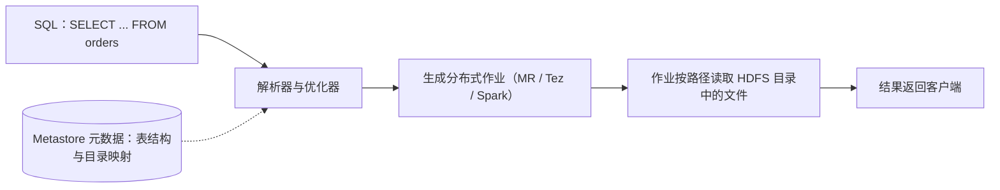
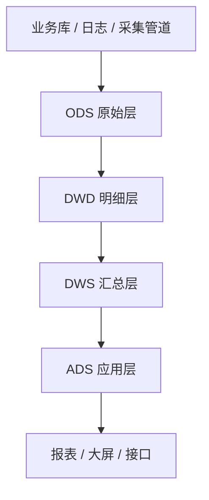
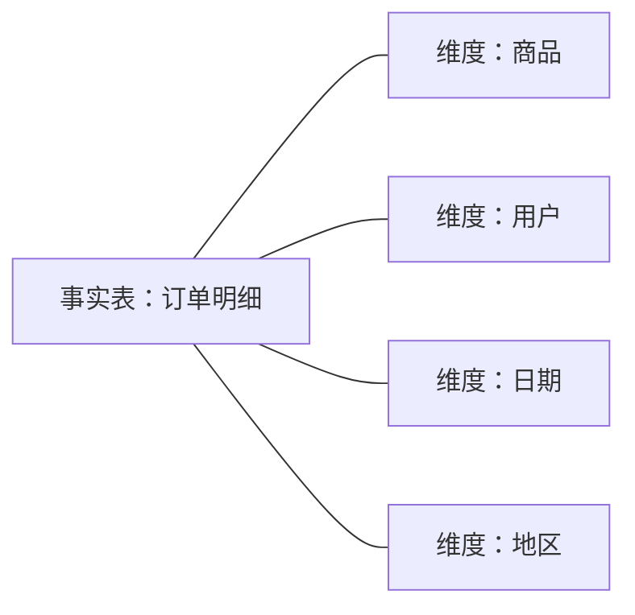

## 前置知识

- 读过 [HDFS 与 MapReduce](/bigdata/020-HadoopHdfsMapReduce)：知道 HDFS 上存的是被切块的文件、MapReduce 如何把查询变成分布式作业；
- 读过 [SQL 第一步](/sql/030-SQLFirstSteps)：会写 `SELECT ... FROM ... WHERE ... GROUP BY` 这个量级的查询。

没读过也可以，本文会带上需要的部分：用到 HDFS 时会用一段话重新交代，SQL 只用到入门查询水平。

## 学习目标

读完本文你将能够：

1. 解释 Hive 的全部动机：用 SQL 查 HDFS 上的表，以及「表 = 目录的元数据投影」这句话的含义；
2. 画出 Hive 从 SQL 到分布式作业的执行路径，说出 Metastore 里存的是什么；
3. 区分内部表与外部表，并根据数据归属选择正确的类型；
4. 解释分区与分桶各自的物理形态（目录级与文件级）与优化原理；
5. 画出 ODS、DWD、DWS、ADS 四层数仓分层，说出每层的职责、写入者与消费者，以及为什么不能一张大宽表用到底；
6. 用维度、事实与星型模型的直觉分析一张业务报表该怎么建模。

预计 30 到 45 分钟，含 2 个动手实验与 4 道练习。

## 1. 问题引入：让分析师写 MapReduce？

上一篇我们写过一个词频统计的 MapReduce 作业：两个类、一套泛型、编译打包提交，跑出结果。现在设想一个真实需求：运营同事想知道「每个品类每天的销售额」。用 MapReduce 实现它，需要设计 map 输出的 key、处理 join（订单要关联商品表拿品类）、处理多级聚合——几百行 Java，还得一个懂分布式框架的人来维护。

而运营和分析师会什么？他们全会 SQL：

```sql
SELECT category, dt, SUM(amount)
FROM orders
GROUP BY category, dt;
```

同一个需求，一边是几百行分布式代码，一边是三行 SQL。Hive 的全部动机就在这个落差里：**让会用 SQL 的人，能查询 HDFS 上的数据**。Hive 不自己存数据、不自己算数据，它是一个「翻译官」——把 SQL 翻译成跑在 Hadoop 集群上的分布式作业。

## 2. 心智模型：表只是 HDFS 目录的元数据投影

理解 Hive 的钥匙是这句话：**Hive 表不存在于任何「数据库文件」里，它只是 HDFS 上一段目录加上一份元数据描述**。

你在 Hive 里执行 `CREATE TABLE orders (...)`，实际发生的事是：

1. 在 Metastore（元数据库，通常是一个 MySQL）里记一条记录：表名 orders、列结构、分隔符约定、对应的 HDFS 路径 `/warehouse/ods/orders`；
2. 在 HDFS 上创建（或关联到）这个目录。

目录里躺着的仍然是一个个原始文本文件（CSV、TSV、Parquet……），Hive 只是在读它们时，按元数据里的列结构「投影」出一张表的样子。这叫 **schema on read**：写数据时不强校验结构，读的时候才按表定义去解释文件内容。

查询时，SQL 走这条路：



注意这条链：SQL 进去，分布式作业出来——你在 [HDFS 与 MapReduce](/bigdata/020-HadoopHdfsMapReduce) 学到的分片、并行、Shuffle 一点没少，只是全部由 Hive 替你生成。Metastore 是整套体系的中枢：表结构、分区信息、目录映射全在里面。这个设计还有一个深远影响——Metastore 与 Hive 引擎是解耦的，后来 Spark 直接复用同一份元数据来查同一批表（第 6 节），因为「表」的定义从来不专属于某个引擎。

## 3. 内部表与外部表：删表删不删数据

Hive 表分两类，差别只有一条：**删表时，动不动 HDFS 上的数据**。

- **内部表（managed table）**：Hive 全权管理数据。`DROP TABLE` 时，元数据和 HDFS 目录里的数据**一起删掉**。
- **外部表（external table）**：Hive 只挂个元数据，数据在别的路径。`DROP TABLE` 只删元数据，**数据原封不动**。

```sql
-- 外部表：指向一批已经存在的日志文件
CREATE EXTERNAL TABLE ods_access_log (
    user_id  STRING,
    url      STRING,
    dt       STRING
)
ROW FORMAT DELIMITED FIELDS TERMINATED BY ','
LOCATION '/raw/access_log';

-- 内部表：中间计算结果，生命周期归 Hive 管
CREATE TABLE dwd_access_log (
    user_id STRING,
    url     STRING
)
PARTITIONED BY (dt STRING);
```

选择标准是**数据归属**：这份数据是别的流程（采集管道、其他团队）的资产吗？是，就用外部表——Hive 只是借来查，删表绝不能误删人家原始数据，比如 ODS 层的原始日志永远用外部表；这份数据是 Hive 自己的计算中间产物吗？是，就用内部表——中间结果没价值了就该连数据一起清掉。一句话经验：**原始数据外部表，中间结果内部表**。

## 4. 分区与分桶：目录级与文件级的两把剪刀

扫描是查询成本的大头（回看上一篇的计算墙），分区与分桶是 Hive 提供的两把「少扫一点」的剪刀，作用在两个不同粒度。

**分区（partition）：目录级裁剪。** 按 `dt`（日期）分区建表后，HDFS 上会形成目录树：

```text
/warehouse/dwd/orders/
  dt=2026-10-27/  part-0000.parquet ...
  dt=2026-10-28/  part-0000.parquet ...
  dt=2026-10-29/  part-0000.parquet ...
```

查询带 `WHERE dt = '2026-10-28'` 时，Hive 直接只扫那一个子目录，其余日期的文件一个字节都不碰——这叫**分区裁剪**。日常分析几乎总是「看某天、某月」，所以日期是最常用的分区键。注意：分区值记录在目录名里（元数据在 Metastore），查询时务必把分区条件写进 WHERE，否则裁剪失效、退化成全表扫描。

**分桶（bucket）：文件级切分。** 分区之内再按某列（如 user_id）的哈希值把数据切成固定数量的文件：

```text
dt=2026-10-28/
  000000_0.parquet   （user_id 哈希 % 4 == 0 的行）
  000001_0.parquet   （哈希 % 4 == 1 的行）
  ...
```

它换来两件事：一是**抽样**高效（`TABLESAMPLE` 直接取某几个桶的文件）；二是**分桶 join 优化**——两张表都按 user_id 分 4 个桶时，相同哈希值的行必然落在编号相同的桶里，join 可以桶对桶进行，避免一次大 Shuffle。

两把剪刀的分工：分区回答「按什么维度查得最多」（通常是时间），分桶回答「哪些 key 经常被 join 或抽样」。

## 5. 数仓分层：ODS、DWD、DWS、ADS

有了表和分区，接下来是组织方式问题。把所有表胡乱堆在一起，用不了三个月就会出现「同一个指标三个人算出三个数」。行业通行的解法是按加工深度分层：



| 层 | 名字 | 职责 | 数据形态 | 谁写入 | 谁消费 |
| --- | --- | --- | --- | --- | --- |
| ODS | 原始层 | 原样落地，不做任何加工 | 与源系统一致的贴源表（外部表） | 采集管道（Flume、Maxwell、Sqoop） | DWD 加工作业 |
| DWD | 明细层 | 清洗（去重、补空、脱敏）、规范化，一行就是一次行为或一笔事务 | 明细事实表 | ETL 作业（Hive SQL / Spark） | DWS 聚合作业、明细查询 |
| DWS | 汇总层 | 按主题做轻度聚合，如「用户天粒度汇总」「商品日销量」 | 粒度较粗的宽表 | ETL 作业 | ADS 与多个应用复用 |
| ADS | 应用层 | 面向具体报表与大屏的最终指标 | 一个指标表对应一个应用 | ETL 作业 | 报表工具、大屏、接口 |

（ODS、DWD、DWS、ADS 分别是 Operational Data Store、Data Warehouse Detail、Data Warehouse Summary、Application Data Store 的缩写。）

为什么不能建一张大宽表从原始数据一路用到底？三个理由，每个都来自真实痛点：

1. **重算成本**：宽表直接对接源数据，源表结构一变或口径一改，就要从头重算整张表；分层后改口径只需重跑 DWS 之后的层，ODS 与 DWD 稳定不动。
2. **口径失控**：所有应用都从原始数据自己算，同一个「日活跃用户」三处定义三种结果；分层让指标在 DWS 统一定义一次，下游全部复用。
3. **依赖混乱**：不分层时表与表互相引用成网，一份数据坏了排查不出影响面；分层把依赖收成单向链，坏了能立刻知道下游哪些层要重跑。

分层的本质是**加工的版本管理**：每一层都只对上游负责、只被下游依赖，改动被隔离在相邻两层之间。

## 6. 建模初步：维度、事实与星型模型

分层解决「怎么组织加工」，建模解决「表长什么样」。数仓建模的第一组概念：

- **事实表（fact table）**：记录「发生了什么」，一行是一个可度量的事件（一笔订单、一次点击），核心是数字度量（金额、次数）；
- **维度表（dimension table）**：回答「从什么角度看」，一行是一个描述对象（一个商品、一个用户、一天），核心是属性（品类、地区、年龄）。

把事实表放中间、维度表围一圈，每个维度用一条外键连接，形状像星星，这就是**星型模型**：



直觉上它和你在数据库课学的第三范式相反：星型模型故意**冗余**——维度表的属性反复出现在各事实表里，也不为消除依赖拆成多层。为什么？因为数仓的主成本是「扫描与 join 的代价」，而不是「存储空间」（盘很便宜）；把维度属性拉平冗余进来，查询时少 join 几张表，简单直接。用空间换查询效率，这是分析型系统与事务型系统在设计哲学上的分水岭。

## 7. 与 MySQL 的对比：两套系统两种性格

| 维度 | MySQL | Hive |
| --- | --- | --- |
| 定位 | 事务型（OLTP）：支撑业务在线运转 | 分析型（OLAP）：支撑批量统计分析 |
| 事务 | 完整支持（ACID） | 基本不支持；update/delete 几乎不用，常规做法是整分区重写 |
| 单条读写延迟 | 毫秒级 | 秒到分钟级（启动分布式作业就有固定开销） |
| 吞吐与扫描 | 单表千万行就需精心设计 | TB 到 PB 级全表扫描是日常 |
| 数据体量 | GB 到 TB | TB 到 PB |
| 底下是什么 | 自己的存储引擎（如 InnoDB） | HDFS 目录里的文件 |

两者不是替代关系而是上下游：MySQL 支撑下单、支付这些在线业务，产生数据；Hive（或后续的 Spark）把 MySQL 和日志的数据汇聚起来做分析，产出报表。比赛题目里常见的搭配正是「结果表写回 MySQL 供页面查询」。至于 Hive 4.x 与湖表格式的关系，一句话带过：新建数仓越来越多用 Iceberg 这类湖表格式来管表（获得事务与时间旅行能力），Hive Metastore 仍常继续担任元数据中心，Hive 本身的角色在向「SQL 入口与兼容层」收缩。

## 8. 常见困惑

**问：Hive 查询为什么这么慢？比赛为什么还在用它？**

答：慢在「每次查询都要编译并启动一个分布式作业」，固定开销就是秒级起步。但比赛与生产用它的原因一致：吞吐大、生态稳、SQL 标准。而且引擎可替换——用 Spark 引擎执行同样的 SQL（Spark on Hive，下一篇讲），速度成倍提升，建表与分层方法一字不变。

**问：分区列为什么「查不到」或报错？**

答：分区列是目录名的一部分，不是文件里的普通列。往表里插数据时要指定分区值（动态分区由数据提供），查询时把分区条件写进 WHERE 才能触发裁剪；如果建表时把分区列也写在普通列里又再建一次分区，就会出现「列重复」或「永远为空」的经典错误。记住：分区列只存在于元数据与目录名中。

**问：外部表 DROP 之后数据还在，再建同名表会怎样？**

答：指向同一路径新建表（无论内部还是外部），数据立刻重新可见——这正是外部表「数据与元数据解耦」的价值：元数据可以随时重建，原始数据毫发无损。反过来千万别对内部表做这个实验，DROP 连数据一起带走。

**问：比赛项目小，四层必须建齐吗？**

答：分层是思想不是仪式。小项目可以 ODS 加 DWD 加 ADS 三层甚至两层，但「原始数据与加工结果分离、指标定义集中一处」这两条底线要守住。面试答辩时能讲清每层职责与省略理由，比机械建满四层更能体现理解。

## 9. 动手实验

**实验一：建表、装数、查询（30 分钟）。** 用 Docker 起一个 Apache Hive 官方镜像（含内嵌 Metastore 与 HiveServer2），通过 beeline 连接：

```bash
docker run -d --name hive -p 10000:10000 -p 10002:10002 apache/hive:4.0.0
docker exec -it hive beeline -u jdbc:hive2://localhost:10000
```

在 beeline 里走一遍本文主线（版本号以官方镜像页为准）：

```sql
-- 1. 外部表挂上 HDFS 里已有的目录
CREATE EXTERNAL TABLE ods_orders (order_id STRING, category STRING, amount DOUBLE)
ROW FORMAT DELIMITED FIELDS TERMINATED BY ','
LOCATION '/raw/orders';

-- 2. 建带分区的内部表并从 ODS 清洗一份 2026-10-28 的数据
CREATE TABLE dwd_orders (order_id STRING, amount DOUBLE)
PARTITIONED BY (category STRING, dt STRING);

INSERT OVERWRITE TABLE dwd_orders PARTITION (dt='2026-10-28')
SELECT order_id, category, amount FROM ods_orders;

-- 3. 验证分区裁剪：只扫一个分区目录
SELECT category, SUM(amount) FROM dwd_orders
WHERE dt = '2026-10-28' GROUP BY category;
```

**实验二：亲眼看到「表是目录」（15 分钟）。** 在另一个终端执行 `hdfs dfs -ls /user/hive/warehouse`（或你建的 LOCATION 路径），观察分区目录 `dt=2026-10-28` 的实际形态；再用 `EXPLAIN` 对比带分区条件与不带分区条件的查询计划，看扫描范围的差别。这张「Hive 表原来是个目录」的截图，值得存进你的笔记。

## 10. 自检清单

1. 能向同学解释「Hive 表只是 HDFS 目录的元数据投影」这句话，并说出 schema on read 的含义吗？
2. 能画出从 SQL 到分布式作业的执行路径，并指出 Metastore 里存了什么吗？
3. 给你一个「其他团队采集的原始日志」与一个「本项目的中间结果」，你能判断各该用内部表还是外部表并说出理由吗？
4. 能说出分区与分桶分别作用在哪个物理粒度、分别优化什么吗？
5. 能画出 ODS 到 ADS 的四层图，说明每层谁写入谁消费，并举出「一张大宽表用到底」的两个具体恶果吗？
6. 给一张「每日商品销量报表」需求，能指出事实表、维度表并画出星型模型吗？

## 11. 本章总结

Hive 的全部动机是让会 SQL 的人查 HDFS 上的数据：表只是「HDFS 目录 + Metastore 元数据」的投影，查询被翻译成分布式作业执行。内部表与外部表以「删表动不动数据」划界，按数据归属选择；分区在目录级裁剪、分桶在文件级切分，是两把不同粒度的扫描剪刀。数仓按 ODS、DWD、DWS、ADS 分层，本质是把加工过程变成可重跑、口径集中的版本管理，避免一张大宽表带来的重算与口径灾难；建模上用事实表度量事件、维度表提供视角，以冗余换 join 效率构成星型模型。Hive 与 MySQL 是 OLAP 与 OLTP 的分工而非替代；2026 年湖表格式正在接管「表」的定义，而分层与建模的思想原样迁移。

## 12. 下一步

下一篇 [Spark Core 与 RDD](/bigdata/040-SparkCoreRdd)：Hive 让你少写 Java，但底层引擎仍是「每步落盘」的作业链；Spark 换掉了引擎，把中间结果请进内存——先从它的基石 RDD 学起。

## 13. 官方文档

- Apache Hive 语言手册：https://cwiki.apache.org/confluence/display/Hive/LanguageManual
- Apache Hive 官网（4.x 发布信息以此为准）：https://hive.apache.org/
- Apache Iceberg（湖表格式延伸阅读）：https://iceberg.apache.org/docs/latest/
