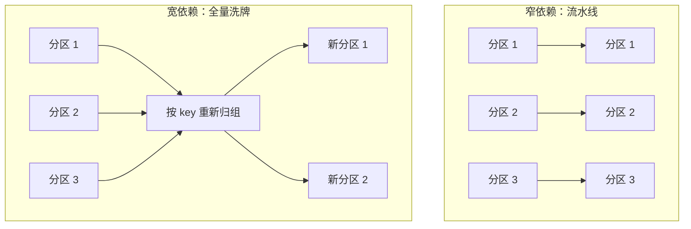

## 前置知识

- 读过 [HDFS 与 MapReduce](/bigdata/020-HadoopHdfsMapReduce)：知道 Map、Shuffle、Reduce 三步与「每步落盘」的代价，这是本文反复对照的对象；
- 熟悉 Java 集合与 Stream（或 Kotlin/C# 的链式调用）：`map`、`filter` 这类高阶函数的用法可以直接平移。

没读过也可以，本文会带上需要的部分：凡涉及 MapReduce 的对比处都会用一两句话重新交代背景。

## 学习目标

读完本文你将能够：

1. 用「落盘税」算清 MapReduce 多步任务的时间都花在了哪里，并说出 Spark 的对策；
2. 解释 DAG 执行模型：为什么把整个作业画成一张图统一调度，就省掉了中间落盘；
3. 说出 RDD 三要素，并解释血统（lineage）容错与 HDFS 副本容错的本质区别；
4. 区分 transformation 与 action，并解释惰性求值为什么让引擎能做全局优化；
5. 用宽窄依赖判断哪些算子会触发 Shuffle，并解释 reduceByKey 比 groupByKey 高效的原因；
6. 独立完成一次 spark-submit 提交，并知道何时该 cache、何时该 checkpoint。

预计 30 到 45 分钟，含 2 个动手实验与 4 道练习。

## 1. 问题引入：MapReduce 的「落盘税」

在 [HDFS 与 MapReduce](/bigdata/020-HadoopHdfsMapReduce) 末尾留了一个伏笔：多步任务里，每个 MapReduce 作业的输出都要完整写三份到 HDFS，下一个作业再完整读回来。我们来算一笔账。一个三步任务（清洗、统计、排序）：

- 3 次全量写 HDFS（每次 3 副本，等于 9 份网络传输加磁盘写）；
- 2 次全量读 HDFS；
- 2 到 3 次 Shuffle（每次都要排序写盘加跨网络拉取）；
- 真正「计算」本身，可能只占总时间的一小部分。

一次成型、规模不大的任务尚可忍受；可真实分析是多步的常态，机器学习训练要迭代几百轮——每一轮都把全量数据在磁盘间倒腾一遍，CPU 大部分时间在等 IO。这个问题不在算法，而在**执行模型的架构决定**：MapReduce 把每个作业当成孤立的单元，作业之间只能靠文件系统传递数据。

Spark 的答案一句话：**把整个多步任务当成一个整体来调度，中间结果留在内存，能不落盘就不落盘**。围绕这句话，Spark 重新设计了执行模型、容错模型和编程接口，它的基石数据结构叫 RDD。

## 2. 心智模型：把整个作业画成一张 DAG

RDD（Resilient Distributed Dataset，弹性分布式数据集）是 Spark 的基本抽象：一个**不可变、可分区、并行计算**的数据集合。你可以把它近似理解为「分布在集群多个分区里的 List」，但它有两个单机集合没有的性格：**惰性**与**有血统**（下面两节展开）。

Spark 程序的执行过程：你从输入数据出发，一路对 RDD 做变换，最后要一个结果。引擎把这条变换链画成一张**有向无环图（DAG，Directed Acyclic Graph）**——节点是数据集，边是变换操作——然后一次性统筹调度：


对照 MapReduce：同样这条链要拆成两三个孤立作业、两次落盘；Spark 把它当**一个作业**，中间数据在各任务的内存里直接传给下游，只有 Shuffle 这样的必要节点才落盘。引擎还能顺手做合并优化——相邻的 filter 与 map 可以在同一个任务里逐条流水线执行，根本不用物化中间集合。

DAG 是 Spark 一切优势的总开关。后续的惰性求值、宽窄依赖、stage 划分、容错重算，全都是在回答「这张图怎么建、怎么切、坏了怎么补」。

## 3. RDD 三要素与血统容错

每个 RDD 内部记录三样东西（源码视角的字段，理解用途即可）：

1. **分区列表（partitions）**：数据被切成哪些片，每片对应一个并行任务；
2. **依赖关系（dependencies）**：我是从哪个 RDD、经过什么变换得来的——这就是**血统（lineage）**；
3. **分区函数（partitioner，可选）**：K-V 型 RDD 按什么规则把 key 分到分区（哈希或范围），决定 Shuffle 行为。

血统带来一种与 HDFS 完全不同的容错思路。HDFS 防「数据坏」靠**备份**：每份数据存三份，坏了拿副本补。Spark 防「中间结果坏」靠**重算**：中间数据不备份，某个分区丢了，就顺着血统记录的变换链，从源头把那个分区重新算出来——因为变换链本身是确定性代码，重算必然得到同样的结果。

| | HDFS 副本容错 | Spark 血统容错 |
| --- | --- | --- |
| 对象 | 持久存储的原始数据 | 内存中的中间结果 |
| 手段 | 冗余备份（空间换可靠） | 记录变换链，坏了重算（计算换空间） |
| 代价 | 3 倍存储 | 重算耗时（与血统链长度和依赖类型有关） |

注意血统里那个括号——「与依赖类型有关」。如果重算一个分区需要重读上游全部分区，代价就高；如果只需要重读对应的那个分区，代价就低。这个区分马上在第 6 节的宽窄依赖里讲清楚。

## 4. 惰性求值：transformation 与 action

RDD 的操作分两类，区别只有一个判据：**返回 RDD 的是 transformation（变换），返回其他（数值、集合、文件落盘）的是 action（动作）**。

- transformation：`map`、`filter`、`flatMap`、`reduceByKey`、`join`……它们**不执行任何计算**，只是在现有 RDD 上盖一层「计划」，生成一个新的 RDD 描述；
- action：`collect`、`count`、`take`、`first`、`saveAsTextFile`……它们触发真正的计算，把结果带回驱动程序或写出集群。

```scala
val lines = sc.textFile("hdfs:///raw/access.log")     // 记下：从这里读

val cleaned = lines.filter(_.contains("ERROR"))        // 只记计划，未执行
val pairs   = cleaned.map(l => (parseDay(l), 1L))      // 只记计划，未执行
val counts  = pairs.reduceByKey(_ + _)                 // 只记计划，未执行

counts.count()                                         // action：此刻才真正开始算
```

上面四行 transformation 之间没有任何数据流动，直到最后一行 `count()` 才触发整条链。这就是**惰性求值**：先攒计划，攒够了再一揽子执行。

为什么非要惰性？因为**只有看到完整的执行图，引擎才能做全局优化**。每收到一个操作就立刻执行的「急切」模式，引擎永远是局部盲目的；而惰性模式下，引擎在真正执行前拿到了整张 DAG，于是可以：合并相邻变换成一次遍历、跳过产出根本不用的分支、把过滤条件推到读取源头（读文件时少读数据）。这个思路你在下一篇会再见到它的豪华版——Catalyst 优化器，本质一脉相承：**执行得晚，才能规划得好**。

## 5. 常用算子分类记忆

不必背算子大全，按「数据形状」分四类，覆盖八成日常：

| 算子 | 作用 | 类别 | 是否 Shuffle |
| --- | --- | --- | --- |
| `map` | 逐条变换，一对一 | transformation | 否 |
| `filter` | 逐条筛选 | transformation | 否 |
| `flatMap` | 一对多变换（切词常用） | transformation | 否 |
| `keyBy` / `mapToPair` | 打上 key，变成 K-V 对 | transformation | 否 |
| `reduceByKey` | 按 key 聚合（map 端先预聚合） | transformation | 是 |
| `groupByKey` | 按 key 归组（不预聚合） | transformation | 是 |
| `join` | 两个 K-V RDD 按 key 连接 | transformation | 是 |
| `collect` / `count` / `take` | 取回驱动程序 | action | - |
| `saveAsTextFile` 等写出 | 落盘到分布式存储 | action | - |

用词频统计串一遍（Spark 版，对照上一篇的 Mapper 与 Reducer）：

```scala
val counts = sc.textFile("hdfs:///raw/article.txt")
  .flatMap(_.split("\\s+"))        // 一行变多词：对应 Mapper
  .map((_, 1L))                    // 打 key：输出 (单词, 1)
  .reduceByKey(_ + _)              // 按 key 聚合：对应 Reducer，含预聚合

counts.saveAsTextFile("hdfs:///out/wc")   // action：触发整条链
```

三行 transformation 加一行 action，上一篇两百行的 Mapper/Reducer 模板被压缩成一条链——但请记住，Shuffle、分区并行、失败重试一样没少，只是从「你写框架代码」变成了「引擎读你的计划」。

## 6. 宽窄依赖与 Shuffle 的代价

上一节的表格里有一列「是否 Shuffle」，这是理解 Spark 性能的钥匙。按血统里父 RDD 与子 RDD 的分区对应关系，依赖分两种：

- **窄依赖（narrow dependency）**：子分区只依赖父分区的**固定少数几个**分区，典型如 `map`、`filter`——分区之间各自独立，可以流水线执行，坏了重算也只需重算对应的父分区，代价小；
- **宽依赖（wide dependency）**：子分区依赖父分区的**全部**分区，典型如 `reduceByKey`、`join`——必须等所有父分区的数据到齐、按 key 重新洗牌归组，这就是 Shuffle。



Shuffle 的代价沿用 MapReduce 时代的三笔账：**写盘**（洗牌数据要落盘以便容错）、**网络**（跨节点传输全量数据）、**排序归组**。它是 Spark 作业里最可能出现「卡住」的环节。因此有一条通用优化心法：**能不 Shuffle 就不 Shuffle，必须 Shuffle 就少搬数据**。一个经典例子：`reduceByKey` 会在每个分区内先做一轮本地聚合（map 端预聚合），再把聚合后的小结果拿去洗牌；`groupByKey` 则把所有 `(key, 1)` 原样洗过去。数据量大时两者传输量可能相差几个数量级——同样是「按 key 统计」，选错算子就是两个性能世界。

引擎还按宽窄依赖把 DAG 切成**阶段（stage）**：stage 内部是窄依赖流水线，宽依赖处切一刀、作为 stage 边界。所以「作业里有几个 Shuffle，大致就有几个 stage 分界」，读 Spark UI 的执行图时先找宽依赖。

## 7. 持久化：cache、persist 与 checkpoint

血统容错省了空间，但有个隐性代价：同一个 RDD 被多条分支重复使用时，没有缓存就意味着**每次使用都从头重算一遍血统**。解决办法是显式持久化：

- **`cache()`**：等价于默认级别的 `persist()`，优先存内存，放不下溢写到磁盘。适合「清洗后的明细被多个下游复用」这种高频场景；
- **`persist(StorageLevel.XXX)`**：手动指定级别，可选内存、磁盘、序列化（占内存更小）、副本等，具体枚举以官方文档为准；
- **`checkpoint()`**：把 RDD 完整写入可靠存储（HDFS），并**切断血统**。适合血统链特别长、或血统里有高开销随机过程的场景——重算代价已经高过一次落盘时，用空间把「重算风险」买断。

三者的关系是递进的：cache 解决「重复计算」，checkpoint 解决「血统太长不可靠」。注意一个新手常见误区：`cache()` 本身不是 action，它只是打上标记，**第一次 action 真正算出结果时才发生缓存**——所以「cache 了立刻测耗时」测不到收益，第二次 action 才开始省。

## 8. 动手实验：从本地模式到 spark-submit

**实验一：本地模式十分钟入门（15 分钟）。** Spark 4.x 要求 Java 17（你 Java 线装好的版本正好）。从官网下载 spark-4.x 预编译包解压后，启动交互式壳：

```bash
export JAVA_HOME=/path/to/jdk17
./bin/spark-shell        # Scala 交互式环境；Python 用户用 ./bin/pyspark
```

在壳里跑本文第 5 节的词频统计（数据换成任意本地文件，`sc.textFile("file:///path/to/file")`），用 `counts.take(10)` 看结果。注意：本地模式也是同一套 DAG 引擎，只是分区与任务都跑在一个 JVM 里——概念与集群模式完全一致。

**实验二：提交一个完整作业（30 分钟）。** 用 [Java 构建工具](/java/740-JavaBuildTool) 学过的方式建一个 Maven 工程，写一个 Scala 或 Java 的词频统计类，打成 jar 后提交：

```bash
./bin/spark-submit \
  --class com.demo.WordCount \
  --master local[4] \
  target/wordcount-1.0.jar \
  file:///data/input.txt file:///data/output
```

跑完到输出目录看结果文件，再打开 http://localhost:4040 的 Spark UI（作业运行期间有效），找到本次作业的 DAG 可视化图——你会看到引擎按宽依赖切出的 stage 边界，与第 6 节的理论完全对应。比赛环境里这套提交参数（master、deploy-mode、executor 资源）是必备技能，细节届时以赛项环境为准。

## 9. 常见困惑

**问：RDD 和 Java 的 List、Stream 有什么本质区别？**

答：四条：**分布式**（数据在多个节点的多个分区）、**不可变**（每次变换产生新 RDD，原 RDD 不变）、**惰性**（transformation 只记计划）、**可容错**（记血统，坏了重算）。单机集合的链式调用只借了「形状」，语义完全不同。

**问：`reduceByKey` 是 action 吗？它明明「聚合」出了结果。**

答：不是。判据永远是返回类型：它返回新的 RDD，所以是 transformation，真正的聚合发生在下一个 action 触发时。同理 `sortBy` 也不是 action。真正的 action 只有 collect、count、take、save 这类「要结果本身」的操作。

**问：我 cache 了，为什么没变快？**

答：三个可能：一是 cache 在第一次 action 之后才生效，你只测了第一次；二是缓存的数据太大，级别是内存优先但实际溢写到了磁盘；三是这个 RDD 只被用了一次，缓存根本没有复用机会——cache 不是万金油，只为「被反复消费」的中间结果付费。

**问：什么时候需要 checkpoint？**

答：当血统链长到「重算一次比重新从盘里读还贵」，或链中含时间、随机数等不可重放的元素时。典型场景是迭代机器学习：每轮都在上一轮结果上继续，血统越积越长，每若干轮 checkpoint 一次切断。日常批处理作业，cache 基本够用。

## 10. 自检清单

1. 能为「清洗、统计、排序」三步任务算出 MapReduce 的落盘税，并说出 Spark 的对应解法吗？
2. 能解释 DAG 模型省掉中间落盘的原因，并画出一条五算子链的执行图吗？
3. 能说出 RDD 三要素，并用「重算换空间」解释血统容错与 HDFS 副本容错的区别吗？
4. 给你任意一个算子，能用「返回类型」判据立刻说出它是 transformation 还是 action 吗？
5. 能用宽窄依赖解释为什么 `reduceByKey` 优于 `groupByKey`，并说出 stage 是在哪里被切开的吗？
6. 能说出 cache、persist、checkpoint 三者分别解决什么问题，以及「cache 后立刻测耗时」错在哪里吗？

## 11. 本章总结

MapReduce 的落盘税源于「作业孤立、靠文件传递」的执行模型；Spark 把整个多步任务建成一张 DAG 统一调度，中间结果驻留内存。RDD 以分区列表、依赖关系、分区函数三要素描述数据，用血统记录变换链，以重算代替备份实现容错。惰性求值让 transformation 只记计划、action 才触发执行，引擎因此能统筹全局做合并与裁剪。宽依赖触发 Shuffle——落盘、网络、排序三笔账，窄依赖则分区独立可流水线；stage 按宽依赖切分，reduceByKey 与 groupByKey 的差距正是预聚合的差距。cache 为重复消费买单，checkpoint 为超长血统兜底。本地模式与 spark-submit 已跑通，Spark UI 里的 stage 图是检验理解的镜子。

## 12. 下一步

下一篇 [Spark SQL 与 DataFrame](/bigdata/050-SparkSqlDataframe)：RDD 是引擎视角的基石，但日常分析的主角是带 schema 的 DataFrame——Catalyst 优化器将把「惰性求值」升级成看得懂 SQL 的智能优化，分组 TopN 等比赛高频题也将登场。

## 13. 官方文档

- Spark 官方文档（4.x 版本要求以此为准）：https://spark.apache.org/docs/latest/
- RDD 编程指南：https://spark.apache.org/docs/latest/rdd-programming-guide.html
- 调优指南（持久化与序列化细节）：https://spark.apache.org/docs/latest/tuning.html
