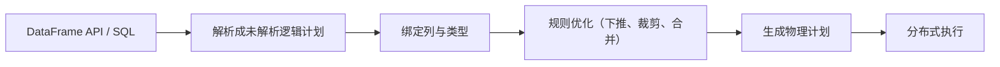

## 前置知识

- 读过 [Spark Core 与 RDD](/bigdata/040-SparkCoreRdd)：知道惰性求值、宽窄依赖与 Shuffle 代价，本文多处直接引用这些概念；
- 读过 [Hive 与数据仓库](/bigdata/030-HiveWarehouseSql)：知道 Hive 表与 Metastore 是什么，本文讲 Spark 如何直接复用它们；
- [SQL 标准与方言总览](/sql/020-OverviewStandard) 若读过更好：窗口函数、子查询这些 SQL 能力会高频出现。

没读过也可以，本文会带上需要的部分：涉及 RDD 与 Hive 的概念处都用一句话重新交代，SQL 部分以示例现场讲解。

## 学习目标

读完本文你将能够：

1. 说清 RDD、DataFrame、Dataset 三代抽象的差别，并解释为什么 DataFrame 成为主流；
2. 解释 Catalyst 优化器做谓词下推与列裁剪的前提是「引擎看得见结构」；
3. 用 DataFrame API 与 spark.sql() 两种方式完成同一分析，理解两者的双生关系；
4. 独立写出分组排名 TopN 的窗口函数解法（比赛高频题）；
5. 说出「内置函数优先于 UDF」的性能理由，以及广播小表如何缓解数据倾斜；
6. 明确 RDD 与 DataFrame 的分工场景，知道何时该退回 RDD。

预计 30 到 45 分钟，含 2 个动手实验与 4 道练习。

## 1. 问题引入：同一个统计，两种写法

任务：统计每个品类每天的成交额。先看 RDD 写法：

```scala
// RDD 视角：亲手把数据变成 K-V 对，再洗牌聚合
val rdd = sc.textFile("hdfs:///raw/orders")
  .map(l => l.split(","))
  .map(a => ((a(2), a(3).substring(0, 10)), a(4).toDouble))
  .reduceByKey(_ + _)
```

再看 SQL 写法：

```sql
SELECT category, dt, SUM(amount) FROM orders GROUP BY category, dt;
```

问题不在代码长短，而在**引擎能看懂什么**。RDD 写法里，引擎只知道「一个函数接一个函数」，函数体是黑盒——它不知道你在过滤、在按什么聚合，因此除了通用的流水线合并，什么都不敢优化：该读哪些列、能提前过滤多少行，引擎一概不知。SQL 写法里，`SUM`、`GROUP BY`、列名全是引擎认识的**语义**。

这就是本文的主线：**给数据加上结构（schema），引擎才第一次真正「看懂」了你要什么，优化才有了着力点**。

## 2. 三代抽象：RDD、DataFrame、Dataset

Spark 的数据抽象演进过三代，差别集中在「结构放不放进类型系统」：

| | RDD | DataFrame | Dataset |
| --- | --- | --- | --- |
| 元素 | 任意对象 | Row（行对象） | 强类型对象 T |
| 结构 | 引擎不可见 | 有 schema，运行时可知 | 有 schema，编译期检查 |
| 优化器 | 基本无法优化 | Catalyst 全力优化 | Catalyst 全力优化 |
| 类型安全 | 运行时 | 运行时 | 编译期 |
| 语言支持 | Scala / Java / Python | 全语言（Python 主力） | 仅 Scala / Java |

Dataset 是「RDD 的类型安全 + DataFrame 的优化」合体：`Dataset[Order]` 里写错字段名，编译期就报错。代价是复杂度与跨语言限制，Python 生态（PySpark）因此以 DataFrame 为主力。比赛与生产的主流选择是 **DataFrame 加 SQL**，本文围绕它展开；Dataset 了解定位即可，细节以官方文档为准。

## 3. Catalyst：看得见结构，才谈得上优化

DataFrame 自带 schema（每列的名字与类型），这让 Spark 的优化器 Catalyst 第一次能读懂用户的意图。Catalyst 的处理流水线：



其中与你性能最相关的两条规则：

**谓词下推（predicate pushdown）**：把过滤条件尽量推到数据读取源头。查询 `WHERE amount > 100` 时，不是把整个文件读进内存再过滤，而是让读取器只读满足条件的行组——配合 Parquet 这类列式存储的行组统计信息（每行组记录最大最小值），大部分行组连打开都不用。

**列裁剪（column pruning）**：只读用到的列。订单表 30 列，你只 select 3 列，就只从盘上读 3 列的存储段，其余 27 列一个字节都不碰。列式存储与列裁剪是一对搭档，扫描量常常直接降一个数量级。

这两条规则合起来意味着一件重要的事：**性能与写法解耦了**。在 RDD 时代，同一个逻辑，先 filter 再 map 与先 map 再 filter 性能可能差很多，快不快取决于你的手艺；在 DataFrame 时代，你只表达「要什么」，执行顺序由优化器决定——它见过的查询比你多得多。RDD 的惰性求值在这里升级成了完整的智能规划，本质一脉相承：**执行得晚，才能规划得好**。

## 4. DataFrame 基本操作与 SQL 双生

DataFrame 的 API 与 SQL 是同一枚硬币的两面。同一个「品类日销售额」：

```scala
val df = spark.read.parquet("hdfs:///dwd/orders")

// 方式一：DataFrame API（链式）
val r1 = df.groupBy("category", "dt")
  .agg(sum("amount").as("total"))

// 方式二：spark.sql()（直接写 SQL）
df.createOrReplaceTempView("orders")
val r2 = spark.sql(
  "SELECT category, dt, SUM(amount) AS total FROM orders GROUP BY category, dt"
)
```

两种写法生成**同一个执行计划**，性能完全相同（可用 `r1.explain()` 与 `r2.explain()` 对比验证）。选择只看口味与场景：简单聚合用 API 更顺，复杂多层嵌套用 SQL 更清晰，比赛里两者混用非常普遍。最常用的操作五件套：`select`（选列与表达式）、`filter`（行筛选）、`groupBy + agg`（分组聚合）、`join`（表连接）、`withColumn`（派生新列）——语法细节可查官方 API 文档，思路与你在 SQL 模块学的完全同构。

## 5. 窗口函数实战：分组 TopN

「每个分组内取前 N」是比赛最高频的题型：每个品类销量前三的商品、每个地区最近三笔交易。普通 `GROUP BY` 只能给每组的聚合值，取不出「组内第几名」的明细行——这正是**窗口函数**的领地：

```sql
SELECT category, product, sales
FROM (
    SELECT category, product, sales,
           ROW_NUMBER() OVER (PARTITION BY category ORDER BY sales DESC) AS rn
    FROM dws_product_daily
    WHERE dt = '2026-10-28'
) t
WHERE rn <= 3;
```

读懂三层结构：`PARTITION BY category` 把数据按品类分成一个个窗口（分组排名的「组」）；`ORDER BY sales DESC` 决定组内名次；`ROW_NUMBER()` 给组内每行编号，外层再筛 `rn <= 3`。三个排名函数的差别一句话：`ROW_NUMBER` 强制唯一名次（1,2,3,4），`RANK` 并列同名次且跳号（1,1,3），`DENSE_RANK` 并列不跳号（1,1,2）——题目说「取前三名商品」还是「取销量前三的行」，决定选哪个。

DataFrame API 版本与上面 SQL 等价：

```scala
import org.apache.spark.sql.expressions.Window

val w = Window.partitionBy("category").orderBy(desc("sales"))
val top3 = dws.withColumn("rn", row_number().over(w)).filter($"rn" <= 3)
```

解题套路固定：**先想清楚「按什么分组、按什么排序、取第几」，窗口函数三要素就齐了**。这个模式在离线分析题型里几乎必考，值得练到肌肉记忆。

## 6. 与 Hive 的关系：Spark on Hive

上一篇说过，Hive 的「表」定义在 Metastore 里，引擎只是翻译官。这个解耦设计给了 Spark 一个天然的切入口：**借 Hive 的元数据，换掉执行引擎**。开启 Hive 支持后，Spark 直接读取 Metastore 里登记的所有 Hive 表，同样的建表与分层，底层执行从 MapReduce（或 Tez）换成 Spark：

```scala
// spark-submit 时带上 --jars（连接 MySQL 的 Metastore 驱动）等依赖
val spark = SparkSession.builder()
  .appName("dws_etl")
  .enableHiveSupport()          // 关键一行：接入 Hive Metastore
  .getOrCreate()

val df = spark.table("dwd.orders")          // 直接查 Hive 表
spark.sql("INSERT OVERWRITE TABLE dws.orders_agg SELECT ...")  // 直接写 Hive 表
```

这就是比赛中常见的「Spark on Hive」组合：**Hive 管表（Metastore 做元数据中心），Spark 管算（引擎与内存计算）**。你在 [Hive 与数据仓库](/bigdata/030-HiveWarehouseSql) 学的分层数仓原样保留，只是每层的 ETL 跑得更快。理解了这一层，你就理解了「Hive 正在退居 SQL 入口与元数据中枢」这句话的具体含义。

## 7. 内置函数优先于 UDF

遇到内置函数不够用的时候（比如自定义的脱敏规则），可以注册 UDF（用户自定义函数）。但有一条性能铁律：**优先在内置函数里找答案**。原因回到第 3 节：内置函数是 Catalyst 认识的语义，能参与下推、裁剪与常量折叠等优化；UDF 对优化器是黑盒，只能整体当一行代码执行，还会打断本可进行的优化。

经验顺序是：先查官方函数列表（`spark.sql` 的 functions 包，几百个函数覆盖字符串、时间、聚合、集合、加密等），确认没有再考虑 UDF；比赛时内置函数组合（如 `regexp_replace`、`date_format`、`coalesce`）几乎总能覆盖清洗需求。

## 8. 调优常识：分区写出、缓存与广播小表

DataFrame 时代大部分调优由 Catalyst 代劳，但仍有三件事需要你亲手做。

**分区并行写出。** 结果表按 `partitionBy("dt")` 写出，数据自动落到对应日期的目录（呼应 Hive 分区），下游按天查询天然裁剪；同时控制每个分区的文件数量与大小，避免上一篇讲过的小文件灾难：

```scala
result.write
  .partitionBy("dt")
  .mode("overwrite")
  .parquet("hdfs:///dws/product_daily")
```

**缓存该缓存的。** 沿用 RDD 的判据：被多个下游反复消费的中间结果才值得 cache（典型是清洗后的明细层），一次性流转的数据不要缓存。AQE（自适应执行，Spark 3 起默认开启）值得一句话记住：它在运行时根据真实统计信息合并过小的分区、自动切换 join 策略，相当于优化器的「现场改方案」，多数情况下保持默认即可，细节以官方文档为准。

**广播小表，缓解倾斜。** 数据倾斜的症状：99% 的任务几分钟跑完，个别任务拖几十分钟（某个 key 的数据量远超其他）。join 时若一侧是小表（几百 MB 内），广播 join 是特效药——把小表整体复制到每个计算节点，大表逐条本地匹配，**整个 join 不发生 Shuffle**，既快又彻底绕开倾斜 key 的拖尾问题：

```scala
import org.apache.spark.sql.functions.broadcast

val joined = big.join(broadcast(small), Seq("product_id"))
```

直觉总结：倾斜的本质是「某些 key 被迫在同一个任务里处理海量数据」，广播小表让数据不用按 key 搬家，倾斜自然消失。更大的数据量下还有加盐拆分等进阶手段，比赛大纲内广播通常够用。

## 9. 与 040 的分工：引擎视角与分析视角

RDD 与 DataFrame 不是新旧替代关系，而是两种视角的分工：

- **RDD 是引擎视角**： partitions、依赖、Shuffle 这些机制层概念在 RDD 上最直白，学它是为了看懂引擎在做什么；
- **DataFrame 是分析视角**：带着 schema 与语义写业务逻辑，优化交给 Catalyst。

日常写分析作业用 DataFrame 与 SQL；只有两类场景需要退回 RDD：一是处理非结构化原始字节流（自定义二进制协议、乱码文本修复），二是需要精细控制分区与分布的底层操作。即使写 RDD，注意保持「可被 DataFrame 包装」的结构意识——两者可以随时无缝互转（`df.rdd` 与 `rdd.toDF()`）。

## 10. 常见困惑

**问：DataFrame 和 JDBC 的 ResultSet、MySQL 的表有什么区别？**

答：三点：**惰性**（定义 DataFrame 不触发计算，action 才执行）、**分布式**（数据在集群分区里，不拉到客户端）、**有血统**（可容错重算）。ResultSet 是「已经取回的单机结果集」，DataFrame 是「还没执行的分布式计划」——所以链式写一大串 DataFrame 操作不会卡，卡在 action。

**问：spark.sql() 和 DataFrame API 到底该用哪个？**

答：同一个执行计划，性能无差。经验法则：向业务方对齐口径时写 SQL（可读、可review），工程代码里做多步管道用 API（类型检查、好重构），比赛里混用最常见。重要的是别把它们当两套体系背两遍——它们是同一计划的两层皮。

**问：group 后想同时取明细和聚合值，为什么直接 select 会报错？**

答：这是 SQL 语义不是 Spark 刁难：分组后每组的明细有多行，聚合值只有一行，两者粒度不同，无法放进同一行输出。正解要么只用聚合值，要么用窗口函数（第 5 节）在明细行上附加聚合或名次信息。

**问：窗口函数和 GROUP BY 长得像，怎么选？**

答：GROUP BY 把组内多行**压成一行**（明细消失）；窗口函数**保留每行明细**、把统计值或名次附加在行上。需要「每行都带排名/累计/同比」的，一律窗口函数。

## 11. 动手实验

**实验一：全流程一把梭（30 分钟）。** 在 spark-shell（本地模式）里完成：读 JSON 格式订单数据，清洗，注册临时视图，用 SQL 算品类日销售额，再用 DataFrame API + 窗口函数取每品类 Top3，最后 `explain()` 查看物理计划里 ColumnPruning 与 PushedFilters 的痕迹：

```scala
val df = spark.read.json("file:///data/orders.json")
df.createOrReplaceTempView("orders")

spark.sql("""
  SELECT category, product, SUM(amount) AS sales
  FROM orders GROUP BY category, product
""").createOrReplaceTempView("sales")

val w = Window.partitionBy("category").orderBy(desc("sales"))
spark.table("sales")
  .withColumn("rn", row_number().over(w))
  .filter($"rn" <= 3)
  .show()

spark.table("sales").explain(true)   // 在输出里找优化证据
```

**实验二：亲眼看一次优化（20 分钟）。** 构造一份 Parquet 订单数据（30 列），分别执行「只查 3 列加过滤」与「查全部列」的聚合，用 `explain(true)` 对比两份物理计划的读取范围；再用 `time` 级别的计时感受列裁剪与谓词下推的差距。这份对比截图，是面试聊 Catalyst 时最有说服力的证据。

## 12. 自检清单

1. 能用「引擎看不懂函数体」解释 RDD 无法深度优化、DataFrame 可以的原因吗？
2. 能说出谓词下推与列裁剪各自省掉哪部分扫描，以及它们为何依赖 schema 与列式存储吗？
3. 能写出分组 TopN 的窗口函数，并说出 ROW_NUMBER、RANK、DENSE_RANK 的取舍吗？
4. 能解释 Spark on Hive 组合中「Hive 管表、Spark 管算」各自的含义吗？
5. 能说出内置函数优先于 UDF 的优化器理由，以及广播小表消除倾斜的直觉吗？
6. 面对一道新题，能判断该用 GROUP BY 还是窗口函数，并说出判据吗？

## 13. 本章总结

从 RDD 到 DataFrame 再到 Dataset，演进的主线是把结构交给引擎：schema 让 Catalyst 看得懂意图，谓词下推与列裁剪把扫描量压下来，性能与写法解耦。DataFrame API 与 spark.sql() 是同一计划的两层皮，按可读性与工程性选用。窗口函数以「分区、排序、取值」三件套解决分组 TopN 这类比赛高频题。Spark on Hive 复用 Metastore 换掉执行引擎，让分层数仓原样提速。调优三常识：分区写出防小文件、缓存只给反复消费的中间结果、广播小表根治 join 倾斜；UDF 是黑盒，内置函数优先。RDD 留给引擎视角与非结构化场景，日常分析以 DataFrame 为主——040 与本文合起来，才是完整的 Spark。

## 14. 下一步

下一篇 [Flink 流处理模型](/bigdata/060-FlinkStreamingModel)：批处理的世界到 Spark 为止已经完整；当数据不再是「昨天的一堆」，而是「此刻的一条」——低延迟、乱序、精确一次这些新问题，就是 Flink 的主场。

## 15. 官方文档

- Spark SQL 编程指南（DataFrame 与函数列表）：https://spark.apache.org/docs/latest/sql-programming-guide.html
- Spark 性能调优（AQE 与广播 join 细节）：https://spark.apache.org/docs/latest/sql-performance-tuning.html
