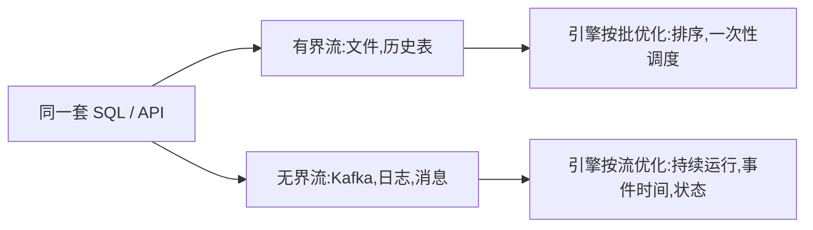
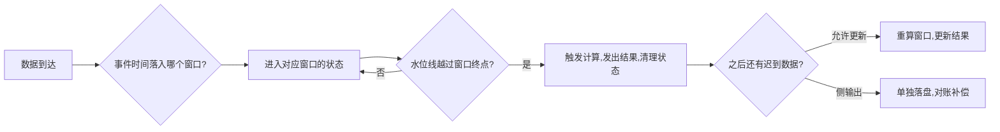
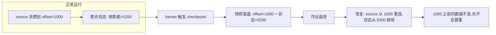

## 前置知识

- 读过 [Spark Core 与 RDD](/bigdata/040-SparkCoreRdd)：知道分布式计算引擎要处理分区、调度与容错，理解 DAG 与 shuffle 的代价；
- 读过 [大数据版图与学习路线](/bigdata/010-BigDataLandscape)：知道 Flink 在实时链路中的位置，以及「批是有界流」这句话的出处。

没读过也可以，本文会带上需要的部分：第 1 节会从「流与批的分野」讲起，不依赖 Spark 的任何细节。

## 学习目标

读完本文你将能够：

1. 解释流处理与批处理在世界观上的差异，并说清「批是有界数据的流」为什么成立；
2. 区分事件时间、处理时间、摄入时间，并判断一个业务需求该用哪一种；
3. 用水位线的心智模型解释「窗口什么时候可以关」以及迟到数据的归宿；
4. 为滚动、滑动、会话三种窗口选对使用场景；
5. 说出 checkpoint 与 barrier 换来精确一次语义的机制，以及恢复时发生什么；
6. 判断一个比赛需求该用 Flink 而不是 Spark，并画出「Kafka 到大屏」的实时链路。

预计 35 到 50 分钟，含 2 个动手实验与 4 道练习。

## 1. 问题引入：一条迟到 8 分钟的订单

想象你在做电商实时大屏：每分钟要显示「过去 5 分钟的销售额」。中午 12:00:59，你在数据库里看到一笔 12:00:01 创建的订单金额 199 元——它因为用户手机断网，8 分钟前就该到达，现在才随重试一起进来。

问题来了：这笔钱该算进哪个窗口？

- 按「数据什么时候到达」算，它属于 12:00 这一分钟；
- 按「订单什么时候发生」算，它属于 11:55 到 12:00 那个窗口。

两种答案都「对」，但业务上只有第二种正确——财务对账、销售排名看的都是「发生时间」。于是流处理的第一座大山出现了：**数据到达的顺序，不等于事件发生的顺序**。网络抖动、分区并行、应用重试都会打乱顺序。整个 Flink 的流处理模型，本质上就是围绕「怎么在乱序的世界里，按事件时间算出正确的结果」展开的。

这也是为什么批处理引擎不能直接拿来干流的活：批处理默认「数据都到齐了才开算」，而流处理永远处于「数据没到齐」的状态——你不知道迟到的数据还有多少、还会不会来。

## 2. 心智模型：一切都是流，批只是有界的那一种

Flink 对世界的切分只有一种东西：**流**。无限流入的数据是流，一个固定文件也是流——只是它「有界」（总有一天读完）。这个统一视角带来一个重要推论：



同一份 SQL 写的聚合，喂给有界数据就是批作业，喂给 Kafka 就是无界流作业——这就是 Flink 宣称「流批统一」的含义。对比另一条技术路线：Spark 的批世界观是「一切都是批，流是微小的批」（微批，micro-batch）。两种世界观各有地盘：

| | 微批（把流切成小批） | 真流（逐条持续处理） |
| --- | --- | --- |
| 延迟 | 受批间隔下限限制（秒级） | 毫秒级 |
| 乱序处理 | 批内排序凑合 | 事件时间 + 水位线一等公民 |
| 状态管理 | 借用批的存储 | 状态是模型的核心概念 |
| 适合 | 准实时报表（分钟级可接受） | 实时告警、实时大屏、CEP |

一句话：**延迟要求到秒以下、或乱序语义重要时，用 Flink；分钟级准实时、想复用批代码时，微批也能活**。

## 3. 时间三兄弟：你说的「几点」是谁的几点

流处理里同时存在三个「时间」，混用它们是实时链路翻车的头号原因：

| 时间 | 定义 | 谁决定 | 例子 |
| --- | --- | --- | --- |
| 事件时间 | 事件**发生**的时刻 | 业务系统打在数据里 | 订单里的 `created_at` |
| 摄入时间 | 数据进入 Flink 的时刻 | 数据源算子 | Kafka source 收到消息的瞬间 |
| 处理时间 | 算子**处理**它的时刻 | 当前机器时钟 | 聚合算子看到它的瞬间 |

理想世界里三者相等。现实中它们可以被任何东西拉开：网络重试（差几分钟）、消费积压（差几小时）、机器时钟漂移（差几秒）。第 1 节那笔迟到订单，就是事件时间与处理时间分道扬镳的现场。

**判断用哪个的规则只有一条：业务结果看的是「发生」，就必须用事件时间。** 财务对账、销量排名、告警归属的窗口，全是事件时间；只有「系统吞吐监控」这类确实关心「现在处理到哪」的指标才用处理时间。摄入时间介于两者之间，实践中很少用——它是历史折中产物，知道即可。

用事件时间意味着：窗口的边界画在时间轴上，与数据到达的快慢完全无关。窗口 `[11:55, 12:00)` 就是 `[11:55, 12:00)`，哪怕 12:00:01 才收到 11:55 的数据，它也该进这个窗口。接下来唯一的问题是：**这个窗口什么时候可以关闭？**

## 4. 水位线：给「等一等」定一个止损点

窗口按事件时间切分，但引擎活在现实时间里——它怎么知道「11:55-12:00 的数据都到齐了」？理论上无法知道：永远可能还有一条迟到 8 分钟的数据在路上。无限等下去，窗口永远关不了，结果永远出不来。

Flink 的答案是**水位线（watermark）**：一条随数据流动的特殊标记，含义是一句承诺——

> 事件时间小于等于 W 的数据，应该都已经到齐了（或者，我不再等了）。

它通常由数据本身推导：比如水位线 = 当前见到的最大事件时间减 5 秒。意思是「我允许乱序最多 5 秒」。推进过程像这样：

```text
事件流到达（括号内是事件时间）:
订单A(12:00:01)  订单B(12:00:03)  订单C(12:00:02)

最大事件时间推进: 12:00:01 -> 12:00:03 -> 12:00:03
水位线(减5秒)推进: 11:59:56 -> 11:59:58 -> 11:59:58

当水位线推进到 12:00:00 时,[11:55,12:00) 窗口触发计算并关闭
```

这张图里有三个要紧的直觉：

1. **水位线是权衡，不是真理**。减 5 秒还是减 5 分钟，是「等更久更准」与「出数更快」之间的业务决策。设置过小，迟到数据多；设置过大，结果延迟高。没有万能参数，只有场景适配。
2. **水位线按分区独立生成再对齐**。Kafka 有 12 个分区，Flink 在每个分区上各自追踪最大事件时间，取最小值作为整体水位线——最慢的分区决定全局进度。一个「卡死」的分区会把所有窗口拖住，这是实时链路最常见的故障之一。
3. **水位线之后来的数据不会消失**。窗口已关，迟到数据有两个去处：更新已发出的结果（允许更新）或丢进**侧输出流**（side output）单独落盘对账。第 6 节的精确一次语义保证的是「不丢不重」，保证不了「不迟」——迟到是物理现实，只能给它安排归宿。

**动手实验一**：不用搭 Flink 集群，用任意流式数据（或手写一个每秒打印当前时间的循环）模拟「水位线 = 最大事件时间减 5 秒」的推进逻辑，在纸上或脚本里记录：窗口何时触发、一笔迟到 8 秒的数据落在哪。做完你会发现，水位线的全部行为从定义就能推出来。

## 5. 窗口：把无限流切成可计算的块

无限流没法一次算完，聚合必须有边界——窗口就是给流画边界的三种方式：

| 窗口 | 切法 | 适合 | 例子 |
| --- | --- | --- | --- |
| 滚动窗口 | 首尾相接、不重不叠 | 周期性报表 | 每 5 分钟销售额 |
| 滑动窗口 | 有重叠、滑动步长小于窗口长 | 移动平均、趋势 | 最近 1 小时、每 1 分钟更新一次 |
| 会话窗口 | 按活动间隙动态切分 | 用户行为会话 | 用户 30 分钟无操作算一次会话结束 |

选型的心智模型：**报表看滚动，趋势看滑动，人的行为看会话**。滚动窗口是「日历思维」（每个 5 分钟一份答案）；滑动窗口是「回想最近一段」（窗口长 = 回看多久，步长 = 多久刷新一次，两者独立设置）；会话窗口最特殊——边界由数据自己决定（活动持续就延长，静默超时就切断），窗口数量事先未知。

窗口与水位线配合的完整生命周期：



注意最后两个分支——「结果发出」不等于「故事结束」。实时链路的完整性设计，一半功夫花在迟到数据的兜底上：允许更新的结果要让下游能覆盖旧值（比如按主键 upsert 写 ClickHouse），侧输出流要有人消费和监控。比赛答辩时能讲清「迟到你怎么办」，比多堆两个算子加分得多。

## 6. Checkpoint：在无限流上做容错

批作业失败了重跑就行——数据在，逻辑幂等。流作业 7×24 小时跑，中途挂了怎么办？从头重算 3 天的数据？下游早已消费了 3 天的结果，重算会**重复**；跳过挂掉的部分会**丢失**。无限流上的容错，要同时回答「恢复到哪」和「重复了怎么办」。

Flink 的答案是 **checkpoint**：周期性地给整个作业的进度拍快照。机制核心是 **barrier（屏障）**：

1. 作业定期从数据源注入特殊标记 barrier，随数据流向下游流动；
2. barrier 经过每个算子时，该算子把自己的**状态**（窗口里的聚合值、计数器等）写入持久存储（如 HDFS、S3）；
3. 一个 barrier 流完全部算子，这次快照完成——系统记录「此刻每个分区的消费位点 + 全部算子状态」。



恢复的语义叫**精确一次（exactly-once）**：崩溃前后的总效果，与「一次都没挂」完全一样。这里有个容易误解的点——精确一次不是「每条数据恰好被处理一次」，而是「处理的效果恰好体现在最终结果一次」。source 重放的数据确实被算子处理了两次，但状态恢复 + 输出去重的组合，让结果层面看不出任何痕迹。

要让「结果层面看不出痕迹」，输出端的配合不可少：sink 到 Kafka 用两阶段提交（checkpoint 完成时才把预写的事务标记为可见）；sink 到 ClickHouse 这类不支持事务的存储，则靠幂等写（按主键 upsert）兜底。所以选实时链路组件时，**「引擎支持精确一次 + sink 端能配合」缺一不可**——这也是第 7 节选 Kafka 做管道、第 120 篇选幂等写 ClickHouse 的原因。

代价也要诚实地说：checkpoint 有间隔（比如 30 秒一次），barrier 对齐时算子要短暂「憋住」数据，大状态作业的快照写入会挤占 IO。checkpoint 失败告警是 Flink 运维的第一大告警来源，比赛环境里把它配到 1 分钟间隔、状态用 RocksDB，通常就够稳。

## 7. 状态：流作业的记忆

前面的窗口聚合其实一直在偷偷使用一个概念——**状态**：窗口里累积的中间值、去重用的集合、上一次的对比基线。有状态的流处理与「无状态的转发」是两个时代：无状态时挂了就丢了，有状态时挂了靠第 6 节的 checkpoint 恢复。

Flink 的状态按「键」组织：**keyed state** 挂在 keyBy 之后的每个 key 上（每个用户一份、每个窗口一份），这是绝大多数业务的形态。状态存在**状态后端**里：小状态放内存（快），大状态放 RocksDB（可到 TB 级，读写走磁盘）。还有一个容易被忽略的死线：**状态的生命周期**——不给状态设 TTL（存活时间），一个「统计所有见过的用户」的作业会让状态无限膨胀，最终把 checkpoint 拖垮。任何 keyed state 都该问一句：这个 key 的数据多久之后可以忘掉？

状态、checkpoint、水位线三者合起来，才是 Flink 流处理模型的完整心智图：**状态是记忆，checkpoint 是记忆的存档，水位线是时间轴上的进度条**。三者任何一个出问题，实时链路都会以「结果不对」的形式报障——排查顺序通常是：先看水位线是否卡住（数据不动），再看 checkpoint 是否失败（重启后状态错），最后看状态是否泄漏（越跑越慢）。

## 8. 动手起步与场景映射

**动手实验二**：本地体验完整流处理循环。用 Docker 起 Kafka 与 Flink（镜像 `flink:2.x` 与 `bitnami/kafka` 均可，参数以官方文档为准），写一个约 30 行的 Flink 作业：从 Kafka 读字符串，按事件时间开 1 分钟滚动窗口计数，打印结果并写回另一个 topic。亲手制造一次乱序（先发 12:00:03 再发 12:00:01），观察水位线与窗口的互动；再 `kill` 掉 JobManager 重启，验证 checkpoint 后计数没有重复。这两次观察比读十篇博客都扎实。

回到第 1 节的大屏需求，现在可以完整回答了：窗口用**事件时间**切；水位线允许 5 秒乱序；迟到的订单**更新已发出的结果**（ClickHouse 按 key 覆盖）；作业挂了靠 checkpoint 恢复，**结果不丢不重**。四个环节正好对应本文的四节正文——这不是巧合，而是所有实时链路的地基：

| 场景 | 时间语义 | 窗口 | 迟到策略 | 精确一次要求 |
| --- | --- | --- | --- | --- |
| 实时销售大屏 | 事件时间 | 滚动 1 分钟 | 更新结果 | 必须（金额不能重） |
| 实时告警 | 事件时间 | 滑动 | 侧输出补偿 | 高（漏报误报都伤） |
| 实时 ETL 入仓 | 事件时间 | 会话/无窗口 | 幂等 upsert | 必须 |

## 9. 常见困惑

**Q：水位线设 5 秒，结果还是错了几笔，为什么？**
A：水位线是「承诺不再等」，不是「保证都到了」。允许 5 秒乱序，就必然有超过 5 秒的迟到数据。它错不了「已经发出的结果会被正确更新」（如果你配了允许迟到）或「迟到数据被侧输出接住」（如果你配了侧输出）——错的是既没配更新又没配兜底还指望全对的期望。

**Q：Flink SQL 能完全替代 DataStream API 吗？**
A：常规 ETL、窗口聚合、join，SQL 覆盖率很高，比赛里大多数需求 Flink SQL 就够；但复杂的状态操作、自定义水位线、CEP 模式匹配仍要 DataStream。心智上把 SQL 当「第一选择、遇到墙再降级」，而不是两个平行世界。

**Q：为什么不用 Spark Structured Streaming 就好，反正也是「流批统一」？**
A：第 2 节的对照表就是答案：分钟级准实时、想与离线批共享代码，微批完全够用；毫秒级延迟、重乱序语义、状态密集的作业，真流引擎是刚需。两个引擎在 2026 年都活得好好的，选型看延迟要求与团队技术栈，不看哪个「更先进」。

## 10. 自检清单

1. 给你一条「用户下单后 10 分钟未支付则发提醒」的需求，你用哪种时间语义、哪种窗口？（提示：事件时间 + 会话或定时器，想想为什么滚动窗口不合适。）
2. 水位线卡住不动，第一步排查什么？（提示：按分区取最小值——哪个分区没数据了？）
3. checkpoint 恢复后，为什么结果不会重复？说清「重放」与「效果恰好一次」的区别。
4. 一个作业「越跑越慢、checkpoint 越来越大」，最可能漏配了什么？
5. 你的 sink 是 Redis（无事务），怎样配合才配得上精确一次？

下一步把 Kafka 这条「进水管」接上：[Kafka 与数据采集管道](/bigdata/070-KafkaPipeline)讲清数据从哪来、怎么不丢；或直接进入[综合实战](/bigdata/120-CapstoneOfflineRealtime)，把本文的窗口与水位线装进一条完整链路。
