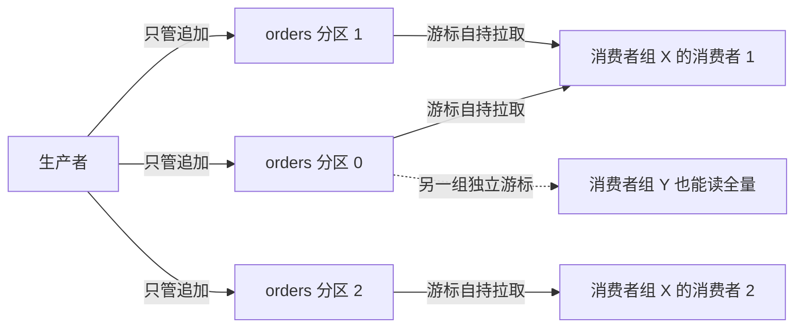
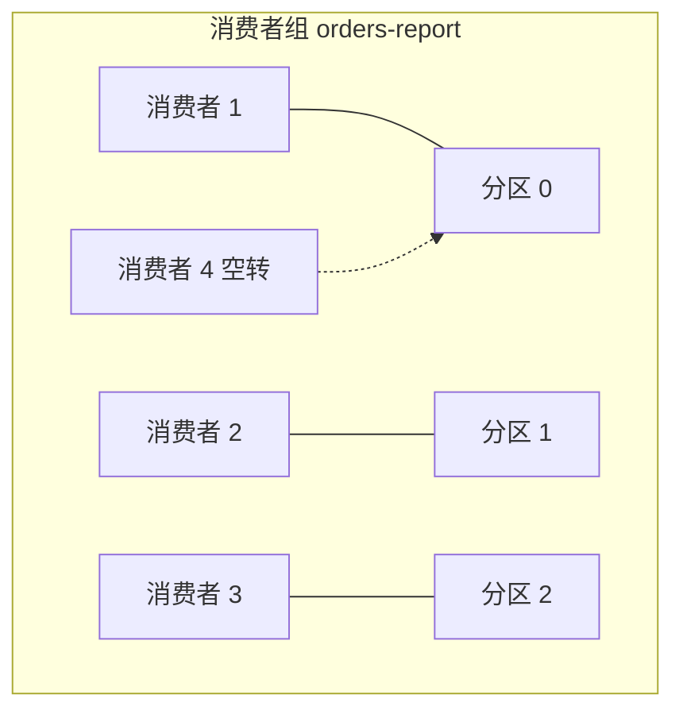

## 前置知识

- 读过 [大数据全景](/bigdata/010-BigDataLandscape)：知道实时链路里 Kafka 通常画在「采集」与「计算」之间，对 Flink、Spark 有一句话级的印象；
- 用过任意一种消息队列，或者至少写过「一个线程往队列里放、另一个线程往外取」的练习，知道队列解耦是什么意思。

没读过也可以，本文会带上需要的部分：全景图 10 分钟可补齐，消息队列的经验一句类比就够。

## 学习目标

读完本文你将能够：

1. 用「提交日志」解释 Kafka 与传统消息队列的本质差异，并说清游标、保留期两个关键词；
2. 画出分区与消费者组的关系图，并据此判断一个作业该建多少分区、能开多少消费者；
3. 解释 Kafka 作为数据管道中枢的三个理由：解耦、削峰、可重放；
4. 说清 Kafka 4.x 的 KRaft 架构取代 ZooKeeper 的原因，以及 2026 年采集端 Flume、Maxwell、Flink CDC 各自的位面；
5. 面对一条「MySQL 业务库 → Kafka → 实时计算」链路，能指出消息在哪个环节可能丢、可能重，并给出 acks 与幂等生产者的取舍。

预计 40 到 55 分钟，含 2 个动手实验与 4 道练习。

## 1. 问题引入：为什么每张大数据架构图的中间都是 Kafka

去看任何一个大数据项目的架构图——比赛方案、公司分享、开源项目 README——你会反复看到同一个名字：Kafka 几乎永远画在中间，左边是各种数据源，右边是各种计算引擎。

为什么偏偏是它？先把场景摆出来。假设你在做一个电商的订单分析项目：

- 业务库是 MySQL，每秒几百笔订单写入；
- 下游有三种消费方：Flink 做实时大屏、Spark 做离线日报、还有一个审计程序检查异常订单；
- 大促的时候流量是平时的 50 倍，下游引擎如果直连 MySQL，第一件事就是把它压垮。

如果让三种消费方各自直连 MySQL，你会得到三个问题：数据库连接被瓜分殆尽；任何一边出故障都会拖累其他边；任何一边想「把昨天的数据重新算一遍」都得去库里反复捞。Kafka 在中间的职责，就是同时解决这三个问题——但在讲它怎么解决之前，得先建立一个正确的心智模型，因为 Kafka 最容易被「消息队列」这个词带偏。

## 2. 心智模型：Kafka 是一个分布式的提交日志

很多人对消息队列的印象来自 RabbitMQ 这类系统：消息被取走一条就少一条，取完了就没了。Kafka 的模型完全不同，把它想成一本书比想成一个队列更准确。

**Kafka 的每个主题（topic）本质是一份只追加的日志（commit log）**，这三个词各有一层含义：

- **只追加（append-only）**：生产者只能在末尾追加新消息，不能修改、不能插队。这是 Kafka 写入极快的根本原因——磁盘顺序写几乎是最快的持久化操作之一；
- **日志（log）**：消息写进去之后待在原地，按时间或大小设置保留期（比如保留 7 天），到期才被后台清理；
- **分布式**：一个主题被横向切成多个分区（partition），分布在多台机器上，每一份都是一个独立的追加日志。

消费者怎么读这份日志？不是「取走」，而是**自带一个游标（offset，位移）去拉取**。游标指向「我读到第几条了」，读完往回汇报。不同的消费者各有各的游标，互不干扰；同一个消费者想重读，把游标拨回去就行。

| | 传统消息队列的印象 | Kafka 的提交日志模型 |
| --- | --- | --- |
| 消费行为 | 取走即删 | 原地保留，消费者自持游标拉取 |
| 消息生命周期 | 被消费即消失 | 与消费无关，按保留期过期 |
| 多个消费方 | 各自分到不同的消息 | 各自独立游标，都能读到全量 |
| 重读历史 | 通常做不到 | 把游标拨回任意位置 |

「消息不删、消费不删」这两点颠覆直觉，却是 Kafka 一切能力的来源——第 4 节的可重放、削峰，全都建立在它上面。

## 3. 分区与消费者组：并行度的来源

分区不只是存储切分，它同时是 Kafka 并行度的度量衡。规则只有一句话：**在一个消费者组内，一个分区同一时刻只被一个消费者消费**。

由此推出三条工程结论：

1. **消费并行度的上限就是分区数**。一个组里 3 个分区最多 3 个消费者同时干活；你开第 4 个消费者，它只会空转等待；
2. **分区是昂贵的资源**。分区数越多，服务端要维护的文件句柄、副本同步越多，并不是越多越好，按「目标并行度」来定；
3. **同一分区内的消息是有序的，分区之间不保证顺序**。需要顺序的领域事件（比如同一笔订单的创建、支付、退款），要用相同的 key 发送——Kafka 默认按 key 的哈希值决定分区，同一 key 永远进同一分区。

判断题：主题 6 个分区，消费者组里开了 8 个消费者，实际并行度是多少？答案是 6——多出的 2 个在分配上闲置。这类题在比赛答辩里很常见，考的就是这条规则的推导，不是背答案。

## 4. 为什么数据管道中枢：解耦、削峰、可重放

有了「提交日志 + 游标」的模型，第 1 节的三个问题都可以推导出答案：

**解耦**。生产者只管往日志里追加，它不知道也不关心谁在读。Flink 来了读一份，Spark 来了读一份，明天再加一个新业务，不用改生产者一行代码——因为日志原地保留，每个消费方用自己的游标独立拉取。对比直连数据库：每多一个消费方就多一份连接压力与查询代码。

**削峰**。大促流量 50 倍的时候，下游 Flink 的处理能力撑死是 5 倍。消息先追加进 Kafka 落盘，下游按自己的速度拉，积压的部分躺在日志里排队。只要「高峰期积压 + 平峰期速度」能在保留期内消化完，系统就是稳的——保留期在这里变成了一个天然的缓冲区。直连数据库的架构里，这 50 倍流量会原样砸到下游头上。

**可重放**。这是比赛里最实用的一条。假设 Flink 的聚合逻辑昨晚上线时有个 bug，算错了昨天的销售额——怎么办？把逻辑修好，把消费者组游标拨回昨天零点，从头再消费一遍。数据还在日志里躺着，根本不用去找上游重新导数据。直连数据库想重算，只能写补偿脚本反复捞表。

一句话总结这一节：**Kafka 把「数据的产生」和「数据的消费」在时间上和系统上都解开了**。这也是为什么架构图里它永远在中间。

## 5. KRaft 架构：2026 年的事实标准已无 ZooKeeper

如果你在网上搜 Kafka 教程，大概率会看到大量 ZooKeeper 相关内容——注册 broker、选主、存元数据。这套说法在 2026 年已经过时：**Kafka 4.x 彻底移除了 ZooKeeper，纯 KRaft（Kafka Raft）架构是事实标准**。

为什么当年要 ZooKeeper，后来又为什么去掉？简单捋一遍：

- 早期 Kafka 自己不管理集群元数据（哪些 broker 活着、谁是分区主副本、配置是什么），这些「集群状态」的活外包给了 ZooKeeper。好处是少写很多分布式协调代码，坏处是多运维一套系统；
- 双系统的问题随着规模放大暴露：元数据同步链路长、故障恢复慢；ZooKeeper 的内存模型能承载的分区数量有上限（百万级分区就要拆集群）；同一份元数据两处存储，迁移与一致性都麻烦；
- 于是 Kafka 把 ZooKeeper 的职责收编进来：**元数据由 controller 集群管理，controller 之间用 Raft 协议选主与同步**，这套内建机制就叫 KRaft。集群从「Kafka + ZooKeeper 两个系统」变成「一个 Kafka 系统」。

对你的影响是两条：第一，看老教程见到 ZooKeeper 相关配置与命令时，知道那是历史包袱，直接查当前版本的官方文档；第二，理解「controller 集群管理元数据」这个分工即可，细节面试都不常深入。

## 6. 采集端选型：Flume、Maxwell 与 Flink CDC 各自的位面

数据不会自己走进 Kafka，得有人把业务库、日志文件里的数据搬进去。2026 年采集端的主流选项有三个，位面各不相同：

| 工具 | 采集什么 | 工作方式 | 2026 年的现状 |
| --- | --- | --- | --- |
| Flume | 服务器日志文件 | agent 进程：source 读文件、channel 缓存、sink 写 Kafka | 仍能用，但在逐渐边缘化，新项目少选 |
| Maxwell | MySQL 增量变更 | 伪装成 MySQL 从库，解析 binlog，把每行变更转成 JSON 写出 | MySQL 采集的主流方案之一，轻量易部署 |
| Flink CDC | MySQL 等多种数据源 | 直接作为 Flink 作业的数据源，把变更捕获嵌进实时计算 | 2026 年的主流趋势，少一跳中转 |

理解 Maxwell 和 Flink CDC 的关键是一个数据库机制：**binlog**。MySQL 会把每一行数据的变更（增、删、改）按顺序记进二进制日志，本意是给主从复制用的。采集工具做的事就是订阅这份日志——不查库、不给业务库加明显负担，却能拿到完整、有序的行级变更流。这也是为什么它比「定时轮询表」的方案高一个位面：轮询有延迟且容易漏删改，binlog 一条不落。

选型口诀：只想把 MySQL 变更搬进 Kafka、让多个下游各自消费，Maxwell 简单够用；如果实时计算已经确定用 Flink，Flink CDC 把「采集」和「计算」合成一个作业，少维护一个中间件，是大屏类比赛项目的常见选择。Flume 留个印象即可，遇到「采集服务器日志文件」的老需求能认出来就行。

## 7. 与 Flink 与 Spark 对接：精确一次的直觉

Kafka 与计算引擎的对接，成败在「精确一次」（exactly-once）这四个字上。先把难点摆出来：一条消息从 Kafka 读出、计算、写入结果存储，中间任何一步崩溃重启，都可能让这条消息被算两次（重放导致重复）或没算（没来得及处理就崩了）。

Kafka 自己提供了一半的答案：**游标是可以「提交」的**——消费者告诉集群「我已处理到位置 X」，重启后从 X 继续。但「提交游标」和「保存计算结果」是两个动作，分开做就有不一致的窗口。

Flink 的方案是把两个动作绑成一个：**checkpoint**。Flink 周期性地把「每个 Kafka 分区的游标位置 + 算子状态」快照到一起，结果写入用两阶段提交——快照成功才算正式提交，快照失败就整体回滚。这样崩溃恢复后，游标和结果永远是同一个时刻的一致状态。Kafka 的 KafkaSink 连接器内建了这套事务写，Spark 的 Structured Streaming 也有对应机制（checkpoint 目录 + 幂等写）。

这一节你只需要带走一个直觉：**精确一次不是 Kafka 单方面给的，而是「Kafka 的可重放游标」+「计算引擎的 checkpoint」两端配合出来的**。机制细节在 [Flink 流处理模型](/bigdata/060-FlinkStreamingModel) 展开。

## 8. 消息可靠性：acks、幂等生产者与重试的取舍

生产者往 Kafka 写消息时，有哪些可靠性档位？核心是三个参数的取舍：

**acks（确认级别）**——生产者等 broker 多少个确认才算写入成功：

| acks | 含义 | 代价与风险 |
| --- | --- | --- |
| 0 | 发出去就算成功，不等确认 | 最快，但网络抖动或 broker 宕机会丢消息 |
| 1 | 等主副本写入确认 | 折中；主副本确认后立刻宕机且未同步，可能丢 |
| all | 等所有同步副本确认 | 最可靠，延迟最高；同步副本太少时形同虚设 |

**幂等生产者（enable.idempotence=true）**——解决「重试导致重复」的问题。生产者发消息后没等到确认会重试，但 broker 可能其实已经收到了：这条消息就会被写两遍。幂等生产者给每条消息带上生产者编号与序列号，broker 发现「这个序列号我记过」就自动去重。这个开关几乎零成本，2026 年的新代码没有理由不开。

**retries（重试次数）**——失败后重试的次数上限。配合幂等开关，放心调大；没有幂等时，重试越多重复风险越大。

推导一条决策链：实时大屏丢一条订单数据无所谓？那就 acks=1 足够；这是对账要用的数据？acks=all 加幂等，用延迟换正确性。**没有放之四海的配置，只有和业务后果匹配的配置**——这句话本身就是答辩加分项。

## 9. 与 devops 模块 380 篇的分工

本文与 [Kafka 快速上手](/devops/380-KafkaQuickStart) 讲同一个系统，但分工明确：

- 那篇回答「怎么跑起来」：安装部署、命令行创建主题、收发消息、常见运维操作，是动手上手的入口；
- 本篇回答「它在数据管道里扮演什么角色、数据语义是什么」：提交日志模型、分区与并行的映射、保留期与重放的语义、与计算引擎对接时的一致性。

两篇的阅读顺序建议：先在那篇把环境跑起来、亲手发一条消息，再回本篇建立模型，最后到 [综合实战](/bigdata/120-CapstoneOfflineRealtime) 把 Kafka 装进完整链路里。

## 10. 常见困惑

**问：消息不删，磁盘不会爆吗？**

按保留期或大小过期清理，典型配置是保留 7 天。Kafka 的日志按段（segment）文件组织，清理是整段删除，代价很低。真正要算的是「高峰积压量 + 平峰流量在保留期内的总量」是否会超过磁盘预算，部署前估算一次即可。

**问：消费者崩了，游标会丢吗？**

游标由消费者定期提交到 Kafka 内部主题（`__consumer_offsets`）持久化。但注意提交时机与处理结果要对齐：自动提交可能在「消息还没处理完」时就提交了，崩溃后会丢一段数据；要求严格的场景用处理完再手动提交的姿势，代价是崩溃后可能重复处理——交给第 7 节的 checkpoint 机制兜底。

**问：分区是不是越多越好？**

不是。并行度上限、吞吐需求定了之后，分区数留出余量即可。几千个分区就会给服务端带来可感知的元数据与文件句柄压力。新主题从「预期消费者并行度的 2 到 3 倍」起步，不够再扩，是常见做法。

**问：开了幂等生产者，整条链路就是精确一次了吗？**

不是。幂等只保证「生产者到 Kafka」这一段不重复；「Kafka 到下游计算」的精确一次要靠下游引擎的 checkpoint 与事务或幂等写。三段各有各的机制，别把一端的保证当成全链路的保证。

## 11. 动手实验

实验一（10 分钟，环境用 [Kafka 快速上手](/devops/380-KafkaQuickStart) 里装好的）：创建一个 3 分区主题，先起一个消费者（同组）观察它分到 3 个分区；再起第二个、第三个，观察分区被逐步分走；起第 4 个，观察它空转。对应第 3 节规则，先预测再验证。

实验二（10 分钟）：用控制台生产者向主题写入 10 条带编号的消息，消费一遍后，用重置游标的命令把该组位移拨回最早，再消费一遍——你会原样再读到 10 条。这就是第 4 节「可重放」的最小体验，试着用自己的话说出它替代了直连数据库架构里的哪个操作。

## 12. 自检清单

1. 能不看资料说出「提交日志」模型与传统消息队列的三点差异；
2. 能画出分区与消费者组的关系图，并回答「6 分区 8 消费者，实际并行度多少」；
3. 能用解耦、削峰、可重放各讲一个具体场景，并说清每个场景依赖模型的哪个特性；
4. 能说出 Kafka 4.x 的元数据由谁管理、ZooKeeper 为什么被移除；
5. 能对比 Flume、Maxwell、Flink CDC 的位面，并为自己项目的「MySQL 业务库 → Kafka」链路选型并说出理由；
6. 能解释 acks=all 与幂等生产者各自挡住了哪种故障，以及精确一次为什么需要计算引擎配合。

## 官方文档

- Kafka 官方文档（KRaft 配置与各版本语义以此为准）：https://kafka.apache.org/documentation/
- Flink 与 Kafka 连接器（checkpoint 联动的精确一次语义）：https://nightlies.apache.org/flink/flink-docs-stable/

## 本章总结

Kafka 是分布式提交日志：生产者只管追加，消费者自持游标拉取，消息按保留期过期而非消费即删。分区数决定消费并行度上限，组内一个分区同一时刻只属于一个消费者；同 key 同分区换来了必要的顺序保证。解耦、削峰、可重放三大能力全部从「日志不删 + 游标自持」推导而来。2026 年 Kafka 4.x 纯 KRaft 架构、无 ZooKeeper；采集端 Maxwell 与 Flink CDC 借 binlog 成为主流，Flume 边缘化；精确一次靠 Kafka 游标与计算引擎 checkpoint 的两端配合；可靠性配置没有标准答案，只有与业务后果的匹配。

## 下一步

进入 [综合实战：离线 + 实时一体化数仓小项目](/bigdata/120-CapstoneOfflineRealtime)，把本文的 Kafka 放进完整链路；或先读 [Flink 流处理模型](/bigdata/060-FlinkStreamingModel)，把第 7 节的 checkpoint 直觉展开成机制。
