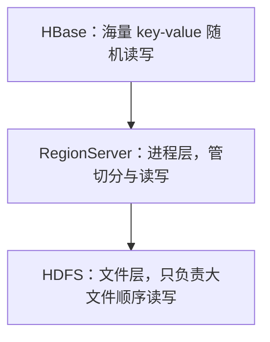
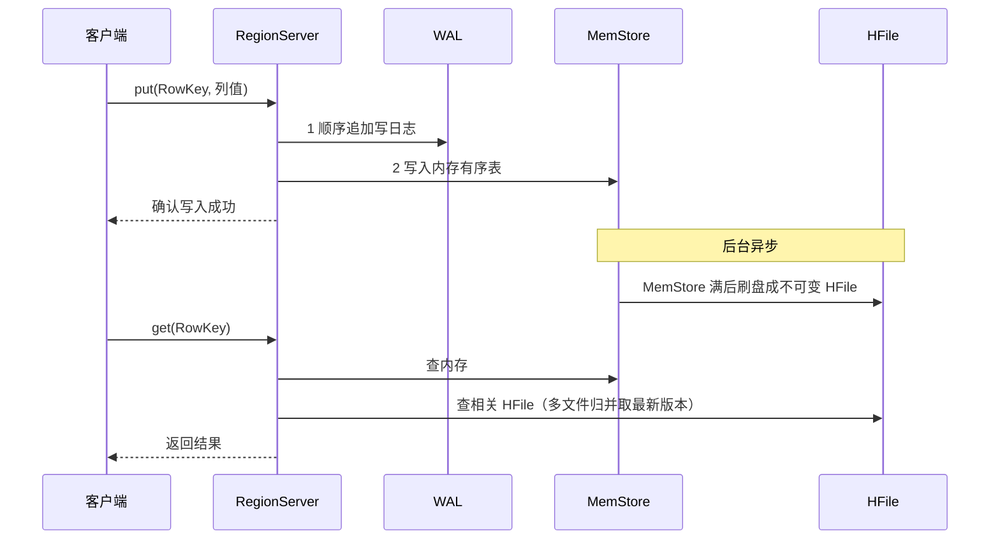

## 前置知识

- 读过 [Hadoop 与 HDFS、MapReduce](/bigdata/020-HadoopHdfsMapReduce)：知道 HDFS 的定位是「大文件顺序读写、不支持随机修改」，这是本文问题引入的一半；
- 会用 MySQL：知道主键索引、B+ 树的大致形状，理解「按主键查一行很快」，这是对照的另一边。

没读过也可以，本文会带上需要的部分：HDFS 那条只需要一句话结论，第 1 节会重新讲一遍。

## 学习目标

读完本文你将能够：

1. 说出 HBase 补的是哪一块能力空白，并画出它在 HDFS 之上的分层位置；
2. 画出 LSM 树的写路径（WAL、MemStore、HFile），并据此解释「写快读慢」的根因与读放大；
3. 面对一个新业务，能设计 RowKey 并预判热点问题，给出加盐、反转、哈希的选择及理由；
4. 解释列族的物理含义，说出「少列族、宽表」的理由；
5. 列出 HBase 与关系库的五条模型反差，并判断一个场景该上 HBase 还是 ClickHouse 或 Redis。

预计 45 到 60 分钟，含 1 个动手实验与 4 道练习。

## 1. 问题引入：一个两头堵的存储难题

先看你会面对的真实需求。做一个用户画像系统：十亿用户的标签表，每个用户几百个标签，两种访问模式都要——

- 随机取：用户打开 App，毫秒级取出这一个用户的全部标签，每天几亿次；
- 随机写：用户的行为实时改变标签值，同样是每天几亿次。

手头的两件武器恰好都不行：

**HDFS 不行**。HDFS 的强项是大文件顺序扫（这正是 MapReduce 能扫全量数据的基础），但它不支持随机修改文件中间的某一条记录，更没有「按 key 取一条」的索引。十亿行画像放进去，取一行等于扫一遍。

**MySQL 不行**。MySQL 的 B+ 树索引随机读写很擅长，但十亿行、单行几百列的表会让索引和缓冲池全面吃紧；单机的写入上限（每秒万级）离「几亿次随机写」差着量级；就算堆主从架构，写的瓶颈依然在主库。

HBase 补的就是这个空白：**在 HDFS 这个只能顺序扫的底座上，提供十亿行级别的 key-value 随机读写**。听起来矛盾——底座明明只会顺序读写，怎么长出随机能力？答案是 LSM 树加分布式切分，下面两节拆开。



## 2. 心智模型：一张按 RowKey 排好序的巨型键值表

把 HBase 的一张表想象成一本**按 key 排好序、印在活页夹上的巨型字典**：

- 每一行有一个 RowKey（行键），全表按 RowKey 的**字典序**排列；
- 活页夹是可以拆的：表按 RowKey 的范围横切成多个 **Region**（区间），比如 RowKey 以 a 到 f 开头的归 Region 1，g 到 m 的归 Region 2……
- 每个 Region 由一台 **RegionServer** 负责读写，Region 数据最终落在 HDFS 文件里（沾了 HDFS 副本容错的光）。

这个模型直接推出 HBase 的核心能力与边界：

- 单行随机读写快不快，取决于「能不能一步定位到 Region」——这是设计出来的能力，下两节讲；
- 范围扫描快：RowKey 相邻的数据物理上就在同一个 Region、同一批文件里，顺序读即可；
- 没有除 RowKey 之外的索引：想按其他列找行，只能全表扫——这是边界，第 6 节讲补法。

## 3. LSM 树：写快读慢的根因

先回答第 1 节留下的矛盾：HDFS 文件不可随机修改，HBase 怎么做到随机写？答案是**不修改，只追加**。这套机制叫 LSM 树（Log-Structured Merge Tree，日志结构合并树），写路径分四步：

1. **写 WAL**：变更先顺序追加到 WAL（Write-Ahead Log，预写日志）并落盘——这一步保证崩溃不丢数据；
2. **进 MemStore**：变更写入内存里的 MemStore（按 RowKey 有序的内存结构），随后即可向客户端确认写入成功。到这里「写」就完成了，代价只是两次顺序写加一次内存操作，这就是 HBase 写入快的根因；
3. **刷盘成 HFile**：MemStore 涨到阈值，整体刷成 HDFS 上一个 **HFile 文件**。文件一旦生成不可修改——数据更新不是「改旧文件」，而是「新文件里有一条更新的版本」，删除也只是记一个墓碑标记；
4. **后台 Compaction**：小文件越攒越多，后台线程把它们合并成大文件，顺手丢掉被墓碑覆盖的数据和过期版本。


代价藏在读的一侧。读一条数据时，它可能同时存在于 MemStore、多个 HFile（旧版本在老文件、新版本在新文件）里，HBase 要**把所有可能的位置都查一遍，再按版本归并出最新值**——一个 Region 的 HFile 攒了 20 个，一次读理论上就要查 20 个文件。这就是「写快读慢」的根因，术语叫**读放大**（一次逻辑读放大成多次物理读）。

与 MySQL 的 B+ 树对照着看，两种流派的取舍就清楚了：

| | B+ 树（MySQL） | LSM 树（HBase） |
| --- | --- | --- |
| 更新方式 | 原地修改页，写放大在磁盘随机写 | 只追加新版本，写永远是顺序的 |
| 读取 | 树高通常 3 到 4 层，路径稳定 | 可能要归并多个文件，读放大 |
| 适合 | 读多写少、要求读延迟稳定 | 写吞吐极大、读能容忍波动 |

Compaction 就是两边的调节阀：合并得勤，文件少、读快，但占用写带宽（写放大转移到后台）；合并得懒，读放大加剧。这套「写放大换读放大」的权衡是 LSM 家族（HBase、RocksDB、LevelDB）的通识。

## 4. RowKey 设计是 HBase 应用的第一课

模型讲完，转到实务。HBase 应用水平的分水岭不在 API，在 **RowKey 设计**——因为它同时决定三件事：查询能力（只有按 RowKey 前缀查才是高效的）、数据分布（Region 按字典序切分）、读写压力分布。

先看反面教材。订单表如果用「时间戳 + 订单号」做 RowKey（这是最直觉的设计），会发生什么？新订单的时间戳永远单调递增，字典序永远排在全表最后——**所有写入全部落在最后一个 Region 上**，其余 Region 空闲围观。这个 Region 所在的机器 CPU、磁盘、网络被打满，其他机器干瞪眼，术语叫**热点**（hotspotting）。分区切分完全失效，等于花钱买了一堆服务器只用一台。

三种主流的散列策略，各有适用面：

| 策略 | 做法 | 效果 | 代价 |
| --- | --- | --- | --- |
| 加盐（salting） | RowKey 前面拼一个随机前缀，如 `2_timestamp_id` | 写入均匀散到各 Region | 前缀打散了字典序，范围扫描要在所有前缀上各扫一遍 |
| 反转（reverse） | 把手机号这类定长 key 反转存储 | 尾部变化大的字段提到开头，天然散开 | 原始顺序语义丢失，取回后要还原 |
| 哈希（hash） | 对业务 key 取 MD5 前几位做前缀 | 散列均匀，定位简单 | 完全失去范围扫描能力，只能点查 |

选择的原则只有一句：**先写清查询模式，再定 RowKey**。比如画像系统是「按用户 ID 点查全部标签」，查询模式就是点查，用哈希前缀最省心；如果还要「按注册日期范围扫用户」，就得保留时间语义，改用「哈希前缀 + 日期 + 用户 ID」的拼接，把散列和范围各照顾一半。

再往下深一层：Region 切分发生在字典序上，所以设计时最好让 RowKey 的前缀空间一开始就「跳着长」——比如预设 16 个哈希桶，等于提前把表切成了 16 段，每段一开始就有机会落在不同机器上。

## 5. 列族与宽表模型

HBase 的「表」与 MySQL 的表长得像，物理结构完全不同。数据按**列族（column family）**组织：建表时声明若干列族，每个列族在物理上是独立的存储单元——独立的 MemStore、独立的一组 HFile。列族内部的列（qualifier）不需要预定义，写的时候随手创建。

两条由此推导出的设计纪律：

**列族要少（一到三个）**。因为物理存储按列族分开，读某列族的数据不会碰其他列族的文件（列存的雏形）；但列族多了，MemStore 刷盘的频率、Compaction 的次数都按列族数翻倍。默认一个列族，确实有截然不同的访问模式（比如一个存热数据设短 TTL、一个存冷数据）才拆第二个。

**优先宽表**。画像场景两种建模：「一行一个用户、标签全在列上」（宽表），或「一行一个标签值、用户和标签各占一行」（窄表，行数爆炸百倍）。HBase 稀疏存储（第 6 节）让宽表里大量空标签不占空间，而它取一行是原子的，宽表把「取一个用户的全部标签」从 N 次读变 1 次读。结论：在 HBase 上，「列很多但每行都很稀疏」不是负担，是适配。

用 shell 体会一下模型（环境装好后照抄即可，含义见注释）：

```bash
# 建表：表 user_profile，一个列族 t（tag 的缩写）
create 'user_profile', 't'
# 写入：RowKey 为哈希前缀拼接的用户 ID，列族 t 下的 age 列
put 'user_profile', '7f_10086', 't:age', '21'
put 'user_profile', '7f_10086', 't:city', 'hangzhou'
# 读取：一行全部标签，一次读出
get 'user_profile', '7f_10086'
```

## 6. 与关系库的模型反差

把两边摆在一起，反差一目了然：

| | MySQL | HBase |
| --- | --- | --- |
| 索引 | 多级索引，任意列都能建 | 只有 RowKey 一个「索引」 |
| 查询 | SQL，join 任意组合 | 按 RowKey 点查与前缀扫，没有 join |
| 空列 | 每行都占存储（NULL 也有开销） | 稀疏存储：没写过的列完全不占空间 |
| 事务 | 多行事务、隔离级别齐全 | 只保证单行原子性 |
| 扩展 | 纵向扩展为主 | 加机器加 Region，横向扩展 |

三条反差值得展开：

**没有 join**。需要关联的数据在建表时就应该冗余进同一行（宽表的另一层含义）。用关系库思维「先存规范化、查询时 join」在 HBase 上会退化成客户端循环点查，性能惨不忍睹。

**没有二级索引，但有补法**。按非 RowKey 列查询的需求真实存在，生态的答案是 Apache Phoenix（在 HBase 上加 SQL 层与二级索引）或自建「索引表」——把倒排的结果存成另一张 HBase 表，写双份。比赛项目知道这两条路存在即可，不必展开。

**稀疏存储是宽表的前提**。十亿用户每人几百个可选标签，实际每人命中几十个；「没写的列不占空间」让宽表的存储规模由实际数据量而不是列数决定。

## 7. 读写流程：一张时序图

把前几节的机制串成一次完整的读写交互：



读图三处要点：写确认发生在 WAL 加 MemStore 之后、刷盘之前（内存易失靠 WAL 兜底）；读请求要同时探内存与多个文件，这正是读放大的现场；所有交互都发生在该 RowKey 所属 Region 的那台 RegionServer 上，客户端通过定位机制（先查 meta 表拿「这个 RowKey 区间归谁管」）一步跳过去，这就是随机读写快的另一半原因。

## 8. 适用判断：什么时候上 HBase，什么时候不

把本模块三个存储摆在一起做判断（ClickHouse 详见 [ClickHouse 列式 OLAP](/bigdata/090-ClickhouseOlap)）：

| 场景特征 | 该选谁 | 理由 |
| --- | --- | --- |
| 十亿级 key 的随机点读写，按 key 取整行 | HBase | LSM 树 + Region 切分就是为此而生 |
| 亿级行的聚合分析（sum、group by、多维筛选） | ClickHouse | 列存向量化，聚合快几个数量级 |
| 热点小数据、亚毫秒延迟、总量在内存装得下 | Redis | HBase 走磁盘与网络，延迟比 Redis 高一个量级 |
| 复杂关联查询、多表事务 | MySQL | HBase 没有 join 与多行事务，别为难它 |

一句话版：**点查按 key 的海量随机读写找 HBase，聚合分析找 ClickHouse，极低延迟找 Redis，复杂关系查询留在 MySQL**。比赛项目的存储选型题，基本都落在这个四分格上。

## 9. 常见困惑

**问：HBase 和 HDFS 什么关系？HBase 是数据库还是文件系统？**

HDFS 是它的磁盘层：Region 最终就是 HDFS 上的文件，借 HDFS 的多副本保证不丢。HBase 本身是数据库（提供按 key 的随机读写语义），不是文件系统；也不要把它和 Hive 混淆——Hive 是把 SQL 翻译成 MapReduce 的数仓工具（见 [Hive 数仓与 SQL](/bigdata/030-HiveWarehouseSql)），存储还是裸 HDFS 文件，没有随机读写。

**问：都说 HBase 快，为什么我查询要几百毫秒？**

先查三件事：读放大是否失控（该 Region 的 HFile 攒了太多、Compaction 跟不上）；是否触了反模式（用非 RowKey 条件过滤，退化成全表扫）；缓存是否预热（BlockCache 冷启动本来就慢）。多数「HBase 慢」的案例是设计问题，不是引擎问题。

**问：为什么不用 Redis 直接扛十亿行？**

算一笔账：十亿行、每行几 KB，总量 TB 级，全放内存的硬件成本高到失去意义。Redis 的甜区是「热数据、小总量、极低延迟」；HBase 用磁盘加少量缓存把成本降两个量级，代价是延迟从亚毫秒涨到几毫秒到几十毫秒——多数画像与订单场景完全可接受。

**问：LSM 的 Compaction 会不会把线上读写卡死？**

会抖动，这是 HBase 运维的经典课题。Compaction 在后台跑但消耗磁盘 IO，大合并期间读写延迟会抬升。生产上靠限速、错峰触发、监控告警来压平，比赛项目数据量小，感知不明显，知道这个坑存在即可。

## 10. 动手实验

实验一（20 分钟，装好 HBase 2.x 单机版后进行）：按第 5 节的 shell 命令建表写入，然后做一个热点验证——用一个循环往表里写 1000 个「时间戳开头」的 RowKey，再用 HBase 自带的 Region 查看命令观察写入落在了几个 Region 上；接着改用「哈希前缀 + 时间戳」重写一遍，观察分布差异。把两次观察的结论各写一句话。

## 11. 自检清单

1. 能画出 HBase 在 HDFS 之上的分层图，并说清「HDFS 只会顺序读写，随机能力来自哪里」；
2. 能不看资料写出 LSM 树写路径四步，并据此向同学解释读放大；
3. 拿到「物流轨迹表，按运单号点查 + 按日期范围扫」的需求，能设计 RowKey 并说明热点与扫描两头怎么权衡；
4. 能解释列族为什么是物理存储单元，以及宽表在 HBase 上为什么反而划算；
5. 能对着第 8 节的四分格，为自己的项目场景说出存储选型与理由。

## 官方文档

- Apache HBase 官方手册（RowKey 与 Region 的机制细节以此为准）：https://hbase.apache.org/book.html
- Apache Phoenix（SQL 层与二级索引方案）：https://phoenix.apache.org/

## 本章总结

HBase 在 HDFS 的顺序存储之上补出海量 key-value 随机读写：靠 LSM 树把随机写变成 WAL 加 MemStore 的顺序追加、刷盘成不可变 HFile，代价是读时多文件归并的读放大，Compaction 在写放大与读放大之间调节。RowKey 设计是应用第一课：字典序决定 Region 分布，单调递增 key 制造热点，加盐、反转、哈希按查询模式取舍；列族是物理存储单元，少列族、宽表是默认姿势；没有 join 与二级索引（Phoenix 补位）、稀疏存储是模型三反差。选型口诀：点查找 HBase，聚合找 ClickHouse，极低延迟找 Redis，复杂关联留在 MySQL。

## 下一步

进入 [ClickHouse 列式 OLAP](/bigdata/090-ClickhouseOlap)，看另一侧的存储流派——同样是「读列不读行」，它如何把聚合分析做到极致；或直接进入 [综合实战](/bigdata/120-CapstoneOfflineRealtime) 看两种存储在一条链路里的分工。
