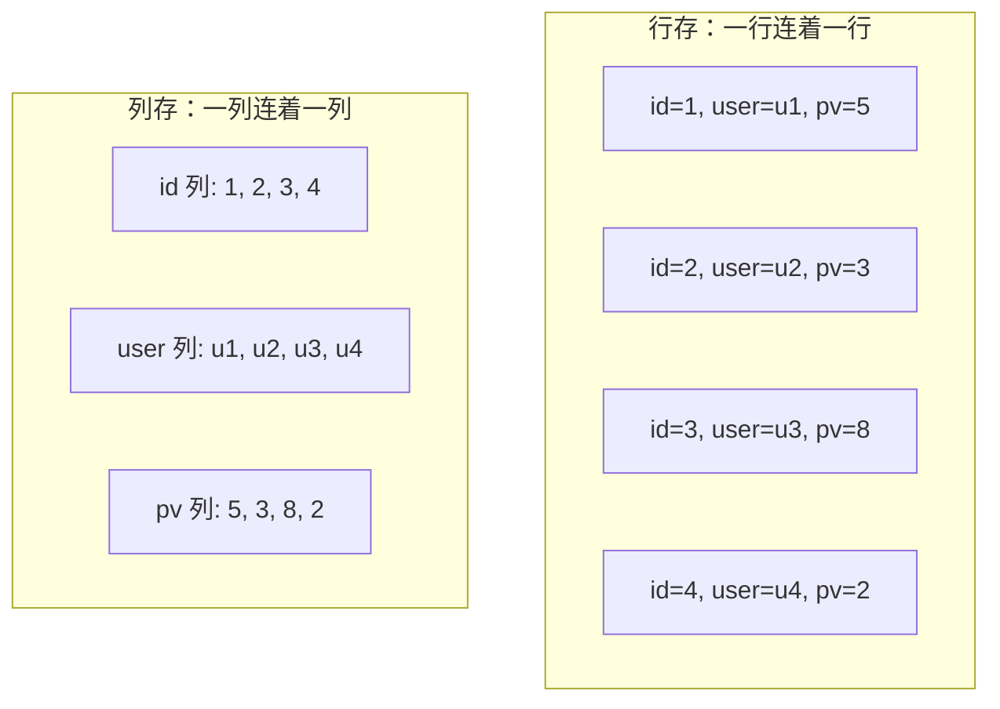

## 前置知识

- 读过 [大数据全景](/bigdata/010-BigDataLandscape)：知道「交互式分析」在链路里的位置，见过 OLAP 这个词；
- 读过 [SQL 概述与标准](/sql/020-OverviewStandard) 或会用 MySQL：会写 group by、聚合函数、子查询——ClickHouse 的界面就是 SQL，本文所有查询假设你有这个底子。

没读过也可以，本文会带上需要的部分：全景图补齐链路位置，SQL 部分用到哪句讲哪句。

## 学习目标

读完本文你将能够：

1. 画出同一张表在行存与列存下的物理布局差异，并推导列存在聚合场景快的原因；
2. 说出 ClickHouse 的核心取舍（单表极快、join 与事务弱），并解释「宽表 + 预聚合」如何适配这个取舍；
3. 解释 MergeTree 的 ORDER BY 主键为什么是排序裁剪而非唯一约束，以及分区裁剪怎么发生；
4. 用物化视图建一张预聚合表，作为实时大屏的指标层；
5. 说清 ClickHouse 与 Hive/Spark 的分工边界，并判断自己的场景该选 ClickHouse 还是 Doris 或 StarRocks。

预计 40 到 55 分钟，含 1 个动手实验与 4 道练习。

## 1. 问题引入：分析师的一次查询为什么慢

场景：五亿行的用户行为表（每次点击、浏览一行），分析师想看「上周各渠道的下单转化漏斗」。用 MySQL 写出来大概是这样：

```sql
-- 五亿行的表上执行这种聚合，MySQL 会跑到让人失去耐心
SELECT channel, count(*) AS pv, count(DISTINCT user_id) AS uv
FROM user_events
WHERE event_date BETWEEN '2026-10-20' AND '2026-10-26'
GROUP BY channel;
```

这条查询只涉及 3 个列，却在 MySQL 上要读整张表。为什么？**行存的物理布局是把一行的所有列连续存在一起**，要读任何一列，都得把整行搬进内存再挑出那 3 列。五亿行乘以几十个列宽，真正参与计算的只有 3 列，其余 95% 以上的 IO 是纯浪费。

ClickHouse 把这个浪费砍掉的思路很直接：**既然这次只用 3 列，那就只把这 3 列从磁盘读出来**。它是一种列式存储的 OLAP（Online Analytical Processing，联机分析处理）数据库——「列式」指存储布局，「OLAP」指面向分析而非事务的负载。2016 年开源、2026 年滚动发布 25.x 版本（版本号即年.月，以官方文档为准），是实时分析与大屏出数的主流选择。

## 2. 心智模型：行存与列存

把同一张 4 行 3 列的小表按两种布局画出来，差异立刻可见：



聚合查询「sum(pv)」在两种布局下的工作量：行存读 4 行全部数据再挑 pv 列；列存只读 pv 那一段。放大到五亿行、几十列，这就是几个数量级的差距。列存的优势不止这一条，三个来源层层叠加：

- **压缩率极高**：同一列里是同类型、语义相近的数据（几千个城市名反复出现、一列布尔值只有 0 和 1），字典编码、游程编码这类压缩手段效果极好——磁盘上往往比原始数据小一个量级，IO 进一步变小；
- **向量化执行**：ClickHouse 不一行一行算，而是一次取一批（几千行）数据、用紧密循环对整批做运算，CPU 流水线与缓存都被喂满；
- **缓存友好**：连续同类型数据天然对 CPU 缓存线友好，扫描一遍列的开销远低于「读散落在各处的行再挑字段」。

代价也要看清：想取「某一行」时，列存要把这一行在几十个列文件里各找一段再拼回来，点查不是它的强项；更新一行更麻烦（后面会讲 ClickHouse 的更新为何「重」）。所以列存不是全面替代行存，而是把宝押在「读宽表、算聚合」这一种负载上，并把这种负载做到极致。

## 3. ClickHouse 的取舍：单表极快，宽表 + 预聚合

上一节的代价落成 ClickHouse 的三条工程取舍：

- **单表查询极快，join 相对弱**。不是不能用 join，而是大数据量下多表 join 的代价与它的设计哲学冲突。社区的解法是**把关联好的数据落成一张宽表**——ETL 阶段就把维度信息冗余进行表，查询时单表搞定；
- **事务与更新弱**。没有完整事务；UPDATE 和 DELETE 不是常规操作而是「重排数据」的 mutation，代价高。所以 ClickHouse 的表多数设计成只追加不改（分析场景恰好不需要改：事实发生后就是历史）；
- **为聚合而生，点查非强项**。亿行按用户 ID 取一行的需求归 HBase（见 [HBase 宽表存储](/bigdata/080-HbaseWideTable)），不归它。

三条取舍指向同一个用法哲学：**上游把数据加工成宽表灌进来，ClickHouse 只负责在宽表上做单表聚合与出数**。谁负责加工宽表？下一节的分工表回答。

## 4. MergeTree 引擎家族：主键裁剪、分区裁剪与物化视图

ClickHouse 的表引擎决定数据的组织方式，MergeTree 是家族核心（ReplacingMergeTree、SummingMergeTree、AggregatingMergeTree 都是它的变体）。建一张行为明细表：

```sql
CREATE TABLE user_events
(
    event_date Date,
    channel    LowCardinality(String),
    user_id    UInt64,
    event_type LowCardinality(String)
)
ENGINE = MergeTree
PARTITION BY toYYYYMM(event_date)   -- 按月分区
ORDER BY (channel, event_date, user_id);  -- 排序键，数据按它物理排序
```

三个机制分别理解：

**ORDER BY 是排序裁剪的索引，不是唯一约束**。数据物理上按这组列排序存储，主键索引是稀疏的：每隔一段（granule，默认 8192 行）记一个首行值。查询带 `channel = 'app'` 时，索引先定位到目标值所在的区间段，无关段整段跳过——这就是**主键裁剪**。注意两点：它不保证唯一（没有 unique 约束这回事），且把「最常过滤的列」放进 ORDER BY 前列是设计的关键决策。

**PARTITION BY 是分区裁剪**。按月分区后，查 10 月的数据直接跳过其他所有月份的目录，跟 Hive 分区是同一个思想。分区别太细（按天、按用户 ID 分区是经典错误——分区数爆炸，每个分区一个小目录，反而拖垮合并），按月是最常见的粒度。

**物化视图是预聚合**，实时大屏指标层的核心手段。原理：每当明细表写入数据，物化视图指定的聚合查询就对这些新数据自动执行一遍，结果写进一张聚合表——查询大屏指标时读的是早已算好的聚合表，不再碰明细。

```sql
-- 聚合结果表：每渠道每天一行
CREATE TABLE daily_channel_stats
(
    event_date Date,
    channel    LowCardinality(String),
    pv         UInt64,
    uv         AggregateFunction(uniq, UInt64)
)
ENGINE = AggregatingMergeTree
ORDER BY (event_date, channel);

-- 物化视图：明细表每来一批数据，自动算增量并写入聚合表
CREATE MATERIALIZED VIEW mv_daily_channel
TO daily_channel_stats AS
SELECT event_date, channel,
       count()          AS pv,
       uniqState(user_id) AS uv
FROM user_events
GROUP BY event_date, channel;

-- 大屏查询聚合表：count() 扫全表变成了查几万行的小表
SELECT event_date, channel, pv, uniqMerge(uv) AS uv
FROM daily_channel_stats
WHERE event_date = today()
GROUP BY event_date, channel;
```

`uniqState` 与 `uniqMerge` 这对函数是 AggregatingMergeTree 的标准姿势：写入时存「可合并的中间状态」，查询时把状态合并出精确或近似结果——中间状态可合并，意味着增量写入与全量查询天然兼容，这是分布式预聚合能成立的关键。比赛大屏里「每分钟订单数、今日 GMV」这类指标，全走这条路。

## 5. 与 Hive 与 Spark 的分工：谁加工，谁出数

链路里 ClickHouse 从不单打独斗，分工是清晰的:

| | Hive / Spark | ClickHouse |
| --- | --- | --- |
| 角色 | ETL 与批处理（加工宽表、算日报） | 交互式查询与大屏出数 |
| 查询延迟 | 分钟到小时级（批作业） | 亚秒到秒级 |
| 数据规模 | PB 级历史全量 | 热数据明细加聚合，TB 级常见 |
| 用户 | 数据工程师的代码 | 分析师点报表、大屏接口 |

把 [Hive 数仓与 SQL](/bigdata/030-HiveWarehouseSql) 的数仓分层接过来：ODS 到 DWD 到 ADS 的加工在 Hive 加 Spark 里做，ADS 层（面向应用的汇总）的结果同步进 ClickHouse；同时 [Flink 流处理模型](/bigdata/060-FlinkStreamingModel) 的实时链路把增量明细直接写进 ClickHouse 明细表，物化视图实时维护聚合。批与流两个来源在 ClickHouse 汇合——这是 [综合实战](/bigdata/120-CapstoneOfflineRealtime) 的存储层设计。

## 6. 与其他 OLAP 的一句话对比

2026 年实时 OLAP 赛道不止一家，答辩时能一句话说清边界即可：

- **ClickHouse**：单表性能标杆，生态与社区成熟，join 与运维复杂度是交换的代价；
- **Doris / StarRocks**：同为列存 MPP 架构的 2026 热门，join 能力与 MySQL 协议兼容性更好，运维模型对团队更友好，星型模型重的场景常见选择；
- **Hive / Presto 类**：批处理与即席查询的底座，延迟到不了「秒级大屏」。

三者都够比赛项目用，选型看两点：团队已有的生态（会用 Spark 就顺着 ClickHouse 走，要 MySQL 生态亲和就 Doris）与运维成本（Doris 对新手部署更省事）。具体版本能力以各家官方文档为准，本文不背版本特性清单。

## 7. SQL 方言差异与 Java 接入小例

会 MySQL 的人上手 ClickHouse 的 SQL，八成语法直接能用，少数地方会踩方言坑，提前知道四个：

```sql
-- 1 类型系统不同：没有 varchar(50)，字符串就是 String
-- 2 高频函数名不同：日期取整、去重计数都有专用函数
SELECT
    toStartOfMinute(event_time)      AS minute_bucket,  -- 时间截断到分钟
    uniqExact(user_id)               AS uv,             -- 精确去重（近似版是 uniq）
    quantile(0.95)(latency_ms)       AS p95_latency     -- 分位数是两级括号语法
FROM request_log
WHERE event_date = today()
GROUP BY minute_bucket;

-- 3 更新与删除是 mutation，代价高，别当 MySQL 的 UPDATE 用
ALTER TABLE request_log DELETE WHERE user_id = 0;   -- 触发后台重写数据
```

Java 侧通过官方 JDBC 驱动接入，对写过 JDBC 的人零新知识：

```java
// Maven 依赖：com.clickhouse:clickhouse-jdbc
try (Connection conn = DriverManager.getConnection(
        "jdbc:clickhouse://localhost:8123/analytics")) {
    // 大屏接口：查预聚合表，亚秒返回
    try (PreparedStatement ps = conn.prepareStatement(
            "SELECT channel, pv, uniqMerge(uv) AS uv "
          + "FROM daily_channel_stats WHERE event_date = ? GROUP BY channel")) {
        ps.setDate(1, java.sql.Date.valueOf("2026-10-29"));
        try (ResultSet rs = ps.executeQuery()) {
            while (rs.next()) {
                System.out.println(rs.getString("channel")
                        + " pv=" + rs.getLong("pv")
                        + " uv=" + rs.getLong("uv"));
            }
        }
    }
}
```

Spring Boot 项目里直接用 JdbcTemplate 或 MyBatis 都能对接这个驱动；大批量写入场景别逐行 INSERT，用 JDBC 批量接口或官方推荐的数据格式（如 JSONEachRow）攒批写，这是与 MySQL 最大的用法差异之一。

## 8. 场景映射：它出现在链路的哪里

三个典型场景，对应本模块链路的不同位置：

- **用户行为宽表分析**：Spark 把行为数据加工成宽表灌入，分析师在宽表上任意维度组合查询——这是「宽表 + 预聚合」哲学的标准画面；
- **监控指标看板**：指标时序数据写入，物化视图按分钟聚合，看板接口查聚合表——p95、uv 这类指标函数就是为它准备的；
- **实时大屏的存储层**：[Flink 实时链路](/bigdata/060-FlinkStreamingModel) 把分钟级聚合写进 ClickHouse，[ECharts 大屏](/bigdata/110-EchartsVisualization) 的接口层直接查它——数据从 Kafka 流进来，到用户眼前，全程秒级。

反过来说，什么别往 ClickHouse 放：要随机点查更新的业务主数据（MySQL）、要按 key 取整行的画像数据（HBase）、要复杂多表事务的订单库（MySQL）。链路里各归其位。

## 9. 常见困惑

**问：主键既然不保证唯一，为什么还叫主键？**

历史命名，容易误导。把它读作「排序键」更准确：数据按它排序、索引按它裁剪。表里同一 key 出现多行完全合法，去重要用 ReplacingMergeTree 之类的变体加后台合并，或查询时去重——「唯一」从来不是它承诺的。

**问：为什么我的物化视图数字和明细对不上？**

最常见两个原因：物化视图只处理「建视图之后」写入的数据，建之前的历史明细不会回填（要手工 INSERT 一遍聚合查询）；或聚合用了不可合并的普通函数而不是 `*State` 系列函数，增量与全量口径就断了。对账排查的完整方法论在 [综合实战](/bigdata/120-CapstoneOfflineRealtime) 第 6 步。

**问：ClickHouse 也能建分区，跟 Hive 分区是一回事吗？**

思想同源（目录级裁剪），机制不同：Hive 分区是「按分区列建目录、查询时裁剪目录」，ClickHouse 的 PARTITION BY 是表引擎内部的存储组织，还参与合并与 TTL。用法纪律相通：分区键选低基数的日期类列，别选高基数的 ID 列。

**问：既然 join 弱，我是不是完全不能用 join？**

小维表 join（几万到几百万行的维度表）日常在用，性能可接受；弱指的是「两张亿级大表现场 join」。设计宽表时把维度冗余进来，本质就是预先「join 完」——不是禁用 join，是把 join 从查询时挪到加工时。

## 10. 动手实验

实验一（20 分钟，ClickHouse 25.x 单机版或官方 Playground）：按第 4 节建 user_events 明细表，随机生成 100 万行测试数据（用 numbers 表函数加 rand 即可），先在明细表跑聚合记录耗时；再建物化视图与聚合表，跑同一语义的查询对比耗时与扫描行数（用 EXPLAIN 或系统表看）。把两个耗时各记下来，这条对比就是你答辩讲「为什么要预聚合」的实测证据。

## 11. 自检清单

1. 能画出行存与列存的物理布局差异，并推导出聚合场景列存快的三个来源；
2. 能说出 ClickHouse 三条取舍，并解释「宽表 + 预聚合」分别化解了哪条；
3. 能解释 ORDER BY 键的裁剪机制与「不是唯一约束」，以及分区键为什么不该选用户 ID；
4. 能写出物化视图加 AggregatingMergeTree 的预聚合建表流程，并说出 State 与 Merge 函数为什么必须成对；
5. 能画出「Hive 加 Spark 加工、ClickHouse 出数」的分工图，并为自己的大屏项目说出选 ClickHouse 还是 Doris 的理由。

## 官方文档

- ClickHouse 官方文档（引擎、函数与版本特性以此为准）：https://clickhouse.com/docs
- ClickHouse JDBC 驱动：https://clickhouse.com/docs/integrations/language-clients/java/jdbc

## 本章总结

列存把「只读要算的几列」变成物理现实：同列同类型带来极高压缩率，向量化按批执行加上缓存友好，聚合查询因此快出数量级。ClickHouse 把宝押在单表聚合上，代价是 join 与事务弱，于是「宽表 + 预聚合」成为用法哲学：加工交给 Hive 加 Spark，出数交给 ClickHouse。MergeTree 家族的 ORDER BY 是排序裁剪索引而非唯一约束，分区裁剪按低基数列切，物化视图以 State 与 Merge 函数对维护可合并的预聚合，是实时大屏指标层的核心手段。与 Doris、StarRocks 的选型看生态与运维；点查归 HBase、事务归 MySQL，链路里各归其位。

## 下一步

进入 [ECharts 数据可视化大屏](/bigdata/110-EchartsVisualization)，看预聚合好的数据如何变成评委眼前的看板；或直接进入 [综合实战](/bigdata/120-CapstoneOfflineRealtime)，把 ClickHouse 装进离线加实时的完整链路。
