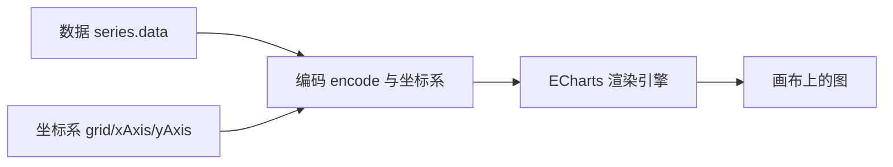

## 前置知识

- 读过 [Vue3 概述与环境](/vue3/010-OverviewEnv)：会建一个 Vue3 项目、写过最简单的组件（props、ref、onMounted 这些词眼熟即可）；
- 会一点 HTML 与 CSS：知道 div 是个容器、style 能改样式。

没读过也可以，本文会带上需要的部分：Vue3 那篇补 20 分钟，组件封装的代码会逐段解释。

## 学习目标

读完本文你将能够：

1. 用「option 是一份声明式 JSON」解释 ECharts 的工作方式，说出数据、坐标系、编码三要素；
2. 独立写出柱、折、饼、地图、散点五类图表的 option 骨架，并说出每类适合的数据形态；
3. 把图表封装成可复用的 BaseChart 组件，并实现容器变化时的自适应；
4. 为大屏选择适配方案（等比缩放或流式布局）并为看板选择取数方式（轮询或 WebSocket）；
5. 说出大数据量图表的三招性能手段与两条视觉纪律，并识别自己大屏上的违规项。

预计 35 到 50 分钟，含 2 个动手实验与 4 道练习。

## 1. 问题引入：算出来的数要看得见

想象链路的最后一公里。你的 Flink 算出了每分钟订单量，ClickHouse 里躺着聚合好的 GMV——然后呢？比赛答辩现场，评委看到的不是你的 SQL 和算子，而是一块大屏：曲线在动、地图在亮、数字在跳。**可视化层是大数据项目「被看见」的部分，往往也是答辩的视觉主体**——数据链路再漂亮，最后呈现不出来，讲一遍故事就少了一半说服力。

ECharts 是这个环节的国产事实标准：百度开源、Apache 顶级项目、文档与示例全中文生态。它上手很快，但「快」也带来一个典型问题——很多人从网上抄一段 option 改改数字，图表能跑，却说不清每个配置项在干什么，一遇到「图不对」「屏不齐」「数据不动」就抓瞎。本文要建立的就是那份说不清的心智模型：**option 到底是什么**。

## 2. 心智模型：option 是一份声明式 JSON

ECharts 的工作方式一句话：**你交给它一份叫 option 的配置对象，声明「我要什么样的图」，它负责画**。注意「声明」这个词——你不写「先画一个矩形，坐标是多少，颜色是蓝的」，你写「这是数据、这是坐标系、这个字段映射到 x 轴、那个字段映射到柱高」，剩下的全是它的事。

一份 option 由三要素组成，理解了这三要素，所有图表的配置都能读懂：



- **数据**：`series.data`，你要可视化的数组。最简单的形式是数值数组，规范的形式是对象数组（每个对象一行记录）；
- **坐标系**：`xAxis`、`yAxis`（直角坐标），或 `polar`、`geo`（地图坐标）。声明轴的类型（类目轴 category、数值轴 value、时间轴 time）；
- **编码**：声明数据的哪个字段映射到哪个视觉通道——x 位置、y 高度、颜色、半径。多数简单图表编码由默认规则完成，复杂图表用 `encode` 显式指定。

看一个最小例子，三要素各就各位：

```javascript
// 每个部门的销售额：数据是 [{名称, 数值}] 的对象数组
const data = [
  { name: '华东', value: 320 },
  { name: '华南', value: 260 },
  { name: '华北', value: 180 }
];

const option = {
  xAxis: { type: 'category', data: data.map(d => d.name) },  // 坐标系：x 是类目轴
  yAxis: { type: 'value' },                                  // y 是数值轴
  series: [{
    type: 'bar',                                             // 编码：数值映射为柱高
    data: data.map(d => d.value)
  }]
};

const chart = echarts.init(document.getElementById('box'));  // 初始化：绑定容器
chart.setOption(option);                                     // 应用配置：图就出现了
```

心智模型里最关键的一条：**setOption 是可重复调用的**。第一次调用创建图表，之后再调用就按新 option 更新——「数据来了刷新图表」这个大屏的核心动作，就是隔一段时间用新数据再 setOption 一遍。第 6 节会直接用上这一点。

## 3. 基础五件套：五类图表的 option 骨架

大屏上九成的图落在这五类里。每类记住「适合什么数据形态 + 骨架长什么样」，遇到需求先对号入座。

**柱状图（bar）——类目对比**。各部门、各渠道的量级对比，就是第 2 节那个例子，骨架是 category 轴加 value 轴加 bar 系列。

**折线图（line）——时间趋势**。把 x 轴换成时间维度即可，多条系列叠在一起看多指标：

```javascript
const option = {
  xAxis: { type: 'time' },                  // 时间轴：data 直接给时间戳或日期字符串
  yAxis: { type: 'value' },
  series: [
    { type: 'line', name: '订单量', smooth: true, data: orderData },   // [[时间, 数值], ...]
    { type: 'line', name: '支付量', smooth: true, data: payData }
  ],
  tooltip: { trigger: 'axis' }              // 悬浮显示同一时刻的全部系列
};
```

**饼图（pie）——占比构成**。没有坐标轴，数据直接是名称加数值：

```javascript
const option = {
  series: [{
    type: 'pie',
    radius: ['40%', '70%'],                 // 内外半径：给了就是环形图
    data: [{ name: '移动端', value: 480 }, { name: 'PC 端', value: 220 }],
    label: { formatter: '{b}: {d}%' }       // {d} 是百分比的占位符
  }]
};
```

**地图（map）——地理分布**。注册地图数据后按地区名编码：

```javascript
// 地图是少数要先"注册"地理数据的类型
echarts.registerMap('china', chinaGeoJson);   // chinaGeoJson 来自公开的地理数据文件

const option = {
  series: [{
    type: 'map',
    map: 'china',
    data: [{ name: '浙江', value: 890 }, { name: '广东', value: 1230 }]
  }],
  visualMap: { min: 0, max: 1500, calculable: true }  // 颜色深浅映射数值的图例
};
```

**散点图（scatter）——两维分布**。x 和 y 都是数值轴，每个点是一对值，适合看相关性或聚集（比如「客单价对购买时长」）：

```javascript
const option = {
  xAxis: { type: 'value' },
  yAxis: { type: 'value' },
  series: [{ type: 'scatter', symbolSize: 8, data: [[12, 30], [25, 45], [8, 21]] }]
};
```

选型一句话：比量级用柱，看趋势用折，说占比用饼，摆地理用地图，找分布用散点。用反了（比如用饼图比八个月的趋势）是答辩里常见的扣分点。

## 4. 与 Vue3 集成：封装一个 BaseChart

图表代码直接散落在页面组件里会有三个问题：初始化重复写、容器变化不重绘、组件销毁时实例泄漏。解法是封装一个 BaseChart 组件，全项目复用。先解决依赖体积：直接 `import * as echarts from 'echarts'` 会把全部图表类型打进包里，大屏场景建议按需引入：

```javascript
// src/utils/echarts.js：项目统一的入口，只引入用到的部分
import * as echarts from 'echarts/core';
import { BarChart, LineChart, PieChart, MapChart, ScatterChart } from 'echarts/charts';
import { GridComponent, TooltipComponent, VisualMapComponent, DataZoomComponent } from 'echarts/components';
import { CanvasRenderer } from 'echarts/renderers';

echarts.use([BarChart, LineChart, PieChart, MapChart, ScatterChart,
             GridComponent, TooltipComponent, VisualMapComponent, DataZoomComponent,
             CanvasRenderer]);
export default echarts;
```

然后是 BaseChart 组件本体，30 行左右：

```vue
<template>
  <div ref="el" :style="{ width: '100%', height: '100%' }"></div>
</template>

<script setup>
import { ref, onMounted, onBeforeUnmount, watch } from 'vue';
import echarts from '../utils/echarts';

const props = defineProps({ option: { type: Object, required: true } });
const el = ref(null);
let chart = null;
let observer = null;

onMounted(() => {
  chart = echarts.init(el.value);
  chart.setOption(props.option);
  // 容器尺寸变化时让图表自适应，ResizeObserver 比 window.resize 更精准
  observer = new ResizeObserver(() => chart && chart.resize());
  observer.observe(el.value);
});

watch(() => props.option, (newOption) => chart && chart.setOption(newOption));

onBeforeUnmount(() => {          // 销毁时清理，防止实例与监听器泄漏
  observer && observer.disconnect();
  chart && chart.dispose();
});
</script>
```

用法就变成了声明式的一行，正好呼应第 2 节「声明式」的心智模型：

```vue
<BaseChart :option="salesOption" />
```

三处细节值得逐个说出为什么：init 绑定的是模板里的 div 引用（el）；ResizeObserver 在容器大小变化时调 chart.resize 让画布重算；dispose 在组件卸载时释放实例——单页应用里页面切来切去，不清理就会越积越多。

## 5. 大屏适配：等比缩放与流式布局

设计稿通常是 1920 乘 1080，但答辩现场的大屏可能是 4K、拼接屏或带黑边的 LED。两条适配路线：

**路线一：等比缩放（transform: scale）**。页面固定按 1920 乘 1080 的设计稿尺寸写死，外面套一层容器，用 JS 算出实际屏幕与设计稿的宽高比，整体 scale 缩放：

```javascript
// 设计稿 1920 x 1080，按比例缩放铺满
function fitScreen() {
  const scaleX = window.innerWidth / 1920;
  const scaleY = window.innerHeight / 1080;
  // 两方向取同一个比例（宽高比一致时取哪个都行），画布内容整体等比变形
  screenRef.value.style.transform = `scale(${Math.min(scaleX, scaleY)})`;
}
window.addEventListener('resize', fitScreen);
```

优点：内部所有坐标、字号、图表完全不用管适配，开发体验简单，大屏场景最常用；缺点：屏幕比例和设计稿不一致时会出现留边（等比必然保形）。

**路线二：流式布局**。用 flex 与 grid 加百分比、vw 单位布局，图表容器随窗口伸缩（配合第 4 节的 ResizeObserver 自适应）。优点：任何比例都铺满、通用于管理后台；缺点：极端比例下布局可能错位，开发量更大。

| | 等比缩放 | 流式布局 |
| --- | --- | --- |
| 开发成本 | 低（写死设计稿尺寸） | 中高（处处考虑伸缩） |
| 比例不一致时 | 保形但留边 | 铺满但可能变形错位 |
| 适用 | 比赛大屏、演示环境 | 管理后台、多端复用 |

比赛项目选路线一：答辩环境可控，保形和省事都拿得到。

## 6. 数据从哪来：轮询与 WebSocket 两条路

图有了、屏适配了，剩下的问题是：ClickHouse 里每分钟更新的数据，怎么送到大屏上？

**路线一：轮询（polling）**。前端用 setInterval 定时请求接口（比如每 30 秒查一次 [ClickHouse](/bigdata/090-ClickhouseOlap) 的聚合表），拿到新数据更新 option 再 setOption：

```javascript
onMounted(() => {
  load();                                       // 进页面先取一次
  timer = setInterval(load, 30 * 1000);         // 之后每 30 秒取一次
});
onBeforeUnmount(() => clearInterval(timer));    // 记得清定时器

async function load() {
  const res = await fetch('/api/dash/channel-stats').then(r => r.json());
  option.value = buildOption(res);              // 用新数据重建 option
}
```

**路线二：WebSocket 推送**。后端算好就主动推，前端建立长连接监听消息，收到即更新。数据一到就到，没有轮询间隔的滞后与空请求。

| | 轮询 | WebSocket |
| --- | --- | --- |
| 实现复杂度 | 低（普通 HTTP 接口） | 中（要维护连接、断线重连） |
| 实时性 | 受间隔限制（30 秒级常见） | 秒级甚至即时 |
| 适用 | 分钟级指标、日报看板 | 秒级实时大屏 |

选择原则看指标的更新节奏：分钟级看板轮询完全够，而且稳；真要做秒级滚动的实时大屏，后端从流式链路（[综合实战](/bigdata/120-CapstoneOfflineRealtime) 的实时支线）算出增量后推送。比赛项目里「实时指标走推送、日级指标走轮询」的混用也很常见。

## 7. 性能：大数据量时的三招

点位数据一多（几万个点、一年的分钟级曲线），图表会卡，三招按序用：

- **dataZoom**：加数据缩放组件，默认只渲染一个窗口，用户拖动看细节——先控住初始渲染量；
- **采样降采样**：折线图加 `sampling: 'lttb'`（按最大保真算法抽点），几万个点抽成几千个视觉上几乎无差别的点；
- **增量 setOption**：数据滚动更新时别每次重建整个 option，只把新的一批点 setOption 进去（配合 appendData 或 replaceMerge 策略），避免整图重绘的顿挫。

判断标准很简单：打开大屏拖动与刷新，肉眼可感知的卡顿就算超标，回到这三招排查。

## 8. 视觉纪律与无障碍一句话

最后是两件与代码无关、却直接影响答辩观感的事。

**视觉纪律**：配色不超过「一个主色加一个强调色」，语义色固定（红跌绿涨或者反过来，全屏统一）；背景深色、文字高对比；动画只用于数据变化本身，不要给每个图加循环动效。大赛评委看的是信息清晰，不是动效堆砌——一个能一眼读出结论的朴素大屏，好过一个花哨但读不懂的大屏。图表类型的选择（第 3 节的选型一句话）本身就是视觉纪律的一部分。

**无障碍与降级一句话**：给图表容器补上描述性的文本说明（aria 属性或图旁的文字摘要），关键数字除图外也保留表格视图；图表加载失败时展示兜底文案而不是白屏——大屏现场网络抖一下，白屏十分钟是真实发生过的翻车现场。

## 9. 常见困惑

**问：图表初始化后是空白的，数据明明有了？**

最常见原因是容器没有尺寸：div 高度为 0，init 画在了一个看不见的地方。检查容器是否设了宽高、是否在 display:none 的容器里初始化（切换标签页的场景要在显示后再 init 或调 resize）。

**问：窗口大小变了，图表没有跟着变？**

init 时画布尺寸就固定了，ECharts 自己不监听容器。用第 4 节 BaseChart 里的 ResizeObserver 方案，容器变了就调 chart.resize()。

**问：setOption 传新数据，图上怎么还留着旧系列？**

setOption 默认按「合并」处理：新 option 没提到的部分沿用旧的。系列的条数变化时旧系列可能残留，更新时用 `{ notMerge: false, replaceMerge: ['series'] }` 声明 series 按新数据整体替换。

**问：轮询接口每 30 秒一次会不会太频繁？**

看数据节奏和接口成本：指标每分钟才更新，30 秒轮询一半是空转，把间隔对齐到数据更新周期即可；接口背后是聚合表（预聚合过的），单次查询亚秒级，频率不是瓶颈。别轮询明细表——那是让 [ClickHouse](/bigdata/090-ClickhouseOlap) 干它不擅长的事。

## 10. 动手实验

实验一（20 分钟）：从零做一个「五分钟搭出三图一屏」练习——建一个 Vue3 页面，用 BaseChart 放一个折线（模拟 24 小时订单曲线）、一个饼图（渠道占比）、一个数字卡片（今日 GMV），用 setInterval 每 5 秒给 GMV 随机加一笔并增量更新。验收：缩放浏览器窗口三块内容全部自适应；控制台无泄漏警告。

实验二（15 分钟）：把实验一的页面套进等比缩放容器（1920 乘 1080 设计稿），然后用浏览器开发者工具把窗口调成 1366 乘 768（比例不同），观察留边行为；再切换成流式布局感受差异。把两种方案在同一窗口下的表现各写一句结论。

## 11. 自检清单

1. 能用自己的话说出 option 三要素（数据、坐标系、编码），并指出一段陌生 option 里的三要素各在哪；
2. 能按「比量级、看趋势、说占比、摆地理、找分布」为五个需求各选一种图表类型；
3. 能解释 BaseChart 组件里 init、setOption、resize、dispose 四个动作各自的职责；
4. 能为自己的项目说出大屏适配选等比缩放还是流式布局、取数选轮询还是 WebSocket，各附一条理由；
5. 能说出大数据量图表的三招性能手段，以及两条视觉纪律。

## 官方文档

- ECharts 官方文档与示例库（配置项以此为准）：https://echarts.apache.org/
- ECharts 按需引入指南：https://echarts.apache.org/handbook/zh/basics/import

## 本章总结

ECharts 的心智模型是声明式：option 一份 JSON，由数据、坐标系、编码三要素组成，setOption 可重复调用实现刷新。五件套对号入座：柱比量级、折看趋势、饼说占比、地图摆地理、散点找分布。Vue3 集成的标准姿势是按需引入加 BaseChart 组件（init、setOption、ResizeObserver 自适应、dispose 清理）。大屏适配两条路：比赛选等比缩放省事保形，管理后台选流式布局铺满多端；取数两条路：分钟级轮询、秒级推送，按指标节奏选。性能三招 dataZoom、降采样、增量更新；视觉纪律是主色加强调色、信息清晰优先于动效堆砌，别忘了兜底文案。

## 下一步

进入 [综合实战：离线 + 实时一体化数仓小项目](/bigdata/120-CapstoneOfflineRealtime)，本文的大屏将接上真实的数据链路；想先补存储层细节，回看 [ClickHouse 列式 OLAP](/bigdata/090-ClickhouseOlap)。
