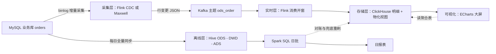

## 前置知识

- 读过 [Flink 流处理模型](/bigdata/060-FlinkStreamingModel)：会写 Flink SQL 的源表、窗口聚合与水印；
- 读过 [ClickHouse 列式 OLAP](/bigdata/090-ClickhouseOlap)：会建 MergeTree 表与物化视图，理解「宽表 + 预聚合」；
- 读过 [Hive 数仓与 SQL](/bigdata/030-HiveWarehouseSql)：知道 ODS、DWD、ADS 分层各自的职责。

没读过也可以，本文每个环节都会先给「这一步在干什么」再给代码，缺哪块回哪篇补——这也是本篇作为总装篇的读法：**遇到卡壳就跳进对应链接，读完回来继续**。

## 学习目标

读完本文你将能够：

1. 画出「MySQL 业务库 → Kafka → Flink → ClickHouse」实时链路与「全量同步 → Hive → Spark」离线链路的双路架构图，并解释同一份数据为什么走两条路；
2. 独立实现采集、实时、存储、离线、可视化五层的最小可运行版本，每层能说出目标、关键决策与核心代码；
3. 为两条链路建立统一的指标口径，并用对账查询发现两边数字的差异；
4. 设计「实时错、离线兜底」的重刷方案，并说明重刷时各组件要做什么；
5. 面对答辩问题，说出每个组件的选型理由，以及时区、水位线、数据倾斜、小文件四个翻车点的排查方法。

预计 60 到 90 分钟（含动手搭建则需一整天），含 1 个综合动手实验与 4 道练习。

## 1. 项目设定：一个看板，两条链路

项目很小但五脏俱全：**电商订单的「销售分析看板」**。数据源是一张 MySQL 业务库的订单表（下模拟真即可）：

```sql
CREATE TABLE orders (
  id          BIGINT PRIMARY KEY AUTO_INCREMENT,
  order_no    VARCHAR(32)  NOT NULL,        -- 订单号
  channel     VARCHAR(16)  NOT NULL,        -- 渠道：app / web / mini
  amount      DECIMAL(10,2) NOT NULL,       -- 支付金额
  status      TINYINT      NOT NULL,        -- 0 已下单 1 已支付 2 已退款
  pay_time    DATETIME     NULL,            -- 支付时间（核心口径字段）
  created_at  DATETIME     NOT NULL
);
```

看板要两个更新节奏的指标：

- **分钟级大屏**：当前分钟各渠道的支付 GMV 与订单数，近一小时的分钟曲线——运营盯着它盯大促，延迟容忍秒级；
- **日级报表**：每天的 GMV、订单数、渠道占比，供次日复盘——要准，不要快。

这两个需求放在一条链路上会互相为难：实时引擎为「快」优化，对「绝对准」（迟到数据、故障补数）天然让步；批引擎为「准」优化，跑不进分钟级。于是架构上做了本模块反复铺垫的那个决定——**同一份数据，两条链路**：



实线是常态数据流，虚线是治理动作：离线链路每天跑完后**对账**——两条链路的同一指标对不上时，以离线为准修正实时侧。这就是「离线加实时一体化」的核心含义：不是两套互不相干的系统，而是**实时给速度、离线给准头，离线兜实时**。

## 2. 第 1 步：采集层——让变更流进 Kafka

**目标**：订单表的每一行变更，以 JSON 事件的形式出现在 Kafka 主题 `ods_order` 里。

**关键决策**：采集工具三选一（位面对比见 [Kafka 与数据采集管道](/bigdata/070-KafkaPipeline)）。本项目已确定实时层用 Flink，选 **Flink CDC**——采集与计算合成一套作业，少维护一个中间件；如果团队想把采集独立出来给多个下游用，就选 Maxwell。

用 Flink SQL 声明采集，核心配置不到 20 行：

```sql
-- 从 MySQL 订单表读 binlog 变更
CREATE TABLE orders_mysql (
  id BIGINT, order_no STRING, channel STRING,
  amount DECIMAL(10,2), status INT,
  pay_time TIMESTAMP_LTZ(3), created_at TIMESTAMP_LTZ(3),
  PRIMARY KEY (id) NOT ENFORCED
) WITH (
  'connector' = 'mysql-cdc',
  'hostname' = 'mysql', 'port' = '3306',
  'database-name' = 'mall', 'table-name' = 'orders',
  'username' = 'cdc', 'password' = 'cdc_pass',
  'scan.startup.mode' = 'initial'      -- 首次启动先全量快照，再切增量
);

-- 变更写进 Kafka 主题，key 用订单号保证同单有序
CREATE TABLE kafka_ods (
  id BIGINT, order_no STRING, channel STRING,
  amount DECIMAL(10,2), status INT,
  pay_time TIMESTAMP_LTZ(3), created_at TIMESTAMP_LTZ(3),
  PRIMARY KEY (id) NOT ENFORCED
) WITH (
  'connector' = 'kafka', 'topic' = 'ods_order',
  'properties.bootstrap.servers' = 'kafka:9092',
  'format' = 'json',
  'key.format' = 'json', 'kafka.topic' = 'ods_order'
);

INSERT INTO kafka_ods SELECT * FROM orders_mysql;
```

两个决策值得说出理由：`scan.startup.mode = initial` 让作业第一次启动自动做全量快照再跟进增量，业务库不用单独导数；Kafka 消息按 `order_no` 做 key，同一订单的变更（下单、支付、退款）落在同一分区，保证下游读到的单内顺序。采集端的可靠性参数（acks、幂等）按 [Kafka 篇](/bigdata/070-KafkaPipeline) 第 8 节的决策链选：这是要对账的数据，acks=all 加幂等。

## 3. 第 2 步：实时层——Flink 开窗聚合写 ClickHouse

**目标**：消费 `ods_order`，按分钟窗口聚合出「每分钟每渠道的支付 GMV 与订单数」，写入 ClickHouse。

**关键决策**有三个。第一，**口径用事件时间**：指标挂在 `pay_time` 上而不是处理时刻，乱序与迟到由水印机制兜底（机制见 [Flink 流处理模型](/bigdata/060-FlinkStreamingModel)）。第二，**只算已支付**：`status = 1`，退款单不算进 GMV——口径在第 7 步对账时还要用，先记下。第三，**窗口用滚动一分钟**：与看板的分钟粒度严格对齐。

```sql
-- Kafka 源表：声明事件时间与水印（容忍 5 秒乱序）
CREATE TABLE ods_order (
  order_no STRING, channel STRING, amount DECIMAL(10,2),
  status INT, pay_time TIMESTAMP(3),
  WATERMARK FOR pay_time AS pay_time - INTERVAL '5' SECOND
) WITH (
  'connector' = 'kafka', 'topic' = 'ods_order',
  'properties.bootstrap.servers' = 'kafka:9092',
  'properties.group.id' = 'flink_rt', 'format' = 'json',
  'scan.startup.mode' = 'earliest-offset'
);

-- 1 分钟滚动窗口聚合，结果写 ClickHouse
INSERT INTO ch_minute_stats
SELECT
  window_start, window_end, channel,
  SUM(amount) AS gmv,
  COUNT(*)    AS order_cnt
FROM TABLE(
  TUMBLE(TABLE ods_order, DESCRIPTOR(pay_time), INTERVAL '1' MINUTE))
WHERE status = 1
GROUP BY window_start, window_end, channel;
```

Flink 的 Kafka 连接器与 checkpoint 联动（位移存进快照、结果两阶段提交），故障恢复后窗口结果不重不漏——精确一次的直觉在 [Kafka 篇](/bigdata/070-KafkaPipeline) 第 7 节，机制细节在 [Flink 篇](/bigdata/060-FlinkStreamingModel)，这里只强调一条纪律：**checkpoint 间隔与 ClickHouse 写入批大小要一起调**，间隔太短会产生海量小批次写入（第 9 步翻车点的伏笔）。

## 4. 第 3 步：存储层——明细表与物化视图

**目标**：ClickHouse 里建「分钟明细 + 可查聚合」两层，支撑大屏接口的亚秒查询。

**关键决策**：明细表只追加不更新（MergeTree 的正确用法），查询聚合交给物化视图实时维护（机制见 [ClickHouse 列式 OLAP](/bigdata/090-ClickhouseOlap)）：

```sql
-- Flink 实时层写入的分钟明细
CREATE TABLE ch_minute_stats (
  window_start DateTime,
  window_end   DateTime,
  channel      LowCardinality(String),
  gmv          Decimal(18, 2),
  order_cnt    UInt64
) ENGINE = MergeTree
PARTITION BY toYYYYMM(window_start)
ORDER BY (channel, window_start);

-- 大屏直接查的「近一小时分钟曲线」视图：聚合表上再包一层查询逻辑即可
-- 今日累计 GMV 卡片：在明细上再建一张按日聚合的物化视图
CREATE MATERIALIZED VIEW mv_daily_gmv TO daily_gmv AS
SELECT toDate(window_start) AS d, channel,
       sum(gmv) AS gmv, sum(order_cnt) AS order_cnt
FROM ch_minute_stats GROUP BY d, channel;
```

这里的设计与 [ECharts 篇](/bigdata/110-EchartsVisualization) 第 6 节对上：大屏接口全部只读这两张小表，分钟曲线查明细表（一天 1440 行每小时乘渠道数，极小），今日累计查日聚合表——**大屏快不快，在存储设计，不在前端优化**。

## 5. 第 4 步：离线层——Hive 分层与 Spark 日批

**目标**：每天凌晨把昨日全量订单同步进 Hive，按 ODS 到 DWD 到 ADS 分层加工出日级报表，产出「昨日全渠道 GMV、订单数、渠道占比」。

**关键决策**：分层只为两个目的——DWD 层做清洗与口径统一（这是对账的基准层），ADS 层出面向应用的最终报表（分层职责见 [Hive 数仓与 SQL](/bigdata/030-HiveWarehouseSql)）。

```sql
-- ODS：全量同步的原始订单（DataX/Sqoop 每日凌晨拉取，此处略）
-- DWD：清洗 + 统一口径：只留已支付、pay_time 为准、金额转分避免浮点误差
CREATE TABLE dwd_order_pay AS
SELECT order_no, channel,
       CAST(amount * 100 AS BIGINT) AS amount_cent,
       toDate(pay_time)             AS pay_date
FROM ods_orders
WHERE status = 1 AND pay_time IS NOT NULL;

-- ADS：日渠道粒度汇总
CREATE TABLE ads_channel_daily AS
SELECT pay_date, channel,
       SUM(amount_cent) / 100.0 AS gmv,
       COUNT(*)                 AS order_cnt
FROM dwd_order_pay
GROUP BY pay_date, channel;
```

Spark SQL 日批就是把这两段 SQL 按序执行，提交命令一行：

```bash
spark-submit --class com.mall.DailyReportJob \
  --master yarn daily-report.jar   # 作业内按序执行建 DWD 与 ADS 的 SQL
```

注意 DWD 里那个小动作：金额统一转成分再算，到 ADS 出报表再除回元。浮点误差是「两条链路对不上账」最隐蔽的一类来源，离线侧先立好精确口径，实时侧最后要向它看齐。

## 6. 第 5 步：可视化——ECharts 大屏读 ClickHouse

**目标**：一块 1920 乘 1080 的大屏：今日累计 GMV 数字卡片、近一小时分钟曲线、今日渠道占比饼图。

**关键决策**：分钟级指标走「后端读 ClickHouse 聚合表 + 前端 30 秒轮询」起步（简单稳定），做大促演示再加 WebSocket；大屏适配用等比缩放；组件用 BaseChart 封装——这些决策的完整推理都在 [ECharts 篇](/bigdata/110-EchartsVisualization)，核心代码就是那里实验一的三图一屏，这里只补接口层的一段：

```java
// Spring Boot 接口：读 ClickHouse 日聚合表，喂给大屏的 GMV 卡片
@GetMapping("/api/dash/today-gmv")
public Map<String, Object> todayGmv() {
    return jdbcTemplate.queryForMap(
        "SELECT sum(gmv) AS gmv, sum(order_cnt) AS cnt " +
        "FROM daily_gmv WHERE d = ?", LocalDate.now());
}
```

大屏上前端拿到这份数据更新 option 再 setOption，一分钟内新订单就会出现在曲线上——数据从业务库变更到评委眼前，全程不超过一两分钟，这条延迟就是答辩时最直观的演示点。

## 7. 第 6 步：数据质量与对账——两条链路的数字对不上怎么办

这一步是本篇的灵魂。上线第一天就会发现：**实时链路算的「昨日 GMV」和离线报表对不上**，差个几百到几千。先说为什么会差，再说怎么办。

会差的四个常见来源：

1. **口径漂移**：实时层按处理时刻截断、离线层按 `pay_time`；或一边算进退款单、一边没算。这是口径问题，两边必须用同一份口径文档（本项目的口径：已支付、按 `pay_time`、金额以分为单位）；
2. **迟到数据**：支付事件晚于水印 5 秒到达，Flink 窗口关了没等到，实时侧漏算。这是流处理的固有取舍，不是 bug；
3. **故障补数缺口**：Flink 停机维护两小时，Kafka 里的数据靠 checkpoint 恢复补齐，但上游 Maxwell 写 Kafka 的那段若恰好丢了消息，实时侧就永远缺一块；
4. **浮点与取整**：第 5 步说的分与元的问题。

治理方案是「**离线为准，兜底重刷**」：每天日批跑完后跑一次对账，把差异修回实时侧。

```sql
-- 对账查询：离线 ADS 与 ClickHouse 日聚合逐渠道比对
SELECT h.channel, h.gmv AS hive_gmv, c.gmv AS ch_gmv,
       h.gmv - c.gmv AS diff
FROM ads_channel_daily h
JOIN daily_gmv c ON h.pay_date = c.d AND h.channel = c.channel
WHERE h.pay_date = '2026-10-28' AND h.gmv != c.gmv;
```

diff 不为零的渠道，处理分两档：小差异（迟到与浮点范围内）记监控报表接受；大差异（数据缺口）触发**重刷**——从 Kafka 把该时段数据重放进 Flink 重算窗口（Kafka 可重放的回报，见 [Kafka 篇](/bigdata/070-KafkaPipeline)），或最粗暴有效地把 ClickHouse 该日的聚合按离线结果覆写。**对账要自动跑、差异要留痕**，这两句话写进答辩稿是数据质量意识的直接证明。

## 8. 答辩映射：每个组件的选型理由都要能讲出来

这条链路覆盖「数据采集、存储、计算、分析、可视化」全环节，答辩时每个环节都有一道必问题，答案提前备好：

| 环节 | 组件 | 一句话选型理由 | 依据 |
| --- | --- | --- | --- |
| 采集 | Flink CDC | binlog 采集零侵入、与 Flink 同栈少一跳 | 070 |
| 缓冲 | Kafka | 提交日志解耦削峰，可重放支撑补数 | 070 |
| 实时计算 | Flink | 事件时间与水印处理乱序，checkpoint 精确一次 | 060 |
| 离线计算 | Hive + Spark | 数仓分层沉淀口径，Spark 引擎跑日批 | 030 / 050 |
| 实时存储 | ClickHouse | 列存加物化视图，亚秒支撑大屏出数 | 090 |
| 可视化 | ECharts | 声明式 option、中文生态、大屏组件全 | 110 |
| 海量点查备选 | HBase | 若再加「按用户查画像」需求才引入 | 080 |

被问到「为什么不用 X」时的答题骨架：先承认 X 的优势场景，再说本项目负载落在了哪里，最后落在成本与维护。例如「为什么不用 Spark 做实时」：Spark Streaming 也能做，但本项目窗口聚合加事件时间乱序的需求，Flink 的 watermark 与精确一次机制更对口——答的是权衡，不是站队。

## 9. 常见翻车点清单

**时区**。MySQL 的 DATETIME 不带时区、Flink 的 TIMESTAMP_LTZ 依赖作业时区、ClickHouse 的 DateTime 带服务器时区——三边不一致时，「昨天」的边界会整体错位几小时，表现为「每天零点前后的数据莫名进了别的日子」。排查口诀：三边的时区配置打印出来对一遍，统一成 Asia/Shanghai 或统一 UTC，全链路只认一种。

**水位线**。水印设 5 秒，大促高峰 Kafka 积压导致数据晚到 30 秒，窗口成批漏算，对账差异突然变大。这不是调大水印就能根治的——水印越大延迟越高，是权衡不是修复；正确姿势是监控水位与事件时间的差距，差距持续拉大就告警，补数交给离线兜底。

**数据倾斜**。某个爆款渠道或某个大商户的 key 独占一个分区或一个分组，Flink 的局部聚合怎么也匀不开，任务里某一个 subtask 跑成瓶颈。两段式治理：先局部聚合（加随机前缀打散）再全局聚合，或对热点 key 单独并行度。判断方法：看 Flink UI 各 subtask 的处理量是否严重不均。

**小文件**。两个地方都会犯：Hive 侧分钟级调度的小作业每天生成上万个 HDFS 小文件，NameNode 与下游扫描一起遭殃；ClickHouse 侧 Flink 每几秒提交一批写入，parts 碎片化触发「too many parts」拒写。治理都一样：**攒批**——Hive 侧合并小文件任务定期跑，ClickHouse 侧把 checkpoint 与写入批次调大到秒级、批量行数上千。

## 10. 动手实验

综合实验（一整天，可拆四晚）：把本项目从零搭起来。环境：MySQL、Kafka（KRaft 单机）、Flink 2.x、ClickHouse 25.x、Hive 加 Spark（内存紧张可先跳过第 5 步，用 MySQL 直出离线口径做对账）。里程碑验收：M1 采集层跑通，控制台消费 ods_order 能看到 JSON 变更；M2 实时层跑通，往 MySQL 插一笔已支付订单，一分钟内 ClickHouse 明细表出现对应聚合行；M3 大屏三块内容随数据变化；M4 人为制造一条差异（直接改 ClickHouse 一行），跑通对账查询并写出演示重刷的操作步骤。每完成一个里程碑，把当时的卡点与解法记下来——这份记录就是答辩素材。

## 11. 自检清单

1. 能画出双链路架构图，并说清「同一份数据两条链路」各自优化什么、靠什么环节互兜；
2. 能为五层各写出目标、关键决策与不超过 30 行的核心代码或配置；
3. 能说出本项目指标口径的三个要素（已支付、pay_time、按分计），并解释口径漂移为何是对账差异的第一大来源；
4. 能演示对账查询，并区分「可接受的小差异」与「要重刷的大差异」的处理路径；
5. 能对着答辩映射表，为每个组件说出选型理由与「为什么不用 X」的权衡答案；
6. 能对时区、水位线、数据倾斜、小文件四个翻车点各说出一个现象、一个根因与一个治理动作。

## 本章总结

本篇把模块前六篇总装成一个能跑、能对账、能答辩的项目：Flink CDC 借 binlog 把订单变更送进 Kafka，Flink 按事件时间开一分钟窗口写 ClickHouse 的明细与物化视图，撑起分钟级大屏；Hive 三层加 Spark 日批产出日级报表，立下精确口径；两条链路靠每日对账互兜，实时给速度、离线给准头。每一层的选型理由（binlog 零侵入、Kafka 可重放、Flink 水位线、ClickHouse 预聚合、ECharts 声明式）都来自对应篇章的心智模型——答辩答的是权衡不是站队。四个翻车点（时区、水位线、数据倾斜、小文件）各有一条现象、一个根因、一个治理动作，考前过一遍。

## 下一步

把综合实验跑完，你就有了第一段可写进简历的大数据项目经历。想加深某一环：实时语义回 [Flink 流处理模型](/bigdata/060-FlinkStreamingModel)，存储扩展回 [HBase 宽表存储](/bigdata/080-HbaseWideTable)，批处理细节回 [Spark SQL 与 DataFrame](/bigdata/050-SparkSqlDataframe)——模块的每一篇，现在都是你项目里的一段真实链路。
